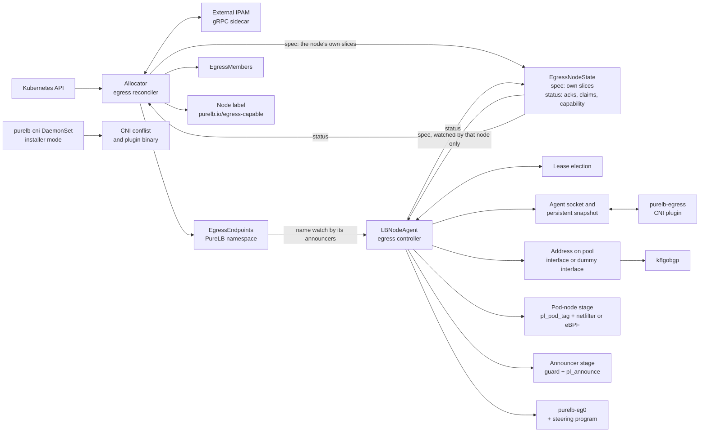
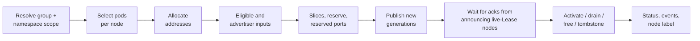
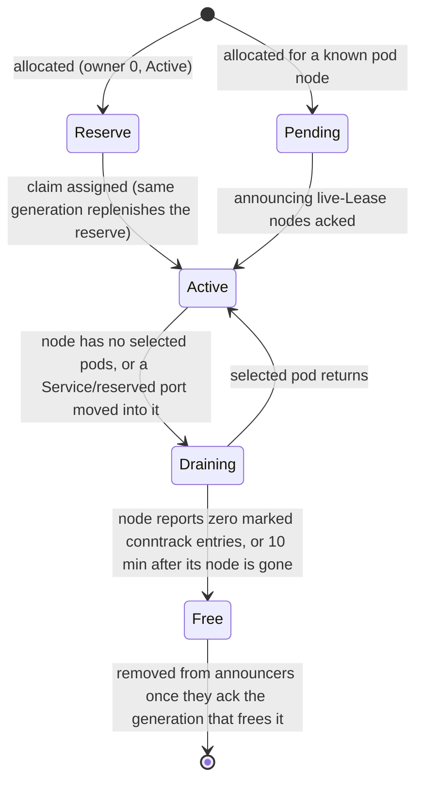
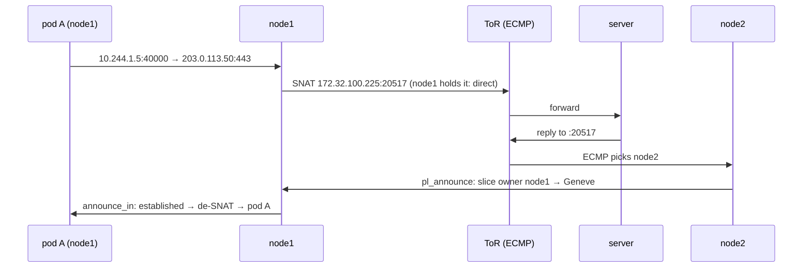

# PureLB Egress Design

Revised Oct 20, 2026 · @Adam Dunstan

> **Revision.** Revised 2026-10-19 from the Oct 12, 2026 draft. It applies the decision register of the egress review plan: D1–D35, D7a, D-pref, D-conc, D-lease, D-pack, D-idle, D-iso and the scope rulings, including the rows revised on 2026-10-19 (D5, D6, D7, D9, D17, D21, D34, D-conc, D-lease and the Phase 1.3 client QPS). Superseded decisions are applied in their final form. It also applies the Phase 0b spike results in `hack/egress-spikes/RESULTS.md` and `hack/egress-spikes/kwok/RESULTS.md`.
>
> **Markers.**
> - **(spike n)**: the statement is a measured result of Phase 0b spike *n*. Appendix B.1 gives each spike's status.
> - **PENDING SPIKE n**: the statement depends on a spike that has not run. It states intended behaviour, not measured behaviour. Still not run (2026-10-20): spike 10's D7 relay fraction, CNI ADD p99, agent RSS and restart convergence (need the implementation or real hardware); spike 2 `bpf_redirect_peer` and `pl_pod_flow` in the eBPF stage, `pl_pod_reply` called from `pl_announce`, and the extension-header walk in the eBPF stage's parser; PTB rate limiting and GSO / CHECKSUM_PARTIAL skbs; spike 11 probe loss with BFD on.
> - **OPEN**: the register does not settle the point. The text shows the draft's working assumption, and Appendix B lists every such point.
> - **OPEN DECISION**: a resolution's precondition failed when measured, so the point is back with the user. The text gives the measured result and picks no option. None remain in this revision.
> - **(resolution n, 2026-10-20)**: the point was an open item of the previous revision and is settled by resolution *n* in the plan's "Resolutions of the redline's open items (user, 2026-10-20)". Where a register row says otherwise, the resolution wins.
>
> **Sections materially changed:**
> - §1: goals 5–8 rescoped.
> - §2: terms added.
> - §3: rewritten.
> - §4: field tables completed; `EgressMembers` added; LBNodeAgent `tunnelEncapsulation`, `markField` byte and `tunnelPort` added; `optOut` and `skipIPv6DAD` added; `PodUID` removed.
> - §5, §6 (including the new §6.13 IPv6) and §8: rewritten.
> - §7.2, §7.3, §7.5, §7.8 and §7.9: changed; §7.12 added.
> - §9: replaced by the delivery inventory.
> - §10: rewritten; IPVS removed.
> - §11 and §13: rewritten.
> - §12: metrics, alerts and tooling.
> - §14: rewritten as Tier 1 and Tier 2.
> - §15: kernel features, sysctls and privileges.
> - Second pass (2026-10-19): §3, §4.5–§4.7, §5 (the scoped ack handshake replaces the allocator-wide epoch in §5.7), §6, §7.5, §8, §9, §10, §11.3, §14, §15 and Appendices A and B, for the revised decisions and the spike results.
> - Third pass (2026-10-20): the user's resolutions 1b and 3–23 of the open items; D13's larger underlay MTU with fallback (§6.7, §6.12, §6.13); D34's verified Cilium chaining through `cni.configMap` (§8.10, §10); the spike 8 takeover re-read numbers (§5.7, §8.4, §14.5); the spike 3 IPv6 tag survival and the Calico eBPF SNAT test (§6.2, §10.2); the spike 1, 6 and 7 gap results. Calico eBPF uses the netfilter stage with the pool's `natOutgoing` on (resolution 20, re-measured; confirmed by the user 2026-10-20; §6.1, §10.2). Spike 10's budgets were approved by the user (2026-10-20, §14.5); egress requires a kernel with CVE-2025-40183 fixed (user decision 2026-10-20, §6.7). No open decisions remain.
> - Fourth pass (2026-10-20, consistency review against the plan and the spike results of the same day): the remaining Tier 2 rows (Calico nftables, Canal, kube-router, Cilium profiles (b) and (c)) in spike 3, spike 5 and the boot window (§1, §6.2, §8.1, §8.10, §10.2, §10.4, §13, §14.2.3); the default `markField` byte `0x000000ff` on every CNI, measured and confirmed by the user (resolution 22; §4.4, §6.2, §14.2.3); the netkit decision in the eBPF stage's hook table (§6.4, §9.1); the agent-start check of every sandbox without a plugin record (§8.1, §9.1); the eBPF NAT first-failure budget of at least 85% and the approved budget table (§14.5); the kernel requirement in the VM matrix, kernel features and docs (§9.1, §14.2.1, §15.1); round 2's reordered fragments and extension headers (§13); `validate`'s `natOutgoing` check (§12.3); the decided allocator settings' measured API server load (§15.4); Appendices A and B brought in line.
>
> Appendix A lists every change against the Oct 12 draft with the decision that drove it.

Egress gives Kubernetes pods stable source addresses from PureLB pools:
- on local, routed and external pools;
- with or without a LoadBalancer Service;
- without `externalTrafficPolicy: Local`;
- without flow loss when an address moves between nodes.

## 1. Overview

Egress addresses are PureLB addresses. They are allocated from ServiceGroup pools and placed exactly like LoadBalancer addresses.

A pod node translates selected pod traffic into its own port slice of the address. It then sends the traffic:
- straight out, when the pod node holds the address itself;
- otherwise through a Geneve tunnel to a node that holds it.

Nodes holding the address return each reply to the pod node that owns its slice, using a stateless TC program. NAT state exists only on pod nodes, so a change of announcer never breaks a flow.

### Goals

1. Egress from any egress-capable node for any selected pod, independent of where the address is announced.
2. Every usage mode on local, routed and external pools: LB only, egress only, LB and egress on separate addresses, and LB and egress on a shared address.
3. Hitless handling of announcer failure, affinity-driven address moves, pool NIC failure and scale-out.
4. Integration with node affinity, multipool, namespace-scoped ServiceGroups, external IPAM and the address guard.
5. Fixed source ports on every address. Stable per-replica addresses keyed by StatefulSet ordinal (D27). Conntrack helpers on per-replica (PerPod) addresses only (D23).
6. Protocol support:
   - TCP, UDP, SCTP and ICMP/ICMPv6 echo on every egress address;
   - every IP protocol on PerPod addresses (D4);
   - correct IP fragments, ICMP errors, PMTU, dual-stack and IPv6 throughout.
7. Fail-closed from the first packet a pod sends, on every supported CNI including eBPF host-routing CNIs, on egress-capable nodes (D29).
   - Multus secondary interfaces are excluded.
   - The one documented exception is the CNI plugin's age-bound pass-through (D35, §11.2).
   - A pod sandbox created in the CNI boot window, between the primary CNI rewriting its conflist and `purelb-cni` re-inserting the entry, would bypass the plugin. Measured on flannel, Calico iptables, Calico nftables, Calico eBPF, Canal, kube-router, Antrea and Cilium profiles (a), (b) and (c) (spike 5, 2026-10-20): no pod reached the network without the plugin. On Calico a sub-second moment remains between Calico's own rewrite and the re-insert. Phase 6's agent-start check covers such a pod, treating every sandbox on the node without a plugin record like a pod that predates the plugin (user decision 2026-10-20) (§8.1, §8.10, Appendix B).
8. No datapath change for LB-only users while egress is not enabled (D-idle, D-iso). The only intended LB-visible changes are D7a's damped down-link handling (§6.8) and D-lease's isolation of election traffic (§9, §11.3), each with a release note.

### Design principles

| Principle | Mechanism |
| --- | --- |
| Transparent to workloads | Nothing is placed in a pod's network namespace. No sysctl inside it is changed. No CNI anti-spoofing exemption is needed. |
| Announced like a LoadBalancer address | Local pools use the same Lease election. Placement is the same: the pool interface, or the LBNodeAgent `dummyInterface` (default `kube-lb0`). The same GARP / unsolicited NA, k8gobgp netlink import and address guard apply. |
| One owner authority | The Lease election is the only owner authority (D1). The allocator never names an owner. Routed dedicated addresses have no owner at all, only advertisers (D7). |
| One path through the announcer | Pod traffic leaves through a node holding its address, and replies return through one. Upstream uRPF and source-MAC binding therefore always see a holder, and pod nodes need no pool interfaces. |
| Translation on the pod node, nothing stateful elsewhere | SNAT into a per-node slice on the pod's node. Announcers forward by slice with no per-flow state. |
| Kernel-native on the pod node | Where pod traffic traverses the host stack: netfilter conntrack NAT and policy routing. On CNIs that bypass the host stack: a PureLB-owned eBPF NAT (D32). |
| No kfuncs | Every program uses only helpers that load under NET_ADMIN, NET_RAW and BPF (D12, D32). |
| One announcer implementation | One TC program, `pl_announce`, returns replies by slice and forwards tunnel transit on every node, for every pool type. |
| Installed but idle | In the default install, egress is present but does nothing until an LBNodeAgent enables it (D-idle). |
| Detect and report, never edit | PureLB reports foreign firewalls, CNI egress features and missing encryption. It never edits them (D25, D30). The only foreign file PureLB writes is its own CNI chain entry, written by `purelb-cni` (D34). If the CNI keeps undoing that entry, `purelb-cni` stops writing and reports; on Cilium the entry comes from Cilium's own CNI configuration instead (D34, §10.4). |
| Configuration is intent only | Users choose addresses, pods, destinations and failure behaviour, and datapath choices are detected. The exceptions are three node-level overrides on LBNodeAgent: `tunnelEncapsulation`, the `markField` byte and `tunnelPort` (D3, D18). |

### Translation

All egress is source NAT on the pod's own node into that node's slice of the egress address. The pod keeps its CNI address and sends normally.

| Address kind | Translation |
| --- | --- |
| Slice address | Each pod node translates into its own slice of the port range. |
| PerPod address | One StatefulSet ordinal owns the whole address, so its node translates into the full port range, for any protocol (D4). |
| Reserved port | A pod that needs a fixed source port uses `ports.reserved` (D19). |
| Embedded addresses | Applications that embed addresses in payloads (SIP, FTP, H.323) use conntrack helpers. Helpers are available on PerPod addresses only (D23). |

## 2. Terminology

| Term | Definition |
| --- | --- |
| Egress address | A PureLB-allocated address used as the source of selected pod traffic. It is either dedicated, or shared with a LoadBalancer Service. |
| Local pool | A ServiceGroup `local` pool, or an `external` group with `announce: local`. Addresses go on the holder's pool interface. |
| Routed pool | A ServiceGroup `remote` pool, or an `external` group with `announce: remote`. Addresses go on the LBNodeAgent `dummyInterface` (default `kube-lb0`), and k8gobgp advertises them. |
| Egress-capable node | A node whose agent reports egress capability. The allocator labels it `purelb.io/egress-capable=true` (D29). |
| Selected pod | A pod matched by an `Egress` or `ClusterEgress` after namespace scope, exclusions and opt-out. Overlap is resolved per destination (D24). |
| Pod node | The node running a selected pod. It performs the translation. |
| Owner | For a local-pool address, the node chosen by the Lease election (D1). For an `Inherit` address, the Service's own placement. |
| Advertiser | For a routed dedicated address, a node that advertises it from the dummy interface (D7). Host-route mode: every live `announcerNodeSelector` node, advertising the address as a /32 or /128 (user decision 2026-10-21, option C). Aggregate mode: every `announcerNodeSelector` node, advertising the pool's aggregate. |
| Advertisement mode | Per routed pool and per family, from the pool's existing `aggregation`, computed as the LB path does (`announcedPrefix`): *host-route mode* when the prefix is /32 or /128, *aggregate mode* for any shorter prefix (D7). |
| Holder / announcer | Any node holding the address (owner or advertiser). It attracts return traffic and forwards outbound transit. |
| Announcer set | All holders of one address and family. |
| Placement | `SingleAnnouncer` (one holder) or `MultiAnnouncer` (several holders, with upstream ECMP). |
| Slice | A power-of-two sized, aligned source-port range of an egress address, assigned to one pod node. |
| Reserve slice | An Active, unassigned slice of an address. Each address keeps a configurable number of them, default 4. Owner 0 means drop until a claim assigns the slice (D17). |
| Reserved port | A port of an egress address assigned to one matched pod, keyed by the pod's original source port (D19). |
| PerPod address | An address owned by one StatefulSet ordinal (D27). Its node uses the full port range. |
| Pod-node stage | Classification, translation and steering on the pod node, implemented in netfilter or eBPF and selected per node. |
| Announcer stage | The TC program `pl_announce` on uplinks and on the tunnel device. |
| Mark field | One fixed 8-bit byte of `skb->mark` and the conntrack mark. `markField` selects which byte (D18). |
| Pod-set id | A node-local value 1–127 written into the mark field by `pl_pod_tag` for a selected pod. It names the ordered set of policies that may apply to that pod (D2, D24). |
| Policy slot | A node-local value 1–127 for an (egress policy, address) pair with selected pods on that node. It shares the 127-value budget with pod-set ids (D18). |
| Reply flag | The top bit of the mark field: a reply that arrived through the tunnel, or a direct-path reply marked by `pl_announce`. |
| Tunnel | The collect-metadata Geneve device `purelb-eg0` between nodes. It runs in L3 or L2 encapsulation (D3). |
| Steering program | The tcx egress program on `purelb-eg0`. It turns a slot into a tunnel key for one holder (D3). |
| Ack | A node's report, in its `EgressNodeState` status, that it has fully installed a given `metadata.generation`: of each `EgressEndpoints` whose address it announces, and of its own `EgressNodeState` spec. There is no cluster-wide epoch (D6, §5.7). |
| Takeover re-read | The full read from the API server that starts a node's watch on an address's `EgressEndpoints` when the node starts announcing that address, so it never announces from a stale slice table (D6). |
| Tombstone | An `EgressEndpoints` in state `Quarantined`. It holds a released address out of every pool until `until` (D16). |

## 3. Architecture

The parts and their roles:
- The allocator decides what exists (addresses, selected pods per node, slices) and publishes it.
- The Lease election alone decides which node holds each local-pool address (D1).
- Routed dedicated addresses follow a deterministic advertiser rule instead (D7).
- lbnodeagents place addresses and program the kernel.
- Scoped acknowledgements guarantee that every node currently announcing an address can return a slice's replies before any pod node sends from that slice (D6). Each object carries its own `metadata.generation`, and only the nodes involved watch and ack it.



Each agent watches, by name, the `EgressEndpoints` of the addresses that its own election view (or, for routed addresses, the D7 rule) says it announces (D1, D6), and only its own `EgressNodeState`, whose `spec` the allocator writes with the node's own slices. In that object's status the agent reports the addresses it announces with the generation it has acked for each, the spec generation it has installed, its reserve-slice claims and its capability (D21).

The allocator activates or retires a slice only after every node that currently reports announcing the address, and has a live Lease, has acked that object's generation. The allocator observes announcers and never names them (D1).

### Components

| Component | Runs as | Responsibilities |
| --- | --- | --- |
| Allocator egress reconciler | PureLB allocator (`replicas: 1`, `Recreate`), new `queueItem` kinds on the existing union work queue (D-conc) | Resolve ServiceGroup and namespace scope; select pods; allocate addresses (in-tree pools or sidecar); compute eligibility and advertiser inputs; allocate slices, the reserve and reserved ports; publish `EgressEndpoints` and `EgressMembers`; write each node's own slices into its `EgressNodeState` spec; gate activation on scoped acks (D6); drive finalizers and tombstones; write status, events and the `purelb.io/egress-capable` node label |
| CRD validation | CEL rules in the CRDs | Single-object rules (§4). Cross-object rules run in the allocator. |
| `internal/egresshook` | Go interface package with a no-op default | The only path from the allocator, announcer, guard and `internal/k8s` into egress code. A CI import check enforces it (D-iso). |
| Egress controller, control part | lbnodeagent service-sync goroutine | Consume election snapshots through the composed `OnMemberChange`; add, withdraw and renew egress addresses through the VIP path; GARP / NA |
| Egress datapath | lbnodeagent, one datapath goroutine fed by a channel (D-conc) | nft table, BPF programs and maps, `purelb-eg0`, RPDB rules and routing tables, conntrack drain counting, detection probes |
| purelb-egress CNI plugin | The lbnodeagent binary in plugin mode, installed in the CNI bin dir, chained after the primary CNI | ADD / DEL / CHECK over the agent socket. Falls back to the persistent snapshot, and never holds an API credential (D35). |
| purelb-cni | Token-less DaemonSet running the lbnodeagent image in installer mode (D34) | Owns the CNI bin and conf dirs; inserts or removes the chain entry from the agent's desired-state file. It never branches on the CNI's identity: if the CNI rewrites the conflist right after each re-insert (5 reverts within 10 s, each within 1 s of our write), it stops editing and reports `CNIChainMissing` unless the chain already contains the plugin, for example through Cilium's `cni.configMap` (D34, §10.4) (user decision 2026-10-21). |
| BPF programs | lbnodeagent | `pl_pod_tag`, the steering program and `pl_announce` on every egress-enabled node. `pl_pod_out` and `pl_pod_reply` on eBPF-stage nodes. Pinned under `/sys/fs/bpf/purelb` only when egress is enabled and bpffs is mounted (D12). |
| Address guard | lbnodeagent | First program at tcx ingress (or XDP) of each uplink. Egress supplies address, slice and reserved-port entries (§6.9). |
| k8gobgp | Sidecar in the lbnodeagent pod | Advertises routed egress addresses (host-route mode) or the pool's aggregate (aggregate mode), importing them from the dummy interface through netlink. There is no PureLB-to-gobgp integration (D7). |
| External IPAM sidecar | gRPC sidecar in the allocator pod | Allocates and releases addresses for `external` groups, keyed per D15 |

### Objects

| Object | Scope | Written by | Read by |
| --- | --- | --- | --- |
| `Egress` | Namespaced | Users | Allocator; agents (cache, for CNI ADD) |
| `ClusterEgress` | Cluster | Platform admins | Allocator; agents |
| ServiceGroup `spec.egress`, `spec.namespaces`, pool `name` | PureLB namespace | Cluster admins | Allocator; agents |
| LBNodeAgent `spec.egress` | PureLB namespace | Cluster admins | Agents |
| `EgressEndpoints` | PureLB namespace, one per (policy, address) (D5) | Allocator | Only the agents announcing or advertising its address, each through a watch on the object's name (D5, D6) |
| `EgressMembers` | PureLB namespace, one or more per policy (D5) | Allocator | Allocator; `kubectl purelb egress trace` (static) |
| `EgressNodeState` | Cluster, one per node, ownerRef to its Node (D6) | Allocator (`spec`: the node's own slices); the agent on that node (`status`) (D6, D21) | Allocator; the agent on that node only, through a field-selector watch |
| Lease `purelb-node-<node>` | PureLB namespace | Agent, through the election's own clientset (D-lease) | Agents; allocator (watch) |
| FlowSchema for PureLB's Lease requests | Cluster | Shipped in the core manifests of every install method (D-lease) | API server priority and fairness |
| Node label `purelb.io/egress-capable` | Node | Allocator, limited to this key by a shipped ValidatingAdmissionPolicy (D29) | Users' scheduling rules; the plugin |

### Concurrency

There are no locks (D-conc).

| Process | Rule |
| --- | --- |
| Allocator | Egress reconcile items are new `queueItem` kinds on the existing union work queue in `internal/k8s`. `ForceSync` enqueues them. One goroutine owns all allocator state, pool state included as `LocalPool` is today, and makes every decision in queue order. Up to 4 API writes run in flight on a writer pool that only performs the HTTP calls and returns each result to the owner on a channel. One object never has two writes in flight; an object changed meanwhile is redone after its write completes. A priority lane ahead of the normal queue carries the claim path (claims, activations and the claimant's `EgressNodeState` spec), so claims do not wait behind membership rewrites. |
| Agent, control | Address add, withdraw and renew stay on the service-sync goroutine, which already owns `quietWithdrawn`, `svcIngresses` and `announced`. Election snapshots arrive through a composed `OnMemberChange`; there is no second Lease watch. |
| Agent, datapath | Only the egress-private datapath (nft, BPF maps, `purelb-eg0`, rules and routes) has its own goroutine. It receives immutable desired-state snapshots over a channel. Readers of shared state use `atomic.Pointer` snapshots. |
| Both, API clients | The election's Lease get, create, update and delete, and its Lease informer, use their own clientset built from their own `rest.Config` with their own rate limiter (D-lease). Phase 1.3 sets client QPS and Burst explicitly: agents 50/100, allocator 200/400. |

### Packaging and isolation

Egress ships the way k8gobgp does:
- a kustomize component, `deployments/components/egress`;
- a Helm value, `egress.enabled`, which defaults to true (D-pack).

In the default install, egress is idle until an LBNodeAgent sets `spec.egress.enabled: true` (D-idle). Core packages reach egress only through `internal/egresshook` (D-iso). §9.2 lists the install variants. The D-lease FlowSchema is in the core manifests, so every install method ships it, egress or not.

## 4. API

The roles:
- Users express intent with `Egress` or `ClusterEgress`.
- Cluster admins bound that intent with the ServiceGroup's `spec.egress` and namespace fields, and enable egress per node set with LBNodeAgent `spec.egress`.
- `EgressEndpoints`, `EgressMembers` and `EgressNodeState` are machine-owned and form the programming handshake.

Conventions for every table below:
- Enum values are PascalCase.
- Every list has `MaxItems` and every string has `MaxLength`.
- "CEL" marks a rule enforced at admission. "Runtime" marks a cross-object rule enforced by the allocator, which reports it in status.
- The CRDs need the Kubernetes CEL IP and CIDR library (`isIP`, `isCIDR`, `ip()`, `cidr()`). The exact minimum Kubernetes version is fixed in Phase 2. The D-lease FlowSchema (`flowcontrol.apiserver.k8s.io/v1`) needs Kubernetes ≥ 1.29, which feeds that minimum.
- The existing LBNodeAgent `addressGuard` enums (`enforce|monitor`, `tcx|xdp`, `closed|open`) are unchanged. Changing them would break existing objects.

### 4.1 Egress

```yaml
apiVersion: purelb.io/v2
kind: Egress
metadata:
  name: partner-sync
  namespace: tenant-a
spec:
  # Address source: at most one of serviceGroup / serviceRef; neither = the namespace's default group
  serviceGroup: partner
  # serviceRef: {name: sip-gw}           # share the Service's address and placement

  pool: public                           # pool entry name in the group
  addresses: []                          # optional pins inside the pool
  ipFamilyPolicy: PreferDualStack        # SingleStack | PreferDualStack | RequireDualStack
  skipIPv6DAD: false                     # dedicated local-pool addresses only

  podSelector: {matchLabels: {app: partner-sync}}

  destinations:
    include:
    - cidrs: [0.0.0.0/0, "::/0"]
      ports:                             # optional; omitted = all protocols and ports
      - {protocol: TCP, port: 443}
      - {protocol: UDP, port: 5060, endPort: 5070}
    exclude:
    - cidrs: [203.0.113.99/32]

  affinity:
    mode: Hash                           # Hash | PerPod | Inherit (serviceRef only)
    identity: StatefulSetOrdinal         # PerPod only; the only value (D27)

  ports:
    sliceSize: 4096                      # optional; the group's default otherwise
    reserved:
    - {protocol: UDP, port: 5060, podSelector: {matchLabels: {role: registrar}}}

  helpers: []                            # SIP | FTP | H323; PerPod addresses only (D23)
  priority: 100                          # 0-999, capped by the group's tenancy.priorityCeiling
  failurePolicy: FailClosed              # FailClosed | FailOpen
  optOut: Allowed                        # Allowed | Denied (D20)
```

| Field | Type | Default | Validation | Semantics |
| --- | --- | --- | --- | --- |
| `metadata.name` | string | — | CEL: length ≤ 63 | The name appears in labels and in the sidecar key (D15). |
| `serviceGroup` | string | The namespace's default group (§5.2) | MaxLength 63, DNS label. CEL: not with `serviceRef`. | A ServiceGroup in the PureLB namespace. Runtime: the group must serve the namespace (`Contained`). |
| `serviceRef.name` | string | — | MaxLength 63, DNS-1035 label. CEL: excludes `serviceGroup`, `pool`, `addresses`, `podSelector`, `skipIPv6DAD`; requires `affinity.mode: Inherit`. | A LoadBalancer Service in the same namespace. Pods come from the Service's selector in that namespace, never from EndpointSlices (D20). §5.9 covers the target lifecycle. |
| `pool` | string | The group's normal pool selection (first fit or `balancePools`) | MaxLength 64 | The `name` of a pool entry (§4.3). Runtime: unknown name → `Allocated=False PoolNotFound`. Omitted on a `multiPool` group → `Allocated=False PoolRequired`. |
| `addresses` | []string | [] | MaxItems 2; each `isIP`. CEL: two entries must differ in family. CEL: empty when `affinity.mode: PerPod`. | Pins. Runtime: must lie inside `pool` and not be quarantined (`Allocated=False PinUnavailable`, D16). |
| `ipFamilyPolicy` | enum `SingleStack` \| `PreferDualStack` \| `RequireDualStack` | `PreferDualStack` | Enum | `RequireDualStack` on a group missing a family → `Allocated=False FamilyUnavailable`. `SingleStack` takes the cluster's primary family (resolution 12, 2026-10-20). |
| `skipIPv6DAD` | *bool | Unset: the pool's `skipIPv6DAD` | CEL: not with `serviceRef` | Applies to dedicated addresses on local pools; DAD is local-pool only. For shared addresses the pool's setting always wins (D31). |
| `podSelector` | LabelSelector | — | CEL: required exactly when `serviceRef` is absent | `{}` selects every pod in the namespace. |
| `destinations.include` | list | — | Required. MinItems 1, MaxItems 32. | A destination is egress when it matches an include entry and no exclude entry. |
| `destinations.include[].cidrs` | []string | — | MinItems 1, MaxItems 64; each `isCIDR` | Cluster networks are always excluded and cannot be included. That check is runtime: cluster networks are detected (§13), so CEL cannot express it. |
| `destinations.include[].ports` | list | Omitted: all protocols and ports | MaxItems 32 | A port filter. Port-less protocols are handled per D4 (§6.3). |
| `…ports[].protocol` | enum `TCP` \| `UDP` \| `SCTP` | `TCP` | Enum | |
| `…ports[].port` | int32 | — | 1–65535 | |
| `…ports[].endPort` | int32 | `port` | CEL: `port ≤ endPort ≤ 65535` | Inclusive range end. |
| `destinations.exclude` | list | [] | MaxItems 32 | |
| `destinations.exclude[].cidrs` | []string | — | MinItems 1, MaxItems 64; each `isCIDR` | |
| `affinity.mode` | enum `Hash` \| `PerPod` \| `Inherit` | `Hash`, or `Inherit` with `serviceRef` | Enum. CEL: `Inherit` ⇔ `serviceRef`. | §5.5 |
| `affinity.identity` | enum `StatefulSetOrdinal` | `StatefulSetOrdinal` | Enum. CEL: only with `PerPod`. | `PodUID` is removed (D27). Pods not owned by a StatefulSet are excluded (`excludedPods` reason `NotStatefulSet`). |
| `ports.sliceSize` | int32 enum 64, 128, 256, 512, 1024, 2048, 4096, 8192, 16384 | The group's `egress.sliceSize` | Enum | Ignored for `PerPod`. Runtime: must be allowed by the group's slice bounds (§4.3). |
| `ports.reserved` | list | [] | MaxItems 16. CEL: (protocol, port) unique. CEL: empty when `PerPod`. | §5.6 |
| `ports.reserved[].protocol` | enum `TCP` \| `UDP` \| `SCTP` | — | Enum | |
| `ports.reserved[].port` | int32 | — | 1–65535 | Keyed by the pod's original source port (D19). Runtime: must not be a Service port of a shared address (`PortCapacity=False ReservedPortConflict`). |
| `ports.reserved[].podSelector` | LabelSelector | — | Required | Runtime: must match exactly one selected pod, else `PortCapacity=False ReservedPortAmbiguous` (D19). |
| `helpers` | []enum `SIP` \| `FTP` \| `H323` | [] | MaxItems 3, listType set | Runtime: allowed by the group (`Contained=False FeatureNotAllowed`), and PerPod only (`Contained=False HelpersRequirePerPod`, D23). CEL could express the PerPod rule; D23 makes it a condition. |
| `priority` | int32 | 0 | CEL: 0–999 | Clamped to `tenancy.priorityCeiling` (`Contained=False PriorityClamped`). Overlap is resolved per (pod, destination) (D24). |
| `failurePolicy` | enum `FailClosed` \| `FailOpen` | `FailClosed` | Enum | §11.2 |
| `optOut` | enum `Allowed` \| `Denied` | `Allowed` (resolution 10, 2026-10-20; `ClusterEgress` defaults to `Denied`, §4.2) | Enum | `Allowed`: a pod annotated `purelb.io/egress: "false"` is excluded. `Denied`: the annotation is ignored (D20). |

### 4.2 ClusterEgress

`ClusterEgress` is identical to `Egress` except for the fields below. It is cluster-scoped.

```yaml
apiVersion: purelb.io/v2
kind: ClusterEgress
metadata:
  name: pci-zone
spec:
  serviceGroup: pci
  namespaceSelector:
    matchExpressions:
    - {key: kubernetes.io/metadata.name, operator: In, values: [payments, ledger]}
  podSelector: {}
  namespaceScope: Respect                # Respect | AdmittedOnly
  destinations:
    include: [{cidrs: [198.51.100.0/24]}]
  priority: 1000
  failurePolicy: FailClosed
  optOut: Denied
```

| Field | Type | Default | Validation | Semantics |
| --- | --- | --- | --- | --- |
| `serviceGroup` | string | — | Required | `serviceRef` does not exist on `ClusterEgress`, so `Inherit` is unavailable. |
| `namespaceSelector` | LabelSelector | — | Required | Scope must be bounded (D20), in one of two ways. (1) The selector constrains `kubernetes.io/metadata.name`; CEL can check this on the object. (2) The group's `spec.namespaces` is non-empty; this is cross-object, so it is runtime: `Contained=False ScopeUnbounded`. Mutable labels alone never define scope. |
| `namespaceScope` | enum `Respect` \| `AdmittedOnly` | `Respect` | Enum | `Respect`: only namespaces the group serves and whose group sets `tenancy.allowClusterEgress`. `AdmittedOnly`: additionally requires the namespace label `purelb.io/cluster-egress-admitted: "true"`. That label can only narrow a bounded scope. |
| `priority` | int32 | 1000 | CEL: ≥ 1000 | Always above namespaced policies. |
| `affinity.mode` | enum `Hash` \| `PerPod` | `Hash` | Enum | |
| `optOut` | enum `Allowed` \| `Denied` | `Denied` (resolution 10, 2026-10-20) | Enum | As on `Egress`. With the default, the `purelb.io/egress: "false"` annotation is ignored for `ClusterEgress`. |

### 4.3 ServiceGroup egress

```yaml
apiVersion: purelb.io/v2
kind: ServiceGroup
metadata:
  name: partner
  namespace: purelb-system
spec:
  namespaces: [tenant-a, tenant-b]       # existing field
  enforceNamespaces: true                # existing field
  namespaceDefault: true                 # existing field
  local:
    v4pools:
    - {name: public, subnet: 172.30.10.0/24, pool: 172.30.10.100-172.30.10.150}
    - {name: partner, subnet: 192.168.50.0/24, pool: 192.168.50.100-192.168.50.150}
    v6pools:
    - {name: public, subnet: "fc00:30:10::/64", pool: "fc00:30:10::100-fc00:30:10::1ff"}
  egress:
    allowed: true
    allowSharedServiceAddress: true
    affinityModes: [Hash, PerPod, Inherit]
    helpers: [SIP, FTP]
    announcerNodeSelector: {matchLabels: {purelb.io/egress-gateway: "true"}}   # "nodes that peer" on routed pools
    preferPodNodes: true                 # prefer nodes holding an Active slice (D-pref)
    sliceSize: 4096
    releaseQuarantine: 1h
    tenancy:
      allowClusterEgress: true
      priorityCeiling: 999
      statusDetail: Redacted             # Full | Redacted
      onRevocation: Withdraw             # Withdraw | RetainUntilDelete
      maxEgressesPerNamespace: 20
```

The existing fields `namespaces`, `enforceNamespaces`, `namespaceDefault`, `local`, `remote`, `external`, `multiPool`, `balancePools`, `skipIPv6DAD` and `aggregation` are unchanged. The new fields are below.

| Field | Type | Default | Validation | Semantics |
| --- | --- | --- | --- | --- |
| `<pools>[].name` | string | The entry's `subnet` | MaxLength 64. CEL: unique per family within the list (the plan's Phase 1 adds `AddressPool.Name` with per-family uniqueness and pool `MaxItems`). | Names the entry for `Egress.pool`. In an `external` group, the pool is named by the `pool` value the sidecar receives. |
| `egress` | object | Absent: egress refused | — | |
| `egress.allowed` | bool | false | — | `false` refuses new Egresses and withdraws existing ones (D20). |
| `egress.allowSharedServiceAddress` | bool | false | — | Permits `serviceRef`. Violation → `Contained=False FeatureNotAllowed`. |
| `egress.affinityModes` | []enum `Hash` \| `PerPod` \| `Inherit` | [`Hash`, `PerPod`, `Inherit`] | MaxItems 3, listType set | Intersected with the policy. `Inherit` also needs `allowSharedServiceAddress`. |
| `egress.helpers` | []enum `SIP` \| `FTP` \| `H323` | [] | MaxItems 3, listType set | Helpers a policy may request (PerPod only, D23). |
| `egress.announcerNodeSelector` | LabelSelector | Every egress-capable node | — | Local pools: restricts the election's eligible set (D7a). Routed pools: names the nodes that peer. They are the advertiser candidates in host-route mode, and all advertise in aggregate mode (D7). Evaluated from a Node informer. |
| `egress.preferPodNodes` | bool | false | — | Local-pool election prefers nodes holding an Active slice of the address (D-pref). |
| `egress.sliceSize` | int32 enum 64 … 16384 (powers of two) | 4096 | Enum | The default slice size. Policies may choose another enum value. |
| `egress.releaseQuarantine` | duration string | `1h` | CEL: `duration(self) >= duration('0s') && duration(self) <= duration('720h')` | Tombstone hold before a released address returns to the pool (D16). |
| `egress.tenancy.allowClusterEgress` | bool | true | — | Whether ClusterEgress may use this group. Refused → `Contained=False ClusterEgressNotAllowed`. |
| `egress.tenancy.priorityCeiling` | int32 | 999 | CEL: 0–999 | Namespaced priority is clamped to this value. |
| `egress.tenancy.statusDetail` | enum `Full` \| `Redacted` | `Full` | Enum | `Redacted` does three things (D20, D21): hides nodes, slices and announcers in `Egress` status; routes node-bearing events to the PureLB namespace; suppresses per-address egress metric series. |
| `egress.tenancy.onRevocation` | enum `Withdraw` \| `RetainUntilDelete` | `Withdraw` | Enum | Applies to every `Contained=False` cause (D20). |
| `egress.tenancy.maxEgressesPerNamespace` | int32 | Unset: unlimited | Minimum 0 | Quota. Excess Egresses get `Contained=False QuotaExceeded`. |

The reserve count (D17, §5.6) is a field of the ServiceGroup's `spec.egress`, default 4 (resolution 13, 2026-10-20). The resolution does not name the field, so it is not in the table above.

The cross-object rules are runtime:
- the group must be in the PureLB namespace (`Contained=False NotInPureLBNamespace`);
- the `remote`/`external` pool type decides the placement model, and a routed pool's `aggregation` decides its advertisement mode per family (D7, §5.5);
- a shared address on a pool advertised as an aggregate is accepted: D9 is lifted, because in aggregate mode every gateway serves every address of the pool. The former `Contained=False AggregatedPool` reason is removed.

### 4.4 LBNodeAgent egress

```yaml
apiVersion: purelb.io/v2
kind: LBNodeAgent
metadata:
  name: default
  namespace: purelb-system
spec:
  local:
    garpConfig: {enabled: true}          # existing: GARP / NA timing for VIPs and egress addresses
    addressGuard: {mode: enforce}        # existing
  egress:
    enabled: true                        # default false: installed but idle (D-idle)
    excludedNetworks: [10.50.0.0/16]
    tunnelEncapsulation: Auto            # Auto | L3 | L2 (D3)
    tunnelPort: 6082
    markField: "0x000000ff"              # selects the byte; the field is always 8 bits (D18)
    reservedClusterSlots: 0
    flowLog: false
```

| Field | Type | Default | Validation | Semantics |
| --- | --- | --- | --- | --- |
| `egress.enabled` | bool | false | — | `false` (D-idle): `purelb-cni` leaves the conflist untouched, and there are no tunnel, `pl_announce`, nft table, RPDB rules, pins or egress informers. Turning a node from true to false triggers teardown (D26, §8.10). |
| `egress.excludedNetworks` | []string | [] | MaxItems 64; each `isCIDR` | Added to the auto-detected cluster networks (§6.3). |
| `egress.tunnelEncapsulation` | enum `Auto` \| `L3` \| `L2` | `Auto` | Enum | `Auto` picks `L3` (Geneve `innerprotoinherit`) where the kernel supports it and `L2` otherwise. Both modes work on every matrix kernel from 6.6 to 6.18, inner IPv4 and IPv6 over IPv4 and IPv6 underlays, provided L3 transit pushes an Ethernet header and L2 sets `purelb-eg0` NOARP (spike 1, §6.7). All nodes must resolve the same mode, else `DatapathCompatible=False TunnelModeMismatch`. |
| `egress.tunnelPort` | int32 | 6082 | 1024–65535 | Geneve destination UDP port. It must not collide with the CNI's own Geneve (6081 for Cilium and Antrea). Runtime: a collision gives `DatapathCompatible=False TunnelPortConflict`. |
| `egress.markField` | enum `"0x000000ff"` \| `"0x0000ff00"` \| `"0x00ff0000"` \| `"0xff000000"` | Unset: `0x000000ff` on every CNI (resolution 22, 2026-10-20) | Enum | Selects which byte of `skb->mark` and the conntrack mark egress uses. The width is fixed at 8 bits (D18). On a detected collision with the CNI, the agent moves an unset (default) field and reports `MarkConflict`. An explicitly set value is never moved; the collision is only reported as `MarkConflict` (resolution 9, 2026-10-20). Spike 3 measured whether the tag survives, not which byte each CNI leaves free: the tag survived on flannel, Calico iptables, Canal, kube-router and Antrea, and was overwritten on Cilium legacy routing and Calico eBPF, which classify by source IP instead (§6.2). kube-router's IPVS service proxy marks 0x0–0x3FFF, which overlaps the mark byte (spike 3). The per-CNI default byte was measured from each CNI's netfilter mark masks on Tier 2 (resolution 22, 2026-10-20): `0x000000ff` is the only byte free on every CNI that keeps the tag (flannel, Calico iptables and nftables, Canal, kube-router, Antrea) and the only one none of them reserves (Felix reserves `0xffe00000`); Calico eBPF and Cilium use every byte but classify by source IP, so the default is `0x000000ff` everywhere (confirmed by the user 2026-10-20). Cilium's TPROXY rule rewrites the whole mark of flows sent to its L7 proxy, so those lose PureLB's slot. |
| `egress.reservedClusterSlots` | int32 | 0 (resolution 11, 2026-10-20) | 0–127 | Per-node slot budget reserved for policies with priority ≥ 1000 (the Phase 3 quota). |
| `egress.flowLog` | bool | false | — | Opt-in flow log from conntrack NEW and DESTROY events, at Info level (netfilter stage). |

Everything else is detected:
- the pod-node stage, from the active probe (§10.1);
- the cluster networks, from the API;
- the tunnel underlay, from each node's InternalIPs (both families);
- the per-peer MTU, from `ip route get <peer>` (D30).

Holder changes send GARP / NA with `garpConfig` timing. When `garpConfig` is absent, egress uses count 3, initial delay 100 ms and interval 500 ms.

CNI paths are Helm and kustomize values of `purelb-cni` (D34), not CRD fields.

### 4.5 EgressEndpoints (allocator-owned)

There is one object per (policy, address), in the PureLB namespace. It holds addresses and slices only; pods are in `EgressMembers` (D5). There is no ownerRef from an `Egress`.

It is watched only by the nodes that announce or advertise its address, each through a watch on the object's name (D5, D6). The spike 8 prototype selected the watchers with an allocator-written announcer label instead; that differs only in who selects the watchers, not in the load (D6).

```yaml
apiVersion: purelb.io/v2
kind: EgressEndpoints
metadata:
  name: e-voice.sip-gw-5f0c2a91          # generated: kind prefix, namespace.name, hash of the address
  namespace: purelb-system
  generation: 17                         # metadata.generation: the version announcing nodes ack (D6)
  labels:
    purelb.io/egress-kind: Egress
    purelb.io/egress-namespace: voice
    purelb.io/egress-name: sip-gw
    purelb.io/egress-uid: 7d1e9c52-...
spec:
  state: Active                          # Active | Quarantined (tombstone, D16)
  until: null                            # quarantine end, Quarantined only
  policy:
    priority: 100
    failurePolicy: FailClosed
    affinityMode: Inherit
    helpers: []
    destinations: {include: [...], exclude: [...]}
  address: 172.32.100.225
  family: IPv4
  serviceGroup: voice-routed
  pool: public
  poolType: Routed                       # Local | Routed
  sharedWith: {service: sip-gw}          # serviceRef only
  identity: ""                           # PerPod: <statefulset>-<ordinal>
  placement: MultiAnnouncer
  sliceSize: 4096
  servicePorts: [{protocol: UDP, port: 5060}]
  slices:
  - {index: 5, node: node1, state: Active}
  - {index: 6, node: node2, state: Active}
  - {index: 7, node: "", state: Active}          # a reserve slice: owner 0 = drop (D17; default 4 per address)
  - {index: 8, node: node4, state: Draining}
  reserved:
  - {protocol: UDP, port: 5060, node: node1, pod: registrar-0}
  excludedNodes: [node5]                 # evicted from gating: lagging past the timeout (D6)
status:
  observedAnnouncers: [node1, node2]     # observational only (D1)
```

| Field | Type | Semantics |
| --- | --- | --- |
| `metadata.generation` | int64 | Increments on every spec change, as for any object. The nodes announcing the address ack it per object; there is no cluster-wide epoch (D6, §5.7). |
| `spec.state` | enum `Active` \| `Quarantined` | `Quarantined` objects are tombstones. They are replayed on every pool rebuild (D16). |
| `spec.until` | time | End of quarantine. |
| `spec.policy` | object | The policy fields an agent needs to program the pod-node stage. |
| `spec.address`, `family` | string, enum `IPv4` \| `IPv6` | |
| `spec.serviceGroup`, `pool`, `poolType` | string, string, enum `Local` \| `Routed` | `Routed` covers `remote` groups and `external` groups with `announce: remote`. |
| `spec.sharedWith.service` | string | Set for `serviceRef`. Egress references the address but never places, renews or releases it (D31, D15). |
| `spec.identity` | string | PerPod ordinal identity (D27). |
| `spec.placement` | enum `SingleAnnouncer` \| `MultiAnnouncer` | §5.5 |
| `spec.sliceSize` | int32 | Copied from the policy or group. |
| `spec.servicePorts` | list (MaxItems 1024) | Service ports of a shared address. Excluded from slices, and passed to kube-proxy. |
| `spec.slices` | list (MaxItems 1008, the most 64-port slices in 1024–65535) | `index` → ports `[index × sliceSize, (index+1) × sliceSize − 1]`. `node` empty = owner 0 = drop. `state`: `Pending` \| `Active` \| `Draining`. Free slices are absent. |
| `spec.reserved` | list (MaxItems 16) | Reserved port → node and pod (D19). |
| `spec.excludedNodes` | []string (MaxItems 1000) | Gating nodes evicted for ack lag (D6). Eviction affects gating only: the node keeps its place in the eligible and advertiser sets, so the election stays the only owner authority (D1; user decision 2026-10-20). While evicted it can serve a stale slice table, and replies for slices it has not yet seen are dropped as owner 0 until it catches up. A node rejoins gating when it again reports announcing the address in `EgressNodeState.status.announcing` (resolution 21, 2026-10-20). |
| `status.observedAnnouncers` | []string | What the allocator computes from its Lease view and the addresses nodes report announcing in `EgressNodeState.status.announcing`. Never consumed by agents (D1). |

### 4.6 EgressNodeState (allocator-written spec, agent-written status)

One object per node, cluster-scoped, with an ownerRef to its Node, so a deleted node's state is garbage-collected (D6). It stays small (D21):
- `spec` holds the node's own slices. The allocator writes it, and only that node watches it, through a field selector on its name (D6).
- `status` holds the node's acks for the addresses it announces, the spec generation it has installed, its drain reports (next to the acks, resolution 8, 2026-10-20), its claims, its capability and its conditions. The agent writes it.

Acks are debounced to at most one write per second; claims are written at once (D6). Live detail comes from `kubectl purelb egress dump --live` (§12.3). The field names are this revision's; D6 and D21 fix the content.

```yaml
apiVersion: purelb.io/v2
kind: EgressNodeState
metadata:
  name: node1
  generation: 42                         # bumped by every allocator write of spec
  ownerReferences: [{apiVersion: v1, kind: Node, name: node1, uid: ...}]
spec:                                    # written by the allocator (D6)
  slices:                                # this node's own slices
  - {endpoints: e-voice.sip-gw-5f0c2a91, address: 172.32.100.225, index: 5, state: Active}
status:                                  # written by the agent on node1
  observedGeneration: 42                 # spec generation fully installed: the node's ack of its own slices
  announcing:                            # addresses this node announces now, each with the acked generation (D6)
  - {endpoints: e-voice.sip-gw-5f0c2a91, address: 172.32.100.225, generation: 17}
  claims:                                # reserve-slice claims, written at once (D17)
  - {endpoints: e-voice.sip-gw-5f0c2a91}
  drained:                               # Draining slices with zero marked conntrack entries (resolution 8)
  - {endpoints: e-voice.sip-gw-5f0c2a91, index: 8}
  capability:
    egressCapable: true
    kernel: 6.12.111
    podNodeStage: Netfilter              # Netfilter | EBPF, from the active probe
    tunnelEncapsulation: L3              # resolved mode
    markField: "0x000000ff"              # byte in use
    slots: {used: 14, capacity: 127}
    underlay: {ipv4: 10.0.0.11, ipv6: "fd00::11"}
  conditions:
  - {type: DatapathReady, status: "True"}
  - {type: TunnelPeersReachable, status: "True"}
```

| Field | Type | Semantics |
| --- | --- | --- |
| `spec.slices` | list (MaxItems 4096) | The node's own slices and their state, written by the allocator. A claim completes when the node acks a spec showing its slice Active (D6). |
| `status.observedGeneration` | int64 | The spec generation fully installed on this node: its ack of its own slices (D6). |
| `status.announcing` | list (MaxItems 4096) | The addresses this node announces or advertises now, each with the `metadata.generation` of its `EgressEndpoints` that is fully installed (demux and guard entries). The allocator gates activation and retirement on these acks (§5.7), takes `observedAnnouncers` from them, and detects SplitBrain from them (§5.5). It replaces the earlier `spec.holding` (D6, D21). |
| `status.claims` | list (MaxItems 1000) | One claim per address for which this node needs a slice and has none (D17). Written at once, not debounced (D6). |
| `status.drained` | list (MaxItems 1008) | Lets the allocator free Draining slices (§5.6). Drain reports live in `EgressNodeState.status`, next to the acks (resolution 8, 2026-10-20). |
| `status.capability` | object | Input to the `purelb.io/egress-capable` label (D29) and to `DatapathCompatible`. |
| `status.conditions` | []Condition | `DatapathReady`, `DatapathCompatible`, `TunnelPeersReachable`, `UnderlayEncrypted`, `ForwardPath`. Every condition is True when healthy. |

### 4.7 Status and conditions

```yaml
status:
  observedGeneration: 7
  selectedPods: 6
  excludedPods: [{pod: batch-1, reason: OptedOut}]
  addresses:
  - address: 172.30.10.110
    family: IPv4
    pool: public
    placement: SingleAnnouncer
    announcers: [node3]                  # hidden under Redacted
    slices: [{node: node1, ports: 20480-24575, state: Active}]   # hidden under Redacted
    capacity: {slicesTotal: 15, active: 3, draining: 1, free: 11}
  conditions: [...]
```

`excludedPods[].reason` is one of `HostNetwork`, `OptedOut`, `NotStatefulSet`, `NodeUnsupported`, `NamespaceNotInScope` or `Outranked`. The list is MaxItems 100, truncated with a count.

Every condition is True when healthy, so the polarity is uniform. `Ready` is True when every other condition is True, except `UnderlayEncrypted`, which is a warning only (D30).

| Condition | True when | False reasons |
| --- | --- | --- |
| `Ready` | Every condition below except `UnderlayEncrypted` is True | As below |
| `Allocated` | Every requested address is allocated | `PoolExhausted`, `PoolNotFound`, `PoolRequired`, `PinUnavailable`, `FamilyUnavailable`, `IPAMUnavailable` |
| `Contained` | The group serves the namespace and allows every requested feature | `NamespaceNotServed`, `NotInPureLBNamespace`, `EgressNotAllowed`, `FeatureNotAllowed`, `HelpersRequirePerPod`, `ClusterEgressNotAllowed`, `ScopeUnbounded`, `QuotaExceeded`, `Revoked`, `PriorityClamped`, `ServiceNotFound`, `ServiceNotLoadBalancer`, `ServiceHasNoSelector` |
| `Announced` | Every required holder holds the address. For routed pools, the address (host-route mode) or the pool's aggregate (aggregate mode) is on the dummy interface and that interface is in k8gobgp's `netlinkImport`. | `AddressAddFailed`, `ImportMissing`, `SplitBrain`, `NoEligibleNode`, `DADFailed` |
| `DatapathReady` | Every node announcing an address of the policy has acked the current generation of its `EgressEndpoints`, and every pod node has acked a spec showing its slices (D6) | `NodesLagging`, `SlotsExhausted`, `NoGateway` |
| `DatapathCompatible` | Every pod node supports the policy | `HelpersUnsupported`, `ProtocolUnsupported`, `KernelTooOld`, `ChainMissing`, `CNIChainMissing` (Cilium, D34), `NodeUnsupported`, `TunnelModeMismatch`, `TunnelPortConflict`, `MarkConflict`, `CNIEgressPolicy`, `ForwardBlocked`, `TunnelPortBlocked`, `NATOutgoingRequired` (Calico eBPF: the pool has `natOutgoing` off and the node cannot run the eBPF stage; (user decision 2026-10-21)) |
| `Guarded` | Every holder with an address guard holds the egress entries, or no guard is configured | `GuardStandingDown`, `GuardMapFull` |
| `PortCapacity` | Every pod node with selected pods has a slice, and every reserved port resolves to one pod | `SliceExhausted`, `ReservedPortAmbiguous`, `ReservedPortConflict` |
| `PolicyEffective` | The policy wins for every (pod, destination) it selects | `OutrankedBy`, `PartiallyOutranked` |
| `AddressUnique` | The ARP probe or ND DAD before placement was clean, and no DADFAILED was observed after it | `DuplicateAddress`, `DADFailed` |
| `UnderlayEncrypted` | No node-to-node encryption is bypassed by the egress tunnel | `UnderlayUnencrypted` (D30; warning only) |

The draft's `PolicyConflict` and `AddressConflict` conditions were True on failure. They are renamed `PolicyEffective` and `AddressUnique`, with uniform polarity.

### 4.8 EgressMembers (allocator-owned)

`EgressMembers` holds the selected pods per node for one policy. Like EndpointSlice, it is split at 500 pods per object. The allocator writes and reads it. Agents do not read it: they compute selection locally at CNI ADD (§5.3) from their pod cache.

```yaml
apiVersion: purelb.io/v2
kind: EgressMembers
metadata:
  name: e-voice.sip-gw-0
  namespace: purelb-system
  labels: {purelb.io/egress-kind: Egress, purelb.io/egress-namespace: voice, purelb.io/egress-name: sip-gw, purelb.io/egress-uid: 7d1e9c52-...}
spec:
  nodes:
  - node: node1
    pods:
    - {name: sip-gw-0, uid: 1f..., identity: sip-gw-0}
  - node: node2
    pods:
    - {name: sip-gw-1, uid: 2a..., identity: sip-gw-1}
```

| Field | Type | Semantics |
| --- | --- | --- |
| `spec.nodes[].node` | string | A node with at least one selected pod. |
| `spec.nodes[].pods` | list | Pod name, UID and PerPod identity. MaxItems 500 per object across all nodes. |

## 5. Control plane

The allocator runs one level-triggered reconcile per `Egress` or `ClusterEgress` on its union work queue (D-conc).

Every change that affects forwarding is published as a new `metadata.generation` of the affected object: the address's `EgressEndpoints`, a node's `EgressNodeState` spec, or both. A change takes effect only after the nodes that must forward it ack that generation: the nodes announcing the address, and the pod node whose slice it is (D6, §5.7).

Ownership itself is never published:
- local-pool owners come from the Lease election, computed by each agent (D1);
- routed advertisers come from the D7 rule, computed by each agent.

### 5.1 Reconcile pipeline



The inputs are:
- `Egress`, `ClusterEgress`, ServiceGroups and Namespaces;
- Pods, list/watch with transforms that keep only labels, owner references, `spec.nodeName`, `hostNetwork` and `status.podIPs`;
- Services and Nodes;
- Leases (watch);
- `EgressNodeState` status: acks, announced addresses, claims and capability;
- EndpointSlices, only for the observational announcer list of shared ETP Local addresses. EndpointSlices are never used for selection (D20).

Each stage is idempotent and writes only when its output changes. The populate gate replays egress records, tombstones included, on every `SetPools` when the egress CRDs exist (D16, Phase 1.3). Today `SetPools` resets `populated` on every ServiceGroup change, and `populateFromExisting` replays Services only.

### 5.2 Group and namespace scope

1. `serviceRef`: the Service's ServiceGroup. The Service must be in the same namespace.
2. `serviceGroup`: a ServiceGroup in the PureLB namespace. When it is omitted, the group with `namespaceDefault: true` among those serving the namespace is used. These are the existing Service rules.
3. A namespace may use a group when either:
   - the group's `spec.namespaces` lists it; or
   - the list is empty and no group with `enforceNamespaces: true` lists the namespace.
4. A `ClusterEgress` scope must be bounded (D20):
   - either the group's `spec.namespaces` is non-empty, or the `namespaceSelector` constrains `kubernetes.io/metadata.name`;
   - otherwise `Contained=False ScopeUnbounded`;
   - `namespaceScope: AdmittedOnly` additionally requires the `purelb.io/cluster-egress-admitted` label.
5. The group's `spec.egress` bounds the policy. Any violation sets `Contained=False`, and `tenancy.onRevocation` then applies to every such cause (D20):
   - `Withdraw` drains and releases;
   - `RetainUntilDelete` keeps programmed state until the policy is deleted.
6. `egress.allowed: false` always withdraws.
7. CEL enforces single-object rules at admission. The cross-object checks above run in the allocator on every reconcile, so `Egress` writes never depend on allocator availability.

### 5.3 Pod selection

| Step | Rule |
| --- | --- |
| Candidates | `Egress`: `podSelector` in the namespace. `ClusterEgress`: `namespaceSelector` × `podSelector` within the bounded scope. `serviceRef`: the Service's selector evaluated in the Service's namespace. EndpointSlices are never used, which closes the CVE-2021-25740 class (D20). |
| Exclusions | `hostNetwork` pods. Pods annotated `purelb.io/egress: "false"` when the policy has `optOut: Allowed` (D20). For `PerPod`, pods not owned by a StatefulSet. Pods on nodes without `purelb.io/egress-capable=true` (`NodeUnsupported`, D29). |
| Overlap | Resolved per (pod, destination) (D24). Every policy that selects a pod contributes, in one total order shared by allocator and agents: priority descending, then `creationTimestamp` ascending, then UID ascending. For each new flow, the first policy in that order whose destinations match supplies the slot (§6.3). A policy that loses some or all of its (pod, destination) pairs reports `PolicyEffective=False PartiallyOutranked` or `OutrankedBy`. |
| Timing | The agent resolves selection by labels at CNI ADD, before the pod has an IP, from its node-local pod watch (field selector `spec.nodeName`) and its policy cache. The allocator records a pod in `EgressMembers` once `spec.nodeName` is set, and allocates that node a slice. |

### 5.4 Address allocation

Addresses come from the group's pool through the refactored request-based pool core (Phase 1): in-tree for `local` and `remote` groups, the gRPC sidecar for `external` groups. Egress allocations carry an empty sharing key, so a Service's sharing key can never capture an egress address (D20).

| Case | In-tree pool | External sidecar (D15) |
| --- | --- | --- |
| Allocate | The next free address, or the pin | One `Allocate` per owner with `FamilyRequest`. `service` = `egress:<Egress\|ClusterEgress>:<namespace or empty>:<name>` |
| PerPod | One address per StatefulSet ordinal. Recorded in that address's `EgressEndpoints.identity`, so the same ordinal gets the same address back. | `service` = `egress:<kind>:<ns>:<name>:<statefulset>-<ordinal>`. The sidecar's idempotency on `service` returns the same address. |
| Shared with a Service | The Service's address. No allocation; a reference hold only. | The same. `Release` is never called for `serviceRef` addresses. |
| Release | Steps: the address is removed from every holder, and every slice is Free. The `EgressEndpoints` becomes a tombstone (`state: Quarantined`, `until` = now + `releaseQuarantine`, default 1 h), so no other owner inherits allowlist entries made for the address. When the tombstone expires, the address is freed. | The same hold, then `Release`. |

Additional rules:
- **Tombstones** (D16) are replayed in `populateFromExisting` on every pool rebuild.
- **Service releases** of an address that has an egress record are held until the tombstone expires.
- **Pins** to a quarantined address fail with `Allocated=False PinUnavailable`.
- **PerPod ordinals** are exempt from quarantine: when the same identity returns, it gets its address back. On StatefulSet scale-down, higher ordinals drain and then enter quarantine (D27).
- **`ipam.proto`** documents the key format, along with `test/e2e/py/EXTERNAL-IPAM.md` and the website. `cmd/test-sidecar` implements it. Today `ipam.proto` documents `service` as `namespace/name`.
- **Sidecar responses** outside the group's pools are rejected (`Allocated=False`).
- **Allocation errors** never remove existing addresses.
- **Duplicate check**: before placing a new local-pool address, the holder sends an ARP probe or runs ND DAD, and reports `AddressUnique` (D31).

### 5.5 Announcers

| Pool | Address use | Holders | Authority | Placement |
| --- | --- | --- | --- | --- |
| Local | Dedicated, `Hash` | One owner: `Election.WinnerAmong(address, eligible)`, with no fallback outside `eligible` (D7a). | Lease election (D1) | SingleAnnouncer |
| Local | Dedicated, `PerPod` | One owner: `WinnerAmong` with the pod's node as the preferred set when it is eligible. Otherwise another eligible node holds the address and the pod node tunnels to it. | Lease election | SingleAnnouncer |
| Local | Shared (`Inherit`) | The Service's elected node, including `purelb.io/node-affinity` | The Service's election | SingleAnnouncer |
| Routed | Dedicated, `Hash` or `PerPod` | Advertisers (D7). Host-route mode: every live `announcerNodeSelector` node (user decision 2026-10-21, option C). Aggregate mode: every selector node. | Deterministic rule, no election | MultiAnnouncer |
| Routed | Shared, ETP Cluster | Every node announcing the Service (the Service path) | Service path | MultiAnnouncer |
| Routed | Shared, ETP Local | Nodes with ready endpoints (the Service path) | Service path | MultiAnnouncer |

The local-pool `eligible` set has four parts:
1. A live Lease whose `purelb.io/subnets` lists the pool subnet. Down links leave the Lease, with damping (D7a, §6.8).
2. `announcerNodeSelector`, from the Node informer.
3. The address guard is not standing down.
4. The node is egress-capable.

`excludedNodes` is not part of eligibility: it only removes a lagging node from gating (§4.5, §5.7).

When `preferPodNodes` is set, the election runs among `eligible` ∩ Active-slice holders if that intersection is non-empty, and among `eligible` otherwise (D-pref).

PerPod placement on local pools is this revision's application of D7a and D-pref (Appendix A). The draft returned `NoEligibleNode` instead.

Rules:
- **D1, single authority.** The allocator never names an owner. `EgressEndpoints.status.observedAnnouncers` is observational. Each pod node computes its steering locally:
  - local pools: the winner from its own Lease view;
  - routed pools: advertisers whose Lease is live.
- **Last known good.** When a pod node's own Lease is unhealthy, it keeps the last known good steering set rather than treating `""` as "no owner" (D1). Today `WinnerWithPreference` returns `""` when the node's own lease is unhealthy, and that remains the behaviour for owning an address.
- **SplitBrain.** When two nodes report announcing a SingleAnnouncer address in `EgressNodeState.status.announcing` for more than two lease durations, the allocator reports `Announced=False SplitBrain` and emits an event. It does not arbitrate (D1).
- **Slice tables follow announcing (D6).** A node opens a watch, by object name, on an address's `EgressEndpoints` when its own election view (D1) or the D7 rule says it announces or advertises the address, and closes it when it stops. The watch's initial read is the takeover re-read: the node installs the current slice table before it announces. A returning gateway advertises only after its egress datapath is programmed (spike 11, §6.10).
- **D7, routed dedicated.** There is no election. The advertisement mode is set per pool and per family from the pool's existing `aggregation`, computed as the LB path does (`announcedPrefix`). Every node derives it from the ServiceGroup, so no coordination is needed.
  - *Host-route mode* (the prefix is /32 or /128): every live `announcerNodeSelector` node places the address on the dummy interface as a host route and watches and serves the address's slice table, as in aggregate mode (user decision 2026-10-21, option C). Each node decides this from its own labels; pod nodes take the advertiser set from the selector and live Leases, which they already watch. There is no allocator-computed advertiser state.
  - *Aggregate mode* (any shorter prefix): every `announcerNodeSelector` node advertises the pool's aggregate on the dummy interface, as the LB path does, and watches and serves every slice table of the pool, so whichever gateway the router picks can return any reply. There is no relay and no address-guard exception, and failover stays with BGP/BFD.
  - In both modes k8gobgp learns the route from netlink. Pod nodes steer only to advertisers whose Lease is live.
  - `announcerNodeSelector` is documented as "the nodes that peer". BFD is documented for routed SLOs. Spike 11 measured route withdrawal on prox-purelb2 at 0.6 s with BFD against 7.8–9.4 s without after an unclean failure, and 1.3 s against 4.3 s for a graceful one. BFD must not be recommended until purelb/gobgp-netlink#65 is fixed: k8gobgp's BFD does not recover after a session drop and then flaps BGP (spike 11).
  - There is no gobgp integration and no BGP-session signal: D8 is removed.
- **Inherit.** Egress follows the Service's actual placement (Phase 4). Ingress and egress therefore never disagree.
- **D9, lifted.** A shared address on a pool advertised as an aggregate is accepted: in aggregate mode every gateway serves every address of the pool. The former `Contained=False AggregatedPool` reason is removed.
- **Election key.** The key is the address string, the same key space as VIPs. A handover counts in `purelb_election_winner_changes_total{key}`.

### 5.6 Slices and reserved ports

Each pod node with selected pods for an address gets one slice of that address. A PerPod address gives its node the whole range.

Slice rules:
- Slices come from ports 1024–65535.
- Any aligned block containing a Service port of a shared address, or a reserved port, is excluded.
- Nothing else needs excluding: the node's own connections never use the egress address (§6.11), and the D32 chain drops any new inbound connection to it.
- Slices are power-of-two sized and aligned, allocated first-fit, and never split while in use.
- A Service port or reserved port added inside an Active slice drains that slice and allocates a replacement (Phase 3).

**Reserve (D17).**
- Each address keeps a configurable number of Active, unassigned slices (owner 0 = drop) in reserve, default 4. The count is a ServiceGroup `spec.egress` field (resolution 13, 2026-10-20; §4.3).
- A pod node that needs a slice writes a claim in its `EgressNodeState` status, at once rather than debounced (D6).
- The allocator arbitrates claims in its single work-queue order, on the priority lane (D-conc). It assigns a reserve slice to the claimant, writes the claimant's `EgressNodeState` spec, and replenishes the reserve in the same generation.
- Concurrent claims take reserve slices that already exist, instead of waiting for a new slice to be created and activated. A reserve claim still waits for the address's announcers to ack the slice table naming the new owner (until then the slice is owner 0 and replies are dropped), and then for the claimant's ack of its spec (resolution 5, 2026-10-20; §5.7).
- The claim completes when the claimant acks a spec showing its slice Active and, for a reserve claim, after the address's announcers have acked the slice table naming it as owner (D6, D17).
- A claim needs the allocator (§5.8).
- Measured claim latency (spike 8, kwok: 500 nodes, 500 addresses, 5,000 pods replaced at 50/s, 4 allocator writers, the priority lane, allocator QPS 200, 4 reserves, reserve claims waiting for the announcers' ack): 12 s p50 / 25 s p99 during the rollout, 7 / 9 s in the claim burst (200 new pods, 400 claims), with no 429s and no late lease renewals. The user chose to stop optimizing there (D17).

**Capacity (D28, D17).** Usable slices per address are:

> floor((65536 − 1024) / sliceSize) − (blocks holding reserved or Service ports) − (slices still Draining)

Reserves cost no capacity (D17): they are free slices activated early, claims take them first, the reserve is topped up only from slices still free, and near capacity it shrinks to zero. At the default 4096 an address serves 15 pod nodes. Under churn, Draining slices (up to 10 minutes after their node stops using them) are what consume capacity.
- The sustained new-flow rate from one pod node to one destination (address, port, protocol) is bounded by sliceSize / T. T is the conntrack timeout of the closed state; for TCP it is `nf_conntrack_tcp_timeout_time_wait`, 120 s by default. Both formulas appear in the `PortCapacity=False SliceExhausted` message.
- Gauges report active, draining and free slices. An alert fires at 80 % utilisation, counting draining slices.
- The user sizes for exhaustion; PureLB reports it but does not expand.



**Draining.**
- A Draining slice is freed when its node reports it in `EgressNodeState.status.drained`, next to the node's acks (resolution 8, 2026-10-20; §4.6). The node counts entries with one mark-filtered conntrack dump per poll (Phase 5).
- If the node is gone, the slice is freed after 10 minutes.
- A slot number is never reused while conntrack entries carry its mark (D18).

**Reserved ports (D19).**
- A reserved port belongs to the node running its matched pod and moves with that pod.
- It is keyed on the pod node by the host-side pod device, the L4 protocol and the original source port. It translates to `address:port` ahead of the slice SNAT.
- A selector that matches more than one pod gives `PortCapacity=False ReservedPortAmbiguous`, and no pod gets the port.

### 5.7 Scoped ack handshake

Acks and watches are scoped to the nodes involved (D6, revised 2026-10-19). Versions are each object's `metadata.generation`, and `status.observedGeneration` works as for any Kubernetes object. There is no cluster-wide epoch.

| Object | Watched by | Acked by, and where |
| --- | --- | --- |
| `EgressEndpoints` (one per policy and address) | Only the nodes that announce or advertise its address. Each agent opens a watch by object name for each address its own election view (D1) says it announces, and closes it when it stops. In D7 aggregate mode that is every `announcerNodeSelector` node of the pool. | Each of those nodes, as the generation it has fully installed (demux and guard entries), in `EgressNodeState.status.announcing` |
| `EgressNodeState` spec (the node's own slices) | Only that node, through a field selector | That node, as `status.observedGeneration` |

Rules (D6):
1. **Takeover.** A new watch starts with a full read from the API server. A node that takes over an address therefore installs the current slice table before it announces, and never announces from a stale one.
2. **Gating.** Activating or retiring a slice waits only for the nodes that currently report announcing the address in their `EgressNodeState` status, each having acked that object's generation. The allocator observes announcers and never names them (D1).
3. **Own slices.** The allocator writes a node's slices into its `EgressNodeState` spec. A claim completes when the claiming node acks a spec showing its slice Active.
4. **Rate.** Acks are debounced to at most one write per second per node. Claims are written at once.

| Change | Published as | Takes effect when |
| --- | --- | --- |
| New slice | `Pending` in a new generation of the address's `EgressEndpoints` | Every node reporting the address as announced, with a live Lease and not in `excludedNodes`, has acked that generation with demux and guard entries installed. The allocator then sets `Active` there and in the pod node's spec. The pod node starts sending after it acks a spec showing `Active`. |
| Reserve claim | The agent writes a claim. The allocator assigns a reserve slice to the claimant in the same generation that replenishes the reserve, and writes the claimant's spec (D17). | The address's announcers ack the slice table naming the claimant as owner (until then the reserve is owner 0 and replies are dropped); then the claimant acks a spec showing the slice Active. The claim completes only after both (resolution 5, 2026-10-20). |
| Node starts announcing (local owner, routed advertiser, Inherit member) | None: its own election view or the D7 rule | The node opens the name watch, installs the slice table from the initial read (the takeover re-read), then announces and reports the address in `status.announcing`. |
| Node stops announcing | — (Lease or selector change) | The node removes the address first, then its demux entries, then closes the watch. |
| Owner change (local) | None: the Lease election moves it | The new owner takes over as above and sends GARP / NA. The old owner removes the address on losing. Pod nodes update the steering map. |
| Slice freed | Removed in a new generation | Announcers remove the entries after acking it. |

**Lag.**
- Only gating nodes with a live Lease count.
- A gating node that has not acked within the lag timeout is evicted (recorded in `excludedNodes`), and `DatapathReady=False NodesLagging` is reported. An evicted node rejoins gating when it again reports announcing the address (resolution 21, 2026-10-20; §4.5).
- The lag timeout is longer than the time after which a routed advertiser whose own Lease is unhealthy withdraws its routed egress advertisements, so a partitioned advertiser withdraws before it is evicted (resolution 17, 2026-10-20; §8.8).
- `EgressNodeState` has an ownerRef to its Node, so a deleted node's state is garbage-collected.

**CNI hold.** The CNI plugin holds ADD until the pod node has an Active slice (or its PerPod address) and the pod's classifier entry is installed. The hold comes from the measured p99 (D17): spike 8's worst case is 12 s p50 / 25 s p99 (§5.6). Then `failurePolicy` applies (§8.1).

**Measured (spike 8).** kwok, 500 nodes, 500 addresses, 5,000 selected pods, agent QPS 50/100. Against the global-epoch design that the first revision used, the scoped design settles where that design never did, with 27x fewer acks (5,561 against 153,228), slice-table watch events down from 1,124 to 44 per second (4.4 to 0.1 MB/s), ack p99 under 1 s, no 429s and no late lease renewals. Apiserver CPU is 6.0 cores against 10.5 (4.7 without egress), and apiserver peak memory 1.90 GB against 7.65 GB (1.16 GB without egress). §14.5 has the full comparison.

**Takeover re-read, measured (spike 8).** A by-name GET of an address's slice table through a random agent's own client, every 250 ms, scoped design with the decided settings, N=500, 500 addresses: idle 7 / 42 ms (p50 / p99), during the 5,000-pod rollout 25 / 410 ms, during the claim burst 14 / 85 ms. That is at most about 0.4 s on top of the Lease expiry (10 s) that triggers a takeover. The same run measured claim latency 15 / 26 s against 12 / 25 s in the previous run of the same configuration: run-to-run variation is about 3 s at the median.

**Host-route-mode advertisers on pod nodes** (user decision 2026-10-21, option C). Every live selector node advertises every routed host-route address, so a pod node takes the advertiser set from the selector and the live Leases it already watches, and the allocator holds no advertiser state. Option A (the allocator writing each holder an advertiser list, measured 2026-10-21) was dropped: it needed the allocator to push per-node placement lists, because a selector node holding no slice could not otherwise learn it must advertise. Under option C each selector node watches and acks the slice table of every routed address it advertises, and slice activation gates on those acks (D6); measured in kwok (2026-10-21, N=500, decided allocator settings, all addresses routed): claim latency is not raised by gating on K acks (rollout p50 / p99 9.4-11.4 / 15.0-18.9 s against 15.1 / 27.1 s for the same-day control), total ack writes fall about 3x at K=10, and the cost is slice-table watch traffic, 0.19-0.25 MB/s per selector node, so 2.0-2.4 MB/s at K=10 and 11.6 MB/s at K=50 (apiserver peak memory 5.8 GB at K=50 against 2.8 GB).

### 5.8 Control-plane failure

Without the allocator:
- programmed datapaths keep forwarding;
- elections continue, since they need only the Lease API;
- no new addresses or slices are allocated, and claims wait (D17).

A new pod on a node that already holds an Active slice for its address starts normally. Otherwise it waits at CNI ADD for the hold and then follows `failurePolicy`.

### 5.9 serviceRef target lifecycle

| Event on the referenced Service | Reason | Behaviour |
| --- | --- | --- |
| Deleted | `Contained=False ServiceNotFound` | Slots follow `failurePolicy`: `FailClosed` → `prohibit`; `FailOpen` → removed. Egress never releases the address (D15). |
| Type changes away from LoadBalancer | `Contained=False ServiceNotLoadBalancer` | As deleted |
| Selector removed | `Contained=False ServiceHasNoSelector` | As deleted. Endpoints are never taken from EndpointSlices (D20). |
| Re-addressed | — | The new address is programmed first; the old one drains. As a pool or address change (§8.9). |
| ETP change (routed) | — | The announcer set follows the Service's placement, handled as holder join and leave (§5.7). |
| Sharing key added or changed | — | `servicePorts` is recomputed from every Service on the address. Slices overlapping a new port drain and are reallocated. Node affinity does not apply to IP-sharing Services, and Inherit follows the Service's plain hash. |
| Pool's `aggregation` changes | — | Accepted (D9 lifted). The advertisement mode follows the new prefix (D7); in aggregate mode every gateway serves every address of the pool. |

The reason names in this table are this revision's proposal for the Phase 3 item "define the reason and failurePolicy behaviour per target-lifecycle case".

### 5.10 Finalizers and teardown

The allocator adds the finalizer `purelb.io/egress` to an `Egress` or `ClusterEgress` after its first allocation (D5).

Deletion runs in this order:
1. Pod nodes stop selecting.
2. Slices drain.
3. Holders remove the address.
4. Slices are freed.
5. The `EgressEndpoints` becomes a tombstone.
6. The sidecar `Release` runs when the tombstone expires.
7. The finalizer is removed once the tombstone exists. The tombstone outlives the policy, which is why there is no ownerRef.

Escape hatches:
- Disabling egress on a group (`egress.allowed: false`) also clears finalizers after withdrawal.
- `kubectl purelb egress release-finalizers` is the break-glass command for a stuck finalizer.

### 5.11 Quotas

- `tenancy.maxEgressesPerNamespace` limits the number of policies per namespace (`Contained=False QuotaExceeded`).
- `LBNodeAgent.egress.reservedClusterSlots` reserves part of each node's 127-value slot budget for policies with priority ≥ 1000.
- Slot-budget exhaustion on a node reports `DatapathReady=False SlotsExhausted` and a metric (D18).

## 6. Node datapath

Every egress-enabled node runs the same agent-owned objects and acts as pod node, holder, or both, per address.

| Stage | Function |
| --- | --- |
| Pod-node stage | Tags pod traffic at the pod's host-side device (`pl_pod_tag`), then classifies, translates and steers it toward a holder. |
| Announcer stage | One TC program (`pl_announce`). It returns replies by slice and forwards tunnel transit to the network. |

Examples assume `markField: "0x000000ff"`. §6.13 gives the IPv6 specifics. IPv6 is otherwise identical, with NAT66, `ip -6`, and the v6 sets of the same `inet` table.

### 6.1 Pod-node stage selection

The agent picks the stage per node from an active probe, with no user setting. A marked test flow runs from a probe netns through the pod path, and the agent checks whether an nft counter in `inet purelb_egress` sees it. The CNI identity is a hint only (Phase 7). On Calico eBPF the result follows the pool's `natOutgoing`: on, Calico hands pod egress to the host stack and the netfilter stage is used; off, Calico redirects it past netfilter and the eBPF stage is used, which works there (§10.2) (user decision 2026-10-21). `natOutgoing` is per Calico IP pool, so on one node two pools can need different stages. The stage stays per node: on Calico eBPF the selected pods' pools on a node must share their `natOutgoing` setting, which the documentation states, `validate` checks, and a policy reports as `DatapathCompatible=False NATOutgoingRequired` when they differ (user decision 2026-10-21). **Decided (user, 2026-10-21): the Calico integration stays.** The CNI-agnostic alternatives were tested (RESULTS.md, "CNI-agnostic alternatives"): arming both stages on every node (A3) worked everywhere but adds per-packet cost to every node's NIC traffic, which the user rejected; deciding per pod from observed packets (A2) leaks the first packets; NAT before the CNI (A5) is dropped by Calico's and Cilium's source checks.

| Stage | Chosen when |
| --- | --- |
| **Netfilter** | Pod traffic traverses the host's netfilter and routing. |
| **eBPF** | The CNI bypasses netfilter and routing: Cilium eBPF host routing (veth or netkit). Calico eBPF was assumed to bypass netfilter, but spike 3 found its pod traffic reaches host prerouting with the pod source, without the tag. **RESOLVED (Calico eBPF, user 2026-10-20):** resolution 20 (2026-10-20) chose the netfilter stage with source-IP classification once the masquerade test passed. Re-measured 2026-10-20 (§10.2): with `natOutgoing` on, Calico hands pod egress to the host stack and PureLB's netfilter SNAT works for whole flows in both families; with it off, Calico redirects pod egress straight to the NIC and netfilter never sees it. So resolution 20's condition holds when the selected pods' Calico pool has `natOutgoing` on (Calico's default). With it off, the stage probe selects the eBPF stage, which works there; `NATOutgoingRequired` is reported only where that stage is unavailable (user decisions 2026-10-20 and 2026-10-21). |

Netfilter is preferred because the kernel provides behaviours that the eBPF stage must reimplement or cannot offer.

| Behaviour | Netfilter stage | eBPF stage |
| --- | --- | --- |
| NAT | Kernel conntrack NAT. Visible in `conntrack -L`. | PureLB-owned NAT (D32). It handles: bounded port probing within the slice (64 probes, starting at the flow hash's low bits and stepping by its high bits made odd; user decision 2026-10-20: linear probing clustered and failed at 43-59% occupancy, this fails first at 89.5-95.3% on every matrix kernel, as nft's 88-96%; spike 10); header and checksum rewrite, including the quoted header inside ICMP errors; TCP-state-aware expiry; map GC. Not visible in `conntrack -L`. |
| Conntrack helpers (PerPod only, D23) | Kernel helpers on the policy's flows | Not available. Pods report `DatapathCompatible=False HelpersUnsupported`. |
| Frag-needed / Packet Too Big to the pod | Generated by the forward path from route `mtu` (IPv4) or `mtu lock` (IPv6) (D13, §6.12) | Synthesized by `pl_pod_out` and delivered to the pod's veth with `bpf_redirect` (D13) |
| TCP MSS clamping | nft, per family | Rewritten by `pl_pod_out` |
| Fragments and IPv6 extension headers | Reassembled by conntrack defrag | Tracked by PureLB (first fragment records the flow), or dropped and counted (D32). Extension headers are walked within verifier limits. |
| CNI NetworkPolicy | Netfilter-based CNIs enforce it in FORWARD as usual | The CNI's own BPF policy runs. PureLB programs attach relative to the CNI's programs (§6.4). |
| Debugging | `nft`, `conntrack`, `ip route get` | `bpftool`, `pwru`, `kubectl purelb egress dump --live` |

### 6.2 Marks and pod classification

**Mark field (D18).** Egress uses one 8-bit field, in both `skb->mark` and the conntrack mark.
- `markField` selects which byte. The width never changes.
- Writes preserve the other 24 bits.
- On a detected collision with the CNI, the agent moves the field and reports `MarkConflict`. A `markField` set explicitly on the LBNodeAgent is never moved; the collision is only reported as `MarkConflict` (resolution 9, 2026-10-20).
- Only constant writes are used (mask, then OR a constant). Copying the conntrack mark into `skb->mark` while preserving foreign bits would need a two-register OR, which nf_tables on 6.6 lacks. Established flows therefore restore their slot through a vmap of constant writes. Spike 7 confirmed the need and the shape on 6.6 through 6.18: a router marks only a flow's first packet (`ct state new`), so every later packet must get its slot back from the conntrack mark through per-slot chains that write the mark with constant mask-and-xor, or the slot rule does not route it.

| `skb->mark` field value | Meaning |
| --- | --- |
| `0x00` | Not egress |
| `0x01`–`0x7f` | A pod-set id written by `pl_pod_tag`, or a policy slot written by nft. Pod-set ids and slots share one budget of 127 per node. |
| `0x80` | Reply flag: a reply that arrived through `purelb-eg0` (table 7800) |
| `0x81`–`0xc0` | Reply flag + pool-interface index n + 1: a direct-path reply marked by `pl_announce` on pool interface n (table 7900 + n) |
| `0xc1`–`0xff` | Reserved |

| Conntrack mark field value | Meaning |
| --- | --- |
| `0x00` | Unclassified |
| `0x01`–`0x7f` | The flow's slot |
| `0xff` | Classified as not egress (cached, D18) |

The direct-path encoding (`0x81`–`0xc0`) and the conntrack value `0xff` are this revision's encoding of D18's "reply flag is the top bit" and "caches 'not egress'".

**Mark lifecycle (D18).**
- The field is cleared on every non-slot exit from classification, so a pod-set id never reaches routing, the CNI or the wire.
- A slot is assigned only on `ct state new`.
- Established packets restore their slot from the conntrack mark, or clear the field when the cached value is "not egress".
- The steering program clears the field before encapsulation (§6.7).

**Classification (D2).** `pl_pod_tag` is a tcx ingress program on the host-side device of every pod on egress-capable nodes. The device is a veth, or on netkit the `BPF_NETKIT_PEER` attach point. Identity is the host-visible device (ifindex and netns cookie) resolved at CNI ADD; pod IPs are never trusted for identity. The device is found from the pod interface's `iflink`, never by a name prefix: Antrea names the host-side veth after the pod (spike 3).

| Pod | `pl_pod_tag` work |
| --- | --- |
| Unselected | One `pod_dev` map lookup, plus the source check below. |
| Selected | The same, plus a write of the pod's pod-set id into the mark field. |
| `FailClosed`, waiting for its slot | Drop every packet whose destination is not in the cluster-network LPM map (the same networks as the nft cluster sets). |

The source check: the IPv4 or IPv6 source must be one of the pod's IPs. IPv6 link-local and the unspecified source are allowed for ICMPv6 ND only. Everything else is dropped and counted (D20). This check also drops pod packets sourced from an egress address, and it makes the pod source IP trustworthy for the fallback below.

`pl_pod_tag` only tags. The CNI's own programs and policy still run on the packet after it. nft acts on the mark only.

A pod-set id names one ordered list of policies that may select the pod on this node. Pods with the same list share an id. A pod holding a reserved port gets its own id, so the NAT step can key on it (D19). Using a pod-set id to carry D19's device key is this revision's construction.

**Mark survival (spike 3).** `pl_pod_tag` at the head of a test pod's host-side tcx ingress chain marked the pod's packets, and nft counted the mark at prerouting (−150), forward and postrouting.

| Cluster, CNI | Program already on the pod's chain | Tag at prerouting | Result |
| --- | --- | --- | --- |
| prox-purelb2, flannel (bridge `cni0`) | none | 92–94% | Survives `br_pass_frame_up` |
| t2-calico, Calico iptables (routed `cali*`) | none | 91–94% | Survives |
| t2-misc, Canal (`cali*` + flannel VXLAN) | none | 94% | Survives |
| t2-misc, kube-router v2.11.1 (bridge `kube-bridge`) | none | 98% (89% at forward and postrouting) | Survives, also through a kube-router restart |
| t2-misc, Antrea v2.7.0 (OVS `br-int`) | none | 92% (86% at forward and postrouting) | Survives through OVS, also through an antrea-agent restart |
| t2-cilium, Cilium 1.20 legacy host routing (`lxc*`) | 1 (Cilium) | 0% | Overwritten by Cilium |
| t2-calico-ebpf, Calico eBPF (`cali*`) | 1 (Calico) | 0% | Overwritten by Calico |

The pod's packets reached netfilter on every CNI. The percentages are below 100% because the counting window starts after the first tagged packets. The reference counter in this table counted the pod's IPv4 packets.

**IPv6 (spike 3, re-run 2026-10-19 with per-family counters).** Tagged packets and pod-sourced packets were counted per family at prerouting, over 30 s of IPv4 and IPv6 pings to the gateway:

| CNI | IPv4: tagged / pod packets at prerouting | IPv6: tagged / pod packets at prerouting | Result |
| --- | --- | --- | --- |
| flannel (prox-purelb2) | 24 / 24 | 31 / 26 | Survives |
| Calico iptables | 24 / 24 | 29 / 26 | Survives |
| Antrea (t2-misc) | 24 / 24 | 31 / 26 | Survives |
| Calico eBPF | 0 / 24 | 0 / 26 | Overwritten |
| Cilium, legacy host routing | 0 / 24 | 0 / 24 | Overwritten |

IPv6 behaves as IPv4 on every CNI in the re-run: flannel, Calico iptables and Antrea keep the tag; Calico eBPF and Cilium overwrite it. Where it survives, the IPv6 count is above 100% because `pl_pod_tag` also tags the pod's link-local packets (neighbour discovery), while the denominator counts only the pod's global address.

**The remaining Tier 2 rows (spike 3, 2026-10-20).** Calico's nftables dataplane keeps the tag, 100% for IPv4 and IPv6, through a Felix restart; Canal and kube-router keep it, 100% for IPv4 and IPv6 in their first IPv6 run, through a restart. On Cilium eBPF host routing with veth (profile (b)) no pod packet reaches netfilter; on netkit (profile (c)) a tcx program on the netkit primary sees no packet at all, because Cilium uses netkit's peer hook. Those rows use the eBPF stage (§6.4, §10.2).

Consequences:
- Bridge CNIs work with D2: flannel's bridge does not touch the mark. This retires review blocker 3 for flannel, Calico iptables and Canal.
- Cilium legacy routing overwrites the low mark bits, confirming the review's concern about `set_identity_mark`. That row classifies in nft by source IP instead (the fallback below), relying also on Cilium's own anti-spoofing.
- Calico eBPF overwrites the tag too. Whether pod egress reaches netfilter depends on the pool's `natOutgoing`: on, every packet goes up the host stack and PureLB's netfilter SNAT works; off, Calico redirects it to the NIC in BPF (§10.2). Resolution 20's netfilter stage with source-IP classification therefore needs `natOutgoing` on; with it off the stage probe selects the eBPF stage, and `NATOutgoingRequired` is reported only where that stage is unavailable (user decisions 2026-10-20 and 2026-10-21; §6.1, §10.2).
- kube-router keeps the tag with its service proxy off. Its firewall marks only the masked bits 0x10000 and 0x20000. With `--run-service-proxy=true` its IPVS proxy marks each service with a hash in 0x0–0x3FFF, which overlaps the mark byte; that configuration is IPVS-based and unsupported for egress (§10.3).
- Antrea's own Egress feature, which marks packets, was not enabled and is not measured.
- Calico's nftables dataplane, Canal and kube-router keep the tag in both families (above). Cilium eBPF host routing (veth, netkit) bypasses netfilter for pod egress and uses the eBPF stage.
- The default `markField` byte was measured from each CNI's netfilter mark masks on Tier 2 (resolution 22, 2026-10-20; §14.2.3): `0x000000ff` is the only byte free on every CNI that keeps the tag (flannel with kube-proxy nftables, Calico iptables and nftables, Canal, kube-router, Antrea) and the only one none of them reserves (Felix reserves `0xff000000` through `endpointMark=0xffe00000`). Calico eBPF and Cilium use all four bytes, but those rows classify by source IP. The default is `0x000000ff` on every CNI (confirmed by the user 2026-10-20). Cilium's TPROXY rule (`meta mark set 0x200`) rewrites the whole mark of flows sent to its L7 proxy, so those flows lose PureLB's slot.

The fallback keys nft classification on the pod's source IP, which is trustworthy only because of the D20 source check. The active probe picks the method per node, never the CNI's name: a tagged, pod-sourced probe packet that reaches the forward hook with the tag intact selects mark classification; one that reaches it without the tag selects source IP; none reaching netfilter selects the eBPF stage. Only forwarded packets count, because IPv6 neighbour discovery reaches prerouting even when forwarding bypasses netfilter (user decision 2026-10-21); measured 2026-10-21, the probe chose correctly on flannel, Calico iptables, Calico eBPF and Cilium (a), (b). A CNI row is documented as supported only after its Tier 2 run passes.

### 6.3 Pod-node stage, netfilter

Classification runs after kube-proxy DNAT, so Service traffic already has a pod destination and the cluster-network sets exclude it.

The agent emits the table as netlink bytecode with `google/nftables`. That library is a new dependency; the repo does not use it today. Spike 7, built with `google/nftables` v0.3.0, verified this shape on every matrix kernel from 6.6 to 6.18: the constant-write `ct mark` restore, per-slot constant `snat` rules and no register-to-register OR load, a 16 MiB stream completed, and the server saw the per-slot constant SNAT address. NAT66 (spike 7 gaps, every matrix kernel): the per-slot constant SNAT with an IPv6 egress address loads and translates TCP (a 4 MiB stream) and UDP (one mapping per flow, replies return through the ct-mark restore), with the server seeing the egress address and a port inside the slice. Spike 1 already covered NAT66 for TCP through the tunnel.

```
table inet purelb_egress {
  set cluster4  { type ipv4_addr; flags interval; }   # pod, service, node, apiserver, excludedNetworks,
  set cluster6  { type ipv6_addr; flags interval; }   #   link-local, multicast, broadcast
  set egress4   { type ipv4_addr; }                   # every egress address known to this node
  set egress6   { type ipv6_addr; }
  set nodes4    { type ipv4_addr; }                   # every node InternalIP (tunnel peers)
  set nodes6    { type ipv6_addr; }
  set svcports4 { type ipv4_addr . inet_proto . inet_service; }   # Service ports of shared addresses
  set svcports6 { type ipv6_addr . inet_proto . inet_service; }
  map podset    { type mark : verdict; }              # pod-set id      -> goto ps_<id>
  map restore   { type mark : verdict; }              # ct mark field   -> goto rs_<slot> | rs_none
  map snat      { type mark : verdict; }              # slot            -> goto sn_<slot>
  map mss       { type mark : integer; }              # slot            -> MSS for its family and path
  map helper    { type mark . inet_proto . inet_service : ct_helper; }   # (slot, l4proto, dport), PerPod only (D23)

  chain classify {
    type filter hook prerouting priority dstnat + 10; policy accept;
    meta mark & 0xff == 0 ct mark & 0xff == 0 return                     # unselected pod or host traffic
    ct direction reply meta mark & 0x80 == 0x80 return                    # reply flag set by pl_announce: tunnel arrival 0x80 (spike 1) or direct path 0x81+n
    ct direction reply meta mark set meta mark & 0xffffff00 return        # a selected pod replying to an ingress flow
    ct state established,related ct mark & 0xff vmap @restore             # constant-write restore (D18)
    ct state established,related meta mark set meta mark & 0xffffff00 return   # flows that predate selection
    ct state new meta mark & 0xff vmap @podset                            # per (pod, destination) resolution (D24)
    meta mark set meta mark & 0xffffff00
  }

  chain rs_3    { meta mark set meta mark & 0xffffff00 | 0x03 }           # one per slot
  chain rs_none { meta mark set meta mark & 0xffffff00 }                  # ct mark 0xff: cached "not egress"

  chain ps_7 {                                                            # pods selected by pci-zone (1000) and partner-sync (100)
    fib daddr type local goto noeg
    ip daddr @cluster4 goto noeg
    ip6 daddr @cluster6 goto noeg
    jump pol_pci_zone                                                     # a matching policy ends in accept
    jump pol_partner_sync
    goto noeg
  }

  chain pol_partner_sync {                                                # one per policy with selected pods here
    meta nfproto ipv4 jump pol_partner_sync_v4
    meta nfproto ipv6 jump pol_partner_sync_v6
  }
  chain pol_partner_sync_v4 {
    ip daddr @pol_partner_sync_ex4 return
    ip daddr != @pol_partner_sync_in4 return
    meta l4proto . th dport != @pol_partner_sync_ports return            # omitted when no port filter
    meta l4proto != { tcp, udp, sctp, icmp } goto portless_fc             # D4: slice addresses only
    icmp type != echo-request goto portless_fc
    goto slot_3
  }

  chain slot_3 {                                                          # (partner-sync, 172.30.10.110)
    meta mark set meta mark & 0xffffff00 | 0x03
    ct mark set ct mark & 0xffffff00 | 0x03
    accept
  }
  chain noeg {
    meta mark set meta mark & 0xffffff00
    ct mark set ct mark & 0xffffff00 | 0xff
    accept
  }
  chain portless_fc { counter drop }                                      # FailClosed; FailOpen policies goto noeg

  chain helpers {
    type filter hook prerouting priority dstnat + 20; policy accept;
    ct state new ct mark & 0xff != 0 ct helper set ct mark & 0xff . meta l4proto . th dport map @helper
  }

  chain mss {
    type filter hook forward priority mangle; policy accept;
    tcp flags syn / syn,rst ct mark & 0xff != 0 tcp option maxseg size set ct mark & 0xff map @mss   # both directions
  }

  chain nat {
    type nat hook postrouting priority srcnat - 10; policy accept;        # before CNI and kube-proxy masquerade
    meta mark & 0xff vmap @snat
  }
  chain sn_3 { snat ip to 172.30.10.110:20480-24575 }                      # slice of this node
  chain sn_9 {                                                             # reserved-port pod's slot (D19)
    udp sport 5060 snat ip to 172.32.100.230:5060
    snat ip to 172.32.100.230:20480-24575
  }
  chain sn_12 { snat ip to 172.32.100.241 }                               # PerPod: whole address, any protocol (D4)
}
```

**Slot resolution.**
- A slot names one (policy, address). The IPv4 and IPv6 addresses of one dual-stack policy have different slots.
- `ps_<id>` runs the applicable policies in the shared priority order (§5.3). The first policy whose destinations match writes the slot and accepts. That is how overlap is resolved per (pod, destination) (D24).
- The PerPod variant of `pol_…` omits the port-less and ICMP checks.

**NAT.**
- The kernel NAT core binds a flow at the first chain that sets a mapping. CNI and kube-proxy masquerade at priority 100 therefore never rewrite selected flows.
- A port-specified `snat` also confines ICMP echo identifiers to the slice. Spike 7 gaps verified it for IPv4 and IPv6 on every matrix kernel: an echo identifier outside the slice is remapped into it (for example 4,660 became 24,246 on 6.6 IPv4) and kept across sequence numbers; one already inside is kept; the server sees the egress address with valid checksums; replies reach the pod with its original identifier.

**Reserved ports.** The `udp sport 5060` rule in `sn_9` is the D19 reserved-port mapping: the pod's original source port 5060 is translated to `172.32.100.230:5060` ahead of the slice SNAT. The pod gets its own pod-set id and slot, so `sn_9` applies to that pod only.

**Helpers.** Helpers attach only on PerPod slots (D23). The helper map is keyed `mark . l4proto . dport`. If `nf_conntrack_<h>` or `nf_nat_<h>` is missing, the pod reports `DatapathCompatible=False HelpersUnsupported`.

**Routing.** Rules sit at RPDB preference < 100, ahead of CNI rules and the main table (D18). PureLB uses preferences 80–99.

```
# replies (tables are per family; IPv6 repeats everything with ip -6)
ip rule add pref 80 fwmark 0x80/0xff lookup 7800             # arrived through purelb-eg0
ip rule add pref 81 fwmark 0x81/0xff lookup 7900             # direct-path reply on pool interface 0
# slots
ip rule add pref 90 fwmark 0x03/0xff lookup 7700             # slot 3  -> tunnel target
ip rule add pref 90 fwmark 0x05/0xff lookup 7900             # slot 5  -> direct, pool interface 0 (this node holds the address)
ip rule add pref 90 fwmark 0x06/0xff lookup 7799             # slot 6  -> prohibit (FailClosed, no holder)

# target tables
ip route add throw 10.244.0.0/16 table 7700                  # cluster networks
ip route add throw 10.96.0.0/12  table 7700
ip route add throw 10.0.0.13/32  table 7700                  # every node InternalIP: underlay backstop (D3)
ip route add default dev purelb-eg0 mtu 1464 table 7700      # L3 Geneve over a 1500-byte IPv4 underlay
ip -6 route add default dev purelb-eg0 mtu lock <path MTU> table 7700   # IPv6 target routes lock the MTU (D13, §6.12)
ip route add default via 172.30.10.1 dev ens2f0 mtu 1500 table 7900   # mirrored pool-interface table (6.8)
ip route add prohibit default table 7799

ip route add throw 10.244.0.0/16 table 7800
ip route add default dev purelb-eg0 table 7800
```

**Rule granularity (resolution 7, 2026-10-20).** One fwmark rule per slot (at most 127 per family), pointing at per-target tables (tunnel, direct per pool interface, prohibit). A fwmark rule matches one value under a mask, and slots occupy an 8-bit field, so a set of slots cannot be expressed in one rule; this replaces the register's "one rule per target, not one per slot". Spike 10 measured the cost with `bpf_fib_lookup` at mark 0 (every rule walked): the first rule about +25 ns, then about 1.35 ns per rule; 127 rules cost 205-271 ns per lookup (IPv4) and 245-304 ns (IPv6), and forwarded 64-byte UDP +300 to +490 ns CPU per packet. A packet that matches an early rule pays less. A per-target table carries one route `mtu`, so it is set to the minimum over the slots using the target, and MSS stays per slot.

**Reverse-path checks.** `src_valid_mark=1` (IPv4) on `purelb-eg0` and on pool interfaces lets strict `rp_filter` accept replies:
- the reply flag makes the reverse lookup resolve the external source through table 7800 (`purelb-eg0`) or 79xx (the pool interface);
- the forward lookup for the de-NATed pod destination throws to `main`.

Spike 1 found that strict `rp_filter` drops tunnel replies unless all of these hold: the tunnel-ingress program sets the reply flag 0x80; `src_valid_mark=1` is on `purelb-eg0`; a mark rule sends the reverse lookup to a table whose default is `purelb-eg0` (7800); and that table throws the pod CIDR back to `main`. With them, every reply passed under `rp_filter=1`. The reply flag 0x80 on tunnel arrivals is therefore set by `pl_announce` on `purelb-eg0` (§6.5), the spike 1 mechanism, not by an nft rule (resolution 6, 2026-10-20). Spike 7 found the same for a pod node that is itself the announcer: replies arrive on the pool interface with the slot restored, and the test passed under strict `rp_filter` only with `src_valid_mark` on that interface (or loose `rp_filter`). IPv6 has no `rp_filter` (§6.13).

The agent sets `src_valid_mark` through rtnetlink (`IFLA_INET_CONF`) rather than `/proc/sys`. That mechanism is confirmed in Phase 5; if it fails, the egress-conditional `/proc/sys/net` hostPath applies (§15.2).

**MTU.** Route `mtu` on IPv4 target routes, and `mtu lock` on IPv6 target routes, make forwarding return frag-needed (IPv4) or Packet Too Big (IPv6) to the pod for oversize packets. The `mss` map clamps SYN and SYN-ACK in both directions (D13, §6.12). §6.12 gives the preferred underlay MTU and this fallback for underlays that cannot be raised.

### 6.4 Pod-node stage, eBPF

No kfuncs are used (D32). NAT state is PureLB-owned and kept in BPF maps.

| Hook | Program | Function |
| --- | --- | --- |
| tcx ingress on the host-side veth, or `BPF_NETKIT_PEER` on netkit; attached before the CNI's from-pod program | `pl_pod_tag` | As in §6.2. On eBPF-stage nodes it also resolves the policy per (pod, destination) from LPM maps that mirror the nft sets, and records the flow's slot. |
| tcx egress on the host-side veth | `pl_pod_flow` | Records flows entering the pod, so `pl_pod_tag` recognises the pod's replies and never classifies them (Phase 7) |
| tcx egress on host NICs, before the CNI's to-network program | `pl_pod_out` | Steps: find the pod (on veth nodes by `skb->ingress_ifindex`; on netkit nodes by source address, because `ingress_ifindex` is 0 there; user decision 2026-10-20, §10.2); look up the flow's slot; NAT into the slice (bounded port probing, header and checksum rewrite); MTU check, synthesizing frag-needed / PTB to the pod's veth with `bpf_redirect` (D13); MSS rewrite. Then either `bpf_fib_lookup` + `bpf_redirect_neigh` out the pool interface (this node holds the address), or tunnel key + `bpf_redirect` to `purelb-eg0`. FailClosed is a per-device drop verdict. |
| Called from `pl_announce` on tunnel and pool-interface ingress | `pl_pod_reply` | NAT table lookup; reverse NAT of the outer header, and of the quoted header in ICMP errors; `bpf_redirect_peer` into the pod |

| Pod device | Attach | Ordering |
| --- | --- | --- |
| veth | tcx ingress on the host side | At the head of the chain (`link.Head()`), ahead of whatever the CNI attaches; no CNI program is named (user decision 2026-10-21) |
| netkit (L2 or L3) | `BPF_NETKIT_PEER` | At the head of the peer chain, ahead of the CNI's peer program (user decision 2026-10-21). Measured on Cilium netkit L3 (2026-10-20): the frame still carries an Ethernet header at the peer hook, `skb->ifindex` is the host-side primary, and `skb->ingress_ifindex` is 0 there and at the NIC. `pl_pod_tag` at the head of the peer hook ran ahead of Cilium's `cil_from_container` and dropped spoofed sources before Cilium saw them. On netkit nodes `pl_pod_out` therefore finds the pod by source address; veth nodes keep the ingress-device lookup (user decision 2026-10-20, §10.2). |
| Host NIC | tcx egress | At the head of the chain, so egress NAT precedes any CNI program (Cilium's `cil_to_netdev` ends the chain: a program behind it never runs) (user decision 2026-10-21) |

Attach order is verified on every reconcile and after every CNI restart, per CNI (Phase 7, Tier 2). Program names are as given by the CNIs today, and the Tier 2 runs confirm them.

**Tunnel-port drop.** Pod traffic on eBPF-stage nodes bypasses the forward hook, so the `tun_fwd` rule (§6.11) never sees it. The eBPF pod stage therefore drops pod-originated UDP to the tunnel port toward the node set, as the forward-hook rule does on netfilter nodes (resolution 15, 2026-10-20).

Spike 3 rolled each CNI's DaemonSet with a PureLB program at the head of a pod device's tcx ingress chain. Neither eBPF CNI re-anchored at the head, so PureLB's program stayed first: Cilium 1.20 (legacy host routing) replaced its program with a separate attach and detach behind ours, and Calico 3.33 eBPF replaced its program in place behind ours. kube-router and Antrea attach nothing to the pod's device. On Cilium and Calico eBPF the program behind ours still overwrites the tag (§6.2). The remaining Tier 2 rows (2026-10-20): Calico nftables and Canal also leave PureLB's program alone on the pod device (`[ours]`); Cilium profile (b) shows `[ours, cilium]`; on profile (c) Cilium's program is on `netkit/peer`, where `pl_pod_tag` attaches ahead of it (above). On the NIC, Cilium's eth0 programs end the tcx chain, so on profile (b) `pl_pod_out` works only at the head and never runs at the tail.

### 6.5 Announcer stage

`pl_announce` attaches at tcx ingress on two kinds of device:
- **Uplinks**, the interfaces the address guard covers. It sits behind the guard when a guard is configured, giving the chain invariant [guard, `pl_announce`, …], and is anchored at `link.Head()` when there is no guard. It attaches to uplinks only while the node holds an egress address.
- **`purelb-eg0`**, whenever the tunnel exists. Pod nodes need the tunnel attachment for reply admission and, in L2 mode, for the `pkt_type` and MAC rewrite. Phase 4's "it attaches only while the node holds an egress address" applies to uplinks only (resolution 14, 2026-10-20).

Behaviour:
- Variants follow the device's link layer: Ethernet uplinks, L3 devices, and `purelb-eg0` in L3 or L2 mode.
- Holders keep no routing rules and no conntrack state for transit.
- Transit is redirected and never punted to the routing stack, so `rp_filter`, local-address checks and the `local` table do not apply to it.
- The miss path is one lookup.

On an uplink:

1. Parse up to two VLAN tags, as the guard does. ICMPv6 types 133–137 (RS, RA, NS, NA, Redirect) → pass.
2. Destination is not an egress address in `addr_cfg` → pass.
3. Destination is in `addr_cfg` but this node does not hold it → drop, counted `not_announcer`. D31 orders the flag: set before the address is added, cleared after it is removed.
4. Destination port is a Service port of a shared address → pass to kube-proxy.
5. Find the owner node. Reserved ports are checked first, then slices.
   - TCP, UDP or SCTP: by destination port.
   - ICMP or ICMPv6 echo reply: by identifier.
   - ICMP error: by the quoted header's source port or identifier.
   - Non-first fragments: through the `frags` map, filled by their first fragment.
   - PerPod address: the whole-address owner in `addr_cfg`, for any protocol (D4).
6. Owner is another node → pop VLAN tags, set the tunnel key from the `nodes` map (L2 mode: also set the inner MAC), and `bpf_redirect` to `purelb-eg0`. A reply too large to tunnel that the underlay cannot carry (an IPv6 underlay does not fragment the outer packet, §6.12) is not redirected: `pl_announce` answers the sender with ICMPv6 Packet Too Big (ICMP frag-needed for IPv4), so the server learns the path MTU (resolution 1b, 2026-10-20).
7. Owner is this node → set the direct-path reply flag (`0x81`+n) and pass. The D32 chain admits only established and related packets (§6.11).
8. Owner 0 (the unassigned reserve) or no owner → drop, counted `no_owner`.

On `purelb-eg0`:

1. Outer source is not in `nodes` → drop, counted `forged_tunnel`.
2. L2 mode: rewrite `pkt_type` to `PACKET_HOST` and set the destination MAC (D3). Spike 1 verified the L2 mode with this rewrite and `purelb-eg0` NOARP, inner IPv4 and IPv6 over IPv4 and IPv6 underlays; after tunnel ingress `pkt_type` was `PACKET_HOST` for every reply.
3. Inner source is an egress address this node holds → outbound transit.
   - The source port or ICMP identifier must lie in the sending node's slice or reserved port. For a PerPod address, the sender must be the whole-address owner. Otherwise drop, counted `forged_inner`.
   - TTL or hop limit ≤ 1 → drop, counted `ttl_expired` (D13).
   - Decrement TTL or hop limit and fix the checksum.
   - Track transit fragments in `frags`.
   - L3 mode: push an Ethernet header with `bpf_skb_change_head` first, because `bpf_redirect_neigh` drops an skb with no MAC header (spike 1).
   - `bpf_fib_lookup` with `BPF_FIB_LOOKUP_TBID` in the pool interface's 79xx table, then `bpf_redirect_neigh` with the FIB result.
4. Inner destination is an egress address whose owner for that port is this node → a reply for a local pod. Set the reply flag 0x80, which strict `rp_filter` needs (spike 1, §6.3; set here, not by an nft rule, resolution 6, 2026-10-20), then pass, or call `pl_pod_reply` on eBPF-stage nodes. The D32 chain admits only established and related packets.
5. Anything else → drop, counted `forged_inner_destination`.

| Map | Type | Key | Value |
| --- | --- | --- | --- |
| `addr_cfg` | HASH | address | held flag, range base, slice shift, Service-port index, whole-address owner (PerPod). The slice index is `port >> shift`: slices are aligned on absolute port numbers, and subtracting a base port mis-indexes most of a slice (spike 1). |
| `slices` | HASH, `BPF_F_NO_PREALLOC` | address, slice index | owner node id (0 = drop) |
| `reserved` | HASH, `BPF_F_NO_PREALLOC` | address, protocol, port | owner node id |
| `frags` | LRU_HASH | source, destination, protocol, fragment ID (IPv6: the 32-bit ID) | owner node id (short-lived) |
| `nodes` | HASH | node id | underlay IPv4 and IPv6, tunnel MAC (L2), flags |
| `steer` | HASH | slot | holder node ids for the steering program (§6.7) |
| `pod_dev` | HASH | ifindex, netns cookie | pod-set id, pod IPs, FailClosed-hold flag |

**Fragments (spike 1 gaps, every matrix kernel).** With the `frags` handling above added to the spike 1 prototype, a first fragment's slice owner is recorded in `frags` (IPv4: addresses, IP ID, protocol; IPv6: addresses and the 32-bit Fragment Header ID), later fragments take the recorded owner, and a later fragment with no entry is dropped and counted. The entry stores the slice owner, never the sender, so a forged first fragment cannot authorise someone else's fragments. All 49 tests passed on every kernel, for transit and both reply hops, in all four inner/underlay combinations; the only missing entries were in the IPv6-underlay oversize case (§6.12). The fragment code cost `pl_announce` 675-782 verified instructions (was 418) and `pl_tun_in` 1,247 (2,007 on 6.6; was 733 / 1,233), with no verifier rejection. Behaviour change: later ICMP fragments whose first fragment was not an echo are dropped by `pl_announce` (they used to pass to the node's stack). **Round 2 (2026-10-20, every matrix kernel, both families, both underlays):** reordered fragments [F2, F1, F3] behave as specified: the early F2 is dropped and counted (`first/followed/missing +1/+1/+1`), the datagram is lost unless F2 is sent again while the receiver still holds F1 and F3 (re-sending it recovered the datagram), and there is no buffering. IPv6 extension headers are walked in a `bpf_loop` callback, at most 8 (Hop-by-Hop, Routing, Destination Options, Fragment, AH): `[HBH, DestOpts, UDP]` and `[HBH, Frag, DestOpts, UDP]` are delivered for reply and transit. The `frags` key uses the Fragment Header's own next header, so the first and later fragments of one datagram share a key. With the walk and PTB, `pl_announce` verifies at 1,506-1,564 instructions and `pl_tun_in` at 1,519 (2,524 on 6.6).

Maps change in generation order (§5.7): a node acks a generation only after its entries are installed, and removes entries only after the generation that frees them. The node map is rebuilt from the Node informer before any transit is accepted (Phase 4). A node IP change therefore cannot open a forged-tunnel window.

All programs use the `ag_scratch` discipline, so they load without `CAP_PERFMON` on 6.17, 6.18 < 6.18.14 and 6.19 < 6.19.4 (D12). Spike 2 loaded prototypes of `pl_steer`, `pl_announce`, `pl_tun_in` (the tunnel-ingress half) and `pl_pod_tag` under only CAP_BPF and CAP_NET_ADMIN on 6.6, 6.8, 6.12, 6.17 and 6.18 (§14.2.1). Without CAP_PERFMON the verifier refused nine constructs, and each is a coding rule for the production programs (spike 2; rules 7 and 8 from the eBPF-NAT prototype in the spike 2 gaps, 2026-10-19; rule 9 from the extension-header walk, 2026-10-20):
1. **No variable-offset direct packet access.** The speculation sanitizer allows variable offsets only on stack and map-value pointers, so `data + l4` is refused even when bounded. Read variable-offset fields with `bpf_skb_load_bytes` into a per-CPU scratch map, and write them with `bpf_skb_store_bytes` and the checksum-replace helpers, as the address guard does.
2. **No parse structs on the stack.** A struct built field by field overlaps spilled pointers. Build it in the scratch map.
3. **No path-dependent pointer arithmetic.** Write shapes that store scalars at fixed offsets. For the tunnel key, both families store into the shared word `remote_ipv4` / `remote_ipv6[0]` unconditionally, and one helper call takes the family flag as a scalar.
4. **One load length per call site.** Load 8 bytes once for TCP, UDP and ICMP.
5. **Choose values, not addresses.** Read both the source and destination port and select the value.
6. **Write `__sk_buff->mark` as 32 bits.** clang narrows a masked update to a 1-byte store, which the verifier refuses; an asm barrier keeps it a 4-byte store.
7. **No ternary between two map values.** clang turns `v6 ? pn->eg6[0] : pn->eg4` into a choice of addresses. Load both and combine them with a mask behind an asm barrier.
8. **Probing loops go in `bpf_loop`.** A plain bounded 16-candidate port-probe loop was refused on 6.12 ("sequence of 8193 jumps is too complex") and hit a verifier EFAULT on 6.6 and 6.8; 6.17 and 6.18 accepted it. In a `bpf_loop` callback that writes its result to the scratch map, it loads on every kernel.
9. **A stack context passed to `bpf_loop` lives in its own subprogram.** Inlined, clang reused the context's spill slot for another key (`attempt to corrupt spilled pointer on stack`, every kernel); a `__noinline` subprogram around the `bpf_loop` call fixes it (round 2, 2026-10-20).

### 6.6 Address placement

The announcer places egress addresses exactly as it places LoadBalancer addresses, through the VIP path on the service-sync goroutine.

| Pool | Placement | Attraction |
| --- | --- | --- |
| Local | The owner's pool interface: the link holding an address in the pool subnet | The kernel answers ARP / ND. GARP and unsolicited NA on every owner change, with `garpConfig` timing. |
| Routed, dedicated | The dummy interface on each advertiser, per the pool's advertisement mode (D7). Host-route mode: the address as a /32 or /128 host route. Aggregate mode: the pool's aggregate on every `announcerNodeSelector` node, as the LB path places it. | k8gobgp's `netlinkImport` of the dummy interface advertises it; removal withdraws it. `kubectl purelb validate` already checks that `netlinkImport` covers the dummy interface. A returning gateway advertises only after its egress datapath is programmed (spike 11, §6.10). |
| Shared with a Service | The Service's address, placed once by the Service path | As for the Service |

Address lifecycle (D31):
- **Renewal keys.** Egress-only addresses use their own renewal-key namespace (`egress/<uid>:<ip>`), separate from Service keys.
- **Shared addresses** are only referenced by egress. They are never placed, renewed or withdrawn by it. `otherAnnouncerOf` counts egress references, so a Service release never removes an address an egress still uses.
- **DAD.** IPv6 DAD runs unless `skipIPv6DAD` applies. For dedicated local-pool addresses that is the Egress value, falling back to the pool's. For shared addresses the pool's value always wins.
- **DADFAILED** is observed after placement and reported as `AddressUnique=False DADFailed`.
- **Link flaps.** Addresses are re-added after a link flap.
- **The `addr_cfg` held flag** is set before the address is added and cleared after it is removed.
- **IPv6 addresses are added deprecated** (preferred lifetime 0), as IPv6 VIPs are today, so the host never selects one as a source.

Because the address is local, the D32 chain, the address guard and `pl_announce` decide what reaches the host:
- Service ports of a shared address pass;
- flows owned by this node pass to conntrack;
- every new connection to the address is dropped before it reaches a socket.

### 6.7 Tunnel and steering

```
# L3 (Auto's choice where supported); works on 6.6 through 6.18 (spike 1)
ip link add purelb-eg0 type geneve external dstport 6082 innerprotoinherit
# L2 fallback: fixed per-node MAC, NOARP
ip link add purelb-eg0 address 02:00:0a:00:00:0b type geneve external dstport 6082   # MAC derived from the node
ip link set purelb-eg0 arp off
```

`tunnelEncapsulation: Auto | L3 | L2` configures the mode (D3).

| Mode | Behaviour |
| --- | --- |
| L3 | Carries the inner IP packet with no Ethernet header. This avoids the L2 `PACKET_OTHERHOST` drop. Transit at a holder must push an Ethernet header with `bpf_skb_change_head` before `bpf_redirect_neigh`, which drops an skb with no MAC header (spike 1). |
| L2 | Uses a fixed per-node MAC with NOARP. `pl_announce` rewrites `pkt_type` and the MAC on tunnel ingress. NOARP is required: without it the node ARPs for the remote destination across the tunnel, and ARP frames carry no tunnel key (spike 1). |

**Kernel requirement (user decision 2026-10-20).** Egress requires a kernel with **CVE-2025-40183** fixed: upstream commit `23f3770e1a53` "bpf: Fix metadata_dst leak __bpf_redirect_neigh_v{4,6}", in 6.6.113, 6.12.54, 6.17.4 and 6.18.0 or later, or a distribution kernel carrying the backport (for example Ubuntu's 6.8.0-146; upstream 6.8 never received it). Without it, Geneve's collect-metadata receive attaches a `metadata_dst` to each decapsulated packet and `bpf_redirect_neigh()` replaces the dst without releasing it, so every transit packet (pod node -> holder -> uplink) leaks one `kmalloc-256` object: spike 10 measured about 0.9 GB in 20 s on 6.6.15, bisected to the fix between 6.6.110 and 6.6.115. The datapath keeps `bpf_redirect_neigh` on the transit path, as Cilium's egress gateway does on its decapsulated overlay traffic; Cilium's reporters and maintainer fixed the kernel rather than work around it. The documentation states the requirement by CVE and fixed releases, because a version check cannot see distribution backports. The test matrix's 6.6 kernel for tunnel tests must be a fixed 6.6.y, and the tunnel tests include a soak that fails on slab growth (spike 10 budget: no more than 50 MB over 10 minutes).

Spike 1 verified both modes on every matrix kernel from 6.6 to 6.18, inner IPv4 and IPv6 over IPv4 and IPv6 underlays: a pod node SNATs into its slice and steers through `purelb-eg0`, the holder forwards transit out of its pool interface and returns the reply by slice, and the server sees the egress address with a port inside the pod node's slice. L3 transit without the Ethernet push fails, as predicted.

Every node must resolve the same mode, or every Egress using it reports `DatapathCompatible=False TunnelModeMismatch`.

**Steering program (D3)**, at tcx egress of `purelb-eg0`:

1. Read the slot from the mark field. No slot → pass. This covers replies redirected by `pl_announce`, which already carry a tunnel key.
2. Never overwrite an existing tunnel key.
3. Look up `steer[slot]` → holder set. For local pools that is the elected owner, also when the pod node cannot reach it. For routed pools it is the advertisers whose Lease is live, skipping an advertiser the pod node cannot reach while another live one remains (D1, D7; resolution 16, 2026-10-20).
4. Pick a holder by `bpf_get_hash_recalc`, so the fragments of one datagram share a holder. Spike 1 gaps, with two announcers, across all four inner/underlay combinations, on every matrix kernel: no fragmented datagram was ever split across announcers. For IPv4 inner traffic the hash covers addresses only, so all fragmented traffic between one pod node and one server takes one announcer, and a flow's fragments and its unfragmented packets can use different announcers; IPv6 inner traffic stays per flow.
5. `bpf_skb_set_tunnel_key` with the holder's underlay address. Use `BPF_F_TUNINFO_IPV6` for an IPv6 outer header.
6. Clear the mark field, then pass.

Clearing the field keeps the outer packet's route lookup out of the slot rules (the ELOOP finding): the Geneve outer route lookup uses `skb->mark`, and spike 1's passing runs had the clear in place. Underlay throw routes for every node InternalIP, IPv4 and IPv6, in every target table are the backstop.

| Aspect | Behaviour |
| --- | --- |
| Underlay | Both InternalIPs of each node. Outer family: the inner family when both ends have an InternalIP of that family, otherwise the other family. This rule is this revision's; §6.13 covers it. |
| Holder choice | The steering program, per flow hash. A holder change rewrites `steer` entries, with no route or nexthop change. |
| MTU | Per path. Underlay MTU from `ip route get <peer>` (D30), minus the encapsulation: L3 36 (IPv4 outer) / 56 (IPv6 outer); L2 50 / 70. Set on target routes (IPv4 `mtu`, IPv6 `mtu lock`) and in the `mss` map. The preferred setup is an underlay MTU at least the pool interface's MTU plus this overhead, so full-size packets fit the tunnel; `validate` warns when it is smaller (D13, §6.12). |
| DF | Outer IPv4 packets leave without DF (the Geneve default), so an oversize tunnel packet is fragmented by an IPv4 underlay and reassembled at the far node. An IPv6 underlay drops, rather than fragments, oversize tunnel packets in both directions (spike 1 gaps: `Ip6FragFails`; without the fixes below, no signal reaches the pod or the server). Outbound, the pod node's target-route MTU returns the signal to the pod; for replies, `pl_announce` answers the server with Packet Too Big or frag-needed (resolution 1b, 2026-10-20; §6.12). |
| Peer check | Only cluster nodes may send tunnel traffic (`pl_announce` `nodes` map, and the nft input rule, §6.11). |
| Port | `tunnelPort`, default 6082. It must differ from the CNI's Geneve port. |
| Health | The agent probes every peer and reports failures as `TunnelPeersReachable=False` and `purelb_egress_tunnel_peer_up`. Ownership is not changed (D1). A pod node that cannot reach a holder: for a local pool it keeps steering to the elected owner and reports; for a routed pool it skips the unreachable advertiser while another live one remains (resolution 16, 2026-10-20). |
| Throughput | Spike 1 ran only inside a VM over veth (40–50 Gbit/s on the host kernel), which is not representative. Spike 10 measured relative numbers in the VM matrix (tunnel 0.56-0.82x plain routing, CPU per Gbit 1.16-1.72x; MTU effects not exercised by veth); the approved budgets are re-measured on real NICs at 1,500 and 9,000 MTU (§14.5). |

### 6.8 Multiple interfaces

Only holders need pool interfaces; pod nodes send everything through the tunnel.

**Per-interface tables.**
- Each holder keeps a routing table per pool interface (7900–7963), mirrored from main-table routes on that interface by a route watcher.
- `pl_announce` forwards transit with `BPF_FIB_LOOKUP_TBID` in that table, so pools on different NICs, VLANs or gateways never mix.
- Gateway discovery reports `DatapathReady=False NoGateway` when a pool interface has no usable default.
- The routed uplink follows the routes to the BGP neighbours.
- `arp_announce=2` is validated, not set.

**Down links (D7a, an LB-visible change).** The subnets of a down link leave the node's Lease for all local pools, LB addresses included, with damping:
- hold-down on both withdraw and restore;
- operstate UNKNOWN treated as up;
- `RenewNow` on link events (`Election.RenewNow` exists today);
- an Info log and a metric per change;
- an LB link-flap e2e and a release note.

The announcer has no link up/down detection today; this is new. The new owner takes over as on a crash.

### 6.9 Address guard

When an LBNodeAgent enables the address guard, egress addresses get the same first-hook filtering as VIPs.

| Aspect | Design |
| --- | --- |
| Order | The guard attaches at the head of tcx ingress (`link.Head()`, as today) or at XDP. `pl_announce` attaches after it. The invariant is [guard, `pl_announce`, …]. The guard's existing `chain_position` metric reports violations. |
| Addresses | Every egress address is in `ag_vip4` / `ag_vip6` on every egress-enabled node. These maps hold 4096 entries each today. D7 places routed dedicated addresses on many advertisers, so the maps are re-sized in Phase 4. |
| Slices | New guard map `ag_egress`: an LPM trie keyed {prefixlen, family, addr[16], be16 port}, with no protocol. A power-of-two slice is one entry. Hits pass with the new reason `egress_slice`. |
| Reserved and Service ports | `ag_ports` entries (key: address, port, protocol, family), as for VIP Service ports |
| ICMP | Errors pass only when they quote a packet from the address, which every egress packet is. |
| Ordering | Entries are written before a node acks the generation that activates a slice, and removed after Free. |
| `addressGuard.failurePolicy: closed` | The guard's own, lowercase policy, distinct from an Egress's `failurePolicy: FailClosed`. A node whose guard cannot run stands down: it leaves every local election and withdraws its routed advertisements. Its pod-node stage keeps working. |
| Capacity | 65,536 `ag_egress` entries per node. Overflow sets `Guarded=False GuardMapFull`, and the slice stays Pending. |
| Pinning | The guard's link and maps are pinned only when egress is enabled and bpffs is mounted. Otherwise the guard behaves exactly as today: loaded at startup, unpinned (D12). |

### 6.10 Kernel object ownership

| Object | Name / range | Rule |
| --- | --- | --- |
| nftables table | `inet purelb_egress` | Netfilter-stage and holder chains. Replaced atomically on full reconcile, in one netlink transaction with raised socket buffers (§8.7). |
| RPDB rules | Preferences 80–99, both families | The agent deletes any rule in its range that it did not compute. |
| Routing tables | 7700 tunnel target, 7799 prohibit, 7800 tunnel arrival, 7900–7963 pool interface (direct targets and direct-path replies) | Rebuilt per reconcile |
| Nexthops | None | Steering is a BPF program (D3). |
| Addresses | Pool interface or dummy interface | Placed and renewed by the announcer, as VIPs (D31) |
| Device | `purelb-eg0` | Created when egress is enabled |
| BPF | `/sys/fs/bpf/purelb` (hostPath, checked with `statfs`) | Pinned links and maps, only when egress is enabled and bpffs is mounted (D12). `bpf_link_update` on upgrade. Spike 4, on 6.6 through 6.18 under only CAP_BPF and CAP_NET_ADMIN: pinned links keep the [guard, `pl_announce`] order across a full close (agent restart) and a `bpf_link_update` upgrade, and pinning needs no CAP_SYS_ADMIN, only a writable bpffs directory. On 6.6 detach after the last close is asynchronous (65 ms); on 6.8 and later it was immediate. Teardown therefore waits for the detach to show in a chain query. |
| Address guard entries | `ag_vip4` / `ag_vip6`, `ag_ports`, `ag_egress` | Egress keys only |
| CNI chain entry and plugin binary | CNI conf and bin dirs | Owned by `purelb-cni`, never by the agent (D34) |
| Snapshot and desired-state files | `/var/lib/purelb` | Agent writes; plugin and `purelb-cni` read (D34, D35) |
| Agent socket | `/run/purelb` | Mode 0600, root |
| Pod namespaces | Nothing | Only the host-side device is referenced. |

Restart order (D12):
1. Informers synced.
2. Slots, pod-set ids and devices recovered from the kernel and pins.
3. Desired state computed.
4. Add-before-delete applied.
5. Prune.

A returning gateway does not advertise until its egress datapath is programmed. Spike 11 found that a node that comes back advertises its route before it can serve.

### 6.11 Host hardening chains

These chains live in the same `inet purelb_egress` table and exist on every egress-enabled node.

```
  chain announce_in {                                              # D32: holder and owner-local admission, every protocol
    type filter hook prerouting priority -150; policy accept;
    ip daddr . meta l4proto . th dport @svcports4 accept           # Service ports of shared addresses
    ip6 daddr . meta l4proto . th dport @svcports6 accept
    ct state new,invalid ip daddr @egress4 drop
    ct state new,invalid ip6 daddr @egress6 drop                   # NS/NA are untracked, never new or invalid: no ND exemption (resolution 4)
    ct state new,invalid iifname "purelb-eg0" drop
  }

  chain out_src {                                                  # D20: the host never sources an egress address
    type filter hook output priority filter; policy accept;
    icmpv6 type { nd-neighbor-solicit, nd-neighbor-advert } ip6 hoplimit 255 accept
    ct direction reply accept                                      # resolution 3: kept (spike 6 gaps)
    ip saddr @egress4 drop
    ip6 saddr @egress6 drop
  }

  chain tun_fwd {                                                  # D20: pods cannot reach any node's tunnel port
    type filter hook forward priority filter; policy accept;
    udp dport 6082 ip daddr @nodes4 drop
    udp dport 6082 ip6 daddr @nodes6 drop
  }

  chain tun_in {                                                   # D20: tunnel port accepts nodes only
    type filter hook input priority filter; policy accept;
    udp dport 6082 ip saddr != @nodes4 drop
    udp dport 6082 ip6 saddr != @nodes6 drop
  }

  chain tun_raw {                                                  # no conntrack for node-to-node tunnel UDP
    type filter hook prerouting priority raw; policy accept;
    udp dport 6082 ip saddr @nodes4 notrack
    udp dport 6082 ip6 saddr @nodes6 notrack
  }
  chain tun_raw_out {
    type filter hook output priority raw; policy accept;
    udp dport 6082 ip daddr @nodes4 notrack
    udp dport 6082 ip6 daddr @nodes6 notrack
  }
```

| Chain | Closes |
| --- | --- |
| `announce_in` (D32) | Every new or invalid packet to an egress address, and every new or invalid packet from the tunnel, except Service ports. It works for every protocol, with no kfunc. It closes NodePort, hostPort and host-service exposure through the egress address, and makes owner-local admission a conntrack property. There is no ND exemption (resolution 4, 2026-10-20): conntrack marks NS and NA untracked, so `ct state new,invalid` never matches them and the chain never drops them. Spike 6 gaps showed neighbour discovery to the egress address passing the −150 chain with or without the exemption, while the chain was shown to be dropping other traffic. |
| `out_src` (D20) | Any locally generated packet sourced from an egress address: hostNetwork binds, kernel RSTs and ICMP errors. Exemptions: NS/NA with hop limit 255 (the node's own NA for the address), and conntrack reply-direction traffic (replies of a shared address's Service). Spike 6, on every matrix kernel: without exemptions the drop breaks IPv6 reachability, because the node's NA comes from the egress address; with NS/NA (ICMPv6 135/136, hop limit 255) and `ct state established,related` exempted it works. The chain keeps `ct direction reply` (resolution 3, 2026-10-20). Spike 6 gaps, every matrix kernel, IPv4 and IPv6: it behaves like `established,related` (neighbour discovery stays REACHABLE; replies to connections that came in to the egress address leave; new connections originated from it are dropped), except that a flow a local process opened from the egress address before the rule existed is dropped under `ct direction reply` and kept under `established,related`. Without the ND rule IPv6 breaks (neighbour entry FAILED, inbound TCP "no route to host"); IPv4 is unaffected. A local process connecting to the egress address itself is dropped under every form; a Service with kube-proxy DNAT on a shared address was not tested. |
| `tun_fwd`, `tun_in` (D20) | Forged Geneve from pods, on this node or another. On eBPF-stage nodes pod traffic bypasses the forward hook, so the eBPF pod stage drops pod-originated UDP to the tunnel port toward the node set (resolution 15, 2026-10-20; §6.4). `pl_announce`'s node map and the pod source check remain in force. |
| `tun_raw` | Tunnel packets between nodes consume no conntrack entries. |

PureLB never edits other firewalls (D25). §10.5 covers foreign FORWARD and INPUT drops.

### 6.12 MTU, PMTU and ICMP

**Preferred setup: a larger underlay MTU (D13, user decision 2026-10-20, from the spike 1 gaps).** The documented, preferred setup is an underlay MTU at least the pool interface's MTU plus the tunnel overhead (Geneve 8 + UDP 8 + outer IP 20/40): 36 bytes over an IPv4 underlay, 56 over an IPv6 underlay, plus 14 in L2 mode. Full-size packets and replies then fit the tunnel in both families. `kubectl purelb validate` warns when the underlay is smaller (§12.3).

**Fallback, for underlays that cannot be raised.** Path MTU for an address = min(tunnel MTU, the pool-interface MTU of every holder of the address) (D13). It is enforced on both the direct and the tunnel path, per family:
- with the route MTU on target routes, so forwarding returns frag-needed (IPv4) or Packet Too Big (IPv6) to the pod for oversize packets. IPv4 target routes use a plain `mtu`. IPv6 target routes use **`mtu lock`**: with a plain `mtu`, an oversize IPv6 packet from a pod is dropped silently on every kernel; locked, the pod gets Packet Too Big;
- with MSS clamping of SYN and SYN-ACK in both directions.

Spike 1 gaps, a 1500-byte DF inner packet over a 1500-byte underlay, same result on every matrix kernel:

| Underlay | Pod node's target route | Result |
| --- | --- | --- |
| IPv4 | no `mtu` | The outer packet is fragmented and reassembled at the announcer; the pod gets no signal |
| IPv6 | no `mtu` | The outer packet is not fragmented: dropped (`Ip6FragFails`); the pod gets no signal |
| either | `mtu`, IPv4 inner | Frag-needed reaches the pod, which learns the path MTU |
| either | `mtu` (not locked), IPv6 inner | No Packet Too Big: dropped silently |
| either | `mtu lock`, IPv6 inner | Packet Too Big reaches the pod, which learns the path MTU |

**Oversize replies (resolution 1b, 2026-10-20).** An oversize reply from a remote server that MSS clamping does not cover reaches a holder and must be tunnelled to the pod node. Over an IPv4 underlay the outer packet is fragmented, and the reply is delivered (spike 1 gaps: 4 / 4 for IPv4 and IPv6 inner). Over an IPv6 underlay the holder's kernel drops it (`Ip6FragFails`, Packet Too Big sent only to itself), and no Packet Too Big reaches the server (spike 1 gaps: 0 / 4 for IPv4 and IPv6 inner). So `pl_announce` answers an oversize reply it cannot tunnel with ICMPv6 Packet Too Big (ICMP frag-needed for IPv4) toward the sender, and the server learns the path MTU (§6.5). **Prototyped (round 2, 2026-10-20, every matrix kernel), IPv6 underlay, tunnel MTU 1400, 3000-byte replies:** `pl_announce` sent 2 frag-needed (type 3 code 4, MTU 1400) for an IPv4 server and 2 Packet Too Big (type 2, MTU 1400) for an IPv6 server, with valid checksums; each server's route MTU became 1400; the first batch delivered 3 / 4 and the second 4 / 4 with no further errors. Only the error for the first fragment updates the server's path MTU (an error quoting a later fragment matches no socket). Over an IPv4 underlay nothing is sent and 4 / 4 are delivered. The production program rate-limits the errors, as RFC 4443 §2.4(f) requires for ICMPv6 (and RFC 1812 §4.3.2.8 recommends for IPv4); GSO and CHECKSUM_PARTIAL skbs were not covered.

**Other behaviour.**
- **eBPF stage:** `pl_pod_out` synthesizes frag-needed and PTB at the pod's veth with `bpf_redirect` (D13).
- **Inbound ICMP errors** about an egress flow are steered by the quoted header (§6.5). On the pod node they are conntrack `related` and reverse-NATed, including the quoted header.
- **TTL expiry** of transit at a holder is dropped and counted. No Time Exceeded is generated (D13).
- **Path changes:** a change of underlay MTU, encryption state or holder set recomputes routes and MSS.

### 6.13 IPv6

IPv6 has equal function on every path. This section lists what differs from IPv4.

| Area | IPv6 design |
| --- | --- |
| nft | The same `inet purelb_egress` table carries the v6 sets `cluster6`, `egress6`, `nodes6`, `svcports6` and the per-policy `…_in6` / `…_ex6` sets. One table keeps both families in one atomic transaction. Per-family policy chains (`pol_<p>_v6`) jump to the v6 slot of the policy. NAT66 is `snat ip6 to [addr]:lo-hi`. MSS for v6 slots is path MTU − 60. |
| RPDB and tables | `ip -6 rule` at the same preferences 80–99, and `ip -6 route` in the same table numbers. Throw routes cover v6 cluster networks and every node's IPv6 InternalIP. |
| Tunnel underlay | Each node publishes both InternalIPs in the `nodes` map. The outer family is the inner family when both ends have an InternalIP of that family, otherwise the other one. A v6 outer uses `BPF_F_TUNINFO_IPV6` and costs 20 bytes more overhead than v4 (§6.7). A single-stack v6 underlay carries v4 inner traffic and the reverse. Spike 1 verified inner IPv4 and IPv6 over IPv4 and IPv6 underlays in both tunnel modes. |
| ND passthrough | `pl_announce` passes ICMPv6 types 133–137 on every interface before any slice lookup. `announce_in` needs no ND exemption: conntrack marks NS and NA untracked, so its `ct state new,invalid` drop never matches them, and unicast NUD probes from the gateway get an answer (resolution 4, 2026-10-20; spike 6 gaps). `out_src` exempts NS/NA with hop limit 255 sourced from the address, and keeps `ct direction reply` (resolution 3, 2026-10-20). Spike 6, on every matrix kernel: without the NS/NA exemption the node's NA is dropped and reachability breaks; with the NS/NA and established exemptions it works, and `ct direction reply` behaves the same for IPv4 and IPv6 (§6.11). Neighbour caches staying REACHABLE remains a Tier 1 security assertion (§14.2.2). |
| PTB | IPv6 target routes use `mtu lock`, which makes forwarding return ICMPv6 Packet Too Big to the pod; with a plain `mtu` an oversize IPv6 packet from a pod is dropped silently on every kernel (spike 1 gaps, §6.12). IPv4 target routes keep a plain `mtu`. The eBPF stage synthesizes PTB. Inbound PTB about an egress flow is steered by its quoted header and reverse-NATed on the pod node. An IPv6 underlay does not fragment oversize tunnel packets, so a holder answers an oversize reply it cannot tunnel with Packet Too Big toward the server (resolution 1b, 2026-10-20; §6.12). The preferred underlay MTU is the pool interface's MTU plus 56 bytes over an IPv6 underlay (plus 14 in L2 mode). The minimum IPv6 MTU (1280) is a lower bound for every computed path MTU; a path below it reports `DatapathReady=False`. |
| Fragments | `frags` keys v6 fragments by the 32-bit Fragment Header ID. Extension headers are walked within verifier limits. Non-first fragments without a recorded first fragment are dropped and counted `no_owner`. |
| DAD | Local-pool v6 addresses run DAD unless `skipIPv6DAD` applies (§6.6). DADFAILED is reported. DAD on failover is covered by the e2e (§14.2). Routed v6 addresses on the dummy interface follow the existing VIP behaviour. |
| Forwarding | Transit and reply forwarding of v6 needs IPv6 forwarding. Spike 6, on every matrix kernel: per-device `net.ipv6.conf.<dev>.forwarding=1` does not forward IPv6 while `all.forwarding=0`, so any node that forwards IPv6 pod traffic needs `net.ipv6.conf.all.forwarding=1`. That turns every interface into a router: interfaces then ignore Router Advertisements unless `accept_ra=2`, so a node whose IPv6 default route comes from RA/SLAAC would lose it. `all.forwarding` is a `kubectl purelb validate` check, and no new hostPath is added (resolution 23, 2026-10-20); `accept_ra` is a `validate` check too (Phase 5). The agent writes neither. |
| rp_filter | Linux has no IPv6 `rp_filter` sysctl (spike 1), so there is no `src_valid_mark` equivalent to set. Reply routing uses the same fwmark rules. |
| Source selection | v6 egress addresses are added deprecated, and `out_src` drops any locally generated packet sourced from one. |

## 7. Traffic flows

Every mode uses one of two paths:
- **Direct.** Pods on a holder of their address send and receive directly.
- **Tunnel.** Every other pod sends through the tunnel to a holder, and receives replies through the tunnel from whichever holder the network delivers them to.

| Item | Value |
| --- | --- |
| node1 | 10.0.0.11 / fd00::11, pod A 10.244.1.5, has pool NICs, peers with the ToR |
| node2 | 10.0.0.12 / fd00::12, pod B 10.244.2.7, has pool NICs, peers |
| node3 | 10.0.0.13 / fd00::13, no selected pods, has pool NICs, peers |
| node4 | 10.0.0.14 / fd00::14, pod C 10.244.4.9, no pool NICs, does not peer |
| Local pool | 172.30.10.0/24 and fc00:30:10::/64 on ens2f0, gateway 172.30.10.1 / fc00:30:10::1 |
| Routed pool | 172.32.100.0/24, k8gobgp peering with the ToR; `announcerNodeSelector` = node1–node3 |
| Server | 203.0.113.50:443, 2001:db8:50::50 |
| Slices | node1 20480–24575, node2 24576–28671, node4 28672–32767 |
| Tunnel | L3 Geneve over IPv4, MTU 1464 |

### 7.1 LB only

PureLB behaviour is unchanged. With egress enabled, replies from selected pods to ingress connections are conntrack reply-direction: `pl_pod_tag` tags them, `classify` clears the tag, and they keep kube-proxy's reverse DNAT.

### 7.2 Local pool, egress only

Address 172.30.10.110 is elected on node3's ens2f0. Pod A is on node1 and has slot 3.

```
pod A 10.244.1.5:40000 → 203.0.113.50:443
node1  pl_pod_tag: pod-set 7; classify: ps_7 → pol_partner_sync → slot 3
       table 7700 → purelb-eg0; nat: SNAT → 172.30.10.110:20517 (node1's slice)
       steering: steer[3] = {node3} → tunnel key 10.0.0.13, field cleared → Geneve to node3
node3  pl_announce on purelb-eg0: outer source node1 ∈ nodes; inner source 172.30.10.110 held here;
       port 20517 ∈ node1's slice → TTL − 1, fib lookup in ens2f0's table 7900 → redirect_neigh → gateway

reply 203.0.113.50:443 → 172.30.10.110:20517
gateway ARP who-has 172.30.10.110 → node3 answers
node3  guard: ag_egress hit (egress_slice) → pass; pl_announce: slice owner node1 → Geneve to node1
node1  pl_announce on purelb-eg0: owner of :20517 is node1 → reply flag 0x80 → pass
       classify: reply flag set → return; announce_in: ct established → accept
       conntrack de-SNAT → 10.244.1.5:40000; rp_filter via table 7800 → pod A
```

Pod C on node4 follows the same path. node4 needs no pool interface.

### 7.3 Local pool, LB + egress shared, one pod, ETP Cluster with node affinity

ETP Local applies only to remote pools. On local pools, co-location comes from node affinity.

Service address 172.30.10.120 uses `externalTrafficPolicy: Cluster` and `purelb.io/node-affinity: service-endpoints`, so the election places it on pod A's node. The `Egress` uses `serviceRef` with `Inherit`, so node1 is both pod node and owner.

```
ingress  client → 172.30.10.120:5060 → node1 → pl_announce: Service port → announce_in: svcports4 → kube-proxy → pod A
egress   pod A → node1 slot → table 7900 → SNAT 172.30.10.120:<node1 slice port> → ens2f0 → gateway
reply    → node1 → pl_announce: owner is this node → reply flag 0x81 → announce_in: established → de-SNAT → pod A
```

Service port 5060 is excluded from slices. A reschedule moves the Service address, and therefore the pod's egress, together. With ETP Cluster, kube-proxy may masquerade the ingress client source; this is unrelated to egress.

### 7.4 Local pool, LB + egress shared, several pods, ETP Cluster

Address 172.30.10.130 is elected on node3. Ingress to Service ports reaches node3 and kube-proxy, as for any Service.

Pods A and B egress as in §7.2 through node3, each in its own slice. Replies reach node3 and are returned to node1 or node2.

### 7.5 Routed pool, egress only

Address 172.32.100.210 is `Hash`, with no election (D7). The pool's `aggregation` sets the advertisement mode per family.

**Host-route mode** (`aggregation` gives /32):
- **Advertisers** = every live selector node: node1, node2, node3. Each puts the address as a /32 host route on its dummy interface, and k8gobgp advertises it (user decision 2026-10-21, option C).
- **node4** is not in the selector (it does not peer). It steers to node1, node2 or node3 by flow hash, choosing only advertisers whose Lease is live.

```
pod A (node1) → node1 is an advertiser → direct via the uplink table (79xx) toward the ToR
pod C (node4) → steering: steer[s] = {node1, node2, node3} → hash → Geneve to node2 → node2 transit → ToR
reply → ToR ECMP (L4 hash) → node1, node2 or node3 → pl_announce: slice owner → direct (owner) or Geneve (other)
```

Outbound always leaves a node that advertises the address, so a ToR doing strict uRPF accepts it.

If every slice holder were outside the selector, every selector node would advertise (the D7 floor).

**Aggregate mode** (for example `aggregation` /24): node1, node2 and node3, the whole selector, each advertise 172.32.100.0/24 on their dummy interfaces, as the LB path does. Each watches and serves every slice table of the pool, so a reply returns through whichever of them the ToR picks, with no relay. Pod C on node4 steers to any of the three whose Lease is live. Spike 11 measured this routing through PureLB's LB remote path on prox-purelb2 (aggregate `10.255.11.0/24` and `fc00:255:11::/64` from all five nodes, probes from a host behind FRR): 5-way ECMP for IPv4 and IPv6, with no probe failures. The egress datapath did not exist yet, so the spike tested the routing that aggregate mode relies on.

Graceful shutdown of node2 runs in this order:
1. node2 repoints its own slots to the tunnel through node1.
2. node2 withdraws its advertisement.
3. node2 deletes its Lease.

Pod nodes stop steering to node2 when its Lease is gone. In spike 11 a graceful withdrawal (a reboot) took 4.3 s without BFD and 1.3 s with BFD.

### 7.6 Routed pool, LB + egress shared, ETP Local, two pods

Address 172.32.100.225 is on the dummy interface of node1 and node2, the nodes with ready endpoints. Placement is MultiAnnouncer (the Service path).



Pod C on node4 is selected too. The steering program sends its flows to node1 or node2, hashed per flow, and replies arriving at either are returned to node4.

### 7.7 Routed pool, LB + egress shared, ETP Cluster

Every lbnodeagent node holds the address on its dummy interface (the Service path). Pods on any of them send directly; others send through the tunnel. Replies return as in §7.6.

### 7.8 PerPod addresses

StatefulSet pod `db-0` owns 172.32.100.241 through its ordinal identity (D27). Its node holds a whole-range "slice", and `addr_cfg` carries the whole-address owner, so every protocol works (D4).

| Pool | Placement |
| --- | --- |
| Routed | Host-route mode: node1, `db-0`'s node, is in the selector, so it is the only advertiser and `db-0` sends and receives directly. If `db-0` ran on node4 (not in the selector), the D7 floor would make node1–node3 advertise, and node4 would tunnel to them. Aggregate mode: node1–node3 advertise the pool's aggregate and each serves the address (D7). |
| Local | The election prefers `db-0`'s node when it is eligible (§5.5). |

When `db-0` reschedules to node2:
1. The StatefulSet controller deletes the old pod before creating the new one.
2. node1's whole-range slice drains when the old pod's DEL runs.
3. node2 gets the address after `db-0`'s CNI ADD there.
4. Until the old pod's DEL releases the identity, the new pod is held at ADD, or `prohibit` under `FailClosed`.

### 7.9 Reserved port and helper

**Reserved port (slice address).**
- Pods A and B share 172.32.100.230. The registrar pod `registrar-0` on node1 holds reserved UDP 5060.
- It has its own pod-set id and slot, and `sn_9` translates its original source port 5060 to `172.32.100.230:5060` (D19).
- Holders return port 5060 to node1 from the `reserved` map.

**Helper (PerPod only, D23).**
- `sip-0` owns the PerPod address 172.32.100.242 with `helpers: [SIP]`.
- The kernel SIP helper on `sip-0`'s node creates expectations for the media flows. Their translated ports belong to that node, which owns the whole address, so every holder returns them correctly.
- On a slice address, expectation ports could fall outside the node's slice. That is why helpers require PerPod (`Contained=False HelpersRequirePerPod` otherwise).

### 7.10 ICMP errors and PMTU

```
router sends ICMP frag-needed about 172.32.100.225:20517 → ToR → node2
node2  guard: the error quotes a packet from 172.32.100.225 → pass
node2  pl_announce: quoted TCP source port 20517 → owner node1 → Geneve
node1  announce_in: ct related → accept; conntrack reverse NAT of outer and quoted headers → pod A lowers its PMTU
```

The pod node keeps TCP inside the path MTU by clamping MSS on SYN and SYN-ACK. It returns frag-needed (IPv4, route `mtu`) or Packet Too Big (IPv6, route `mtu lock`) to pods for oversize packets. A holder that cannot tunnel an oversize reply, because an IPv6 underlay does not fragment the outer packet, answers the server with Packet Too Big or frag-needed (resolution 1b, 2026-10-20; §6.12). Transit whose TTL expires at a holder is dropped and counted (D13).

### 7.11 LB and egress on separate addresses

The LB address follows §7.1, and the egress address follows §7.2, §7.5 or §7.8. Slices exclude nothing from the LB address, and ETP applies only to the LB address.

### 7.12 IPv6, local pool, egress only

Address fc00:30:10::110 (deprecated, DAD done) is elected on node3. Pod A's IPv6 address is fd04::1:5, and the v6 slot is 4.

```
pod A [fd04::1:5]:40000 → [2001:db8:50::50]:443
node1  classify → pol_partner_sync_v6 → slot 4; ip -6 table 7700 → purelb-eg0
       nat: snat ip6 to [fc00:30:10::110]:20480-24575 → :20517
       steering: outer family IPv6 (both ends have one) → Geneve to fd00::13 (overhead 56)
node3  pl_announce: inner source held, port in node1's slice → hop limit − 1 → fib (table 7900) → redirect_neigh

gateway NS for fc00:30:10::110 → node3: pl_announce passes ICMPv6 135; announce_in: NS is untracked, never new → not dropped (resolution 4)
node3 NA (source fc00:30:10::110, hop limit 255) → out_src exemption → gateway
reply → node3 → slice owner node1 → Geneve → node1 → announce_in: established → de-SNAT → pod A
IPv6 routers never fragment: route mtu lock returns PTB to the pod, and the MSS clamp (path MTU − 60) keeps TCP inside the path
oversize reply at node3 that the IPv6 underlay cannot carry → pl_announce: PTB to 2001:db8:50::50 (resolution 1b)
```

## 8. Lifecycle and failure handling

Every event is ordered so that the state that returns traffic exists before any packet can need it, and is removed only after nothing uses it. Holder events never break flows. Only losing a pod node ends its pods' flows.

### 8.1 Pod start

```mermaid
sequenceDiagram
  participant K as kubelet / CRI
  participant C as purelb-egress plugin
  participant A as agent
  participant AL as allocator
  K->>C: ADD (after the primary CNI)
  alt agent socket present
    C->>A: resolve ns/name/uid, host device, IPs (protocol N±1)
    A->>A: match policies (cache + node-local pod labels)
    A->>A: FailClosed: install pl_pod_tag hold (drop non-cluster)
    A->>AL: claim a reserve slice (EgressNodeState status), if no slice
    AL-->>A: slice Active in this node's EgressNodeState spec
    A->>A: program pod-set id and slot; ack the spec generation; lift hold
    A-->>C: ready, or held after the p99 hold
  else no agent socket
    C->>C: evaluate the persistent snapshot (D35)
  end
  C-->>K: ADD result
  K->>K: start containers
```

| Condition at ADD | Result |
| --- | --- |
| Namespace is `kube-system` or the PureLB namespace | Always passes, and is never held (D35). Policies that select such pods apply once the agent attaches them, so fail-closed from the first packet is not guaranteed in these namespaces. |
| Node already has an Active slice for the address | Immediate |
| Reserve available | Claim it; ready when the address's announcers have acked the slice table naming this node as owner and this node has acked a spec showing the slice Active (D6, D17). Spike 8's worst case: 12 s p50 / 25 s p99 (§5.6). |
| No slice within the hold (the measured p99, D17) | `FailClosed`: the `pl_pod_tag` hold stays on the pod's device before containers start, and is lifted when the slice is ready. `FailOpen`: the pod starts without egress and is attached when the slice is ready. |
| PerPod identity still held by the previous pod | `FailClosed` until the old pod's DEL releases it |
| Node not egress-capable | The plugin drops where it is present; otherwise `NodeUnsupported` (D29) |
| No agent socket, usable snapshot | The pod is evaluated against the snapshot. Not selected → pass. Selected by a `FailClosed` policy → ADD fails, and kubelet retries until the agent is ready. Absent from the snapshot while its namespace is in the scope of any `FailClosed` policy → ADD fails (resolution 18, 2026-10-20). |
| No agent socket, no usable snapshot | ADD fails until the agent is ready (D35). |
| No agent socket, snapshot older than its age bound | The plugin passes the pod through and logs (D35), so a forgotten uninstall never bricks a node. The age bound is 1 h by default, configurable (resolution 18, 2026-10-20). The Tier 1 critic check uses an agent outage of 300 s. |

**On agent start**, existing selected `FailClosed` pods get the hold first, then their classifier entry. Pods that predate the plugin are reported per pod (Phase 6). The same check covers any pod sandbox on the node without a plugin record, including one created in the CNI boot window (user decision 2026-10-20).

**The CNI boot window.** A pod sandbox created between the primary CNI rewriting its conflist at boot and `purelb-cni` re-inserting the entry bypasses the plugin, so a `FailClosed` pod would start untagged. Flannel was exercised on 2026-10-20 (spike 5, five pods pinned to the rebooted node): every non-host-network sandbox after boot went through the plugin, because flannel itself failed each ADD until its daemon was ready, about 20 s after `purelb-cni` re-inserted the entry (a 1 s margin over the kubelet's first attempt). The Tier 2 CNIs were run the same day: on Calico iptables and Calico eBPF the first pods ran from the conflist left from before the reboot, which still held the entry, and Calico's `install-cni` rewrote it only afterwards (re-inserted in the same second); Antrea, like flannel, failed every ADD until its agent was ready; on Cilium the entry lives in Cilium's own conflist (`cni.configMap`) and survived the reboot. Every non-host-network sandbox after boot went through the plugin: flannel 6 / 6, Calico iptables 11 / 11, Calico eBPF 7 / 7, Antrea 7 / 7, Cilium (a) 5 / 5; and in the remaining Tier 2 rows, the same day, Calico nftables 10 / 10, Canal 7 / 7, kube-router 5 / 5 (it never rewrites an existing conflist), Cilium (b) 6 / 6 and (c) 5 / 5. What remains is the sub-second moment on Calico between its rewrite and the re-insert, and any CNI that is ready before `purelb-cni` starts. Phase 6's agent-start check covers such a pod, treating every sandbox on the node without a plugin record like a pod that predates the plugin (user decision 2026-10-20).

### 8.2 Pod stop

1. **Graceful termination:** the pod-set id and slot stay, and the pod's flows keep working.
2. **CNI DEL**, which always succeeds (D26): the device leaves `pod_dev`, and the pod's marked conntrack entries are deleted (Phase 5). The slice stays Active while other selected pods remain on the node.
3. **Last selected pod on the node:** the slice drains, and is freed when the node reports zero marked entries in it (§5.6).
4. **PerPod:** the address is withdrawn from the node after DEL, and stays reserved for the identity.

### 8.3 Reschedule and scale

| Event | Behaviour |
| --- | --- |
| Pod moves node1 → node2 | node2 claims or reuses a slice; node1's slice drains. Local-pool owners are unchanged. Routed advertisers do not change in either mode: every live selector node advertises (D7, option C). |
| PerPod pod moves | The address moves with the identity once the old pod's DEL releases it. |
| Inherit Service address moves (node affinity) | The new owner opens its watch and installs every Active slice from the initial read (§5.7), adds the address and sends GARP / NA. The old owner removes it. Pod nodes rewrite `steer` entries. |
| Scale-out on a shared routed ETP Local address | The new endpoint node opens its watch and installs all Active slices from the initial read, then adds the address to the dummy interface. |
| Scale-in | The node removes the address first; its slice drains. |
| StatefulSet scale-down (PerPod) | Higher ordinals drain and enter quarantine (D27). |

### 8.4 Holder failures

Lease expiry is as configured: the manifests ship 10 s (`PURELB_LEASE_DURATION`), and the code default is 5 s.

| Event | Detection | Action | Flow impact |
| --- | --- | --- | --- |
| Owner crash, local pool | Lease expiry | The new owner opens a name watch on the address's `EgressEndpoints`; the initial read installs the current slice table (the takeover re-read, D6). It then adds the address and sends GARP / NA. Pod nodes rewrite `steer`. | No resets. Loss bounded by lease expiry, the takeover re-read and ARP / ND convergence. Spike 8 measured the re-read as a by-name GET at N=500, 500 addresses: 7 / 42 ms (p50 / p99) idle, 25 / 410 ms during the 5,000-pod rollout, 14 / 85 ms during the claim burst; at most about 0.4 s on top of the 10 s Lease expiry (§5.7). |
| Advertiser crash, routed dedicated | BGP hold timer or BFD at the router; Lease expiry for pod-node steering | ECMP drops the advertiser. Pod nodes stop steering to it once its Lease is not live (D7). In host-route mode a node that becomes an advertiser takes over with the takeover re-read. | No resets. Loss bounded by BFD or hold time (return path) and lease expiry (outbound from pod nodes that steered to it). Spike 11 (LB remote path, aggregate from five nodes, a dead uplink): route withdrawn after 7.8–9.4 s with BFD off (FRR hold time 9 s) and 0.6 s with BFD on. With BFD off, IPv4 lost 4 of about 37 probes in the window and IPv6 none, because FRR's kernel stops using an IPv6 next hop whose neighbour discovery fails before BGP reacts (IPv4's equivalent, `fib_multipath_use_neigh`, is off). Probe loss with BFD on was not separable from the BFD flapping of purelb/gobgp-netlink#65, so BFD is documented for routed SLOs but not recommended until that is fixed. After the link failure BGP took about 2 minutes to re-establish (BFD off), most likely gobgpd's connect-retry timer: capacity, not correctness. |
| MultiAnnouncer member crash, routed shared | BGP session loss | ECMP and pod-node steering drop the member. | No resets |
| Graceful agent shutdown, local | Lease deleted | The node removes its addresses; peers take over at once. | None |
| Graceful agent shutdown, routed dedicated | — | The node repoints its own slots to the tunnel through another advertiser, withdraws its advertisements, then deletes its Lease (D7). In host-route mode, if it is the sole slice holder, the floor makes every selector node advertise. | None. Spike 11 measured a graceful withdrawal (reboot) at 4.3 s without BFD and 1.3 s with BFD. |
| Address guard stands down (`addressGuard.failurePolicy: closed`) | Guard health | The node leaves local elections and withdraws routed advertisements, as on a crash. | No resets |

Only the nodes announcing an address keep its slice table (D6). A node that takes over reads the table first (the takeover re-read), then adds the address. A returning gateway advertises only after its datapath is programmed (spike 11).

### 8.5 Pod node failures

A pod node crash ends its pods' flows, as in any design. Its slices drain for 10 minutes and are then freed. Replacement pods elsewhere use their own nodes' slices.

### 8.6 Interface and tunnel failures

| Event | Action |
| --- | --- |
| Pool interface down on a local-pool owner | After the hold-down, the link's subnets leave the node's Lease (D7a). The node loses the election; a new owner takes over as on a crash. This applies to LB addresses too. |
| Pool interface flaps | Hold-down on withdraw and restore damps it. Operstate UNKNOWN counts as up. Each change logs at Info and counts in a metric. |
| Tunnel peer unreachable | Reported as `TunnelPeersReachable=False` and `purelb_egress_tunnel_peer_up=0`. Ownership is unchanged (D1). A pod node keeps steering to an unreachable local-pool owner and reports it; it skips an unreachable routed advertiser while another live one remains (resolution 16, 2026-10-20; §6.7). |
| Underlay MTU change, or encryption appears | The agent recomputes path MTU from `ip route get <peer>` and updates routes and MSS (D30). |

### 8.7 Agent restart and upgrade

| Event | Behaviour |
| --- | --- |
| Restart, egress enabled | Rules, routes, the nft table, `purelb-eg0` and pinned BPF links and maps persist. The agent follows the D12 restart order (§6.10), and a returning gateway advertises only after its datapath is programmed (spike 11). Conntrack is untouched, and slot numbers are recovered from the kernel. |
| Restart, egress disabled | Exactly today's behaviour. Nothing is pinned, and the guard reloads at startup as it does now. |
| Rolling update | Graceful shutdown runs as in §8.4. Datapath objects persist for the new pod. `minReadySeconds: 30` paces the DaemonSet, as today. |
| Upgrade | The nft table is replaced atomically. Spike 10: with `google/nftables` v0.3.0 defaults, a table of 64 slots or more does not fit one netlink transaction (`recvmsg: no buffer space available`; 127 slots x 2 families `sendmsg: message too long`); 16 and 32 slots do. The agent therefore raises its nft connection's netlink socket buffers (`SO_RCVBUFFORCE` / `SO_SNDBUFFORCE`, under its CAP_NET_ADMIN) so the whole table stays one atomic transaction; 1 MiB fits 127 slots in both families on every matrix kernel (2026-10-21; user decision 2026-10-21). Programs swap with `bpf_link_update` on pinned links. Maps whose layout changed are rebuilt from desired state before the switch. Spike 4 verified pinned-link adoption and the [guard, `pl_announce`] order across a restart and a `bpf_link_update` upgrade on 6.6 through 6.18. |
| Probes | `/readyz` stays informer cache sync only. `/healthz` gains a liveness bracket for the datapath goroutine only: it fails when one item has been in progress for 120 s, matching the existing work-queue bracket. Egress conditions and guard faults raise alerts, never readiness, so they never block the rollout that fixes them. |
| Socket protocol | Versioned, with N±1 support, so a plugin and an agent one version apart interoperate during rollout. |

### 8.8 Control-plane failures

| Event | Behaviour |
| --- | --- |
| Allocator down | Datapaths and elections continue. There are no new addresses, slices or claims. New pods on nodes without a slice follow `failurePolicy`. |
| External IPAM unavailable | Existing addresses are kept; new allocations retry with backoff. |
| API server unreachable from a node | Its pod-node stage keeps forwarding, with last-known-good steering (D1). Its Lease expires. Local-pool addresses move to peers, and other pod nodes stop steering to it as a routed advertiser. Routed placement has no lease-health check today, so without a rule a partitioned advertiser would keep its advertisement, and replies for slices activated after the partition would reach a node that cannot return them. A routed advertiser therefore withdraws its routed egress advertisements once its own Lease has been unhealthy for a set time, and the allocator's lag eviction (§5.7) waits longer than that (resolution 17, 2026-10-20). |

### 8.9 Policy changes

| Change | Behaviour |
| --- | --- |
| Pods added | New pods from their next ADD. Running pods are attached at once; existing flows keep their old translation, because they are classified only on `ct state new`. |
| Pods removed | The device's pod-set id is removed, and the pod's marked conntrack entries are deleted. |
| Destinations or ports change | Set elements are replaced, and marked conntrack entries that no longer match are deleted. |
| Priority change | Pod-set chains are rebuilt in the new order. New flows use it. |
| Helpers change | Applies to new flows. |
| Pool or address change | The new address is placed and programmed first. The old one drains, then becomes a tombstone. |
| Namespace removed from the group, or any other `Contained=False` cause | `onRevocation` (D20) |
| `egress.allowed: false` on the group | Withdraw, then clear finalizers (D5, D20). |

### 8.10 Install, enable, disable, uninstall, downgrade

| Event | Behaviour |
| --- | --- |
| Install (default "everything" variant) | Egress CRDs, RBAC, hostPaths and the `purelb-cni` DaemonSet are installed. With `LBNodeAgent.spec.egress.enabled` false (the default), nothing is programmed: no conflist change, tunnel, `pl_announce`, nft table, RPDB rules, pins or egress informers (D-idle). The migration notes say CRDs go before agents. |
| Enable on a node | The agent starts egress informers, recovers or creates the datapath, and writes the desired-state file. `purelb-cni` inserts the chain entry (atomic rename) and installs the plugin binary. On Cilium, `purelb-cni` installs the binary only and checks that Cilium's chain contains the plugin (D34, §10.4). |
| Disable (`egress.enabled=false`) or LBNodeAgent deleted | Teardown runs in the D26 order: (1) conflist entry, (2) binary, (3) links and pins, (4) nft table, (5) rules, (6) device, (7) finalizers. DEL always succeeds. The installer removes only its own entry and leaves the rest of the conflist byte for byte (spike 5: a prototype that re-serialized the file changed its key order and whitespace). On 6.6, link detach after the last close is asynchronous, so teardown waits until the detach shows in a chain query (spike 4). |
| Agent SIGTERM | The chain entry and binary are never removed on SIGTERM (D26). |
| Helm uninstall | A pre-delete hook sets every node disabled and waits for every node to report teardown complete. |
| Break-glass | `kubectl purelb egress cleanup --node <n> \| --all` runs the teardown through `kubectl debug node`. |
| Forgotten uninstall | Once the snapshot exceeds its age bound and no agent socket exists, the plugin passes pods through (D35). |
| Downgrade | Refused while any node reports programmed egress state. |
| Chain entry rewritten by the CNI | `purelb-cni` re-inserts it from the desired-state file (inotify, atomic rename) and attaches pods started meanwhile. Until then, `DatapathCompatible=False ChainMissing`. Spike 5 on flannel (prox-purelb2), Calico 3.33 iptables, Calico 3.33 eBPF and Antrea 2.7, and on 2026-10-20 Calico nftables, Canal and kube-router: through the CNI restart no 0.2 s sample of the conflist lacked the entry (Antrea deletes and recreates its conflist, and the installer re-inserted within the same second); through a node reboot the snapshot in `/var/lib/purelb` persisted and the entry was re-inserted (on flannel the installer started 30 s after boot and re-inserted the entry within the same second after flannel rewrote the file). |
| Chain entry on Cilium | Spike 5: Cilium 1.20's agent owns `/etc/cni/net.d` (`cni.exclusive`, the default) and rewrites `05-cilium.conflist` on every change, so the re-insert starts a write war: 30 gaps of 0.2–0.7 s (40 of 600 samples without the entry) and one node that never showed it; a re-run had 32 gaps (42 samples) and the entry still missing at the end of the 120 s window. The installer detects that behaviour, not the CNI: 5 reverts within 10 s, each within 1 s of its write, stop it editing (measured 2026-10-21: Cilium reverted 5-42 ms after each write and was detected 53 ms after install; Calico and flannel rewrote once per restart, 74-97 s apart, and never triggered it) (user decision 2026-10-21). On Cilium PureLB is chained through Cilium's own CNI configuration, set up at Cilium install or upgrade and documented: a ConfigMap (key `cni-config`) holding Cilium's own conflist with PureLB's plugin appended, and Cilium's Helm `cni.configMap=<name>`; `cni.exclusive` stays at its default (true). `purelb-cni` installs only the plugin binary, checks the rendered conflist for the entry, and reports `CNIChainMissing` when it is absent (D34). Verified on t2-cilium (Cilium 1.20.3, legacy host routing, 2026-10-20): Cilium writes the entry itself, it was present on all 3 nodes, never missing through a Cilium restart (233 samples at 0.2 s), and a new pod went through the plugin. The ConfigMap carries Cilium's full plugin entry, so it is version-coupled to Cilium's own conflist: an operator who changes Cilium's CNI options must keep the ConfigMap in step, and the docs say so (§10.4). |
| Pod created in the CNI boot window | Measured on every Tier 1 and Tier 2 row (spike 5, 2026-10-20): flannel, Calico iptables, nftables and eBPF, Canal, kube-router, Antrea, and Cilium profiles (a), (b) and (c): no bypass; a sub-second moment remains on Calico. Agent-start check covers it (user decision 2026-10-20, §8.1). |

## 9. Integration with PureLB

Egress reuses PureLB's own subsystems with egress inputs: the Lease election, subnet eligibility, address placement, ServiceGroup namespace scope, the address guard, and the pool and IPAM code. Core packages reach egress only through `internal/egresshook` (D-iso).

| Area | Design |
| --- | --- |
| Election | Local-pool owners use the new `Election.WinnerAmong(key, eligible)`, keyed by the address, with no fallback outside `eligible` (D7a). `Inherit` follows the Service's actual placement, so ingress and egress owners never differ. For an IP-sharing Service, node affinity does not apply, and both use the plain hash, as today. Pod-node steering keeps the last known good set while the node's own Lease is unhealthy (D1). Election snapshots reach egress through a composed `OnMemberChange`. **Election traffic is isolated in every install, egress or not (D-lease; LB-visible, release note):** the election's Lease get, create, update, delete and its Lease informer use their own clientset, built from their own `rest.Config` with their own limiter, because once Phase 1.3 sets QPS client-go shares one token bucket across every API group of a clientset; and a shipped FlowSchema moves the `lbnodeagent` service account's Lease requests to the `leader-election` priority level (§11.3). |
| Eligibility | The Lease's subnet annotations (down links withdrawn with damping, D7a), `announcerNodeSelector` from a Node informer, guard health, and egress capability (`excludedNodes` affects gating only, §4.5). There is no BGP-session signal (D8 removed). |
| Routed placement | Routed dedicated addresses have no election: advertisers per D7, in host-route or aggregate mode from the pool's existing `aggregation` (`announcedPrefix`, as the LB path computes it). Routed shared addresses follow the Service path, as today, and are accepted on aggregated pools (D9 lifted). |
| Placement | The announcer's VIP path: pool interface or dummy interface, renewal (own key namespace, D31), IPv6 deprecated addresses, GARP / NA. Shared addresses are referenced only, and `otherAnnouncerOf` counts egress references. |
| Multipool | `multiPool` groups give a Service one address per pool. An `Egress` names one pool; omitting it on a `multiPool` group gives `PoolRequired`. Destination-specific pools use one `Egress` each. Egress allocations count toward `balancePools`. |
| Namespace scope | `spec.namespaces`, `enforceNamespaces` and `namespaceDefault` apply to Egresses as to Services. ServiceGroups outside the PureLB namespace are ignored (`Contained=False NotInPureLBNamespace`). |
| Sharing keys | Egress allocations carry an empty sharing key (D20). D20's "namespace-scoped sharing keys" applies to egress allocations only; Service sharing keys are unchanged, so there is no LB-visible change (resolution 19, 2026-10-20). Today `purelb.io/allow-shared-ip` keys are compared cluster-wide (`sharingOK` in `internal/allocator/pool.go`), and they stay so. |
| External IPAM | Existing `Allocate` / `Release`, with the D15 `service` key. No IPAM API change. |
| Address guard | Egress addresses, slices (`ag_egress`) and reserved ports are guard entries. Pinning only when egress is enabled (D12). |
| Metrics | Owner moves also appear in `purelb_election_winner_changes_total{key}`. |

### 9.1 Delivery inventory

This inventory follows the plan's phases. PR boundaries are the author's decision.

| Phase | Component | Delivery |
| --- | --- | --- |
| 1 | Allocator pool core | Request-based core behind the unchanged Service methods: `AllocRequest{Key, SharingKey, Families, Policy, Explicit, Existing, Ports}`. One key scheme for in-tree and sidecar pools. Reference holds for `serviceRef`. Slices kept out of `portsInUse`. `Allocate` / `Release(req)` on the `Pool` interface, with stubs in `fakeStatusPool`. |
| 1 | API | `AddressPool.Name`, with CEL per-family uniqueness and pool MaxItems |
| 1 | `internal/egresshook` | Interface with a no-op default, wired at: queue kinds; populate replay; `sharingOK` scope; quarantine on Service release; `otherAnnouncerOf` references; renewal-key namespace; graceful-shutdown repoint; Inherit placement; the `ag_egress` map; CRD discovery. A CI import check (`go list -deps`) fails if a core package imports `internal/egress`. |
| 1 | `internal/k8s` | New `queueItem` kinds and the `ForceSync` hook. Populate gate with egress replay on every `SetPools`. Explicit client-go QPS and Burst (today unset, so 5 and 10): agents 50/100, the value spike 8 validated (5/10 did not quiesce at 500 addresses); allocator 200/400, with the 4-writer pool and priority lane of D-conc. The election's own clientset and limiter (D-lease), in the same change, because setting QPS is what merges the per-group buckets. Shared `SetTransform` helpers. The datapath-goroutine liveness bracket. |
| 1 | Election | `WinnerAmong`; D7a damped down-link handling (**LB-visible; release note**); last-known-good steering; composed `OnMemberChange` |
| 1 | BPF infrastructure | Egress-gated pinning for guard and egress links (no change with egress off). CI byte-identical object check, bpf-test and VM-test paths extended to the new packages. Injectable netlink and nft handles for netns tests. |
| 2 | CRDs and codegen | `Egress`, `ClusterEgress` (`+genclient:nonNamespaced`), `EgressEndpoints`, `EgressMembers`, `EgressNodeState` (cluster-scoped). `ServiceGroupSpec.Egress` and `LBNodeAgentSpec.Egress`. CEL per §4. `register.go`, `make generate`, `make crd`, the Makefile `CRDS` variable, both kustomizations and Helm `crds/`. A CI CRD-drift job. A runtime CRD-staleness check and a Helm pre-upgrade check. |
| 2 | RBAC | The exact diff in §11.3, published across kustomize, both Helm ClusterRoles and `cmd/kubectl-purelb/rbac-sample.yaml`. The egress rules use the `check-helm-rbac-source` single-source marker pattern. A ValidatingAdmissionPolicy limits allocator node patches to the D29 label key. |
| 2 | Packaging | `deployments/components/egress` (kind `Component`, modelled on `components/gobgp`). It carries the egress CRDs, RBAC, the agent hostPaths (`/sys/fs/bpf/purelb`, `/var/lib/purelb`, `/run/purelb`) and the `purelb-cni` DaemonSet with CNI path values (RKE2 and k3s presets). Helm `egress.enabled` (default true) gates the same objects. Install variants per §9.2. The D-lease FlowSchema in the **core** manifests (kustomize `default` and the Helm chart), so it ships in all three install methods, egress or not. `system-node-critical` and `system-cluster-critical` priority classes. Memory limits from measurement (today 100Mi for both components). Fix the `readOnlyRootFilesystem` drift between Helm and kustomize. |
| 2 | Render checks | `hack/check-helm-render.sh` asserts that the PureLB + k8gobgp and PureLB-only renders are identical to today's apart from the D-lease FlowSchema, and that "everything" adds only that and the egress component's objects. |
| 2 | Build | Multi-call `lbnodeagent` binary (agent, installer, plugin, `diag`). Cosign signing and provenance. Distroless base pinned by digest. |
| 3 | Allocator egress | Scope; selection with the shared comparator; allocation and D15 keys; eligibility and advertiser inputs (D7, D7a); slice allocator with property tests; per-object generations, scoped ack gating, lag eviction and each node's slices in its `EgressNodeState` spec (D6); the 4-writer pool and priority lane (D-conc); reserve claims with the reserve count (D17); finalizers and tombstones (D5, D16); status, conditions, events with redaction routing, and the D29 label; `serviceRef` lifecycle (§5.9); multiPool and balancePools; D27, D28 and slot-budget capacity; quotas. |
| 4 | Agent, holder side | Name watches on the `EgressEndpoints` of announced addresses, with the takeover re-read (D6). Local placement through the VIP path; D7 advertisers in host-route and aggregate mode, with the graceful-shutdown repoint; a returning gateway advertises only after its datapath is programmed (spike 11); Inherit placement; the D31 lifecycle; egress GARP / NA config. `purelb-eg0` per D3; the steering program; underlay throws; node map from the Node informer. `pl_announce` (L2/L3 uplinks, tunnel) with the behaviour in §6.5. Maps per §6.5. nft: the D32 chain, the D20 tunnel rules, `notrack`. Per-pool-interface tables, gateway discovery, `arp_announce=2` validation. Guard `ag_egress`, `egress_slice`, `ag_vip` sizing. Detection: encryption, mark collisions, CNI egress CRDs, the active-path probe, capability. Teardown per D26. |
| 5 | Pod-node netfilter stage | `pl_pod_tag` (pod-set id, source check, FailClosed hold). The complete `inet purelb_egress` per §6.3 and §6.11, v4 and v6. RPDB rules at pref < 100. Sysctls per §15.2. Slot recovery. Conntrack drain counting and deletion on DEL. The flow log. |
| 6 | CNI plugin and socket | Plugin mode: ADD, DEL, CHECK; versioned socket N±1; D35 snapshot and age-bound pass-through; system-namespace pass-through; D29 drop. Installer mode (D34), including the Cilium row (no conflist edit; `CNIChainMissing`). The agent socket server with the p99 hold. Start-up ordering for existing FailClosed pods, and the agent-start check of every pod sandbox on the node without a plugin record, including boot-window pods (user decision 2026-10-20). |
| 7 | eBPF pod-node stage | `pl_pod_out`, `pl_pod_reply`, `pl_pod_flow` with PureLB-owned NAT (D32). FailClosed as a per-device verdict. PTB synthesis (D13). netkit attach: `pl_pod_tag` at `BPF_NETKIT_PEER` ahead of the CNI's peer program, and on netkit nodes `pl_pod_out` finds the pod by source address, while veth nodes keep the ingress-device lookup (user decision 2026-10-20). Port probing with 64 probes and an odd hash-derived step (user decision 2026-10-20). Stage selection from the active probe. Per-CNI attach-order verification. |
| 8 | Observability and tooling | Metrics and PrometheusRules per §12 (rendered in `check-helm-render`, checked with `promtool`). `kubectl purelb egress trace\|dump [--live]`, `cleanup`, `release-finalizers`. Egress lines in `status`, `inspect`, `validate` and `guard`. `lbnodeagent diag`. |
| 8 | Docs | A new website egress page. Updates to the 15 existing pages listed in the review. Prerequisites for the new hostPaths and kernel config, and the kernel requirement stated by CVE (CVE-2025-40183 fixed: 6.6.113, 6.12.54, 6.17.4, 6.18.0 or later, or a distribution backport; user decision 2026-10-20, §6.7). A migration entry (CRDs before agents; the D7a LB note; `install-nobgp` now also excludes egress). `ipam.proto`, `test/e2e/py/EXTERNAL-IPAM.md`. `RELEASING.md` gains an egress enable / disable / downgrade smoke test. `BUILDING.md` is updated. |
| 9 | Tests | §14, written with each phase |

### 9.2 Install variants (D-pack)

| Variant | Manifest | CRD-only counterpart | Contents |
| --- | --- | --- | --- |
| Everything (default) | `install-<ver>.yaml` | `install-crds-<ver>.yaml` | PureLB + k8gobgp + egress. Egress is idle until an LBNodeAgent enables it (D-idle). |
| PureLB + k8gobgp | `install-noegress-<ver>.yaml` | `install-crds-noegress-<ver>.yaml` | Today's default content, plus the D-lease FlowSchema |
| PureLB only | `install-nobgp-<ver>.yaml` | `install-crds-nobgp-<ver>.yaml` | The existing name, which now also excludes egress; documented in the migration notes. Plus the D-lease FlowSchema. |
| Helm | Chart with `gobgp.enabled` (existing) and `egress.enabled` (new, default true) | — | Helm's `crds/` directory cannot be templated, so the egress CRD definitions are always installed, as the BGP ones are today. |

The D-lease FlowSchema is in the core manifests (kustomize `default` and the Helm chart), so all three install methods and the Helm chart ship it, egress or not (§11.3).

A binary built without egress (a `noegress` build tag) is not part of this design. D-iso keeps it mechanical.

## 10. CNI and kube-proxy compatibility

On every node the agent detects:
- the pod path;
- mark usage;
- CNI egress features;
- encryption;
- foreign firewall drops;
- the kube-proxy mode.

It selects the pod-node stage (§6.1) and reports the result in `EgressNodeState` and `DatapathCompatible`. A CNI row below is documented as supported only after its Tier 2 run passes (scope ruling).

### 10.1 Detection

| Signal | Method |
| --- | --- |
| Pod-node stage | Active probe (§6.1). A marked test flow from a probe netns verifies source, path and return. The CNI identity (conflist in the CNI conf dir, CNI DaemonSet images) is a hint only. |
| Pod device type | Netlink link kind: veth or netkit |
| Program order | tcx program queries on pod devices and host NICs, checked every reconcile and after CNI restarts. Spike 3: a PureLB program at the head stays first across a Cilium 1.20 or Calico 3.33 eBPF DaemonSet restart; kube-router and Antrea attach nothing to the pod device (§6.4). |
| Pod device discovery | The pod interface's `iflink`, never a name prefix: Antrea names the host-side veth after the pod (spike 3) |
| Conflist ownership | Cilium's agent owns `/etc/cni/net.d` (`cni.exclusive`, the default) and rewrites its conflist on every change (spike 5). `purelb-cni` detects a CNI that keeps undoing its entry (a write war) and stops editing, reporting `CNIChainMissing` unless the entry is already present, as with Cilium's `cni.configMap` (D34, §10.4) (user decision 2026-10-21). |
| Mark collisions | Marks the CNI and kube-proxy use in their nft and iptables rules and BPF programs, against the selected `markField` byte → move the default byte and report `MarkConflict` (D18). An explicitly set byte is never moved, only reported as `MarkConflict` (resolution 9, 2026-10-20). |
| CNI egress features | CNI egress CRDs (for example Cilium, Calico and Antrea egress-gateway resources) → `DatapathCompatible=False CNIEgressPolicy` warning |
| Encryption | WireGuard links and xfrm state on the node → `UnderlayEncrypted=False UnderlayUnencrypted`, a metric and a prominent doc note. Egress continues (D30). |
| Foreign firewall drops | Active probe of forwarded pod traffic and of the tunnel port → `ForwardBlocked` / `TunnelPortBlocked` (D25) |
| kube-proxy mode | kube-proxy ConfigMap and kube-proxy replacement flags. IPVS mode → `validate` reports it unsupported for egress. kube-router's service proxy (`--run-service-proxy=true`) is IPVS-based, and spike 3 recommends that `validate` name it explicitly. |

### 10.2 CNI matrix

| CNI / mode | Pod-node stage | Classification | Spike 3: tag at prerouting | Spike 5: chain entry | Tier 2 cluster | Status |
| --- | --- | --- | --- | --- | --- | --- |
| Flannel (bridge `cni0`) | Netfilter | Mark | Survives (92–94%) | Survives DaemonSet restart and reboot; boot window 6 / 6 | Tier 1 prox-purelb2 | Phase 0 spikes pass, netfilter SNAT end to end passes (2026-10-20); Tier 1 run pending |
| Calico iptables dataplane | Netfilter | Mark | Survives (91–94%) | Survives; boot window 11 / 11 | `t2-calico` | Phase 0 spikes pass, netfilter SNAT passes; Tier 2 (Phase 9) pending |
| Calico nftables dataplane | Netfilter | Mark | Survives (100% IPv4 and IPv6, through a restart; Calico attaches nothing to the pod device) | Survives; boot window 10 / 10 | `t2-calico` (profile switch; Felix restarts in place) | Phase 0 spikes pass, netfilter SNAT passes (2026-10-20); Tier 2 (Phase 9) pending |
| Calico eBPF | Netfilter, with the pool's `natOutgoing` on (resolution 20; see below the table) | Source IP (the tag is overwritten) | Overwritten (0%) | Survives; boot window 7 / 7 | `t2-calico-ebpf` | Phase 0 spikes pass, netfilter SNAT passes with `natOutgoing` on; Tier 2 (Phase 9) pending |
| Cilium, legacy host routing | Netfilter | Source IP, relying also on Cilium's anti-spoofing (the tag is overwritten) | Overwritten (0%) | Write war: re-insert fails. Chained through Cilium's `cni.configMap` instead: entry present through a Cilium restart, boot window 5 / 5 (D34, §10.4) | `t2-cilium` profile (a) | Phase 0 spikes pass, netfilter SNAT passes (2026-10-20); Tier 2 (Phase 9) pending |
| Cilium, eBPF host routing, veth | eBPF, `pl_pod_out` at the **head** of the NIC's tcx egress | BPF | No pod packet reaches netfilter | `cni.configMap`: boot window 6 / 6 | `t2-cilium` profile (b) | eBPF stage works at the head, both families, whole flows; Cilium's eth0 programs end the tcx chain, so a program behind them never runs. Netfilter SNAT fails (bypassed). Tier 2 (Phase 9) pending |
| Cilium, eBPF host routing, netkit | eBPF | `pl_pod_tag` at `BPF_NETKIT_PEER` ahead of Cilium (measured: runs first, drops spoofed sources before Cilium); `pl_pod_out` finds the pod by source address | A tcx program on the netkit primary sees no pod packet | `cni.configMap`: boot window 5 / 5 | `t2-cilium` profile (c) | Finding the pod by `ingress_ifindex` fails (it is 0 on netkit, measured). The peer-hook `pl_pod_tag` plus a source-address lookup in `pl_pod_out` works end to end, both families (2026-10-20). Adopted (user decision 2026-10-20, §10.2 note); Tier 2 (Phase 9) pending |
| Canal | Netfilter | Mark | Survives (94%; 100% IPv4 and IPv6 on 2026-10-20, through a restart) | Survives (Canal rewrites at start, re-inserted within a second); boot window 7 / 7 | `t2-misc` (default) | Phase 0 spikes pass, netfilter SNAT passes; Tier 2 (Phase 9) pending |
| kube-router (service proxy off) | Netfilter | Mark | Survives (98%; 100% IPv4 and IPv6 on 2026-10-20, through a restart) | Survives (never rewrites an existing conflist); boot window 5 / 5 | `t2-misc` (rebuild) | Phase 0 spikes pass, netfilter SNAT passes; Tier 2 (Phase 9) pending. With its IPVS service proxy on, unsupported (§10.3). |
| Antrea | Netfilter | Mark through OVS; device found by `iflink` | Survives (92%; 86% at forward and postrouting) | Survives (Antrea recreates its conflist; re-inserted within the same second); boot window 7 / 7 | `t2-misc` (rebuild) | Phase 0 spikes pass, netfilter SNAT passes; Tier 2 (Phase 9) pending |
| OVN-Kubernetes, local gateway | Netfilter (expected) | — | — | — | None | Not supported: no Tier 2 cluster |
| Multus secondary interfaces | — | — | — | — | — | Excluded. Only the primary interface is classified (D29). |

Spikes 3 and 5 are feasibility spikes, not the Tier 2 run: a row is documented as supported only after its Tier 2 run passes. The percentages above are IPv4 unless the row names IPv6. The IPv6 re-run of spike 3 gave the same result per CNI: flannel, Calico iptables and Antrea keep the tag for IPv6; Calico eBPF and Cilium legacy routing overwrite it (§6.2). Calico nftables, Canal and kube-router were measured in both families on 2026-10-20 (100% / 100%, §6.2). The netfilter SNAT end-to-end test (2026-10-20) put only the egress addresses with slice ports on the wire, pings 2/2 and both SSH banners back, on every netfilter row (Calico eBPF with `natOutgoing` on); on Cilium profiles (b) and (c) it fails because netfilter never sees pod egress, and Cilium's BPF masquerade puts the node address on the wire. The default `markField` byte is `0x000000ff` on every row (resolution 22, 2026-10-20; §6.2).

**RESOLVED (Calico eBPF, user 2026-10-20):** resolution 20 (2026-10-20) chose the netfilter stage with source-IP classification for Calico eBPF, once a test showed Calico's masquerade leaves PureLB's SNAT alone. Measured on t2-calico-ebpf (Calico 3.33, BPF dataplane, 2026-10-20), both families, with a test pod sending ping, UDP and a multi-packet TCP exchange to FRR, the egress addresses on the node, and FRR's capture as the evidence:

| Stage | `natOutgoing` on (Calico's default) | `natOutgoing` off |
| --- | --- | --- |
| Netfilter (postrouting priority 90, per-source-IP `snat` into the slice) | Works: every packet of the flow, both directions, carries the egress address and a slice port; replies reach the pod | Fails: nft counters 0, the pod's address on the wire |
| eBPF (`pl_pod_out` / `pl_pod_reply` on the NIC's tcx hooks, head or tail of Calico's chain) | Fails: the source is already the node's when the NIC hook runs | Works: egress address and slice ports, replies reach the pod |

Calico's own BPF debug log gives the reason. Its program on the pod's interface picks one path per packet. With `natOutgoing` on and a destination outside the pools it logs `need to SNAT` and `Disabling FIB lookup due to outgoing SNAT`, marks the packet `0x1800000` and passes it up the host stack (every packet of the flow), where netfilter masquerades it (`ip`/`ip6 calico`, `nat-cali-nat-outgoing`, `meta mark & 0x01f00000 == 0x01800000 masquerade`, postrouting `srcnat + 10`). PureLB's rule at priority 90 binds the connection first. With `natOutgoing` off it does a Linux FIB lookup and redirects the packet straight to the NIC (`Got Linux FIB hit, redirecting`), and netfilter never sees it. The first run of this test, which reported that PureLB's SNAT never reached the wire, read a stale capture (RESULTS.md).

So resolution 20's condition holds when the selected pods' pool has `natOutgoing` on. With it off, egress would need the eBPF stage on the NIC, and the pods' other traffic would leave with pod addresses, which is not a setup PureLB would recommend. Calico eBPF uses the netfilter stage when the selected pods' pool has `natOutgoing` on, and the eBPF stage when it is off, as the stage probe finds (§6.1); a policy reports `DatapathCompatible=False NATOutgoingRequired` only where `natOutgoing` is off and the node cannot run the eBPF stage (user decision 2026-10-21). (To repeat the test: the Tigera operator owns the default IP pools and reverts direct edits; change `natOutgoing` in the `Installation`.) The OVN-Kubernetes shared-gateway row is removed (scope ruling). Helpers are unavailable on eBPF-stage rows, and require PerPod everywhere (D23).

**RESOLVED (Cilium netkit, user decision 2026-10-20):** measured 2026-10-20 (RESULTS.md, "Cilium netkit: the designed path"). On netkit `skb->ingress_ifindex` is 0 at the peer hook and at the NIC, so a stage that finds the pod by ingress device can never match. `pl_pod_tag` at `BPF_NETKIT_PEER`, at the head ahead of Cilium's `cil_from_container`, works: `skb->ifindex` there is the host-side primary (the same key as on veth), an Ethernet header is present even in L3 mode, and its source check drops spoofed packets before Cilium sees any (Cilium's drop monitor recorded none). `pl_pod_out` at the head of the NIC's tcx egress then finds the pod by **source address** (`pod_src` map) and works in both families, whole flows, replies back; that is safe only because `pl_pod_tag` checked the source first. Cilium's mark overwrite still prevents the tag from carrying identity to the NIC. Decided: on netkit nodes `pl_pod_out` finds the pod by source address; on veth nodes it keeps the ingress-device lookup, so non-pod traffic there pays no parse.

**Calico's BGP and PureLB's BGP (user decision 2026-10-21; documentation item).** A default Calico install (`IPIP` pools) runs Calico's BGP speaker on TCP 179, which k8gobgp also needs. Both cannot run on the same node. The documentation gives the two supported choices: turn Calico's BGP off (VXLAN encapsulation, as the Tier 2 clusters run), or do not use PureLB's BGP on that cluster (local pools only). Calico and Cilium are both supported (user decision 2026-10-21).

### 10.3 kube-proxy modes

| Mode | Handling |
| --- | --- |
| iptables, nftables | DNAT at prerouting −100 precedes classification at −90. Masquerade at postrouting 100 follows egress SNAT at 90. |
| Replacement (Cilium, Calico eBPF) | Services are resolved before the PureLB stage. Destinations are backends, excluded as cluster networks. |
| IPVS | Not supported or tested (deprecated upstream). `validate` reports it unsupported for egress. This includes kube-router's service proxy (`--run-service-proxy=true`), which marks each service with a hash in 0x0–0x3FFF, overlapping the mark byte (spike 3). |

### 10.4 What egress requires and does not require

**Not required.**
- Pods keep their CNI addresses, and translation happens on the host.
- No anti-spoofing or port-security setting changes.
- No pod annotation is needed.

**Required.**
- The chained plugin entry in the CNI conflist. `purelb-cni` owns and repairs it (D34); the agent never writes CNI paths. Spike 5 verified the repair on flannel, Calico (iptables, nftables and eBPF), Canal, kube-router and Antrea.
- On Cilium, PureLB is chained through Cilium's own CNI configuration, set up at Cilium install or upgrade and documented (D34). Editing Cilium's conflist starts a write war that never settles (spike 5). The steps, verified on t2-cilium (Cilium 1.20.3, 2026-10-20):
  1. A ConfigMap, for example `kube-system/purelb-cilium-cni`, with key `cni-config` holding Cilium's own conflist with PureLB's plugin appended to `plugins`.
  2. Cilium's Helm `cni.configMap=<name>` (`cni.configMapKey` at its default `cni-config`). `cni.exclusive` stays at its default (true): the 1.20.3 chart documents it as renaming *non-Cilium* configurations to `*.cilium_bak`, and the entry lives inside Cilium's own file, so it is kept.

  Cilium then writes the entry itself, so there is nothing to fight over: the conflist on all 3 nodes listed `cilium-cni` then the plugin, `05-cilium.conflist` was the only file, 233 samples at 0.2 s through `rollout restart ds/cilium` + 30 s had 0 without the entry, and a new pod went through the plugin; a Helm rollback restored Cilium's conflist and values. The ConfigMap must carry Cilium's full plugin entry, so it is version-coupled to Cilium's own conflist: an operator who changes Cilium's CNI options must keep the ConfigMap in step, and the docs must say so. `purelb-cni` only installs the plugin binary, checks the rendered conflist for the entry, and reports `CNIChainMissing` when it is absent. Cilium profiles (b) and (c) ran with the same `cni.configMap` chaining on 2026-10-20: every boot-window sandbox went through the plugin (6 / 6 and 5 / 5). The Cilium-restart sampling (233 samples) was run on profile (a) only.
- PureLB's programs must keep their position on eBPF dataplanes, which is checked every reconcile.

### 10.5 Foreign firewalls and encryption

**Foreign firewalls.**
- A FORWARD or INPUT drop policy (Docker, firewalld, a host firewall) that blocks forwarded pod traffic or the tunnel port is detected by the active probe and reported as `ForwardBlocked` or `TunnelPortBlocked` (D25).
- The documentation gives the rules to add.
- PureLB never edits other firewalls; the draft's `DOCKER-USER` accept rules are removed.

**Node-to-node encryption** (WireGuard or IPsec CNIs) does not cover `purelb-eg0`.
- The agent detects it, and reports `UnderlayEncrypted=False UnderlayUnencrypted` on Egress status, plus a metric. It warns and continues (D30).
- The documentation states this prominently.
- Encryption also changes the underlay MTU, so per-peer MTU comes from `ip route get <peer>`.

## 11. Security

An egress address is a trust credential for external firewalls. Every path by which a pod, tenant or node could send from an address it does not own is therefore closed in the kernel, not only at admission.

### 11.1 Threats and controls

| Threat | Control |
| --- | --- |
| Tenant uses another tenant's pool | ServiceGroups only in the PureLB namespace. `spec.namespaces` and `enforceNamespaces` are checked by the allocator and the agent. |
| Tenant outranks platform policy | `priorityCeiling`; ClusterEgress priority ≥ 1000; `reservedClusterSlots` |
| ClusterEgress scope widened by relabelling a namespace | Scope requires `spec.namespaces` or a `kubernetes.io/metadata.name` match. Mutable labels alone never define scope (D20). |
| `serviceRef` capturing pods in other namespaces through hand-written EndpointSlices (the CVE-2021-25740 class) | Pods are resolved from the Service selector in-namespace (D20). |
| Pod sends from an egress address | `pl_pod_tag` source check drops it at the pod's device (D20). |
| Pod spoofs another pod's or a node's source on the same node | `pl_pod_tag` source check (D20) |
| Unselected pod uses a slot | Classification by host-side device identity, never by source IP. The source-IP fallback (§6.2) is safe only because of the source check. |
| Pod claims another pod's reserved port | Reserved ports are NAT results chosen by the host, keyed by the pod's device (D19). |
| Forged Geneve from a pod | `tun_fwd` drops pod-forwarded UDP to the tunnel port of any node; on eBPF-stage nodes the eBPF pod stage drops it (resolution 15, 2026-10-20). `tun_in` accepts the tunnel port only from nodes. `pl_announce` drops tunnel packets whose outer source is not a node, and transit whose source port lies outside the sender's slice (D20). |
| NodePort, hostPort or host services reached through an egress address | The D32 chain drops every new or invalid connection to an egress address, except Service ports. |
| Host sources traffic from an egress address (hostNetwork bind, RST, ICMP) | `out_src` output drop (D20), and IPv6 addresses added deprecated |
| Unsolicited inbound to an egress address | The guard passes only slices, reserved ports and Service ports. `pl_announce` drops unknown slices and `not_announcer` traffic. The D32 chain drops new connections. |
| Address reuse inheriting trust | `releaseQuarantine` tombstones, replayed on every pool rebuild (D16) |
| Status, events or metrics exposing topology to tenants | `statusDetail: Redacted` hides nodes, slices and announcers. Node-bearing events go to the PureLB namespace. Per-address metric series are suppressed (D20, D21). `EgressNodeState` is cluster-scoped. |
| CNI plugin as a credential holder | The plugin uses only the socket and the snapshot, never an API credential (D35). `purelb-cni` runs without a service-account token (D34). |
| Allocator abusing `nodes/patch` | A shipped ValidatingAdmissionPolicy limits its node patches to the `purelb.io/egress-capable` key (D29). |
| CNI plugin socket abuse | Socket mode 0600, owned by root, in `/run/purelb`. Peer credentials checked. |
| BPF map tampering | Pins mode 0600, owned by root (D12) |
| Egress traffic bypassing node-to-node encryption | Detected and reported, not blocked (D30) |

### 11.2 Fail-closed

| Situation | `FailClosed` behaviour |
| --- | --- |
| Pod starts before its slice is ready | ADD holds for the p99 hold. The `pl_pod_tag` hold (drop to non-cluster destinations) is installed on the pod's device before containers start. |
| No holder for the address | Target `prohibit` (table 7799) |
| PerPod identity still held by the previous pod | `prohibit` until released |
| Agent down | Programmed state persists in the kernel (pins, nft, rules). New pods are evaluated against the snapshot (§8.1). |
| Helpers on a non-PerPod address | `Contained=False HelpersRequirePerPod` (D23) |
| Helpers requested on an eBPF-stage node | The pod's slot is `prohibit`, with `DatapathCompatible=False HelpersUnsupported`. |
| Port-less protocol on a slice address | Dropped and counted; `DatapathCompatible=False ProtocolUnsupported` (D4) |
| **Exception: agent absent past the snapshot age bound** | The plugin passes new pods through, and they get no egress classification. This deliberately trades fail-closed for not bricking a node after a forgotten uninstall (D35). Pods programmed before the outage keep their kernel state. |
| `kube-system` and the PureLB namespace | Never held at ADD (D35). Policies apply once the agent attaches the pod. |

`FailOpen` instead removes the slot, so traffic takes the CNI's normal path.

### 11.3 RBAC

| Principal | Permissions |
| --- | --- |
| Allocator | list/watch Pods (with transforms), Namespaces, Nodes, EndpointSlices, Services. **watch** Leases (today `get` only). get/list/watch/update Egress and ClusterEgress, plus their `/status` and finalizers. CRUD EgressEndpoints and EgressMembers. get/list/watch EgressNodeState, and update its `spec` (each node's own slices, D6). **patch** Nodes, restricted to the `purelb.io/egress-capable` label by a ValidatingAdmissionPolicy (D29). Events. |
| Agent | get/list/watch Egress, ClusterEgress, EgressEndpoints, ServiceGroups, Namespaces, Nodes. It watches EgressEndpoints only by name, for the addresses it announces (D6). list/watch Pods with the field selector `spec.nodeName=<node>`. create its own EgressNodeState, watch it with a field selector, and update its `status`. Its own Lease, as today, through the election's own clientset (D-lease). No `nodes/patch`. |
| `purelb-cni` | No service-account token (`automountServiceAccountToken: false`) |
| Tenants | CRUD `Egress` in their namespace |
| Cluster admins | CRUD `ClusterEgress` and ServiceGroups; read EgressNodeState, EgressEndpoints and EgressMembers |
| `kubectl purelb` users | Read on the egress kinds. `pods/exec` in the PureLB namespace for `--live`, `cleanup` (through `kubectl debug node`) and `diag` (D21). The existing `pods/proxy` remains for `guard`. |

**FlowSchema (D-lease).** The core manifests (kustomize `default` and the Helm chart) ship a FlowSchema that sends the `lbnodeagent` service account's `get`, `create`, `update` and `delete` on `coordination.k8s.io` `leases` to the built-in `leader-election` priority level, with a matching precedence below `service-accounts` (9000). Without it those requests fall through `service-accounts` to `workload-low`: on prox-purelb2 the built-in `system-leader-election` and `workload-leader-election` FlowSchemas match only `kube-system` accounts and the scheduler and controller-manager users. `flowcontrol.apiserver.k8s.io/v1` needs Kubernetes ≥ 1.29. The FlowSchema ships in all three install methods, egress or not, and is LB-visible (release note). Verification: `kubectl get --raw /metrics` shows PureLB's Lease requests under `priority_level="leader-election"`, and an e2e load case keeps renewals on time while the agents' other writes are throttled.

Evidence (spike 8): the original design delayed 21 renewals at N=100 through the shared client with no 429s, and the CPU-starved N=500 runs had renewals 35–61 s late with APF 429s. Those counts used a 5 s harness lease; re-run with the shipped 10 s lease, no design renewed late (the global-epoch design's longest gap was 9 s). The scoped design (D6) removed the measured starvation, and D-lease is kept as defensive isolation: Phase 1.3's QPS setting merges the per-group limiters, and API-server overload from any source would delay renewals.

### 11.4 Tenancy hardening summary (D20)

| Item | Rule |
| --- | --- |
| Opt-out | Explicit `optOut: Allowed \| Denied` per policy, default `Allowed` for `Egress` and `Denied` for `ClusterEgress` (resolution 10, 2026-10-20). It replaces the draft's implicit "honoured unless outranked by a FailClosed policy" rule. |
| Revocation | `onRevocation` covers every `Contained=False` cause; `egress.allowed: false` withdraws. |
| Sharing | Egress allocations carry an empty sharing key. Namespace scoping applies to egress allocations only; Service sharing keys are unchanged (resolution 19, 2026-10-20; §9). |
| Redaction | Status, events and metrics, per §11.1 |
| Scope | ClusterEgress bounded by `spec.namespaces` or `kubernetes.io/metadata.name` |

## 12. Observability

| Where | What |
| --- | --- |
| `Egress` status | Intent |
| `EgressNodeState` | Small per-node truth: its own slices (spec); acks, announced addresses, claims, capability and conditions (status) |
| Metrics | Traffic |
| `lbnodeagent diag` through `kubectl exec` | Live detail (D21) |

Any flow can be traced end to end with one command.

### 12.1 Events

When the group is `Redacted`, node-bearing events go to the PureLB namespace instead of the policy's namespace (D20).

| Reason | Object | When |
| --- | --- | --- |
| AddressAllocated / AddressReleased / AddressQuarantined | Egress | Allocation changes |
| OwnerChanged | Egress | A local-pool owner moves; includes old node, new node and cause |
| AnnouncerJoined / AnnouncerLeft | Egress | Holder-set membership changes, including D7 advertisers |
| SliceActivated / SliceDraining / SliceFreed | Egress | Slice transitions |
| PodSelected / PodDeselected | Pod | Selection changes |
| EgressHeld | Pod | ADD hold expired and `failurePolicy` applied |
| DatapathDegraded | Node | Stage change, CNI change, program order changed, mark byte moved |
| SplitBrain | Egress | Two holders of a SingleAnnouncer address past the two-lease-duration dwell |
| NodesLagging | Egress | A node was evicted from activation for ack lag |

### 12.2 Metrics

Labels align with the address guard: `ip`, `family`, `reason`, `action`, and no `node` label, since the node is the scrape target. Per-address series (`ip` label) are suppressed for `Redacted` groups (D21). Port 7472 serves metrics only. Metric names below are proposals fixed in Phase 8.

| Metric | Labels | Source |
| --- | --- | --- |
| `purelb_egress_packets_total` | `action` (pass, drop, redirect), `reason`, `family` | Agent (BPF counters) |
| `purelb_egress_ip_packets_total` | `ip`, `action` | Agent; suppressed under Redacted |
| `purelb_egress_bytes_total` | `action`, `family` | Agent (BPF counters) |
| `purelb_egress_drops_total` | `reason` (`no_owner`, `not_announcer`, `forged_tunnel`, `forged_inner`, `forged_inner_destination`, `ttl_expired`, `protocol_unsupported`, `fail_closed`, `source_check`, `frag_untracked`), `family` | Agent |
| `purelb_egress_conntrack_entries` | `ip` | Agent; suppressed under Redacted |
| `purelb_egress_nat_insert_failed_total` | `family` | Agent |
| `purelb_egress_slots` | `state` (used, capacity, reserved) | Agent (D18) |
| `purelb_egress_cni_add_wait_seconds` | `outcome` | Agent |
| `purelb_egress_cni_snapshot_age_seconds` | — | Agent (D35) |
| `purelb_egress_tunnel_peer_up` | `peer` | Agent |
| `purelb_egress_underlay_unencrypted` | — | Agent (D30) |
| `purelb_egress_mark_byte` | — | Agent (D18) |
| `purelb_egress_orphan_pins` | — | Agent |
| `purelb_election_link_changes_total` | `interface`, `state` | Agent (D7a; LB too) |
| `purelb_egress_slices` | `ip`, `state` (active, draining, free) | Allocator (D28); suppressed under Redacted |
| `purelb_egress_slice_utilization_ratio` | `ip` | Allocator; counts draining slices |
| `purelb_egress_lagging_nodes` | `egress` | Allocator (D6) |

Series are removed when the address is released. Owner moves also count in `purelb_election_winner_changes_total{key}`. Guard verdicts appear in `purelb_address_guard_packets_total` with reason `egress_slice`.

**PrometheusRules** (rendered in `check-helm-render`, checked with `promtool`):

| Severity | Alerts |
| --- | --- |
| Page | No holder for an address; NAT insert failures; slice exhaustion at 80 % including drains; `ChainMissing`; CNI ADD failure or p99 breach; program load failure; SplitBrain |
| Warn | Forged and `not_announcer` drops; ack lag; DADFAILED; `ForwardBlocked`; tunnel peer down; `UnderlayUnencrypted`; snapshot age; orphan pins |

**Flow log.** With `LBNodeAgent.egress.flowLog: true`, the agent logs conntrack NEW and DESTROY events of egress flows at Info: pod, slot, translated tuple and destination.

### 12.3 Tooling

| Command | Function |
| --- | --- |
| `kubectl purelb egress trace <pod> --dst 203.0.113.50:443/tcp` | Computed from API objects (static): the pod's policy, slot, stage, slice and holder set. With `--live`, it also runs `lbnodeagent diag` through `kubectl exec` (D21) on the pod node and the holders, and reports the nft verdicts, the conntrack or eBPF NAT tuple, the steering choice, and the guard and `pl_announce` verdicts. |
| `kubectl purelb egress dump --node node2 --live` | The node's addresses, slots, pod-set ids, rules, tables, BPF maps, guard entries and slice ownership |
| `kubectl purelb egress cleanup --node <n> \| --all` | Break-glass teardown through `kubectl debug node` (D26) |
| `kubectl purelb egress release-finalizers` | Escape hatch for stuck finalizers (D5) |
| `kubectl purelb status`, `inspect`, `validate`, `guard` | Include egress |

`validate` checks:
- the kernel version and config list;
- bpffs;
- chain order;
- BFD on routed setups (BFD is not recommended for k8gobgp until purelb/gobgp-netlink#65 is fixed, D7);
- `arp_announce`;
- IPv6 `all.forwarding` (required, spike 6) and `accept_ra`; these are checks, not agent writes (resolution 23, 2026-10-20);
- the underlay MTU, IPv4 and IPv6: a warning when it is below the pool interface's MTU plus the tunnel overhead (36 bytes over an IPv4 underlay, 56 over IPv6, plus 14 in L2 mode; D13, §6.12);
- the CNI paths;
- that k8gobgp's `netlinkImport` covers the dummy interface (an existing check);
- that kube-proxy is not in IPVS mode, and that kube-router's IPVS service proxy is off (spike 3);
- on Calico eBPF, the selected pods' Calico pool `natOutgoing` and the pod-node stage it implies (netfilter when on, eBPF when off; resolution 20 and (user decision 2026-10-21); §6.1, §10.2).

### 12.4 Recipes

| Question | Command |
| --- | --- |
| Which slot and NAT does a flow get? | `kubectl purelb egress trace --live`, or on a netfilter-stage pod node `conntrack -L -n --reply-port-dst <port>` |
| Who owns port P of an address? | `kubectl purelb egress dump --node <holder> --live` |
| Is the address placed and advertised? | `ip addr show dev kube-lb0`; `kubectl purelb bgp dataplane` |
| Does the guard pass the slice? | `kubectl purelb guard` |
| Which node should own a local-pool address? | `kubectl purelb election` |
| Where did a redirected packet go? | `pwru` with the flow filter |

## 13. Corner cases

| Area | Case | Handling | Signal |
| --- | --- | --- | --- |
| Classification | Replies to ingress connections from selected pods (ETP Local, hostPort, NodePort) | Reply-direction conntrack entries: `classify` clears the pod-set id | — |
| Classification | Pod to node-local DNS or other host services | `fib daddr type local`, and link-local addresses in the cluster sets | — |
| Classification | Apiserver VIP outside cluster CIDRs | Detected from the `kubernetes` EndpointSlice into the cluster sets | — |
| Classification | Pod addresses outside `Node.spec.podCIDRs` (Calico IPAM blocks, extra pools) | The cluster sets are built from `Node.spec.podCIDRs` and every pod's `status.podIPs` (pods are already watched); no CNI CRD is read (user decision 2026-10-21). Measured 2026-10-21: Node podCIDRs cover every pod on flannel and Cilium (IPAM `kubernetes`) and none on Calico; pod IPs cover every running pod | — |
| Classification | Multicast and broadcast destinations | In the cluster sets; never classified | — |
| Classification | Pod IP reused before maps update | Classification keyed by device and netns cookie | — |
| Classification | Mark does not survive the CNI's pod path | Source-IP classification in nft where the active probe finds the tag overwritten (§6.2), safe because of the source check. Spike 3: the tag is overwritten on Cilium legacy routing and Calico eBPF, and survives on flannel, Calico iptables, Canal, kube-router and Antrea; the IPv6 re-run gave the same result on flannel, Calico iptables, Antrea, Calico eBPF and Cilium, and Calico nftables, Canal and kube-router keep it in both families (2026-10-20) (§6.2). Calico eBPF uses the netfilter stage when the pool's `natOutgoing` is on and the eBPF stage when it is off, as the stage probe finds; `NATOutgoingRequired` only where the eBPF stage is unavailable (user decisions 2026-10-20 and 2026-10-21; §10.2). | Tier 2 result |
| Classification | hostNetwork pod matched by a selector | Excluded | `excludedPods` HostNetwork |
| Classification | Pod spoofs a source (another pod, a node, an egress address) | `pl_pod_tag` source check drops it | `purelb_egress_drops_total{reason="source_check"}` |
| Classification | Overlapping policies, different destinations | Resolved per (pod, destination) (D24) | `PolicyEffective=False PartiallyOutranked` |
| Classification | Static pods | Selected by their mirror pod's labels. At ADD before the mirror pod is visible, they are evaluated like a pod absent from the snapshot (§8.1). | — |
| Start-up | First packet before programming | ADD holds; `FailClosed` installs the `pl_pod_tag` hold before containers start | `purelb_egress_cni_add_wait_seconds` |
| Start-up | Conflist rewritten without the chained plugin | `purelb-cni` re-inserts it (inotify, atomic rename); the agent attaches pods started meanwhile. Spike 5: works on flannel, Calico iptables, nftables and eBPF, Canal, kube-router and Antrea. On Cilium the re-insert loses a write war, so PureLB is chained through Cilium's own configuration (D34). | `DatapathCompatible=False ChainMissing`; on Cilium `CNIChainMissing` |
| Start-up | Pod sandbox created in the CNI boot window, before `purelb-cni` re-inserts the entry | Measured on flannel, Calico iptables, nftables and eBPF, Canal, kube-router, Antrea and Cilium profiles (a), (b) and (c) (spike 5, 2026-10-20): every boot-window sandbox went through the plugin. Residual: Calico's sub-second rewrite-to-re-insert moment, or a CNI ready before `purelb-cni`; such a pod bypasses the plugin, so a `FailClosed` pod would start untagged. Agent-start check covers it (user decision 2026-10-20, §8.1). | — |
| Start-up | CNI upgrade changes program order | Checked every reconcile and re-attached | DatapathDegraded event |
| Start-up | Agent down for longer than the snapshot age bound (1 h by default, configurable; resolution 18) | New pods pass through (D35) | Snapshot-age alert |
| Start-up | Pods in `kube-system` or the PureLB namespace | Never held at ADD | — |
| Marks | The CNI uses the selected `markField` byte | The agent moves the default byte. An explicitly set byte is never moved, only reported (resolution 9, 2026-10-20). | `MarkConflict`, DatapathDegraded |
| Marks | Slots and pod-set ids exceed 127 on a node | New slots refused, with `reservedClusterSlots` protected | `DatapathReady=False SlotsExhausted` |
| NAT | Another component NATs before PureLB | Detected from hook priorities | DatapathDegraded event |
| NAT | Conntrack table full on a pod node | Insert failures counted | `purelb_egress_nat_insert_failed_total` |
| NAT | One remote endpoint needs more ports than a slice | Larger `sliceSize`, or PerPod. Formula in the status message (D28). | `PortCapacity=False SliceExhausted` |
| NAT | Slot number reuse | Never while conntrack entries carry the mark (D18) | — |
| Ports | Slice overlaps a Service port or reserved port | Excluded at allocation. A port added later drains and reallocates the slice. | — |
| Ports | Reserved-port selector matches several pods | No pod gets the port | `PortCapacity=False ReservedPortAmbiguous` |
| Protocols | Port-less protocol (GRE, ESP, …) from a pod on a slice address | `FailClosed`: dropped; `FailOpen`: CNI path (D4) | `ProtocolUnsupported` |
| Protocols | Helpers on a slice address | Refused | `Contained=False HelpersRequirePerPod` |
| Forwarding | FORWARD or INPUT policy DROP (Docker, firewalld) | Detected and reported. Rules documented; never edited (D25). | `ForwardBlocked`, `TunnelPortBlocked` |
| Forwarding | Tunnel MTU below pod MTU | Preferred: an underlay MTU at least the pool interface's MTU plus the tunnel overhead. Fallback: route `mtu` (IPv4) or `mtu lock` (IPv6), frag-needed / PTB to the pod, MSS clamp in both directions, per family (D13, §6.12) | `validate` underlay-MTU warning |
| Forwarding | Oversize reply over an IPv6 underlay that cannot be raised | `pl_announce` answers the sender with ICMPv6 Packet Too Big (ICMP frag-needed for IPv4) instead of tunnelling it; over an IPv4 underlay the outer packet is fragmented and the reply delivered (resolution 1b, 2026-10-20; §6.12) | — |
| Forwarding | Fragmented reply at a holder | The first fragment records the owner in `frags`, and later fragments follow it. The eBPF stage tracks or drops (D32). | `drops_total{reason="no_owner"}`, `frag_untracked` |
| Forwarding | Fragments of one outbound datagram | The steering hash keeps them on one holder. Spike 1 gaps: no datagram was split across two announcers, all four inner/underlay combinations, every matrix kernel. IPv4 inner traffic hashes addresses only; IPv6 inner traffic stays per flow (§6.7). Round 2 (2026-10-20): reordered fragments are dropped and counted as specified, and IPv6 extension headers before the Fragment Header are walked (§6.5). | — |
| Forwarding | ICMP errors and echo | Demultiplexed by quoted port or identifier | — |
| Forwarding | TTL expiry in transit at a holder | Dropped and counted (D13) | `drops_total{reason="ttl_expired"}` |
| Forwarding | Outer packet route lookup re-enters a slot rule (ELOOP) | The steering program clears the field. Underlay throw routes are the backstop (D3). | — |
| Forwarding | Node-to-node encryption in use | Egress continues unencrypted on the tunnel (D30) | `UnderlayEncrypted=False` |
| Handshake | Slice used before every announcer has it | Activation waits for acks from the live-Lease nodes that report announcing the address (D6) | `purelb_egress_lagging_nodes` |
| Handshake | A node takes over an address | Its name watch's initial read installs the current slice table before it announces (D6). Spike 8: at most about 0.4 s on top of the 10 s Lease expiry (p99 410 ms during a 5,000-pod rollout; §5.7). | — |
| Handshake | One node never acks | Evicted to `excludedNodes` after the lag timeout | `DatapathReady=False NodesLagging` |
| Handshake | Slice freed while flows remain | Freed only at zero marked entries, or 10 minutes after its node is gone | — |
| Attraction | Upstream ARP / ND cache stale after an owner move | GARP / unsolicited NA repeated per `garpConfig` | — |
| Attraction | Covering aggregate on a routed pool | The pool's `aggregation` sets the advertisement mode (D7). In aggregate mode every selector node advertises the aggregate and serves every slice table of the pool, so shared addresses are accepted (D9 lifted). | — |
| Attraction | The dummy interface is missing from k8gobgp's `netlinkImport` | Read from the BGPConfiguration | `Announced=False ImportMissing` |
| Attraction | Duplicate address from IPAM | ARP probe or ND DAD before placement; DADFAILED observed after it | `AddressUnique=False` |
| Attraction | Gateway NUD probe to an IPv6 egress address | The inbound NS passes `announce_in` because conntrack marks it untracked; there is no ND exemption there (resolution 4, 2026-10-20). The NA reply passes the `out_src` exemption (spike 6). | — |
| Placement | Two nodes hold a SingleAnnouncer address | Reported after a dwell of two lease durations; not arbitrated (D1) | SplitBrain event |
| Placement | PerPod pod on a node that cannot hold the address | Local: another eligible node holds it, and the pod node tunnels. Routed: the D7 floor. | — |
| Placement | No eligible node at all | Slots `prohibit` (`FailClosed`) or removed (`FailOpen`) | `Announced=False NoEligibleNode` |
| Placement | Routed dedicated address with no slice holder in the selector | Host-route mode: every selector node advertises (D7). Aggregate mode always has every selector node advertise. | — |
| Placement | A gateway returns after a reboot or restart | It advertises only after its egress datapath is programmed (spike 11: a returning node advertised before it could serve) | — |
| Placement | Sole routed slice holder shuts down | Repoint, withdraw, then the floor applies (D7) | — |
| Placement | `Inherit` on an IP-sharing Service | Follows the Service's plain-hash placement | — |
| Placement | Node IP changes (DHCP swap) | The node map is rebuilt from the Node informer before transit is accepted | — |
| Placement | Routed advertiser partitioned from the API | It withdraws its routed egress advertisements once its own Lease has been unhealthy for a set time; lag eviction waits longer (resolution 17, 2026-10-20; §8.8) | — |
| Tenancy | Namespace label change alters ClusterEgress scope | Re-evaluated as a selector change, within the bounded scope | PodDeselected events |
| Tenancy | Namespace removed from a group with a live `Egress` | `onRevocation` | `Contained=False Revoked` |
| Tenancy | Namespace over quota | New Egresses refused | `Contained=False QuotaExceeded` |
| Guard | Guard cannot load on a holder | The node stands down; addresses move | `Guarded=False GuardStandingDown` |
| Guard | `ag_egress` full | New slices stay Pending | `Guarded=False GuardMapFull` |
| Helpers | PerPod policy with helpers selects pods on an eBPF-stage node | Those pods' slots are `prohibit` (`FailClosed`) | `DatapathCompatible=False HelpersUnsupported` |
| Teardown | Uninstall without the pre-delete hook | Age-bound pass-through (D35); `egress cleanup` break-glass (D26) | Snapshot-age alert |
| Teardown | Downgrade with programmed state | Refused | — |
| kube-proxy | IPVS mode | Unsupported for egress | `validate` |

## 14. Testing

E2E tests are added inline to the existing flows, with log and metric assertions (standing requirement).

### 14.1 Unit and component tests

| Target | Method |
| --- | --- |
| Allocator | Reconciler on a fake clientset with the in-process bufconn IPAM sidecar (`internal/allocator/sidecarpool_test.go` pattern). Covers: scope; selection with the shared comparator; D7 and D7a inputs; slice allocation; per-object generations and scoped ack gating; lag eviction; reserve claims; finalizers; tombstone replay on pool rebuild. |
| Slice allocator | Property tests: disjointness, alignment, exclusions, reserve replenishment, reclaim safety under random event order |
| Election | `WinnerAmong` (no fallback); last-known-good steering; D7a damping (hold-down, UNKNOWN as up, `RenewNow`); Service and egress owners always match under `Inherit` |
| nft and routing | Golden netns tests that check NAT results, not bytecode only: classify, restore, per (pod, destination) resolution, reserved port, PerPod, port-less drop, D32 chain, output drop with ND exemption, tunnel-port rules. `ip route get` for every rule branch, including the outer-header lookup (ELOOP). Both families. |
| BPF programs | `BPF_PROG_TEST_RUN` for every program. Inputs: TCP, UDP, SCTP, ICMP / ICMPv6 echo and errors; NS / NA / RS / RA / Redirect; v4 and v6 fragments; extension headers; VLAN and QinQ; forged tunnel source; forged inner source and destination; TTL expiry; `pkt_type` in L2 mode; steering key selection and the "never overwrite" rule. |
| Address guard | `ag_egress` hits and misses; ICMP errors quoting egress addresses; the chain-order invariant |
| CNI plugin | CNI conformance (ADD, DEL, CHECK), including socket-protocol version skew N±1; ADD hold under both failure policies; snapshot evaluation; age-bound pass-through; system-namespace pass-through |
| Installer | Conflist insert and removal with atomic rename; removal leaves the rest of the file byte for byte (spike 5); inotify re-insert; RKE2 and k3s path values; the Cilium row's chain check and `CNIChainMissing` (D34) |
| Render | `check-helm-render`: the noegress and nobgp variants are identical to today's; "everything" adds only the egress objects; startupProbe stays `/healthz`. |

### 14.2 End-to-end tiers

#### 14.2.1 BPF VM matrix

Every program loads and passes `BPF_PROG_TEST_RUN` under the agent's exact capabilities (NET_ADMIN, NET_RAW, BPF; no PERFMON, no SYS_ADMIN) on kernels 6.6, 6.8, 6.12, 6.17 and 6.18 (`make bpf-vm-test`, `hack/bpf-vm/`). The matrix is Debian 6.6.15 (the floor, added for the spikes), Ubuntu 6.8.0-146, Debian 6.12.111, Ubuntu 6.17.0-1022-azure and Debian 6.18.12, the last two with the verifier bug. Spikes 1, 2, 4, 6 and 7 pass on all five (run 2026-10-19, `BPF_VM_MODULES=egress`). The address guard's own VM tests now also pass on 6.6.15, which had never been tested before.

Debian's 6.6.15 stays in the matrix for the verifier floor, but it carries the CVE-2025-40183 leak (spike 10, §6.7). The tunnel tests therefore run on a fixed 6.6.y, and they gain a soak that fails on slab growth (spike 10 budget: no more than 50 MB over 10 minutes) (user decision 2026-10-20). Spike 10 added Ubuntu's mainline 6.6.159 to `hack/bpf-vm/kernels.sh` as `mainline-6.6.159`, outside the default matrix; it does not leak.

Spike 2 loaded the egress prototypes under CAP_BPF and CAP_NET_ADMIN only, following the coding rules in §6.5:

| Program | Verified instructions (6.6 / 6.12) |
| --- | --- |
| `pl_steer` (tcx egress, `purelb-eg0`) | 210 / 176 |
| `pl_announce` (tcx ingress, uplink) | 418 / 418 |
| `pl_tun_in` (tcx ingress, `purelb-eg0`) | 1,233 / 733 |
| `pl_pod_tag` (tcx ingress, host-side pod device) | 175 / 175 |

The spike 2 gaps (2026-10-19) added the eBPF pod-node stage with PureLB-owned NAT (D32) and a single `pl_announce` carrying both the uplink and tunnel-ingress paths, loaded on all five kernels under the same capabilities:

| Program | Verified instructions (6.6 / 6.8 / 6.12 / 6.17 / 6.18) |
| --- | --- |
| `pl_pod_out` | 2,287 / 2,045 / 2,886 / 2,838 / 2,839 |
| `pl_pod_reply` | 9,680 / 5,356 / 8,422 / 4,966 / 4,966 |
| `pl_announce_all` | 1,746 / 1,130 / 1,130 / 1,130 / 1,130 |

Functionally, IPv4 and IPv6, all 14 cases pass on every kernel: TCP (the server sees the egress address and a port inside the slice), UDP, ICMP echo (identifier mapped and restored), an ICMP port-unreachable de-NATed through the quoted header, fragments dropped and counted, conntrack untouched, and expiry. Round 2 (2026-10-20) moved `pl_pod_out` to the design's attach point, the host NIC's tcx egress after routing, with `pl_pod_reply` at the uplink's tcx ingress: all 14 cases pass in both families on every kernel with `accept_local` 0, plus a 4 MiB bulk TCP echo each way (203-293 translated skbs per run, so GSO/TSO packets translate). The control, the same program at pod-veth ingress without `accept_local`, fails for IPv4 on every kernel (`in_martian_src`), so the design's attach point needs no `accept_local`. A single `pl_announce` (`pl_announce_all`: uplink and tunnel-ingress bodies, dispatched on the ingress device, with `frags`, the extension-header walk and PTB; 3,003-3,899 verified instructions) carried traffic in 8 inner/underlay/L2-L3 variants: owner-local pass, owner-0 drop, transit, forged transit slice, non-node outer source, own-slice reply and another node's reply all behaved as specified. Later prototype changes (2026-10-20), still loading and passing 6 / 6 on all five kernels: with 64-probe odd-step port probing `pl_pod_out` verifies at 2,049-2,890 instructions (+4) (spike 10); with the source-address lookup for netkit nodes, at 2,552-3,448 (the Cilium netkit spike). Not run: `bpf_redirect_peer` into the pod, `pl_pod_flow`, `pl_pod_reply` called from `pl_announce`, and the extension-header walk in the eBPF stage's parser.

#### 14.2.2 Tier 1: prox-purelb2

| Item | Value |
| --- | --- |
| Cluster | prox-purelb2: 5 nodes, two subnets (172.30.250.0/24 + 2001:470:b8f3:250::/64; 172.30.251.0/24 + 2001:470:b8f3:251::/64). purelb2-3 is dual-homed. |
| CNI | Flannel (bridge `cni0`, VXLAN) |
| kube-proxy | nftables (spike 9) |
| Kubernetes, kernel | API server v1.33.12, kubelets v1.33.9 (spike 9); Debian 13 kernel 6.12.111 |
| Router | FRR at 172.30.255.10, run with `--router-host 172.30.255.10`, or the BGP and GARP tests skip as "cluster lacks capability: router" |
| FRR settings | Since 2026-10-19: strict `rp_filter=1` on `ens19` and `ens20` (IPv4), and L4 ECMP hash (`fib_multipath_hash_policy=1`, IPv4 and IPv6). Set in `/etc/sysctl.d/99-purelb-tests.conf` on the FRR host. |

Consequences of the FRR settings:
- Strict-uRPF assertions run for IPv4.
- Reply spreading across holders, and the D7 relay fraction, are measurable.
- Linux has no IPv6 `rp_filter` sysctl, so IPv6 strict-uRPF cases are listed as not runnable, rather than skipped silently.
- Risk: asymmetric replies to the dual-homed purelb2-3 can be dropped on `ens20`. If multi-interface tests regress, suspect the FRR settings first.

Scenarios:

| Group | Scenarios |
| --- | --- |
| Usage modes | Local, routed and external pools. v4, v6 and dual-stack. Egress only, separate and shared. Hash, PerPod and Inherit. Guard off, tcx, xdp and monitor. |
| Faults | Owner or advertiser kill under a long-lived flow load, with and without BFD (the BFD cases are blocked by purelb/gobgp-netlink#65, spike 11). Agent restart, rolling update, allocator down. Node reboot, flannel DaemonSet restart. Uninstall; unhooked uninstall (age-bound pass-through); a downgrade leaving no entries, pins, nft or rules. |
| Security | NodePort, hostPort and kubelet probes through the egress address from FRR. A forged Geneve packet from a pod. Same-node source spoofing. A hostNetwork bind to the egress address. IPv6 neighbour caches staying REACHABLE under the output drop. |
| Critic checks | Agent down for more than 300 s. An IPv6 NIC flap, and an IPv6 failover with DAD on. tcpdump during moves, asserting no RST or ICMP sourced from the egress address. Each `serviceRef` mutation (§5.9). Multicast and broadcast. A node IP swap. An API partition. Static pods. IPv6 MSS. |
| D7 edges | An empty slice-holder set (floor), and the sole holder shutting down (host-route mode). Spike 11 measured aggregate-mode routing, failure and graceful shutdown through the LB remote path on this cluster (§7.5, §8.4). |
| D7a | An LB-only link flap with the damping assertions |
| Capabilities | The e2e capability set gains `egress` and `kernel>=6.6`. Any `--require` case Tier 1 cannot meet (for example kube-proxy iptables mode) is listed with the Tier 2 cluster that covers it. |

#### 14.2.3 Tier 2: Proxmox CNI clusters

The clusters are built by `hack/tier2/` (Ansible) on user-created Proxmox VMs, one per CNI family. Common facts:
- 3 schedulable nodes per cluster; the control plane is untainted.
- Debian 13 with kernel 6.12.86; 4 vCPU and 8 GiB per VM.
- Kubernetes 1.35.9, dual-stack.
- Every cluster shares 172.30.250.0/24 + 2001:470:b8f3:250::/64 with prox-purelb2's first subnet.
- FRR at 172.30.250.1 / 2001:470:b8f3:250::1 (AS 64514) is the gateway. Nodes peer as AS 64515 through FRR's existing `prox-purelb2` peer group.
- Node addresses are Kea DHCP leases.
- Each cluster has its own kubeconfig at `~/.kube/tier2/<cluster>.yaml`.
- The FRR strict `rp_filter` and L4 hash settings above apply.

This revision did not access the clusters. The table records the build definition in `hack/tier2/group_vars/`; the spike results below come from the spike records. Spike 9 recorded the kube-proxy modes as built: t2-calico nftables, t2-cilium and t2-misc iptables, t2-calico-ebpf none.

| Cluster | CNI and profiles | kube-proxy | Local pools | Routed pools | Pod / Service CIDRs | What it settles |
| --- | --- | --- | --- | --- | --- | --- |
| `t2-calico` | Calico v3.33.0, `linuxDataplane: Iptables`, switchable to `Nftables`; VXLAN; Calico BGP off | nftables | 172.30.250.10–.19; 2001:470:b8f3:250:10::1–:10::20 | 10.241.1.0/24; fd10:241:1::/64 | 10.61.0.0/16, fd61::/56 / 10.71.0.0/16, fd71::/112 | Netfilter stage on routed per-pod veths; `natOutgoing` ordering; Felix mark mask vs `markField`; kube-proxy nftables |
| `t2-calico-ebpf` | Calico v3.33.0, `linuxDataplane: BPF`; VXLAN; Calico BGP off | None (Calico replaces it) | .20–.29; :11::1–:11::20 | 10.241.2.0/24; fd10:241:2::/64 | 10.62.0.0/16, fd62::/56 / 10.72.0.0/16, fd72::/112 | Netfilter stage with source-IP classification and the pool's `natOutgoing` on (resolution 20, 2026-10-20; §10.2); Calico tc/tcx program order; host-endpoint policy vs the tunnel port |
| `t2-cilium` | Cilium 1.20.3. Bootstrapped in profile (a), legacy host routing (`bpf.hostLegacyRouting=true`). Switched to (b) eBPF host routing with veth and `kubeProxyReplacement=true`, and (c) (b) + `bpf.datapathMode=netkit`. Geneve on 6081; Cilium BGP off. | (a) iptables; (b), (c) replacement | .30–.39; :12::1–:12::20 | 10.241.3.0/24; fd10:241:3::/64 | 10.63.0.0/16, fd63::/56 / 10.73.0.0/16, fd73::/112 | `set_identity_mark` vs the `markField` byte; tcx order across Cilium restarts; eBPF stage on veth and netkit; kube-proxy replacement |
| `t2-misc` | Canal by default; rebuilt for kube-router (its BGP moved to port 1790) or Antrea v2.7.0 (Geneve 6081) | iptables | .40–.49; :13::1–:13::20 | 10.241.4.0/24; fd10:241:4::/64 | 10.64.0.0/16, fd64::/56 / 10.74.0.0/16, fd74::/112 | Netfilter stage on more CNIs; mark survival through Antrea OVS; Canal's routed veths |

Per cluster, with captured output:
- spike 3 (mark survival), including the Antrea OVS and Cilium `set_identity_mark` checks;
- spike 5 (CNI chain across a CNI DaemonSet restart and a node reboot);
- spike 2 (load under the agent's capabilities on that kernel);
- the CNI's tcx attach order across a CNI restart;
- detection of the CNI's conflist ownership and egress features;
- then the Tier 1 assertions per row.

The results fix, per row:
- the classification method (mark or source-IP fallback);
- the `markField` byte;
- whether the row is supported (§10.2).

Done so far (2026-10-19 and 2026-10-20):
- spike 3 and the attach order across a CNI restart: t2-calico (Calico iptables), t2-calico-ebpf, t2-cilium profile (a), and t2-misc as Canal, kube-router and Antrea (§6.2, §6.4);
- spike 5: t2-calico (iptables), t2-calico-ebpf, t2-cilium and t2-misc as Antrea, each with its `-3` worker rebooted and every node's conflist restored byte for byte at cleanup (§8.10);
- spike 3 IPv6 re-run with per-family counters: prox-purelb2 (flannel), t2-calico (Calico iptables), t2-misc as Antrea, t2-calico-ebpf and t2-cilium profile (a) (§6.2);
- 2026-10-20: Cilium chaining through `cni.configMap` on t2-cilium profile (a) (§10.4); PureLB's netfilter SNAT on t2-calico-ebpf, which works with the pool's `natOutgoing` on and is bypassed with it off (the first run's failure was a stale capture; resolution 20, §10.2); the boot window with the fixed script on Calico iptables, Calico eBPF, Antrea and Cilium (§8.1);
- 2026-10-20, the remaining Tier 2 rows: spike 3, the tcx order and spike 5 with the boot window on Calico's nftables dataplane, Canal, kube-router and Cilium profiles (b) and (c), including spike 3 IPv6 on Calico nftables, Canal and kube-router; the netfilter SNAT end to end on every row (§10.2); the eBPF stage on Cilium profiles (b) and (c) and the designed netkit path (§6.4, §10.2); the per-CNI mark masks, which fixed the default `markField` byte at `0x000000ff` on every CNI (resolution 22, confirmed by the user; §6.2);
- not reported in the spike results: spike 2 on the cluster kernels (6.12.86); the tcx order on Calico iptables; the Cilium-restart sampling of the `cni.configMap` chaining on profiles (b) and (c); the Tier 1 assertions per row.

### 14.3 Assertions per scenario

1. The server sees the egress address and a port in the expected slice or reserved port, shown as real captured output, together with an FRR tcpdump.
2. Pod-to-Service, pod-to-pod, pod-to-node, pod-to-apiserver and node-local DNS keep pod-IP semantics.
3. Ingress to the Service works and is unaffected by egress.
4. TCP, UDP, SCTP, ICMP echo, PMTU discovery, fragmented UDP, and SIP with media (PerPod) complete.
5. Unselected pods are unaffected.
6. Unsolicited inbound to an egress address, including to host services, NodePorts and hostPorts on its holders, is dropped.
7. Pod packets sourced from an egress address, and forged tunnel packets, are dropped.
8. `FailClosed` holds from the first packet.
9. No RST or ICMP is ever sourced from an egress address by a node.
10. The logs show the Info-level events, and the metrics in §12.2 move as expected.

### 14.4 Fault injection

| Fault | Expected result |
| --- | --- |
| Kill the owner or an advertiser (local, routed) during 1,000 long-lived flows | Zero resets. Loss bounded by lease expiry plus ARP / ND or BGP / BFD convergence. |
| Kill a MultiAnnouncer member | Zero resets |
| Inherit Service address moves under load | Zero resets |
| Scale 1 → 4 → 1 on a shared routed ETP Local address | Zero resets for surviving pods |
| Pool interface down on the owner; interface flap | Owner moves without resets; damping limits churn (D7a) |
| Agent kill -9 and restart; rolling update; upgrade | Zero resets |
| Allocator down 10 minutes with pod churn | Existing flows unaffected; new pods follow `failurePolicy` |
| API server partition for one node | Its pods' flows continue. Local addresses move to peers. Routed behaviour per §8.8. |
| Guard fails to load with `addressGuard.failurePolicy: closed` | The node stands down; addresses move without resets |
| Ack delay on one holder | No slice activates until it acks or is evicted |
| Agent absent past the snapshot age bound | New pods pass through; the alert fires |

### 14.5 Performance

Spike 10 (2026-10-20) measured what a prototype can measure and proposed budgets, **approved by the user (2026-10-20)**. The eBPF NAT row was re-set after the probing change (64 probes with an odd hash-derived step, user decision 2026-10-20): first failure at least 85% of the slice, as for nft. The measurements are in `hack/egress-spikes/RESULTS.md` (Spike 10); the approved budgets are in the table below. Test-run budgets are a ratio to the guard measured in the same job, because CI runners are 4-6x slower; throughput, CPU and memory are re-measured on real hardware. Measured: uplink miss 39-42 ns (guard 17 / 23 in the same VM); `pl_pod_tag` 22 ns; tunnel 0.56-0.82x plain routing; eBPF stage +107 to +138 ns CPU per small packet; nft one slice maps all 4,096 ports with the first miss at 88-96%; eBPF NAT with 16 linear probes first failed at 43-59%, and with 64 odd-step probes first fails at 89.5-95.3%, all 4,096 ports mapped, with the new-flow cost unchanged; conntrack 249-259 B per flow. Unmeasured until implementation: the D7 relay fraction, CNI ADD p99, agent RSS, restart convergence.

| Test | Measure |
| --- | --- |
| Uplink fast path | Delta over the guard's 17 / 23 / 23 / 30 ns (tcx4 / tcx6 / xdp4 / xdp6) |
| `pl_pod_tag` | Cost on selected and unselected pods |
| nft | Cost per established flow |
| Throughput: direct, tunnel (L3 and L2), eBPF stage | Gbps and CPU per Gbps at 1,500 and 9,000 MTU; the D7 relay fraction |
| New-flow rate | Flows per second until NAT insert failures |
| Conntrack | Growth and dump time |
| Holder scale | Latency and CPU with 10, 1,000 and 10,000 slices |
| API scale (kwok) | Ack writes per second and watch bytes per second during a 5,000-pod rollout; 500 nodes and 500 policies. Measured by spike 8 (below); the approved budget is in the table below (spike 10). |
| CNI ADD latency | p50 / p99 against node count, with and without a reserve |
| Memory | RSS including BPF maps |
| Restart convergence | Time from agent start to programmed |

**Budgets (spike 10, approved by the user 2026-10-20; Verification item 4).** Copied from `hack/egress-spikes/RESULTS.md`. Test-run budgets are a ratio to the guard measured in the same job; absolute numbers only on a reference machine.

| Gate | Budget | Basis |
| --- | --- | --- |
| Uplink fast path (miss) | <= 45 ns per family on the reference VM; in CI v4 <= 2.6x guard tcx4, v6 <= 2.0x guard tcx6; hits <= 60 (owner-local), <= 85 (to tunnel), <= 175 (first fragment) | 39-42 ns; ratios 2.29-2.35 / 1.74-1.91 |
| `pl_pod_tag` | <= 25 ns (<= 1.5x guard tcx4) | 22 ns |
| nft per established flow | small-packet rate >= 0.70x the CNI baseline, TCP >= 0.80x; re-measured on the real ruleset | 0.70-0.86 / 0.82-0.95 |
| Tunnel | >= 0.55x plain and CPU/Gbit <= 1.8x; direct >= 0.75x and <= 1.35x; eBPF stage <= +150 ns per small packet; no slab growth (<= 50 MB over a 10-minute soak) on every supported kernel | ratios above |
| D7 relay fraction | <= (k-1)/k + 0.10 with k advertisers; unmeasured | -- |
| New flows until NAT failure | nft and eBPF first failure >= 85% of the slice (eBPF: 64 probes, odd step), nft rate >= 0.5x CNI, eBPF new flow <= 400 ns; an exhaustion-drop metric | nft 88-96%; eBPF 89.5-95.3%; 327-365 ns |
| Conntrack | <= 300 B per flow; mark-filtered dump <= 0.3 ms per 1k entries | 256 B; 17.6-21.6 ms per 100k |
| API (kwok) | Set in Phase 3 from the real allocator; until then zero 429s and zero late lease renewals | **Decided (user, 2026-10-21):** the numeric API budget is set from measurements of the real allocator in Phase 3 (a Phase 3 deliverable, before Phase 4), not from the kwok harness. Meanwhile the kwok numbers are ranges only: the harness runs in two unexplained modes about 2.4x apart (about 216 or about 500 egress writes/s under the decided allocator settings; kwok RESULTS, "Merge window"), and its writes come almost entirely from the claim path (about 30 slice-table versions per address against about 19 claims). Kept from the original budget: zero 429s and zero late lease renewals, which every run met. |
| CNI ADD p99 | active slice <= 100 ms; reserve claim <= 30 s at 500 nodes; unmeasured | spike 8 claim 12 / 25 s |
| RSS incl. BPF maps | <= baseline + 40 MiB at full maps; revisit the 100 Mi limit; Go heap unmeasured | maps 8.3 MB core + 18.9 MB NAT |
| Restart convergence | <= 2 s at maximum scale, excluding informer sync; unmeasured | parts sum to < 20 ms |

**API scale, measured (spike 8).** kwok on a dedicated 16 vCPU / 31 GiB VM, a fresh cluster (Kubernetes v1.35.9) per run: 500 nodes (confirmed as the target by the user 2026-10-19), 500 addresses, 5,000 selected pods replaced at 50 pods/s, agent QPS 50/100, with an egress-free baseline. "CPU total" includes kwok and the load generator on the same VM.

Design comparison, with the harness's 5 s lease renewed every 2.5 s (gaps over 5 s count as late):

| Run | Settled | Rollout s | Egress writes/s | Acks | Ack p99 s | Claim p50 / p99 s | 429s | Late renewals (max gap) | CPU total / apiserver | Apiserver peak GB |
| --- | --- | --- | --- | --- | --- | --- | --- | --- | --- | --- |
| Baseline, no egress | yes | 102 | 0 | 0 | 0.0 | — | 0 | 0 (3 s) | 7.9 / 4.7 | 1.16 |
| Global epoch, 1 s ack (replaced) | **no** | 401 | 397 | 153,228 | 170.8 | 199 / 201 | 1,959 | 1,340 (67 s) | 13.7 / 10.5 | 7.65 |
| Global epoch, 5 s ack (replaced) | yes | 234 | 121 | 21,177 | 6.2 | 112 / 152 | 0 | 0 (4 s) | 12.1 / 6.3 | 6.01 |
| Scoped (D6), 1 allocator writer | yes | 175 | 84 | 5,561 | 1.0 | 89 / 128 | 0 | 0 (4 s) | 9.1 / 6.0 | 1.90 |

In the global-epoch run about 1,560 real changes produced 153,228 acks and 1,124 EgressEndpoints watch events/s (4.4 MB/s), because every node acked every change and received every whole object. The scoped design cut slice-table watch traffic to 44 events/s (0.1 MB/s): egress costs about 1.3 apiserver cores over load balancing alone, against 5.8 for the global-epoch design. Steady state (scoped): no egress writes, 16 egress watch events/s (2 kB/s).

The claim path, with PureLB's shipped 10 s lease renewed every 5 s:

| Run | Claim p50 / p99 s | Burst claim p50 / p99 s | Allocator writes/s | 429s | Late renewals >10 s (max gap) | CPU total / apiserver | Apiserver peak GB |
| --- | --- | --- | --- | --- | --- | --- | --- |
| Baseline, no egress | — | — | 0 | 0 | 0 (6 s) | 6.9 / 3.9 | 0.97 |
| Global epoch, 1 s ack (replaced; did not settle) | 320 / 373 | 317 / 362 | 5 | 509 | 0 (9 s) | 12.8 / 9.6 | 7.78 |
| Scoped, 1 writer | 79 / 115 | 24 / 28 | 28 | 0 | 0 (6 s) | 8.4 / 5.5 | 1.87 |
| Scoped, 4 writers | 43 / 63 | 13 / 16 | 50 | 0 | 0 (5 s) | 8.3 / 5.5 | 2.13 |
| Scoped, 4 writers + priority lane | 28 / 42 | 9 / 13 | 50 | 0 | 0 (6 s) | 11.0 / 7.4 | 2.25 |
| Scoped, 4 writers + priority + allocator QPS 200 + 4 reserves (decided) | 12 / 25 | 7 / 9 | 73 | 0 | 0 (6 s) | 11.7 / 8.0 | 2.82 |

Findings: one writer leaves claims behind about 1,000 queued rewrites; more than 4 writers do not help (16 measured with the 5 s lease); at allocator QPS 200 the allocator writes only about 60/s, bound by API round trips rather than its client limit. Agent QPS 5/10 did not quiesce at 500 addresses; 50/100 did.

**Takeover re-read (spike 8).** A by-name GET of an address's slice table through a random agent's own client, every 250 ms, scoped design with the decided settings, N=500, 500 addresses:

| Phase | Re-read p50 / p99 ms |
| --- | --- |
| Idle | 7 / 42 |
| During the 5,000-pod rollout | 25 / 410 |
| During the claim burst | 14 / 85 |

At most about 0.4 s on top of the Lease expiry (10 s) that triggers a takeover. The same run measured claim latency 15 / 26 s against 12 / 25 s in the previous run of the same configuration: run-to-run variation is about 3 s at the median.

## 15. Platform requirements

Every egress-enabled node needs Linux 6.6, the same floor as the address guard, because `pl_announce` and the steering program run on tcx, **and** a kernel with CVE-2025-40183 fixed (6.6.113, 6.12.54, 6.17.4, 6.18.0 or later, or a distribution backport), because the transit path's `bpf_redirect_neigh` otherwise leaks a `metadata_dst` per packet (§6.7; user decision 2026-10-20). Agents report capability, the allocator labels capable nodes (D29), and placement never assigns a feature to a node that cannot run it.

### 15.1 Kernel features

| Feature | Used by | Minimum |
| --- | --- | --- |
| tcx links with relative ordering | `pl_pod_tag`, `pl_announce`, steering, eBPF stage, ordering behind the guard | 6.6 |
| `BPF_FIB_LOOKUP_TBID` | Transit forwarding per pool interface | 6.5 |
| `bpf_redirect_neigh`, `bpf_redirect_peer`, `bpf_check_mtu` | Redirects and MTU checks | 5.12 |
| `bpf_redirect_neigh` releasing the decapsulated packet's `metadata_dst` (CVE-2025-40183, upstream `23f3770e1a53`) | Transit at a holder after Geneve decap | 6.6.113, 6.12.54, 6.17.4, 6.18.0, or a distribution backport; 6.6.15 leaks one `kmalloc-256` per transit packet (spike 10; user decision 2026-10-20, §6.7) |
| Geneve collect-metadata with `innerprotoinherit` | L3 tunnel mode | Works on 6.6 through 6.18 (spike 1) |
| `bpf_skb_change_head` before `bpf_redirect_neigh` | L3 transit at a holder: push an Ethernet header (spike 1) | Works on 6.6 through 6.18 (spike 1) |
| `bpf_skb_set_tunnel_key` with `BPF_F_TUNINFO_IPV6` at tcx egress of the tunnel | Steering, IPv6 underlay | Works on 6.6 through 6.18, IPv4 and IPv6 underlays (spike 1) |
| nf_tables constant-write `ct mark` vmap and per-slot `snat` | Netfilter stage on 6.6 | Works on 6.6 through 6.18 with `google/nftables` v0.3.0 (spike 7) |
| netkit devices | eBPF stage on netkit pods | 6.7 |
| Verifier acceptance without `CAP_PERFMON` / `CAP_SYS_ADMIN` | Every program, with the `ag_scratch` discipline and the nine coding rules in §6.5 | Four prototypes load on 6.6 through 6.18 (spike 2); the eBPF-NAT stage (`pl_pod_out`, `pl_pod_reply`) and a single `pl_announce` also load on all five (spike 2 gaps) |
| Pinned tcx links under CAP_BPF | Restart and upgrade (D12) | No CAP_SYS_ADMIN needed; detach after close is asynchronous on 6.6 (spike 4) |

**No kfuncs** (D32). The draft's `bpf_skb_ct_lookup`, `bpf_ct_insert_entry` and `bpf_ct_set_nat_info` are removed. Resolving them in the `nf_conntrack` module would need `CAP_SYS_ADMIN` in `cilium/ebpf`. Nexthop groups with encapsulation are no longer used; the steering program replaces them.

**Kernel config:** `NF_TABLES`, `NF_TABLES_INET`, `NFT_NAT`, `NFT_CT`, `NFT_FIB_IPV4`, `NFT_FIB_IPV6`, `NF_CONNTRACK`, `NF_CONNTRACK_MARK`, `NF_CT_NETLINK`, `NF_CONNTRACK_SIP` / `_FTP` / `_H323` and `NF_NAT_SIP` / `_FTP` / `_H323` (helpers), `IP_MULTIPLE_TABLES`, `IPV6_MULTIPLE_TABLES`, `GENEVE`, `BPF_SYSCALL`, `DEBUG_INFO_BTF`, `DEBUG_INFO_BTF_MODULES`. bpffs mounted at `/sys/fs/bpf`. `kubectl purelb validate` checks the list.

### 15.2 Sysctls

| Sysctl | Value | Scope | Written by |
| --- | --- | --- | --- |
| `net.ipv4.ip_forward` | 1 | Node | `validate` check (kube-proxy and CNIs already require it) |
| `net.ipv4.conf.purelb-eg0.src_valid_mark`, `net.ipv4.conf.<pool interface>.src_valid_mark` | 1 | Tunnel, pool interfaces | Agent, through rtnetlink `IFLA_INET_CONF` (to confirm in Phase 5). Required under strict `rp_filter`: on `purelb-eg0` for tunnel replies (spike 1), and on the pool interface of a pod node that is itself the announcer (spike 7). |
| `net.ipv6.conf.<dev>.forwarding` | — | `purelb-eg0`, pool interfaces | Not sufficient: with `all.forwarding=0` it does not forward IPv6 (spike 6) |
| `net.ipv6.conf.all.forwarding` | 1, required on any node that forwards IPv6 pod traffic (spike 6) | Node | `validate` check; no new hostPath (resolution 23, 2026-10-20) |
| `net.ipv6.conf.<dev>.accept_ra` | 2 on interfaces whose IPv6 default route comes from RA/SLAAC, once `all.forwarding=1` (§6.13) | Node | `validate` check (Phase 5, resolution 23) |
| `net.ipv4.conf.<pool interface>.arp_announce` | 2 | Pool interfaces | `validate` check |

Nothing inside a pod namespace is read or written. With egress disabled, no sysctl is read or written (D-idle).

### 15.3 Privileges

| Component | Requirements |
| --- | --- |
| Agent | hostNetwork. Capabilities `NET_ADMIN`, `NET_RAW`, `BPF` (unchanged from today, D12; no `PERFMON`, no `SYS_ADMIN`). hostPaths `/sys/fs/bpf/purelb` (checked with `statfs`), `/var/lib/purelb`, `/run/purelb`, all from the egress component. It never mounts CNI paths writable (D34). Spike 2 loaded every prototype, and spike 4 pinned and adopted links, under CAP_BPF and CAP_NET_ADMIN only; pinning needs a writable bpffs directory, not CAP_SYS_ADMIN. |
| `purelb-cni` | The lbnodeagent image in installer mode. Writes the CNI bin and conf dirs (Helm values for RKE2 and k3s paths). Reads the agent's desired-state file. No service-account token. |
| CNI plugin | Runs as root under kubelet. Talks only to the agent socket and reads the snapshot. No API credential (D35). |
| Allocator | No node privileges. `nodes` patch limited by a ValidatingAdmissionPolicy to the D29 label. |

### 15.4 Sizing

| Resource | Formula | Example |
| --- | --- | --- |
| Slots + pod-set ids per node | Distinct (policy, address) with selected pods, plus distinct policy lists, plus reserved-port pods; ≤ 127 | 14 |
| Slices per address | floor((65536 − 1024) / sliceSize) − reserved/Service blocks − Draining slices; reserves cost nothing (D17, D28) | 15 at 4096 |
| `slices` map entries per node | Σ over addresses of active slices (no protocol key) | 3 × 20 = 60 |
| Guard entries per node | Addresses (`ag_vip*`) + slices (`ag_egress`) + reserved and Service ports (`ag_ports`) | 3 + 60 + 1 = 64 |
| Conntrack entries per slice | ≤ slice size per remote (address, port, protocol) | 4,096 |
| API objects | One `EgressEndpoints` per (policy, address); one `EgressMembers` per 500 selected pods; one `EgressNodeState` per node | Spike 8 (scoped, 500 nodes, 500 addresses), JSON as served: `EgressEndpoints` 4,125 bytes average (4,388 max), `EgressMembers` 3,721 (4,193), `EgressNodeState` 5,379 (7,842) |
| Ack writes | ≤ 1 per second per node (D6) | Spike 8 (scoped, 500 nodes, 500 addresses, 5,000-pod rollout): 5,561 acks; `EgressNodeState` writes 66.9/s; ack p50 / p99 0.03 / 0.98 s |
| API server and etcd load, measured | Spike 8, 500 nodes, 500 addresses, 5,000-pod rollout at 50/s; in parentheses, the same rollout without egress (§14.5) | Scoped, 5 s lease: apiserver CPU 6.0 cores (4.7), peak memory 1,949 MiB (1,164 MiB); etcd CPU 1.1 cores (1.2), peak memory 538 MiB (325 MiB), put rate 744 kB/s (528 kB/s). Decided allocator settings, 10 s lease, with reserve claims waiting for the announcers' ack: apiserver CPU 8.0 cores (3.9), peak memory 2.82 GB (0.97 GB). Steady state: 16 egress watch events/s (2 kB/s). |

## Appendix A. Changes from the Oct 12 draft

Every change is listed per original section, with the decision that drove it. "Minor" refers to the minor-findings list in Phase 0a of the plan. Items that were removed or narrowed are marked **Removed** or **Narrowed**.

### §1 Overview

| Change | Driver |
| --- | --- |
| **Narrowed.** Goal 5: conntrack helpers only on PerPod addresses | D23 |
| **Narrowed.** Goal 5: per-replica identity is StatefulSet ordinal only; `PodUID` removed | D27 |
| **Narrowed.** Goal 6: "every IP protocol" now applies to PerPod addresses only. Slice addresses carry TCP, UDP, SCTP and ICMP echo. | D4 |
| **Narrowed.** Goal 7: "any CNI" becomes egress-capable nodes and Tier 2-supported CNIs. Multus is excluded. The age-bound pass-through is a documented exception. | D29, D35, scope ruling |
| New Goal 8: no change for LB-only users, apart from D7a and D-lease | D-idle, D-iso, D7a, D-lease |
| Principles: one owner authority; no kfuncs; installed but idle; detect and report | D1, D32, D-idle, D25 |
| Principle "Kernel-native": the eBPF stage uses PureLB-owned NAT, not kernel conntrack | D32 |
| Principle "Configuration is intent only": node-level exceptions named | D3, D18 |

### §2 Terminology

| Change | Driver |
| --- | --- |
| New terms: advertiser, advertisement mode, owner, holder, egress-capable node, pod-set id, mark field, reply flag, steering program, ack, takeover re-read, reserve slice, tombstone | D7, D1, D29, D2, D18, D3, D6, D17, D16 |
| Announcer set: dedicated routed addresses are now several advertisers, not one owner | D7 |
| Policy slot: shares the 127 budget with pod-set ids | D18 |
| Tunnel: L3 or L2 encapsulation | D3 |

### §3 Architecture

| Change | Driver |
| --- | --- |
| The allocator no longer resolves placement or names owners. The Lease election is the only authority. | D1 |
| The two-phase generation handshake is replaced by scoped acks of per-object `metadata.generation`: each address's slice table is watched and acked only by its announcers, and each node's own slices are in its `EgressNodeState` spec. There is no cluster-wide epoch. | D6 (revised 2026-10-19), spike 8 |
| `EgressEndpoints` move to the PureLB namespace, one per (policy, address), with no ownerRef | D5 |
| `EgressMembers` added | D5 |
| `EgressNodeState`: the allocator writes the node's own slices in `spec`; the agent writes acks, announced addresses, claims, capability and conditions in `status`; ownerRef to its Node | D6, D21 |
| Allocator writes: one deciding goroutine, up to 4 writes in flight, one write per object at a time, a priority lane for the claim path | D-conc, spike 8 |
| Election traffic isolated: its own clientset and limiter, and a shipped FlowSchema to `leader-election` | D-lease, spike 8 |
| The CNI plugin is installed and repaired by the new token-less `purelb-cni` DaemonSet. The agent no longer writes CNI paths. | D34 |
| The plugin falls back to a persistent snapshot, with no API credential | D35 |
| BPF pinning only when egress is enabled and bpffs is mounted | D12 |
| The egress controller no longer "runs" the election. It consumes snapshots; address ops stay on the service-sync goroutine; the datapath has its own goroutine. | D-conc |
| New `internal/egresshook` isolation, with a CI import check | D-iso |
| New packaging and idle-install subsections | D-pack, D-idle |
| The node label is applied by the allocator under a VAP | D29 |

### §4 API

| Change | Driver |
| --- | --- |
| Complete field tables (type, default, validation) for every field | Phase 0a |
| `serviceRef` pods come from the Service selector, not "the Service's endpoints" | D20 |
| `affinity.identity: PodUID` **Removed** | D27 |
| `helpers` enum values in PascalCase (`SIP`, `FTP`, `H323`) | Minor (enum casing) |
| Helpers PerPod only, reported as `HelpersRequirePerPod` | D23 |
| `optOut` added; the implicit annotation rule is replaced | D20 |
| `skipIPv6DAD` added on Egress; the pool wins for shared addresses | D31 |
| Overlap: per (pod, destination); tie-break by creationTimestamp then UID | D24, Phase 3 |
| ClusterEgress: bounded scope (`spec.namespaces` or `kubernetes.io/metadata.name`) | D20 |
| ServiceGroup `preferPodNodes` now prefers Active-slice holders | D-pref |
| `announcerNodeSelector` on routed pools means "nodes that peer" | D7 |
| `onRevocation` covers every `Contained=False` cause; `allowed: false` withdraws | D20 |
| `tenancy.maxEgressesPerNamespace` added | Phase 3 (quotas, scope ruling) |
| Pool entry `name` marked as a new field (it does not exist today) | Phase 1 |
| LBNodeAgent `markField`: was a free mask; now a byte selector, fixed 8 bits | D18 |
| `tunnelEncapsulation` added | D3 |
| `enabled` defaults to false | D-idle |
| `reservedClusterSlots` added | Phase 3 (slot reservation, scope ruling) |
| `flowLog` added | Phase 5 (flow log, scope ruling) |
| `EgressEndpoints`: the `endpoints` list moved to `EgressMembers`. Its `metadata.generation` is acked per object, only by the nodes announcing its address, which watch it by name. `announcers` became observational. `excludedNodes` and tombstone `state`/`until` added. The 500-endpoint split moved to `EgressMembers`. | D5, D6, D1, D16 |
| `EgressNodeState`: the per-egress `observed` list becomes per-address acks in `status.announcing`, for announced addresses only, plus `status.observedGeneration` for the node's own slices, which move into `spec`. `claims` move to status. `cni`, `kubeProxy`, `policySlots` and `addressGuard` detail **Removed** to live `diag`. `announcing` is kept, in status. `drained` added, in status next to the acks. | D6, D21, resolution 8 |
| Conditions: `Contained=False AggregatedPool` **Removed**; `DatapathCompatible=False CNIChainMissing` added | D9 lifted, D34 |
| Conditions: uniform polarity. `PolicyConflict` → `PolicyEffective`; `AddressConflict` → `AddressUnique`. New reasons per decision; `UnderlayEncrypted` added. | Minor (polarity), D30 |
| Defaults: `optOut` `Allowed` for Egress and `Denied` for ClusterEgress; `reservedClusterSlots` 0; `SingleStack` takes the cluster's primary family; an explicit `markField` is never moved on a collision; the default byte is `0x000000ff` on every CNI, measured from each CNI's mark masks on Tier 2 and confirmed by the user; the reserve count is a ServiceGroup egress field, default 4 | Resolutions 10, 11, 12, 9, 22, 13 (2026-10-20) |
| `excludedNodes`: an evicted node rejoins gating when it again reports announcing the address | Resolution 21 (2026-10-20) |

### §5 Control plane

| Change | Driver |
| --- | --- |
| 5.2: `Contained=False` no longer just "stops the reconcile". `onRevocation` applies to every cause, and `allowed: false` always withdraws. | D20 |
| 5.2: ClusterEgress scope bound | D20 |
| 5.3: pods are recorded in `EgressMembers`, not `EgressEndpoints` | D5 |
| 5.3: overlap per destination | D24 |
| 5.4: sidecar key `egress/<ns>/<name>/<family>` replaced by `egress:<kind>:<ns>:<name>[:<identity>]`, with one Allocate per owner using `FamilyRequest`. `Release` never called for `serviceRef`. | D15 |
| 5.4: quarantine implemented as tombstones replayed on every pool rebuild. Service releases held. Pins to quarantined addresses fail. Ordinal reuse exempt. | D16 |
| 5.4: empty sharing key for egress allocations | D20 |
| 5.5: routed dedicated "Live lease ∩ established k8gobgp session ∩ selector, one owner" **Removed**. Replaced by D7 advertisers (MultiAnnouncer) with a floor, Lease-live steering and graceful repoint. The BGP-session signal (D8) is **Removed**. | D7 |
| 5.5: local "pool interface up" eligibility becomes damped Lease withdrawal of down-link subnets, LB included | D7a |
| 5.5: `WinnerWithPreference` fallback replaced by `WinnerAmong`, with no fallback outside `eligible` | D7a |
| 5.5: SplitBrain is reported after a two-lease-duration dwell, not arbitrated. "The lower-ranked node removes it" is **Removed**. | D1 |
| 5.5: last-known-good steering | D1 |
| 5.5: routed advertisement mode per pool and family from the pool's `aggregation`: host-route mode, or aggregate mode in which every selector node advertises the aggregate and serves every slice table. A shared address on an aggregated pool is accepted. | D7, D9 lifted (2026-10-19), spike 11 |
| 5.5: slice tables follow announcing, with the takeover re-read | D6 |
| 5.5: PerPod placement on a non-eligible node: `NoEligibleNode` replaced by tunnelling to an eligible holder (an application of D7, D7a and D-pref) | D7, D7a, D-pref |
| 5.6: reserve claims arbitrated in work-queue order on the priority lane; owner 0 = drop; reserve count default 4, drawn from free slices so it costs no capacity | D17, D-conc, spike 8 |
| 5.6: exhaustion formula, gauges, 80 % alert | D28 |
| 5.6: a Service or reserved port added inside an Active slice drains and reallocates it | Phase 3 |
| 5.7: generation N / N+1 handshake replaced by scoped acks of per-object generations, gating on the live-Lease nodes that report announcing, the takeover re-read and lag eviction. The "owner change in generation N" row is **Removed**: the allocator does not move owners. | D6, D1 |
| 5.7: CNI hold of 2 s replaced by the measured p99 (spike 8: 12 s p50 / 25 s p99) | D17 |
| 5.6, 5.7: a reserve claim waits for the announcers' ack of the new owner, then the claimant's spec ack | D6, D17, resolution 5 (2026-10-20) |
| 5.7: lag eviction: rejoin on announcing again; the lag timeout is longer than a partitioned routed advertiser's withdrawal time | Resolutions 21, 17 (2026-10-20) |
| 5.7: takeover re-read measured (p99 at most 410 ms, about 0.4 s on top of the 10 s Lease expiry) | Spike 8 |
| 5.8: claims need the allocator | D17 |
| New 5.9 serviceRef lifecycle | Phase 3 |
| New 5.10 finalizers and teardown | D5 |
| New 5.11 quotas | Phase 3 |

### §6 Node datapath

| Change | Driver |
| --- | --- |
| 6.1: stage chosen by active probe; CNI identity a hint | Phase 7 |
| 6.1: "Both stages use kernel conntrack for NAT" **Removed** | D32 |
| 6.1: eBPF-stage helpers unavailable; helpers PerPod only | D23 |
| 6.2: configurable mark width **Removed**; fixed 8-bit byte | D18 |
| 6.2: `0xc1` tunnel-reply value replaced by the top-bit reply flag | D18 |
| 6.2: register-OR restore `(meta mark & ~0xff) \| (ct mark & 0xff)` replaced by a constant-write vmap. The original needs a two-register OR that nf_tables on 6.6 lacks. | D18 |
| 6.2: mark lifecycle rules | D18 |
| 6.2, 6.3: device-keyed nft classification (`iif @pod_devs`, `dev_policy`) **Removed**: it fails on bridge CNIs, where `iif` is the bridge. Replaced by `pl_pod_tag` writing a pod-set id. | D2 |
| 6.3: per-policy chain on device replaced by pod-set chains that resolve per destination | D24 |
| 6.3: `snat … map @slot_nat4` interval map replaced by per-slot constant `snat` rules | Phase 5, spike 7 |
| 6.3: helper map keyed `mark . dport` → `mark . l4proto . dport` | D23 |
| 6.3: reserved port "extra map entry for the slot" replaced by a key of device and original source port | D19 |
| 6.3: `iif @pod_devs ip saddr @egress4 drop` replaced by the `pl_pod_tag` source check | D20 |
| 6.3: RPDB 7600–7727 / 7800 per-slot rules and tables replaced by preferences < 100, one fwmark rule per slot and per-target tables | D18, Phase 5, resolution 7 (2026-10-20) |
| 6.3: `nhid` nexthop routes **Removed** | D3 |
| 6.3: port-less protocols on slice addresses dropped | D4 |
| 6.4: kfuncs `bpf_skb_ct_lookup`, `bpf_ct_insert_entry`, `bpf_ct_set_nat_info` **Removed**. Replaced by PureLB-owned NAT and a flow map for reply detection. | D32, Phase 7 |
| 6.4: PTB synthesis via `bpf_redirect` | D13 |
| 6.5: owner-local "if conntrack has the flow" (a kfunc) replaced by the nft −150 chain | D32 |
| 6.5: Time Exceeded generation **Removed**: transit TTL expiry is dropped and counted | D13 |
| 6.5: uplink attachment only while holding an address | Phase 4 |
| 6.5: VLAN pop, ND passthrough, `not_announcer`, forged-inner checks, L2 `pkt_type` rewrite, node map from the Node informer | Phase 4, D3 |
| 6.5: `slices` keyed by protocol replaced by (address, index) HASH NO_PREALLOC. `frags` is LRU, IPv6 32-bit ID. | Phase 4 |
| 6.6: renewal-key namespace; shared addresses referenced only; DAD rules; DADFAILED observed; re-add after flap | D31 |
| 6.7: nexthop objects and groups, and `ip nexthop replace` for owner moves, **Removed**. Replaced by the tcx-egress steering program. vishvananda/netlink also lacks nexthop objects. | D3 |
| 6.7: L2-only Geneve replaced by `tunnelEncapsulation` Auto / L3 / L2 | D3 |
| 6.7: single InternalIP underlay replaced by both families, `BPF_F_TUNINFO_IPV6` | D3 |
| 6.7: MTU overhead per mode; per-peer MTU from `ip route get` | D3, D30 |
| 6.7: "failures remove the peer from announcer candidacy" **Removed**; reported only | D1 |
| 6.8: "pool interface down → leave elections" becomes damped Lease withdrawal (LB too); gateway discovery; `arp_announce` | D7a, Phase 4 |
| 6.9: `ag_egress` key loses the protocol; guard pinning conditional; `ag_vip` sizing; guard `failurePolicy` named `addressGuard.failurePolicy: closed` | Phase 4, D12, D7, minor (naming) |
| 6.10: ranges updated; nexthop IDs **Removed**; CNI files owned by `purelb-cni`; snapshot dir | D3, D34, D35 |
| 6.1, 6.2: Calico eBPF found to reach netfilter; the tag is overwritten on Cilium legacy routing and Calico eBPF, which need source-IP classification; device discovery by `iflink` | Spike 3 |
| 6.3, 6.5: the tunnel-arrival reply flag 0x80 is set by `pl_announce` on `purelb-eg0`, not by `classify` (strict `rp_filter`) | Spike 1 |
| 6.5, 6.7: L3 transit pushes an Ethernet header with `bpf_skb_change_head` before `bpf_redirect_neigh`; L2 needs `purelb-eg0` NOARP; slice index `port >> shift` | Spike 1 |
| 6.5: nine verifier coding rules for programs loaded without CAP_PERFMON | Spike 2, spike 2 gaps and round 2 |
| 6.6: routed dedicated placement per advertisement mode, replacing the forced /32 or /128 host route | D7 (2026-10-19) |
| 6.10: teardown waits for the asynchronous detach on 6.6; a returning gateway advertises only after its datapath is programmed | Spike 4, spike 11 |
| New 6.11 hardening chains | D32, D20 |
| 6.11, 6.13: the output drop's ND and established exemptions verified; `all.forwarding=1` required | Spike 6 |
| New 6.12 MTU / PMTU / ICMP | D13 |
| New 6.13 IPv6 | Phase 0a |
| 6.7, 6.12, 6.13: preferred underlay MTU of at least the pool MTU plus the tunnel overhead, with a `validate` warning; fallback path MTU with IPv6 `mtu lock`; `pl_announce` answers oversize replies it cannot tunnel with PTB / frag-needed | D13 (2026-10-20), resolution 1b, spike 1 gaps |
| 6.5, 6.7: fragment steering and `frags` delivery verified; ICMP non-echo later fragments dropped | Spike 1 gaps |
| 6.3: ICMP echo identifiers and NAT66 verified | Spike 7 gaps |
| 6.11, 6.13: `announce_in` ND exemption **Removed**; `out_src` keeps `ct direction reply` | Resolutions 4, 3 (2026-10-20), spike 6 gaps |
| 6.3, 6.5: reply flag 0x80 set by `pl_announce` on `purelb-eg0`; `pl_announce` on `purelb-eg0` whenever the tunnel exists (the holding rule is for uplinks) | Resolutions 6, 14 (2026-10-20) |
| 6.4, 6.11: the eBPF pod stage drops pod-originated UDP to the tunnel port toward the node set | Resolution 15 (2026-10-20) |
| 6.7: an unreachable local owner keeps being steered to and is reported; an unreachable routed advertiser is skipped while another live one remains | Resolution 16 (2026-10-20) |
| 6.1, 6.2: IPv6 tag survival as IPv4; Calico eBPF on the netfilter stage, which needs the pool's `natOutgoing` on (confirmed by the user 2026-10-20) | Spike 3, resolution 20 (2026-10-20), re-measured |
| 6.13: `all.forwarding` and `accept_ra` are `validate` checks | Resolution 23 (2026-10-20), Phase 5 |
| 6.1, 6.4: eBPF NAT port probing is 64 probes with an odd hash-derived step (first failure 89.5-95.3% of the slice; 16 linear probes failed at 43-59%) | User decision 2026-10-20, spike 10 |
| 6.4: on netkit, `pl_pod_tag` at `BPF_NETKIT_PEER` ahead of the CNI's peer program, and `pl_pod_out` finds the pod by source address (`ingress_ifindex` is 0 there); veth nodes keep the ingress-device lookup | User decision 2026-10-20, Cilium netkit spike |
| 6.2: the default `markField` byte is `0x000000ff` on every CNI; mark survival measured on Calico nftables, Canal and kube-router in both families | Resolution 22 (2026-10-20), spike 3 |
| 6.3: fwmark rule cost measured | Spike 10, resolution 7 |
| 6.7: egress requires a kernel with CVE-2025-40183 fixed; the datapath keeps `bpf_redirect_neigh`; tunnel tests on a fixed 6.6.y with a slab-growth soak | User decision 2026-10-20, spike 10 |

### §7 Traffic flows

| Change | Driver |
| --- | --- |
| 7.2, 7.6: nexthop steering replaced by the steering program; reply flag | D3, D18 |
| 7.3: ETP Local on a local pool replaced by ETP Cluster + node affinity (ETP Local is remote-only) | Minor |
| 7.5: single owner replaced by D7 advertisers, floor and graceful repoint; aggregate mode added | D7, spike 11 |
| 7.8: PerPod placement via D7 (routed) and D7a / D-pref (local) | D7, D7a, D-pref |
| 7.9: the helper example moved from a shared slice address to a PerPod address. The reserved port uses its own slot. | D23, D19 |
| 7.10: TTL expiry dropped | D13 |
| New 7.12 IPv6 walk | Phase 0a |
| 7.10, 7.12: IPv6 `mtu lock`; PTB / frag-needed for oversize replies; no `announce_in` ND exemption | D13, resolutions 1b, 4 (2026-10-20) |

### §8 Lifecycle and failure handling

| Change | Driver |
| --- | --- |
| 8.1: 2 s hold replaced by the p99 hold | D17 |
| 8.1: the FailClosed drop is the `pl_pod_tag` hold | D2 |
| 8.1: snapshot path, system-namespace pass-through, age-bound pass-through | D35 |
| 8.1: `NodeUnsupported` | D29 |
| 8.2: "conntrack entries expire naturally" replaced by deleting the pod's marked entries on DEL. DEL always succeeds. | Phase 5, D26 |
| 8.4: "Lease expiry (default 5 s)" replaced by "as configured (manifests ship 10 s; code default 5 s)" | Minor |
| 8.4: routed owner crash replaced by advertiser crash; graceful shutdown repoint | D7 |
| 8.4: a new owner reads the slice table at takeover, instead of every eligible node holding every slice in advance | D6 |
| 8.4: measured withdrawal times with and without BFD; BFD not recommended until purelb/gobgp-netlink#65 is fixed | Spike 11 |
| 8.6: "an owner moves if a majority of pod nodes cannot reach it" **Removed** | D1 |
| 8.6: pool interface down per D7a | D7a |
| 8.7: pins only when egress is enabled; restart order | D12 |
| 8.7: `/healthz` "egress reconciler stuck 120 s" replaced by a datapath-goroutine bracket only. Readiness stays cache-sync only. | Phase 1.3, standing requirement |
| 8.7: uninstall order "addresses, announcer entries, pod-node stage, device" replaced by the D26 order, moved to 8.10 | D26 |
| 8.8: last-known-good steering; a routed advertiser with an unhealthy own Lease withdraws after a set time | D1, resolution 17 (2026-10-20) |
| 8.1: a pod absent from the snapshot fails ADD in a `FailClosed` policy's scope; age bound 1 h, configurable | D35, resolution 18 (2026-10-20) |
| 8.6: unreachable tunnel peers per resolution 16 | Resolution 16 (2026-10-20) |
| 8.9: revocation on every cause; `allowed: false` | D20 |
| New 8.10 install / enable / disable / uninstall / downgrade | D-idle, D26, D34, D35 |
| 8.10: chain-entry survival measured per CNI; Cilium chained through its own configuration; CNI boot window measured on every Tier 1 and Tier 2 row | Spike 5, D34 |
| 8.1: the agent-start check covers every pod sandbox without a plugin record, boot-window pods included | User decision 2026-10-20, spike 5 |
| 8.7: the nft table does not fit one default netlink transaction at 64 slots or more | Spike 10 |
| 8.10: Cilium chaining through Helm `cni.configMap` (key `cni-config`) verified, `cni.exclusive` left at its default; "with `cni.exclusive` off" **Removed** | D34 (verified 2026-10-20) |

### §9 Integration

| Change | Driver |
| --- | --- |
| Election row: `WinnerWithPreference` replaced by `WinnerAmong`; last-known-good; election traffic isolation | D7a, D1, D-lease |
| Routed placement row: advertisement mode from the pool's `aggregation` | D7 |
| Delivery inventory: agent QPS 50/100, allocator 200/400; the FlowSchema in the core manifests of every install method | Phase 1.3, D-lease, D-pack |
| Eligibility row: "established k8gobgp session" **Removed** | D8 removed |
| Placement row: the `purelb.io/announcing-*` slot mention **Removed**. Egress references shared addresses and never writes Service annotations. | D31 |
| Multipool: `PoolRequired`; balancePools counting | Phase 3 |
| Sharing-key row added: namespace scoping for egress allocations only; Service sharing keys unchanged | D20, resolution 19 (2026-10-20) |
| "Changes to PureLB components" table replaced by the delivery inventory (9.1) and the install variants (9.2) | Phase 0a, D-pack |

### §10 CNI and kube-proxy compatibility

| Change | Driver |
| --- | --- |
| Detection: active probe primary; mark collisions; CNI egress CRDs; encryption; foreign-firewall probes | Phase 7, D18, Phase 4, D30, D25 |
| IPVS row **Removed**; IPVS unsupported and reported by `validate` | Phase 0d ruling |
| OVN-Kubernetes shared-gateway row **Removed** | Scope ruling |
| OVN-Kubernetes local gateway **Narrowed** to "not supported" (no Tier 2 cluster) | Scope ruling ("supported only after its Tier 2 run passes") |
| Matrix rows carry the spike 3 and spike 5 results; support still pending Tier 2 per row | Scope ruling, spikes 3 and 5 |
| The agent re-inserting the chain entry replaced by `purelb-cni`; on Cilium, chaining through Cilium's own CNI configuration | D34 |
| Cilium rows: chaining through Helm `cni.configMap`, verified on profile (a) | D34 (verified 2026-10-20) |
| Calico eBPF row: netfilter stage works with `natOutgoing` on and is bypassed with it off; the eBPF stage the reverse; the first test's "never reaches the wire" was a stale capture. the `natOutgoing` requirement confirmed by the user 2026-10-20 | Resolution 20 (2026-10-20), re-measured |
| IPv6 tag survival added to the matrix notes | Spike 3 |
| Rows for Calico nftables, Cilium eBPF host routing with veth and netkit; per-row boot window and netfilter SNAT end to end; Cilium profiles (b) and (c) chained through `cni.configMap` | Spikes 3 and 5, the remaining Tier 2 rows (2026-10-20) |
| Cilium netkit row: `pl_pod_tag` at the peer hook, `pl_pod_out` by source address | User decision 2026-10-20, Cilium netkit spike |
| Default `markField` byte `0x000000ff` on every row | Resolution 22 (2026-10-20) |
| "The agent adds accept rules for egress and tunnel traffic (`DOCKER-USER`)" **Removed**; detect and report | D25 |

### §11 Security

| Change | Driver |
| --- | --- |
| New threats and controls: bounded ClusterEgress scope; selector-based `serviceRef`; source check; forged Geneve rules; D32 chain; output drop; token-less installer; credential-less plugin; node-patch VAP; encryption bypass | D20, D32, D34, D35, D29, D30 |
| Fail-closed: the age-bound pass-through exception; port-less protocols; helpers PerPod | D35, D4, D23 |
| RBAC: `pods/proxy` for live state replaced by `pods/exec`; allocator Lease watch and node patch; allocator writes `EgressNodeState` spec; agent pods by field selector, `EgressEndpoints` by name and its own `EgressNodeState` status; `purelb-cni` no token | D21, D29, D6, Phase 2 |
| FlowSchema for PureLB's Lease requests | D-lease |

### §12 Observability

| Change | Driver |
| --- | --- |
| Metric labels aligned with the guard (`ip`, `family`, `reason`, `action`); `node` label **Removed**; per-address series suppressed under Redacted. The draft's `address` / `direction` / `role` labels are replaced by `ip` / `action` / `reason`. | Phase 8, D21 |
| `purelb_egress_generation_lag{egress,node}` replaced by `purelb_egress_lagging_nodes{egress}` | D6 |
| New metrics: slots, snapshot age, unencrypted underlay, mark byte, orphan pins, link changes, slice gauges | D18, D35, D30, D7a, D28 |
| Events routed to the PureLB namespace under Redacted; `NodesLagging` event | D20, D6 |
| Tooling: live state through `kubectl exec` of `lbnodeagent diag`, not `pods/proxy`. Port 7472 metrics only. `cleanup` and `release-finalizers` added. | D21, D26, D5 |
| PrometheusRules page/warn lists; flow log | Phase 8, scope ruling |
| `validate`: the Calico pool's `natOutgoing` on Calico eBPF; the underlay MTU warning; `all.forwarding` and `accept_ra` | Resolutions 20, 23 (2026-10-20), D13 |

### §13 Corner cases

| Change | Driver |
| --- | --- |
| "FORWARD policy DROP → add accept rules" replaced by detect and report | D25 |
| "TTL expiry → Time Exceeded" replaced by drop and count | D13 |
| "Two nodes claim → lower-ranked removes it" replaced by report only | D1 |
| "PerPod pod on a node that cannot announce → NoEligibleNode" replaced by D7 floor / D7a | D7, D7a |
| "Slots exceed the mark field → wider markField" **Removed**; replaced by `SlotsExhausted` | D18 |
| Covering-aggregate row: forced host routes replaced by the advertisement mode; `AggregatedPool` removed | D7, D9 lifted |
| New rows: CNI boot window (measured on every Tier 1 and Tier 2 row), takeover re-read, returning gateway | D6; spikes 5, 11 |
| New rows: mark survival, source spoofing, per-destination overlap, static pods, snapshot age, system namespaces, mark conflict, port-less protocols, ELOOP, encryption, lag eviction, NUD, node IP change, routed partition, quotas, uninstall, downgrade, IPVS | D2, D20, D24, D35, D18, D4, D3, D30, D6, D7, Phase 0d, resolution 17 |
| New row: oversize reply over an IPv6 underlay | D13, resolution 1b (2026-10-20) |

### §14 Testing

| Change | Driver |
| --- | --- |
| "kind and bare-metal clusters" replaced by Tier 1 (prox-purelb2) and Tier 2 (four Proxmox clusters as built by `hack/tier2/`) | Scope ruling |
| BPF VM matrix extended with 6.6, under the exact agent capabilities | Spike 2, Phase 9 |
| kube-proxy dimension: IPVS **Removed** | Phase 0d ruling |
| CNI dimension: OVN-Kubernetes **Removed**; other CNIs mapped to clusters | Scope ruling |
| "Pairwise coverage across all dimensions, plus the full product of CNI × pool × usage" **Narrowed** to the Tier 1 scenario list plus the Tier 1 assertions per Tier 2 row | Phase 9 |
| FRR: strict IPv4 `rp_filter` and L4 ECMP hash since 2026-10-19. IPv4 strict-uRPF and reply-spreading tests run; IPv6 strict-uRPF is not runnable. | FRR change of 2026-10-19 (supersedes the plan's "no FRR changes"; see Appendix B) |
| Unit tests: netns NAT-result goldens instead of bytecode-only goldens; CNI version skew; installer; render checks | Phase 9, Phase 2 |
| Performance budgets measured and proposed by spike 10, approved by the user (2026-10-20); eBPF NAT probing changed to 64 probes with an odd step, and its first-failure budget re-set to at least 85%; the approved budget table added | Spike 10, user decision 2026-10-20 |
| VM matrix: Debian 6.6.15 stays for the verifier floor; tunnel tests on a fixed 6.6.y with a slab-growth soak | User decision 2026-10-20, spike 10 |
| Tier 2: the remaining rows (Calico nftables, Canal, kube-router, Cilium profiles (b) and (c)) run for spikes 3 and 5 and the netfilter SNAT end to end | Spikes 3 and 5 (2026-10-20) |
| API scale measured at 500 nodes and 500 addresses | Spike 8 |
| E2E inline in existing flows with log and metric assertions | Standing requirement |

### §15 Platform requirements

| Change | Driver |
| --- | --- |
| Kernel features: kfunc rows **Removed** | D32 |
| Kernel requirement: CVE-2025-40183 fixed (6.6.113, 6.12.54, 6.17.4, 6.18.0 or later, or a distribution backport), stated by CVE | User decision 2026-10-20, spike 10 |
| Kernel features: nexthop-group row **Removed** | D3 |
| `innerprotoinherit`, Ethernet push, tcx-egress tunnel key, nft 6.6 and pinning rows added, verified on 6.6 through 6.18 | D3, D18, D12; spikes 1, 4, 7 |
| Kernel config: `LWTUNNEL` **Removed** (no nexthop encapsulation); `NF_CONNTRACK_MARK`, `NF_CT_NETLINK`, `NF_NAT_*`, `NFT_FIB_IPV4/6`, `DEBUG_INFO_BTF_MODULES` added per the build sheet | D3, Phase 0c |
| Sysctls: the agent no longer sets `ip_forward`. Spike 6 found `all.forwarding=1` required and per-device forwarding insufficient; it is a `validate` check, with no new hostPath | Phase 5, spike 6, resolution 23 (2026-10-20) |
| Privileges: `CAP_PERFMON` and `CAP_SYS_ADMIN` **Removed** | D12 |
| Privileges: agent mounts of `/etc/cni/net.d` and `/opt/cni/bin` **Removed** (moved to `purelb-cni`) | D34 |
| Privileges: hostPaths come from the egress component only | D-pack |
| Sizing: `slices` entries lose the protocol multiplier; API objects per D5; Draining slices, not reserves, in the capacity formula; measured object sizes and API server and etcd load | Phase 4, D5, D17, spike 8 |

## Appendix B. Pending spikes and open items

### B.1 Phase 0b spikes referenced in this document

| Spike | Topic | Status (results in `hack/egress-spikes/RESULTS.md`) | Referenced in |
| --- | --- | --- | --- |
| 1 | Tunnel on a 6.6 VM. L3 Geneve `innerprotoinherit` and the L2 mode for Auto. tcx-egress tunnel key; `bpf_redirect` from an L2 uplink; v4 and v6 underlays; GRO/GSO throughput; `pkt_type` after tunnel ingress. Also the fragment hash and IPv6-outer DF behaviour. | **Done** (6.6–6.18): L3 and L2 work, inner v4/v6 over v4/v6 underlays, `pkt_type` `PACKET_HOST` after tunnel ingress. L3 transit must push an Ethernet header; L2 needs NOARP; the steering program must clear the mark; strict `rp_filter` needs the tunnel-ingress reply flag; slice index `port >> shift`. Gaps run 2026-10-19: no fragmented datagram split across announcers; the `frags` handling delivers fragments for transit and both reply hops, both families; an IPv6 underlay drops rather than fragments oversize tunnel packets in both directions; IPv6 target routes need `mtu lock` (D13, resolution 1b, §6.12). Round 2 (2026-10-20): reordered fragments dropped and counted as specified; IPv6 extension headers walked (up to 8), delivered for reply and transit; `pl_announce` PTB / frag-needed for oversize replies over an IPv6 underlay (resolution 1b) verified, both families. Throughput only inside a VM. | §4.4, §6.3, §6.5, §6.7, §6.12, §6.13, §7.10, §7.12, §13, §15.1 |
| 2 | Verifier load under the agent's exact capabilities (no PERFMON, no SYS_ADMIN) on 6.6, 6.8, 6.12, 6.17 and 6.18 for `pl_announce`, `pl_pod_tag`, steering and an eBPF-NAT prototype; 6.6 added to `hack/bpf-vm/kernels.sh` | **Done**: `pl_steer`, `pl_announce`, `pl_tun_in` and `pl_pod_tag` load on all five kernels under CAP_BPF + CAP_NET_ADMIN; six verifier coding rules. Gaps run 2026-10-19: the eBPF-NAT prototype (`pl_pod_out`, `pl_pod_reply`) and a single `pl_announce` load on all five kernels, 14/14 functional cases pass; two more coding rules (eight in all). Round 2 (2026-10-20): the eBPF stage at the design's attach point (NIC tcx egress, no `accept_local`) passes 14/14 plus a 4 MiB bulk echo; one `pl_announce` carries traffic in 8 variants; a ninth coding rule. Later 2026-10-20 builds of `pl_pod_out` (64-probe odd-step probing; the netkit source-address lookup) still load and pass on all five kernels. Not run: `bpf_redirect_peer`, `pl_pod_flow`, `pl_pod_reply` called from `pl_announce`, the extension-header walk in the eBPF stage's parser. | §6.5, §14.2.1, §15.1, §15.3 |
| 3 | Mark survival on prox-purelb2's flannel (`pl_pod_tag` → `br_pass_frame_up` → nft counter), and per Tier 2 CNI: classification method and `markField` byte | **Done**: the tag survives on flannel, Calico iptables, Canal, kube-router and Antrea; Cilium legacy routing and Calico eBPF overwrite it; Calico eBPF reaches netfilter; PureLB's program stays at the head across CNI restarts. IPv6 behaves as IPv4 on flannel, Calico iptables, Antrea, Calico eBPF and Cilium (2026-10-19). On Calico eBPF, PureLB's netfilter SNAT works for whole flows in both families with `natOutgoing` on and is bypassed with it off; the eBPF stage works only with it off (2026-10-20, Calico's own BPF debug log; an earlier "never reaches the wire" was a stale capture; the `natOutgoing` requirement confirmed by the user 2026-10-20). The remaining Tier 2 rows (2026-10-20): Calico nftables, Canal and kube-router keep the tag, 100% for IPv4 and IPv6, through a restart; on Cilium profiles (b) and (c) no pod packet reaches netfilter, and the eBPF stage works at the head of the NIC's tcx egress on (b); on (c) `pl_pod_tag` at `BPF_NETKIT_PEER` runs ahead of Cilium and `pl_pod_out` works by source address (`ingress_ifindex` is 0 on netkit; user decision 2026-10-20). The netfilter SNAT end to end passes on every netfilter row. The per-CNI mark masks fixed the default byte at `0x000000ff` on every CNI (resolution 22, confirmed by the user 2026-10-20). Not reported: the tcx order on Calico iptables. | §4.4, §6.1, §6.2, §6.4, §10.1, §10.2, §13, §14.2.3 |
| 4 | Pinned-link adoption; the [guard, `pl_announce`] order surviving agent restart and upgrade | **Done** (6.6–6.18): order kept across a full close and a `bpf_link_update` upgrade; no CAP_SYS_ADMIN needed; detach after close is asynchronous on 6.6 (65 ms). | §6.10, §8.7, §8.10, §15.1 |
| 5 | CNI chain entry with `purelb-cni` through a CNI DaemonSet restart and a node reboot, with the persistent snapshot | **Done**: works on flannel, Calico iptables and eBPF, and Antrea; on Cilium a write war (D34 Cilium row). Chaining through Cilium's Helm `cni.configMap` verified on t2-cilium profile (a) (2026-10-20): 0 of 233 samples without the entry through a Cilium restart. Boot window (2026-10-20, flannel only, after fixing a script bug that hid boot-window sandboxes in every earlier run): all 6 non-host-network sandboxes went through the plugin; flannel's own readiness closed the window. Tier 2 re-run with the fixed script (2026-10-20): Calico iptables 11/11, Calico eBPF 7/7, Antrea 7/7, Cilium via `cni.configMap` 5/5 boot-window sandboxes through the plugin. The remaining Tier 2 rows (2026-10-20): Calico nftables 10/10, Canal 7/7, kube-router 5/5 (0 samples without the entry through the CNI restart on all three), and Cilium profiles (b) 6/6 and (c) 5/5 through `cni.configMap`. Not exercised: the Cilium-restart sampling on profiles (b) and (c). | §1, §8.1, §8.10, §10.2, §10.4, §13 |
| 6 | IPv6: per-device forwarding sufficiency on 6.6 versus `all.forwarding`; NS/NA under the output drop and the −150 chain | **Done** (6.6–6.18): `all.forwarding=1` is required; the output drop needs the ND and established exemptions. Gaps run 2026-10-19: `ct direction reply` behaves like `established,related` except for flows that predate the rule (resolution 3); the −150 chain's ND exemption is unnecessary, as conntrack marks NS and NA untracked (resolution 4). | §6.11, §6.13, §13, §15.2 |
| 7 | google/nftables: per-slot constant `snat` rules and the `ct mark` vmap load on 6.6 and NAT correctly in a netns, including ICMP echo identifiers | **Done** (6.6–6.18, `google/nftables` v0.3.0): constant-write restore and per-slot `snat` load and NAT a 16 MiB stream; announcer pod nodes need `src_valid_mark` on the pool interface. Gaps run 2026-10-19: ICMP echo identifiers remapped into the slice and restored, IPv4 and IPv6; NAT66 for TCP and UDP. | §6.2, §6.3, §15.1, §15.2 |
| 8 | kwok: ack writes/s and watch bytes/s with 500 nodes and 500 egresses | **Done**: the global-epoch design does not settle at N=500; the scoped design (D6 revised) settles with 27x fewer acks; claim latency 12 / 25 s (p50 / p99) with the decided allocator settings. Takeover re-read (a by-name GET): idle 7 / 42 ms, rollout 25 / 410 ms, claim burst 14 / 85 ms (p50 / p99). | §3, §5.6, §5.7, §11.3, §14.5, §15.4 |
| 9 | Cluster facts: prox-purelb2 kube-proxy mode; nftables kube-proxy case on Tier 2 | **Done**: prox-purelb2 API server v1.33.12, kubelets v1.33.9, kernel 6.12.111, kube-proxy nftables; t2-calico nftables, t2-cilium and t2-misc iptables, t2-calico-ebpf none. | §14.2.2, §14.2.3 |
| 10 | Numeric performance budgets for the gate | **Done** (2026-10-20, kernel-VM matrix): BPF per-packet costs against the guard in the same VM, map memory, tunnel and eBPF-stage throughput and CPU (relative), fwmark rule cost, NAT exhaustion, conntrack growth and dump; budgets approved by the user. Found the 6.6.15 tunnel leak (CVE-2025-40183, kernel requirement; user decision 2026-10-20) and the nft single-transaction limit. eBPF NAT probing changed to 64 probes with an odd step (user decision 2026-10-20): first failure 89.5-95.3%, budget at least 85%. Not measurable before implementation: D7 relay fraction, CNI ADD p99, agent RSS, restart convergence. | §6.1, §6.3, §6.7, §8.7, §14.2.1, §14.5, §15 |
| 11 | D7 aggregate mode (added 2026-10-19): two gateways advertise a routed egress pool's aggregate through k8gobgp to FRR, v4 and v6; FRR ECMPs replies across them; one gateway fails and, separately, shuts down gracefully | **Done** through the LB remote path (the egress datapath does not exist yet): 5-way ECMP for both families; withdrawal 4.3 s / 1.3 s graceful and 7.8–9.4 s / 0.6 s unclean (BFD off / on); k8gobgp's BFD does not recover after a session drop (purelb/gobgp-netlink#65). Not run: probe loss with BFD on. | §5.5, §6.6, §6.10, §7.5, §8.4, §13, §14.2.2 |

### B.2 Open items

Every row is OPEN unless marked **RESOLVED** or **OPEN DECISION**.

| Item | Section | What is undecided, or how it was settled |
| --- | --- | --- |
| Rule granularity | §6.3 | **RESOLVED** by resolution 7 (2026-10-20): one fwmark rule per slot (at most 127 per family) and per-target tables. A per-target table's route `mtu` is the minimum over the slots using it; MSS stays per slot. Spike 10 measured the rules' cost (§6.3). |
| Ack integer | §5.7 | **RESOLVED** by D6 (revised 2026-10-19): there is no single ack integer or epoch. Each object's `metadata.generation` is acked by the nodes involved. |
| `EgressNodeState.holding` | §4.6 | **RESOLVED** by D6 and D21 (revised 2026-10-19): nodes report the addresses they announce in `status.announcing`, which is the SplitBrain and `observedAnnouncers` input. |
| `EgressNodeState.drained` | §4.6, §5.6 | **RESOLVED** by resolution 8 (2026-10-20): drain reports are in `EgressNodeState.status`, next to the acks. |
| Explicit `markField` | §4.4, §6.2, §13 | **RESOLVED** by resolution 9 (2026-10-20): an explicitly set byte is never moved; a collision is reported as `MarkConflict`. |
| Defaults | §4.1, §4.2, §4.4, §11.4 | **RESOLVED** by resolutions 10, 11 and 12 (2026-10-20): `optOut` `Allowed` for Egress and `Denied` for ClusterEgress; `reservedClusterSlots` 0; `SingleStack` takes the cluster's primary family. |
| Tunnel reply flag 0x80 | §6.3, §6.5 | **RESOLVED** by resolution 6 (2026-10-20): set by `pl_announce` on `purelb-eg0` (the spike 1 mechanism), not by an nft rule. |
| `pl_announce` on the tunnel | §6.5 | **RESOLVED** by resolution 14 (2026-10-20): attached to `purelb-eg0` whenever the tunnel exists; the "only while it holds an egress address" rule applies to uplinks. |
| eBPF-stage tunnel-port drop | §6.4, §6.11, §11.1 | **RESOLVED** by resolution 15 (2026-10-20): the eBPF pod stage drops pod-originated UDP to the tunnel port toward the node set, as the forward-hook rule does on netfilter nodes. |
| Unreachable holder | §6.7, §8.6 | **RESOLVED** by resolution 16 (2026-10-20): local pool, keep steering to the elected owner and report; routed, skip an unreachable advertiser while another live one remains. |
| Routed advertiser under API partition | §5.7, §8.8, §13 | **RESOLVED** by resolution 17 (2026-10-20): it withdraws its routed egress advertisements once its own Lease has been unhealthy for a set time; the allocator's lag eviction waits longer than that. |
| Snapshot evaluation | §8.1, §13 | **RESOLVED** by resolution 18 (2026-10-20): a pod absent from the snapshot fails ADD when its namespace is in a `FailClosed` policy's scope; age bound 1 h, configurable. |
| Namespace-scoped sharing keys | §9, §11.4 | **RESOLVED** by resolution 19 (2026-10-20): egress allocations only; Service sharing keys unchanged, so no LB-visible change. |
| prox-purelb2 Kubernetes patch version | §14.2.2 | **RESOLVED** by spike 9: API server v1.33.12, kubelets v1.33.9. |
| CNI boot window | §1, §8.1, §8.10, §13 | A pod sandbox created between the primary CNI rewriting its conflist at boot and `purelb-cni` re-inserting the entry bypasses the plugin. **Measured** (spike 5, 2026-10-20): no bypass on flannel, Calico iptables, Calico nftables, Calico eBPF, Canal, kube-router, Antrea or Cilium profiles (a), (b) and (c); a sub-second moment remains on Calico. **RESOLVED**: Phase 6's agent-start check covers it (user decision 2026-10-20) |
| Takeover re-read cost | §5.7, §8.4, §13, §14.5 | **RESOLVED** by spike 8 (measured as a by-name GET of the slice table, N=500, 500 addresses): idle 7 / 42 ms (p50 / p99), during the 5,000-pod rollout 25 / 410 ms, during the claim burst 14 / 85 ms; at most about 0.4 s on top of the 10 s Lease expiry. |
| Cilium chaining keys | §8.10, §10.1, §10.2, §10.4 | **RESOLVED** (D34, verified on t2-cilium 2026-10-20): a ConfigMap with key `cni-config` holding Cilium's own conflist with PureLB's plugin appended, and Cilium's Helm `cni.configMap=<name>`; `cni.exclusive` stays at its default (true). The ConfigMap is version-coupled to Cilium's own plugin entry. On Cilium profiles (b) and (c) the same chaining passed the boot window (6 / 6, 5 / 5, 2026-10-20); the Cilium-restart sampling ran on profile (a) only. |
| Calico eBPF masquerade | §10.2 | **RESOLVED** by measurement (2026-10-20, re-run): with `natOutgoing` on, PureLB's netfilter SNAT (priority 90) binds before Calico's masquerade (`srcnat + 10`) and wins, IPv4 and IPv6, whole flows; with it off, Calico redirects pod egress past netfilter. See the Calico eBPF stage row. |
| Probe loss with BFD on | §8.4 | Not separable from the BFD flapping; blocked by purelb/gobgp-netlink#65 (spike 11) |
| Calico eBPF stage per pool | §6.1, §10.2 | **RESOLVED** (user decision 2026-10-21): the stage stays per node; the selected pods' pools on a node must share `natOutgoing`, documented, checked by `validate`, reported as `NATOutgoingRequired` |
| Pod-node view of host-route advertisers | §4.6, §5.7, §7.5 | **RESOLVED** (user decision 2026-10-21, option C): every live selector node advertises every routed host-route address; pod nodes derive the set from the selector and live Leases; no allocator advertiser state. Option A dropped. Measured (kwok, 2026-10-21): no claim-latency cost; slice-table watch 0.19-0.25 MB/s per selector node, linear in K |
| Reserve count | §4.3, §5.6, §15.4 | **RESOLVED** by resolution 13 (2026-10-20): a ServiceGroup egress field, default 4; the resolution does not name the field. The capacity formula no longer subtracts reserves (D17, D28, 2026-10-19). |
| Reserve claim before announcers update | §5.6, §5.7 | **RESOLVED** by resolution 5 (2026-10-20): the claimant waits for the announcers' ack of the slice table naming it as owner, then for its own spec ack; spike 8's claim latency was measured with that wait. |
| Return of an evicted node | §4.5, §5.7 | **RESOLVED** by resolution 21 (2026-10-20): a node rejoins gating when it again reports announcing the address. |
| Calico eBPF stage | §6.1, §6.2, §10.2 | **RESOLVED (Calico eBPF, user 2026-10-20):** resolution 20's condition holds when the selected pods' Calico pool has `natOutgoing` on (Calico's default). With it off, the stage probe selects the eBPF stage; `NATOutgoingRequired` only where that stage is unavailable (user decisions 2026-10-20 and 2026-10-21; §10.2). |
| Per-CNI `markField` byte | §4.4, §6.2, §10.2, §14.2.3 | **RESOLVED** by resolution 22 (2026-10-20): measured from each CNI's netfilter mark masks on Tier 2 (2026-10-20): `0x000000ff` is the only byte free on every CNI that keeps the tag and the only one none of them reserves; Calico eBPF and Cilium use every byte but classify by source IP. The default is `0x000000ff` on every CNI (confirmed by the user 2026-10-20). |
| IPv6 forwarding writer | §6.13, §12.3, §15.2 | **RESOLVED** by resolution 23 (2026-10-20): `all.forwarding` is a `validate` check, with no new hostPath; `accept_ra` is a `validate` check (Phase 5). |
| Underlay MTU | §6.7, §6.12, §6.13, §12.3, §13 | **RESOLVED** by D13 (user decision 2026-10-20): preferred underlay MTU of at least the pool interface's MTU plus 36 (IPv4 underlay) or 56 (IPv6 underlay) bytes, plus 14 in L2 mode, with a `validate` warning; fallback path MTU and MSS clamping, IPv6 target routes with `mtu lock`, IPv4 with a plain `mtu`. |
| Oversize replies over an IPv6 underlay that cannot be raised | §6.5, §6.12, §6.13, §7.10, §13 | **RESOLVED** by resolution 1b (2026-10-20): `pl_announce` answers an oversize reply it cannot tunnel with ICMPv6 Packet Too Big (ICMP frag-needed for IPv4) toward the sender. |
| Spike coverage gaps | §6.2, §6.3, §6.5, §6.7, §6.11, §6.13, §13 | **RESOLVED** by the gap runs: spike 1 (fragment steering and delivery; IPv6-outer drops oversize packets), spike 3 (IPv6 tag survival as IPv4), spike 6 (`ct direction reply` kept, resolution 3; `announce_in` ND exemption removed, resolution 4), spike 7 (ICMP echo identifiers, NAT66). Round 2 (2026-10-20) ran the spike 1 reordered fragments (dropped and counted as specified) and IPv6 extension headers before the Fragment Header (walked, delivered for reply and transit). |
| Kernel with the `metadata_dst` leak | §6.7, §14.2.1, §15, §15.1 | **RESOLVED** by user decision (2026-10-20, spike 10): egress requires a kernel with CVE-2025-40183 fixed (6.6.113, 6.12.54, 6.17.4, 6.18.0 or later, or a distribution backport), stated by CVE; the datapath keeps `bpf_redirect_neigh`; tunnel tests run on a fixed 6.6.y with a slab-growth soak. |
| eBPF NAT port probing | §6.1, §9.1, §14.5 | **RESOLVED** by user decision (2026-10-20, spike 10): 64 probes with an odd hash-derived step; first failure 89.5-95.3% on every matrix kernel; budget at least 85% of the slice. |
| Performance budgets | §14.5 | **RESOLVED**: spike 10's budgets approved by the user (2026-10-20), with the eBPF NAT first-failure row re-set after the probing change. The D7 relay fraction, CNI ADD p99, agent RSS and restart convergence stay unmeasured until the implementation. |
| Cilium netkit pod lookup | §6.4, §9.1, §10.2 | **RESOLVED** by user decision (2026-10-20, Cilium netkit spike): `pl_pod_tag` at `BPF_NETKIT_PEER` ahead of the CNI; on netkit nodes `pl_pod_out` finds the pod by source address (`ingress_ifindex` is 0 there); veth nodes keep the ingress-device lookup. |
