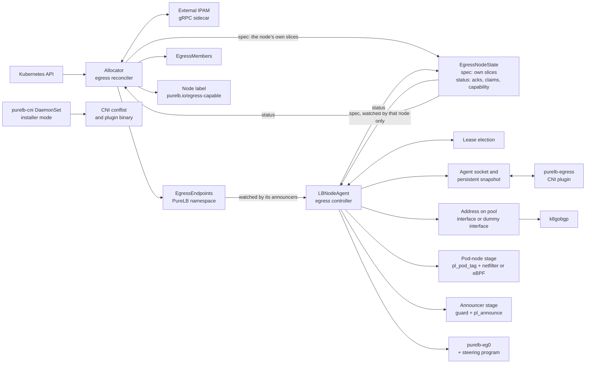
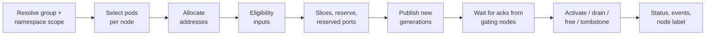
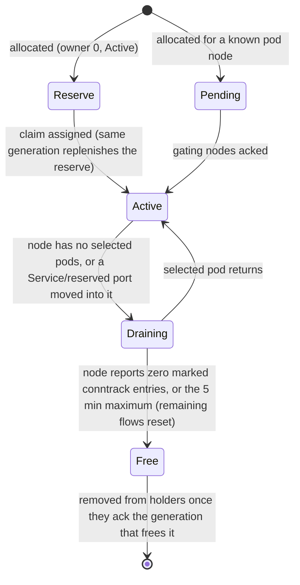
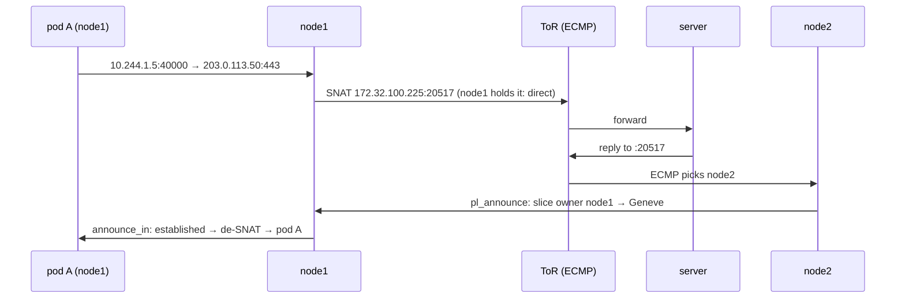

# PureLB Egress Design

This is the design specification for PureLB egress: what implementation Phases 1–9 build, and why it has this shape.
- A rule that comes from the decision register carries its number, for example (D7).
- Evidence is cited by section title in `hack/egress-spikes/RESULTS.md` ("RESULTS") and `hack/egress-spikes/kwok/RESULTS.md` ("kwok RESULTS"). The Appendix maps each decision to its evidence and lists what is not yet measured.
- `docs/egress-design-redline.md` keeps the provenance of every rule.

Egress gives Kubernetes pods stable source addresses from PureLB pools: on local, routed and external pools; with or without a LoadBalancer Service; without `externalTrafficPolicy: Local`; and without flow loss when an address moves between nodes.

## 1. Overview

Egress addresses are PureLB addresses, allocated from ServiceGroup pools and placed exactly like LoadBalancer addresses. A pod node translates selected pod traffic into its own port slice of the address. It sends the result straight out when it holds the address, and otherwise through a Geneve tunnel to a node that does. Holders return each reply to the pod node that owns its slice, with a stateless TC program. NAT state exists only on pod nodes, so a change of holder never breaks a flow.

### 1.1 Goals

1. Egress from any egress-capable node for any selected pod, wherever the address is announced.
2. Every usage mode on local, routed and external pools: LB only, egress only, LB and egress on separate addresses, and on a shared address.
3. Hitless handling of holder failure, affinity-driven address moves, pool NIC failure and scale-out.
4. Integration with node affinity, multipool, namespace-scoped ServiceGroups, external IPAM and the address guard.
5. Fixed source ports (D19). Stable per-replica addresses keyed by StatefulSet ordinal (D27). Conntrack helpers on PerPod addresses only (D23).
6. TCP, UDP, SCTP and ICMP/ICMPv6 echo on every egress address; every IP protocol on PerPod addresses (D4); correct fragments, ICMP errors, PMTU, dual-stack and IPv6 throughout.
7. Fail-closed from the first packet on every supported CNI, including eBPF host-routing CNIs, on egress-capable nodes (D29). Exceptions: Multus secondary interfaces (excluded); the plugin's age-bound pass-through (D35, §11.2); `kube-system` and the PureLB namespace (§8.1). Boot-window sandboxes are caught by the agent-start check (§8.1).
8. No datapath change for LB-only users while egress is not enabled (D-idle, D-iso). The only LB-visible changes are D7a's damped down-link handling (§6.9) and D-lease's election-traffic isolation (§3.3, §11.3), each with a release note.

### 1.2 Design principles

| Principle | Mechanism |
| --- | --- |
| Transparent to workloads | Nothing is placed in, and no sysctl changed in, a pod's network namespace. No CNI anti-spoofing exemption. |
| Announced like a LoadBalancer address | Same Lease election for local pools (routed dedicated addresses have none, D7); same placement (pool interface or `dummyInterface`, default `kube-lb0`), GARP / NA, k8gobgp netlink import and address guard. |
| One owner authority | The Lease election only (D1). The allocator never names an owner. Routed dedicated addresses have advertisers, not owners (D7). |
| One path through a holder | Traffic leaves and replies return through a holder, so upstream uRPF and source-MAC binding always see one, and pod nodes need no pool interfaces. |
| State only on the pod node | SNAT into a per-node slice on the pod's node; holders forward by slice with no per-flow state. |
| Kernel-native on the pod node | Netfilter conntrack NAT and policy routing where pod traffic reaches the host stack; PureLB-owned eBPF NAT where the CNI bypasses it (D32). |
| No kfuncs | Every program loads under NET_ADMIN, NET_RAW and BPF (D12, D32). |
| One announcer program | `pl_announce` returns replies by slice and forwards tunnel transit for every pool type. |
| Installed but idle | Egress does nothing until an LBNodeAgent enables it (D-idle). |
| Detect and report, never edit | Foreign firewalls, CNI egress features and missing encryption are reported, never edited (D25, D30). The only foreign file written is PureLB's own CNI chain entry (D34, §10.4). |
| Detect, don't name the CNI | Stage, classification, pod ranges and program positions come from probes and generic Kubernetes data. The CNI identity is a hint only. The CNI-specific pieces that remain: the Calico eBPF `natOutgoing` rule (§6.1); Cilium chaining through `cni.configMap`, a documented operator setup (§10.4); and named detections of CNI egress CRDs (`CNIEgressPolicy`, §10.1) and kube-router's IPVS proxy in `validate` (§10.3). |
| Configuration is intent only | Users choose addresses, pods, destinations and failure behaviour; datapath choices are detected. Exceptions: LBNodeAgent `tunnelEncapsulation`, `markField` and `tunnelPort` (D3, D18). |

### 1.3 Translation

All egress is source NAT on the pod's own node into that node's slice. The pod keeps its CNI address.

| Address kind | Translation |
| --- | --- |
| Slice address | Each pod node translates into its own slice. |
| PerPod address | One StatefulSet ordinal owns the whole address; its node uses the full port range, for any protocol (D4). |
| Reserved port | A pod that needs a fixed source port uses `ports.reserved` (D19). |
| Embedded addresses (SIP, FTP, H.323) | Conntrack helpers, on PerPod addresses only (D23). |

## 2. Terminology

| Term | Definition |
| --- | --- |
| Egress address | A PureLB-allocated address used as the source of selected pod traffic: dedicated, or shared with a LoadBalancer Service. |
| Local pool | A `local` pool, or an `external` group with `announce: local`. Addresses go on the holder's pool interface. |
| Routed pool | A `remote` pool, or an `external` group with `announce: remote`. Addresses go on the `dummyInterface`; k8gobgp advertises them. |
| Egress-capable node | A node whose agent reports egress capability, labelled `purelb.io/egress-capable=true` by the allocator (D29). |
| Selector node | A node matched by the ServiceGroup's `egress.announcerNodeSelector`. On routed pools: "the nodes that peer". |
| Selected pod | A pod matched by an `Egress` or `ClusterEgress` after scope, exclusions and opt-out. |
| Pod node | The node running a selected pod. It translates. |
| Owner | Local-pool address: the node the Lease election chooses (D1). `Inherit`: the Service's placement. |
| Advertiser | Routed dedicated address: a node advertising it from the dummy interface (D7). Only egress-capable selector nodes with egress enabled qualify. Host-route mode: every such node with a live Lease, as a /32 or /128. Aggregate mode: every such node, advertising the pool's aggregate. |
| Advertisement mode | Per routed pool and family, from the pool's `aggregation` as the LB path computes it (`announcedPrefix`): host-route for /32 or /128, aggregate otherwise (D7). |
| Holder | Any node holding the address (owner or advertiser); "announcer" means the same. The holder set is all holders of one address and family. |
| Placement | `SingleAnnouncer` (one holder) or `MultiAnnouncer` (several, with upstream ECMP). |
| Slice | A power-of-two sized, aligned source-port range of an address, assigned to one pod node. |
| Reserve slice | An Active, unassigned slice; owner 0, meaning drop, until a claim assigns it (D17). |
| Reserved port | A port assigned to one matched pod, keyed by its original source port (D19). |
| PerPod address | An address owned by one StatefulSet ordinal (D27). |
| Pod-node stage | Classification, translation and steering on the pod node: netfilter or eBPF, per node. |
| Announcer stage | `pl_announce` on uplinks and on the tunnel device. |
| Mark field | One 8-bit byte of `skb->mark` and the conntrack mark, chosen by `markField` (D18). |
| Pod-set id | A node-local value 1–127 that `pl_pod_tag` writes for a selected pod. It names the ordered list of policies that may apply to it (D2, D24). |
| Policy slot | A node-local value 1–127 for an (egress policy, address) pair with selected pods on the node. Shares the 127 budget with pod-set ids (D18). |
| Reply flag | The top bit of the mark field: a reply that arrived through the tunnel, or a direct-path reply marked by `pl_announce`. |
| Tunnel | The collect-metadata Geneve device `purelb-eg0`, L3 or L2 encapsulation (D3). |
| Steering program | The tcx egress program on `purelb-eg0` that turns a slot into a tunnel key for one holder (D3). |
| Ack | A node's report in its `EgressNodeState` status that it has fully installed a `metadata.generation` of an `EgressEndpoints` it announces, or of its own spec (D6). |
| Gating node | For one address: a node that reports announcing it, has a live Lease and is not in `excludedNodes`. |
| Takeover re-read | The full read (initial get or list) that starts a node's `EgressEndpoints` watch, so it never announces from a stale slice table (D6, §5.7). |
| Tombstone | An `EgressEndpoints` in state `Quarantined`, holding a released address out of every pool until `until` (D16). |

## 3. Architecture

- The allocator decides what exists (addresses, selected pods per node, slices) and publishes it.
- The Lease election alone decides which node holds each local-pool address (D1). Routed dedicated addresses follow a deterministic advertiser rule (D7).
- lbnodeagents place addresses and program the kernel.
- Scoped acks guarantee that every node announcing an address can return a slice's replies before any pod node sends from it (D6, §5.7).



### 3.1 Components

| Component | Runs as | Responsibilities |
| --- | --- | --- |
| Allocator egress reconciler | Allocator (`replicas: 1`, `Recreate`); new `queueItem` kinds on the union queue (D-conc) | Scope, selection, address allocation, slices and reserves, `EgressEndpoints` / `EgressMembers` / `EgressNodeState` spec, ack gating, finalizers and tombstones, status, events, the node label (§5) |
| CRD validation | CEL | Single-object rules (§4); cross-object rules run in the allocator |
| `internal/egresshook` | Interface package, no-op default | The only path from allocator, announcer, guard and `internal/k8s` into egress code; enforced by a CI import check (D-iso) |
| Egress control | lbnodeagent service-sync goroutine | Election snapshots via composed `OnMemberChange`; address add, withdraw, renew via the VIP path; GARP / NA |
| Egress datapath | lbnodeagent datapath goroutine, fed by a channel | nft, BPF programs and maps, `purelb-eg0`, rules and tables, drain counting, detection probes |
| `purelb-egress` CNI plugin | lbnodeagent binary in plugin mode, chained after the primary CNI | ADD / DEL / CHECK over the agent socket; snapshot fallback; no API credential (D35) |
| `purelb-cni` | Token-less DaemonSet, lbnodeagent image in installer mode (D34) | Owns the CNI bin and conf dirs; the chain entry (§10.4) |
| BPF programs | lbnodeagent | `pl_pod_tag`, steering and `pl_announce` on every egress-enabled node; `pl_pod_out`, `pl_pod_reply`, `pl_pod_flow` on eBPF-stage nodes |
| Address guard | lbnodeagent | First program on each uplink; egress adds entries (§6.10) |
| k8gobgp | Sidecar in the lbnodeagent pod | Advertises routed egress addresses or aggregates, imported from the dummy interface by netlink. No PureLB-to-gobgp integration (D7). |
| External IPAM sidecar | gRPC sidecar in the allocator pod | `external` groups, keyed per D15 |

### 3.2 Objects

| Object | Scope | Written by | Read by |
| --- | --- | --- | --- |
| `Egress` | Namespaced | Users | Allocator; agents (cache, for CNI ADD) |
| `ClusterEgress` | Cluster | Platform admins | Allocator; agents |
| ServiceGroup `spec.egress`, `spec.namespaces`, pool `name` | PureLB namespace | Cluster admins | Allocator; agents |
| LBNodeAgent `spec.egress` | PureLB namespace | Cluster admins | Agents |
| `EgressEndpoints` | PureLB namespace, one per (policy, address) (D5) | Allocator | Only the agents announcing its address: name watch (local), label-selector watch (routed) (D6) |
| `EgressMembers` | PureLB namespace, one or more per policy (D5) | Allocator | Allocator; static `egress trace` |
| `EgressNodeState` | Cluster, one per node, ownerRef to its Node | Allocator (`spec`); that node's agent (`status`) (D6, D21) | Allocator; that node's agent, by field-selector watch |
| Lease `purelb-node-<node>` | PureLB namespace | Agent, through the election's own clientset (D-lease) | Agents; allocator (watch) |
| FlowSchema for PureLB's Lease requests | Cluster | Core manifests of every install method (D-lease, §11.3) | API priority and fairness |
| Node label `purelb.io/egress-capable` | Node | Allocator, limited to this key by a ValidatingAdmissionPolicy (D29) | Users' scheduling; the plugin |

### 3.3 Concurrency

There are no locks (D-conc).

| Process | Rule |
| --- | --- |
| Allocator | Egress items are new `queueItem` kinds on the existing union queue; `ForceSync` enqueues them. One goroutine owns all allocator state and decides in queue order. A writer pool runs up to 4 API writes in flight, only performing the HTTP calls and returning results on a channel. One object never has two writes in flight; an object changed meanwhile is rewritten afterwards. A priority lane ahead of the queue carries the claim path (claims, activations, the claimant's spec). |
| Agent, control | Address add, withdraw and renew stay on the service-sync goroutine, which owns `quietWithdrawn`, `svcIngresses` and `announced`. Election snapshots arrive through a composed `OnMemberChange`; no second Lease watch. |
| Agent, datapath | Only the egress-private datapath has its own goroutine, receiving immutable desired-state snapshots over a channel. Shared state is read through `atomic.Pointer` snapshots. |
| API clients | QPS/Burst set explicitly: agents 50/100, allocator 200/400 (client-go's unset default is 5/10). The election's Lease calls and Lease informer use their own clientset, `rest.Config` and limiter (D-lease), because once QPS is set client-go shares one token bucket across a clientset's API groups. |

### 3.4 Packaging and isolation

Egress ships like k8gobgp: a kustomize component, `deployments/components/egress`, and a Helm value `egress.enabled`, default true (D-pack). It is idle until an LBNodeAgent sets `spec.egress.enabled: true` (D-idle). Core packages reach egress only through `internal/egresshook` (D-iso). The D-lease FlowSchema is in the core manifests. §9.2 lists the install variants.

## 4. API

Users express intent with `Egress` or `ClusterEgress`. Cluster admins bound it with the ServiceGroup's `spec.egress` and namespace fields, and enable egress per node set with LBNodeAgent `spec.egress`. `EgressEndpoints`, `EgressMembers` and `EgressNodeState` are machine-owned.

Conventions:
- Enum values are PascalCase. Every list has `MaxItems` and every string `MaxLength`.
- "CEL" is enforced at admission; "Runtime" is a cross-object rule enforced by the allocator and reported in status.
- The CRDs need the CEL IP and CIDR library (`isIP`, `isCIDR`, `ip()`, `cidr()`); the FlowSchema needs `flowcontrol.apiserver.k8s.io/v1` (Kubernetes ≥ 1.29). Phase 2 fixes the minimum Kubernetes version from both.
- The existing `addressGuard` enums (`enforce|monitor`, `tcx|xdp`, `closed|open`) are unchanged.

### 4.1 Egress

```yaml
apiVersion: purelb.io/v2
kind: Egress
metadata:
  name: partner-sync
  namespace: tenant-a
spec:
  serviceGroup: partner                  # or serviceRef: {name: sip-gw}; neither = the namespace's default group
  pool: public
  addresses: []                          # optional pins
  ipFamilyPolicy: PreferDualStack
  skipIPv6DAD: false
  podSelector: {matchLabels: {app: partner-sync}}
  destinations:
    include:
    - cidrs: [0.0.0.0/0, "::/0"]
      ports:
      - {protocol: TCP, port: 443}
      - {protocol: UDP, port: 5060, endPort: 5070}
    exclude:
    - cidrs: [203.0.113.99/32]
  affinity: {mode: Hash, identity: StatefulSetOrdinal}
  ports:
    sliceSize: 4096
    reserved:
    - {protocol: UDP, port: 5060, podSelector: {matchLabels: {role: registrar}}}
  helpers: []
  priority: 100
  failurePolicy: FailClosed
  optOut: Allowed
```

| Field | Type | Default | Validation | Semantics |
| --- | --- | --- | --- | --- |
| `metadata.name` | string | — | CEL: length ≤ 63 | Used in labels and the sidecar key (D15). |
| `serviceGroup` | string | The namespace's default group (§5.2) | MaxLength 63, DNS label. CEL: not with `serviceRef`. | A ServiceGroup in the PureLB namespace. Runtime: must serve the namespace (`Contained`). |
| `serviceRef.name` | string | — | MaxLength 63, DNS-1035 label. CEL: excludes `serviceGroup`, `pool`, `addresses`, `podSelector`, `skipIPv6DAD`; requires `affinity.mode: Inherit`. | A LoadBalancer Service in the same namespace. Pods come from its selector, never from EndpointSlices (D20). Lifecycle: §5.8. |
| `pool` | string | The group's pool selection (first fit or `balancePools`) | MaxLength 64 | A pool entry `name` (§4.3). Runtime: `Allocated=False PoolNotFound`; omitted on a `multiPool` group → `PoolRequired`. |
| `addresses` | []string | [] | MaxItems 2; each `isIP`. CEL: entries differ in family; empty for `PerPod`. | Pins. Runtime: inside `pool` and not quarantined, else `Allocated=False PinUnavailable` (D16). |
| `ipFamilyPolicy` | enum `SingleStack` \| `PreferDualStack` \| `RequireDualStack` | `PreferDualStack` | Enum | `SingleStack` takes the cluster's primary family. `RequireDualStack` on a group missing a family → `Allocated=False FamilyUnavailable`. |
| `skipIPv6DAD` | *bool | The pool's `skipIPv6DAD` | CEL: not with `serviceRef` | Dedicated local-pool addresses only; for shared addresses the pool always wins (D31). |
| `podSelector` | LabelSelector | — | CEL: required exactly when `serviceRef` is absent | `{}` selects every pod in the namespace. |
| `destinations.include` | list | — | Required; MinItems 1, MaxItems 32 | Egress when a destination matches an include entry and no exclude entry. |
| `…include[].cidrs` | []string | — | MinItems 1, MaxItems 64; each `isCIDR` | Cluster networks are always excluded (runtime, since they are detected: §6.3). |
| `…include[].ports` | list | All protocols and ports | MaxItems 32 | Port filter. Port-less protocols: D4, §6.3. |
| `…ports[].protocol` | enum `TCP` \| `UDP` \| `SCTP` | `TCP` | Enum | |
| `…ports[].port` | int32 | — | 1–65535 | |
| `…ports[].endPort` | int32 | `port` | CEL: `port ≤ endPort ≤ 65535` | Inclusive. |
| `destinations.exclude[].cidrs` | []string | [] | Exclude MaxItems 32; cidrs MinItems 1, MaxItems 64; each `isCIDR` | |
| `affinity.mode` | enum `Hash` \| `PerPod` \| `Inherit` | `Hash`; `Inherit` with `serviceRef` | Enum. CEL: `Inherit` ⇔ `serviceRef`. | §5.5 |
| `affinity.identity` | enum `StatefulSetOrdinal` | `StatefulSetOrdinal` | CEL: only with `PerPod` | Pods not owned by a StatefulSet are excluded (`NotStatefulSet`) (D27). |
| `ports.sliceSize` | int32 enum 64 … 16384 (powers of two) | The group's `egress.sliceSize` | Enum | Ignored for `PerPod`. Runtime: allowed by the group (§4.3). |
| `ports.reserved` | list | [] | MaxItems 16. CEL: (protocol, port) unique; empty for `PerPod`. | §5.6 |
| `ports.reserved[].protocol` / `.port` | enum `TCP` \| `UDP` \| `SCTP` / int32 1–65535 | — | Enum / range | Keyed by the pod's original source port (D19). Runtime: not a Service port of a shared address (`PortCapacity=False ReservedPortConflict`). |
| `ports.reserved[].podSelector` | LabelSelector | — | Required | Runtime: exactly one selected pod, else `PortCapacity=False ReservedPortAmbiguous`. |
| `helpers` | []enum `SIP` \| `FTP` \| `H323` | [] | MaxItems 3, listType set | Runtime: allowed by the group (`Contained=False FeatureNotAllowed`) and PerPod only (`Contained=False HelpersRequirePerPod`, D23). |
| `priority` | int32 | 0 | CEL: 0–999 | Clamped to `tenancy.priorityCeiling` (`Contained=False PriorityClamped`). Overlap: §5.3. |
| `failurePolicy` | enum `FailClosed` \| `FailOpen` | `FailClosed` | Enum | §11.2 |
| `optOut` | enum `Allowed` \| `Denied` | `Allowed` | Enum | `Allowed`: pods annotated `purelb.io/egress: "false"` are excluded. `Denied`: the annotation is ignored (D20). |

### 4.2 ClusterEgress

Cluster-scoped; identical to `Egress` except:

```yaml
apiVersion: purelb.io/v2
kind: ClusterEgress
metadata:
  name: pci-zone
spec:
  serviceGroup: pci
  namespaceSelector:
    matchExpressions:
    - {key: kubernetes.io/metadata.name, operator: In, values: [payments, ledger]}
  podSelector: {}
  namespaceScope: Respect
  destinations:
    include: [{cidrs: [198.51.100.0/24]}]
  priority: 1000
  failurePolicy: FailClosed
  optOut: Denied
```

| Field | Type | Default | Validation | Semantics |
| --- | --- | --- | --- | --- |
| `serviceGroup` | string | — | Required | No `serviceRef`, so no `Inherit`. |
| `namespaceSelector` | LabelSelector | — | Required | Scope must be bounded (D20): the selector constrains `kubernetes.io/metadata.name`, or the group's `spec.namespaces` is non-empty (runtime: `Contained=False ScopeUnbounded`). |
| `namespaceScope` | enum `Respect` \| `AdmittedOnly` | `Respect` | Enum | `Respect`: namespaces the group serves, on a group with `tenancy.allowClusterEgress`. `AdmittedOnly`: also requires the namespace label `purelb.io/cluster-egress-admitted: "true"`, which can only narrow a bounded scope. |
| `priority` | int32 | 1000 | CEL: ≥ 1000 | Always above namespaced policies. |
| `affinity.mode` | enum `Hash` \| `PerPod` | `Hash` | Enum | |
| `optOut` | enum `Allowed` \| `Denied` | `Denied` | Enum | As on `Egress`. |

### 4.3 ServiceGroup egress

```yaml
apiVersion: purelb.io/v2
kind: ServiceGroup
metadata:
  name: partner
  namespace: purelb-system
spec:
  namespaces: [tenant-a, tenant-b]       # existing
  enforceNamespaces: true                # existing
  namespaceDefault: true                 # existing
  local:
    v4pools:
    - {name: public, subnet: 172.30.10.0/24, pool: 172.30.10.100-172.30.10.150}
    v6pools:
    - {name: public, subnet: "fc00:30:10::/64", pool: "fc00:30:10::100-fc00:30:10::1ff"}
  egress:
    allowed: true
    allowSharedServiceAddress: true
    affinityModes: [Hash, PerPod, Inherit]
    helpers: [SIP, FTP]
    announcerNodeSelector: {matchLabels: {purelb.io/egress-gateway: "true"}}
    preferPodNodes: true
    sliceSize: 4096
    releaseQuarantine: 1h
    tenancy:
      allowClusterEgress: true
      priorityCeiling: 999
      statusDetail: Redacted
      onRevocation: Withdraw
      maxEgressesPerNamespace: 20
```

Existing fields (`namespaces`, `enforceNamespaces`, `namespaceDefault`, `local`, `remote`, `external`, `multiPool`, `balancePools`, `skipIPv6DAD`, `aggregation`) are unchanged. New fields:

| Field | Type | Default | Validation | Semantics |
| --- | --- | --- | --- | --- |
| `<pools>[].name` | string | The entry's `subnet` | MaxLength 64. CEL: unique per family; pool lists get `MaxItems`. | Named by `Egress.pool`. In an `external` group, the `pool` value the sidecar receives. |
| `egress` | object | Absent: egress refused | — | |
| `egress.allowed` | bool | false | — | `false` refuses new Egresses and withdraws existing ones (D20). |
| `egress.allowSharedServiceAddress` | bool | false | — | Permits `serviceRef`, else `Contained=False FeatureNotAllowed`. |
| `egress.affinityModes` | []enum `Hash` \| `PerPod` \| `Inherit` | all three | MaxItems 3, listType set | Intersected with the policy. `Inherit` also needs `allowSharedServiceAddress`. |
| `egress.helpers` | []enum `SIP` \| `FTP` \| `H323` | [] | MaxItems 3, listType set | Helpers a policy may request (D23). |
| `egress.announcerNodeSelector` | LabelSelector | Every egress-capable node | — | From a Node informer. Local pools: restricts election eligibility (D7a). Routed pools: the nodes that peer; those that are egress-capable with egress enabled are the advertisers (D7). |
| `egress.preferPodNodes` | bool | false | — | Local pools prefer nodes holding an Active slice (D-pref, §5.5). |
| `egress.sliceSize` | int32 enum 64 … 16384 | 4096 | Enum | Default slice size. |
| Reserve count (name fixed in Phase 2) | int32 | 4 | — | Reserve slices kept per address (D17, §5.6). |
| `egress.releaseQuarantine` | duration | `1h` | CEL: `duration(self) >= duration('0s') && duration(self) <= duration('720h')` | Tombstone hold (D16). |
| `egress.tenancy.allowClusterEgress` | bool | true | — | Refused → `Contained=False ClusterEgressNotAllowed`. |
| `egress.tenancy.priorityCeiling` | int32 | 999 | CEL: 0–999 | Clamp for namespaced priority. |
| `egress.tenancy.statusDetail` | enum `Full` \| `Redacted` | `Full` | Enum | `Redacted` hides nodes, slices and holders in status, routes node-bearing events to the PureLB namespace, and suppresses per-address metric series (D20, D21). |
| `egress.tenancy.onRevocation` | enum `Withdraw` \| `RetainUntilDelete` | `Withdraw` | Enum | Every `Contained=False` cause (§5.2). |
| `egress.tenancy.maxEgressesPerNamespace` | int32 | Unlimited | Minimum 0 | Excess → `Contained=False QuotaExceeded`. |

Runtime rules: the group must be in the PureLB namespace (`Contained=False NotInPureLBNamespace`); the pool type decides the placement model and a routed pool's `aggregation` its advertisement mode per family (D7); shared addresses on aggregated pools are accepted (D9 lifted).

### 4.4 LBNodeAgent egress

```yaml
spec:
  local:
    garpConfig: {enabled: true}          # existing; also times egress GARP / NA
    addressGuard: {mode: enforce}        # existing
  egress:
    enabled: true
    excludedNetworks: [10.50.0.0/16]
    podNetworks: []
    tunnelEncapsulation: Auto
    tunnelPort: 6082
    markField: "0x000000ff"
    reservedClusterSlots: 0
    flowLog: false
```

| Field | Type | Default | Validation | Semantics |
| --- | --- | --- | --- | --- |
| `egress.enabled` | bool | false | — | `false` (D-idle): no conflist change, tunnel, `pl_announce`, nft table, RPDB rule, pin or egress informer. True → false triggers teardown (D26, §8.10). |
| `egress.excludedNetworks` | []string | [] | MaxItems 64; each `isCIDR` | Added to the detected cluster networks (§6.3). |
| `egress.podNetworks` | []string | [] | MaxItems 64; each `isCIDR` | Pod ranges that discovery cannot see, added to the cluster networks (§6.3). |
| `egress.tunnelEncapsulation` | enum `Auto` \| `L3` \| `L2` | `Auto` | Enum | `Auto` picks L3 (`innerprotoinherit`) where supported, else L2 (§6.8). Nodes resolving different modes → `DatapathCompatible=False TunnelModeMismatch`. |
| `egress.tunnelPort` | int32 | 6082 | 1024–65535 | Geneve UDP port. Must differ from the CNI's Geneve port (6081 on Cilium and Antrea), else `TunnelPortConflict`. |
| `egress.markField` | enum `"0x000000ff"` \| `"0x0000ff00"` \| `"0x00ff0000"` \| `"0xff000000"` | `0x000000ff` on every CNI | Enum | Which byte of `skb->mark` and the conntrack mark egress uses; always 8 bits (D18). The default is the only byte free on every CNI that keeps the tag and reserved by none (RESULTS, "Mark bytes per CNI"). Calico eBPF and Cilium use all four bytes but classify by source IP, so the byte is not moved there. Collision handling: §6.2. |
| `egress.reservedClusterSlots` | int32 | 0 | 0–127 | Per-node slots reserved for priority ≥ 1000 (§5.10). |
| `egress.flowLog` | bool | false | — | Flow log from conntrack events, netfilter-stage nodes only (§12.2). |

Everything else is detected: the stage and classification (§6.1), cluster networks (§6.3), the underlay (both InternalIPs), and per-peer MTU (`ip route get <peer>`, D30). Holder changes send GARP / NA with `garpConfig` timing, or count 3, initial delay 100 ms and interval 500 ms when it is absent. CNI paths are `purelb-cni` Helm and kustomize values (D34).

### 4.5 EgressEndpoints

One per (policy, address), in the PureLB namespace, holding the address and its slices (D5). No ownerRef from the policy, because the tombstone outlives it (§5.9). Watched only by the nodes announcing the address: by name on local pools, by a per-node label-selector watch on routed pools (D6, §5.7).

```yaml
apiVersion: purelb.io/v2
kind: EgressEndpoints
metadata:
  name: e-voice.sip-gw-5f0c2a91          # kind prefix, namespace.name, hash of the address
  namespace: purelb-system
  generation: 17
  labels: {purelb.io/egress-kind: Egress, purelb.io/egress-namespace: voice, purelb.io/egress-name: sip-gw, purelb.io/egress-uid: 7d1e9c52-...,
           purelb.io/egress-servicegroup: voice-routed, purelb.io/egress-pool: public}   # routed selector-node watch (§5.7)
spec:
  state: Active                          # Active | Quarantined
  until: null
  policy: {priority: 100, failurePolicy: FailClosed, affinityMode: Inherit, helpers: [], destinations: {include: [...], exclude: [...]}}
  address: 172.32.100.225
  family: IPv4
  serviceGroup: voice-routed
  pool: public
  poolType: Routed                       # Local | Routed
  sharedWith: {service: sip-gw}
  identity: ""                           # PerPod: <statefulset>-<ordinal>
  placement: MultiAnnouncer
  sliceSize: 4096
  servicePorts: [{protocol: UDP, port: 5060}]
  slices:
  - {index: 5, node: node1, state: Active}
  - {index: 7, node: "", state: Active}  # reserve: owner 0 = drop
  - {index: 8, node: node4, state: Draining}
  reserved:
  - {protocol: UDP, port: 5060, node: node1, pod: registrar-0}
  excludedNodes: [node5]
status:
  observedAnnouncers: [node1, node2]
```

| Field | Type | Semantics |
| --- | --- | --- |
| `metadata.generation` | int64 | Increments on every spec change; acked by the address's announcing nodes (§5.7). No cluster-wide epoch. |
| `spec.state` | enum `Active` \| `Quarantined` | `Quarantined` = tombstone, replayed on every pool rebuild (D16). |
| `spec.until` | time | End of quarantine. |
| `spec.policy` | object | The policy fields an agent needs for the pod-node stage. |
| `spec.address`, `family` | string, enum `IPv4` \| `IPv6` | |
| `spec.serviceGroup`, `pool`, `poolType` | string, string, enum `Local` \| `Routed` | `Routed` covers `remote` and `external` with `announce: remote`. |
| `spec.sharedWith.service` | string | Set for `serviceRef`; egress never places, renews or releases the address (D31, D15). |
| `spec.identity` | string | PerPod ordinal (D27). |
| `spec.placement` | enum `SingleAnnouncer` \| `MultiAnnouncer` | §5.5 |
| `spec.sliceSize` | int32 | Copied from the policy or group. |
| `spec.servicePorts` | list (MaxItems 1024) | Service ports of a shared address; excluded from slices, passed to kube-proxy. |
| `spec.slices` | list (MaxItems 1008, the most 64-port slices in 1024–65535) | `index` → ports `[index × sliceSize, (index+1) × sliceSize − 1]`. Empty `node` = owner 0 = drop. `state`: `Pending` \| `Active` \| `Draining`. Free slices are absent. |
| `spec.reserved` | list (MaxItems 16) | Reserved port → node and pod (D19). |
| `spec.excludedNodes` | []string (MaxItems 1000) | Evicted from gating for ack lag (§5.7). Eviction affects gating only, never eligibility or advertising (D1). An evicted node may serve a stale table; replies for slices it has not seen drop as owner 0. It rejoins when it again reports announcing the address. |
| `status.observedAnnouncers` | []string | From the Lease view and `EgressNodeState.status.announcing`; never consumed by agents (D1). |

### 4.6 EgressNodeState

One per node, cluster-scoped, ownerRef to its Node (D6), small (D21). The allocator writes `spec`; the node's agent writes `status`. Live detail comes from `egress dump --live` (§12.3).

```yaml
apiVersion: purelb.io/v2
kind: EgressNodeState
metadata: {name: node1, generation: 42, ownerReferences: [{apiVersion: v1, kind: Node, name: node1, uid: ...}]}
spec:
  slices:
  - {endpoints: e-voice.sip-gw-5f0c2a91, address: 172.32.100.225, index: 5, state: Active}
status:
  observedGeneration: 42
  announcing:
  - {endpoints: e-voice.sip-gw-5f0c2a91, address: 172.32.100.225, generation: 17}
  claims:
  - {endpoints: e-voice.sip-gw-5f0c2a91}
  drained:
  - {endpoints: e-voice.sip-gw-5f0c2a91, index: 8}
  capability:
    egressCapable: true
    kernel: 6.12.111
    podNodeStage: Netfilter              # Netfilter | EBPF
    tunnelEncapsulation: L3
    markField: "0x000000ff"
    slots: {used: 14, capacity: 127}
    underlay: {ipv4: 10.0.0.11, ipv6: "fd00::11"}
  conditions:
  - {type: DatapathReady, status: "True"}
```

| Field | Semantics |
| --- | --- |
| `spec.slices` (MaxItems 4096) | The node's own slices; watched only by that node (field selector). |
| `status.observedGeneration` | The spec generation fully installed: the ack of its own slices. |
| `status.announcing` (MaxItems 4096) | Addresses announced or advertised now, each with the `EgressEndpoints` generation fully installed (demux and guard entries). Input to gating (§5.7), `observedAnnouncers` and SplitBrain (§5.5). |
| `status.claims` (MaxItems 1000) | One per address needing a slice (D17). Written at once. |
| `status.drained` (MaxItems 1008) | Draining slices with zero marked conntrack entries (§5.6). |
| `status.capability` | Input to the D29 label and `DatapathCompatible`. |
| `status.conditions` | `DatapathReady`, `DatapathCompatible`, `TunnelPeersReachable`, `UnderlayEncrypted`, `ForwardPath`; True when healthy. `ForwardPath` is the active probe's forward-path result: False with reason `ForwardBlocked` or `TunnelPortBlocked` (§10.5). |

Acks are debounced to at most one status write per second per node; claims are written at once (D6).

### 4.7 EgressMembers

Selected pods per node for one policy, split at 500 pods per object, like EndpointSlice. Read only by the allocator and static `trace`; agents select locally at CNI ADD (§5.3).

```yaml
apiVersion: purelb.io/v2
kind: EgressMembers
metadata: {name: e-voice.sip-gw-0, namespace: purelb-system, labels: {purelb.io/egress-name: sip-gw, ...}}
spec:
  nodes:
  - node: node1
    pods: [{name: sip-gw-0, uid: 1f..., identity: sip-gw-0}]
```

| Field | Type | Semantics |
| --- | --- | --- |
| `spec.nodes[].node` | string | A node with at least one selected pod. |
| `spec.nodes[].pods` | list | Pod name, UID and PerPod identity. MaxItems 500 per object across all nodes. |

### 4.8 Status and conditions

```yaml
status:
  observedGeneration: 7
  selectedPods: 6
  excludedPods: [{pod: batch-1, reason: OptedOut}]
  addresses:
  - {address: 172.30.10.110, family: IPv4, pool: public, placement: SingleAnnouncer,
     announcers: [node3], slices: [{node: node1, ports: 20480-24575, state: Active}],   # hidden under Redacted
     capacity: {slicesTotal: 15, active: 3, draining: 1, free: 11}}
  conditions: [...]
```

`excludedPods[].reason`: `HostNetwork`, `OptedOut`, `NotStatefulSet`, `NodeUnsupported`, `NamespaceNotInScope`, `Outranked`; MaxItems 100, truncated with a count.

Every condition is True when healthy. `Ready` is True when all others are, except `UnderlayEncrypted`, a warning only (D30).

| Condition | True when | False reasons |
| --- | --- | --- |
| `Allocated` | Every requested address is allocated | `PoolExhausted`, `PoolNotFound`, `PoolRequired`, `PinUnavailable`, `FamilyUnavailable`, `IPAMUnavailable` |
| `Contained` | The group serves the namespace and allows every requested feature | `NamespaceNotServed`, `NotInPureLBNamespace`, `EgressNotAllowed`, `FeatureNotAllowed`, `HelpersRequirePerPod`, `ClusterEgressNotAllowed`, `ScopeUnbounded`, `QuotaExceeded`, `Revoked`, `PriorityClamped`, `ServiceNotFound`, `ServiceNotLoadBalancer`, `ServiceHasNoSelector` |
| `Announced` | Every required holder holds the address; for routed pools the address or aggregate is on the dummy interface and that interface is in k8gobgp's `netlinkImport` | `AddressAddFailed`, `ImportMissing`, `SplitBrain`, `NoEligibleNode`, `DADFailed` |
| `DatapathReady` | Every announcing node acked the current `EgressEndpoints` generation, and every pod node a spec showing its slices (D6) | `NodesLagging`, `SlotsExhausted`, `NoGateway`, `PathMTUTooSmall` |
| `DatapathCompatible` | Every pod node supports the policy | `HelpersUnsupported`, `ProtocolUnsupported`, `KernelTooOld`, `ChainMissing`, `CNIChainMissing`, `NodeUnsupported`, `TunnelModeMismatch`, `TunnelPortConflict`, `MarkConflict`, `CNIEgressPolicy`, `ForwardBlocked`, `TunnelPortBlocked`, `NATOutgoingRequired` |
| `Guarded` | Every guarded holder holds the egress entries, or no guard | `GuardStandingDown`, `GuardMapFull` |
| `PortCapacity` | Every pod node with selected pods has a slice; every reserved port resolves to one pod | `SliceExhausted`, `ReservedPortAmbiguous`, `ReservedPortConflict` |
| `PolicyEffective` | The policy wins every (pod, destination) it selects | `OutrankedBy`, `PartiallyOutranked` |
| `AddressUnique` | The ARP probe / ND DAD was clean and no DADFAILED followed | `DuplicateAddress`, `DADFailed` |
| `UnderlayEncrypted` | No node-to-node encryption is bypassed by the tunnel | `UnderlayUnencrypted` (warning) |

## 5. Control plane

The allocator runs one level-triggered reconcile per `Egress` or `ClusterEgress` on its union work queue (D-conc). Each change that affects forwarding is published as a new `metadata.generation` of the address's `EgressEndpoints`, a node's `EgressNodeState` spec, or both, and takes effect only after the nodes that must forward it have acked it (§5.7). Ownership is never published: each agent computes local-pool owners from the Lease election (D1) and routed advertisers from the D7 rule.

### 5.1 Reconcile pipeline



Inputs: `Egress`, `ClusterEgress`, ServiceGroups, Namespaces; Pods by list/watch with transforms keeping only labels, owner references, `spec.nodeName`, `hostNetwork` and `status.podIPs`; Services; Nodes; Leases (watch); `EgressNodeState` status; and EndpointSlices, only for the observational holder list of shared ETP Local addresses (never for selection, D20).

Each stage is idempotent and writes only when its output changes. The populate gate replays egress records, tombstones included, on every `SetPools` when the egress CRDs exist (D16); today `SetPools` resets `populated` on every ServiceGroup change and `populateFromExisting` replays Services only.

### 5.2 Group and namespace scope

1. `serviceRef`: the Service's ServiceGroup; the Service must be in the same namespace.
2. `serviceGroup`: a ServiceGroup in the PureLB namespace; when omitted, the `namespaceDefault: true` group among those serving the namespace (the existing Service rules).
3. A namespace may use a group when the group's `spec.namespaces` lists it, or the list is empty and no group with `enforceNamespaces: true` lists the namespace.
4. A `ClusterEgress` scope must be bounded (§4.2); `AdmittedOnly` also requires the admission label.
5. The group's `spec.egress` bounds the policy. Any violation sets `Contained=False`, and `tenancy.onRevocation` applies to every such cause (D20): `Withdraw` drains and releases; `RetainUntilDelete` keeps programmed state until the policy is deleted.
6. `egress.allowed: false` always withdraws, then clears finalizers (§5.9).
7. CEL enforces single-object rules at admission. Cross-object checks run in the allocator on every reconcile, so `Egress` writes never depend on allocator availability.

### 5.3 Pod selection

| Step | Rule |
| --- | --- |
| Candidates | `Egress`: `podSelector` in the namespace. `ClusterEgress`: `namespaceSelector` × `podSelector` within the bounded scope. `serviceRef`: the Service's selector in its namespace. Never EndpointSlices, which closes the CVE-2021-25740 class (D20). |
| Exclusions | `hostNetwork` pods; pods annotated `purelb.io/egress: "false"` under `optOut: Allowed`; for `PerPod`, pods not owned by a StatefulSet; pods on nodes without `purelb.io/egress-capable=true` (`NodeUnsupported`, D29). Static pods are selected by their mirror pod's labels. A namespace label change is re-evaluated as a selector change, within the bounded scope. |
| Overlap (D24) | Every policy selecting a pod contributes, in one total order shared by allocator and agents: priority descending, `creationTimestamp` ascending, UID ascending. For each new flow, the first policy whose destinations match supplies the slot (§6.3). Losers report `PolicyEffective=False PartiallyOutranked` or `OutrankedBy`. |
| Timing | The agent resolves selection by labels at CNI ADD, before the pod has an IP, from its node-local pod watch (`spec.nodeName` field selector) and its policy cache. The allocator records the pod in `EgressMembers` once `spec.nodeName` is set and allocates that node a slice. |

### 5.4 Address allocation

Addresses come from the group's pool through the request-based pool core (Phase 1): in-tree for `local` and `remote` groups, the gRPC sidecar for `external` groups. Egress allocations carry an empty sharing key, so a Service's sharing key never captures an egress address (D20).

| Case | In-tree pool | External sidecar (D15) |
| --- | --- | --- |
| Allocate | Next free address, or the pin | One `Allocate` per owner with `FamilyRequest`; `service` = `egress:<Egress\|ClusterEgress>:<namespace or empty>:<name>` |
| PerPod | One address per ordinal, recorded in `EgressEndpoints.identity`, so the ordinal gets it back | `service` = `egress:<kind>:<ns>:<name>:<statefulset>-<ordinal>`; the sidecar's idempotency returns the same address |
| Shared with a Service | The Service's address; a reference hold only | The same; `Release` is never called for `serviceRef` |
| Release | Removed from every holder, all slices freed, then a tombstone (`until` = now + `releaseQuarantine`) so no new owner inherits allowlist entries; freed when the tombstone expires | The same hold, then `Release` |

- Tombstones are replayed on every pool rebuild (D16). A Service release of an address with an egress record is held until the tombstone expires. Pins to a quarantined address fail (`PinUnavailable`).
- PerPod ordinals are exempt from quarantine: the same identity gets its address back. On scale-down, higher ordinals drain, then enter quarantine (D27).
- `ipam.proto` (today documenting `service` as `namespace/name`), `test/e2e/py/EXTERNAL-IPAM.md` and the website document the D15 key; `cmd/test-sidecar` implements it.
- Sidecar responses outside the group's pools are rejected (`Allocated=False`). Allocation errors never remove existing addresses.
- Before placing a new local-pool address the holder runs an ARP probe or ND DAD and reports `AddressUnique` (D31).

### 5.5 Holders

| Pool | Address use | Holders | Authority | Placement |
| --- | --- | --- | --- | --- |
| Local | Dedicated, `Hash` | `Election.WinnerAmong(address, eligible)`, no fallback outside `eligible` (D7a) | Lease election (D1) | SingleAnnouncer |
| Local | Dedicated, `PerPod` | `WinnerAmong` preferring the pod's node when eligible; otherwise another eligible node, and the pod node tunnels to it | Lease election | SingleAnnouncer |
| Local | Shared (`Inherit`) | The Service's elected node, including `purelb.io/node-affinity` | The Service's election | SingleAnnouncer |
| Routed | Dedicated, `Hash` or `PerPod` | Advertisers (D7) | Deterministic rule | MultiAnnouncer |
| Routed | Shared, ETP Cluster | Every node announcing the Service | Service path | MultiAnnouncer |
| Routed | Shared, ETP Local | Nodes with ready endpoints | Service path | MultiAnnouncer |

**Local-pool eligibility** is the intersection of: a live Lease whose `purelb.io/subnets` lists the pool subnet (down links leave it with damping, §6.9); `announcerNodeSelector` from the Node informer; an address guard not standing down (§6.10); egress capability. `excludedNodes` affects gating only (§5.7). With `preferPodNodes`, the election runs among `eligible` ∩ Active-slice holders when non-empty, else among `eligible` (D-pref); a Draining slice counts for at most 5 minutes (§5.6), which damps churn, and there is no other stickiness.

**Routed dedicated addresses (D7).** No election. Every node derives the advertisement mode from the pool's `aggregation` and its own role from its labels, capability and LBNodeAgent, so the allocator holds no advertiser state. As for local eligibility, only selector nodes that are egress-capable and have egress enabled are advertisers ("selector nodes" below).
- *Host-route mode* (/32 or /128): every such selector node with a live Lease places the address on the dummy interface as a host route and watches and serves its slice table. Pod nodes take the set from the selector, the capability label and the Leases they already watch.
- *Aggregate mode* (shorter prefix): every such selector node advertises the pool's aggregate, as the LB path does, and watches and serves every slice table of the pool, so whichever gateway the router picks can return any reply. No relay, no guard exception; failover stays with BGP/BFD.
- k8gobgp learns routes from netlink in both modes. Pod nodes steer only to advertisers whose Lease is live.
- Graceful shutdown: repoint the node's own slots to the tunnel through another advertiser, withdraw, then delete the Lease.
- A partitioned advertiser withdraws (§8.8). No gobgp integration and no BGP-session signal (D8 removed).
- Documentation calls `announcerNodeSelector` "the nodes that peer" and documents BFD for routed SLOs, but BFD is not recommended until purelb/gobgp-netlink#65 is fixed, because k8gobgp's BFD does not recover after a session drop and then flaps BGP (RESULTS, "Spike 11: D7 aggregate mode, through the LB remote path").
- Shared addresses on aggregated pools are accepted (D9 lifted).

**Other rules.**
- **D1.** The allocator never names an owner; `observedAnnouncers` is observational. Pod nodes compute steering locally: local pools, the winner in their own Lease view; routed pools, advertisers with a live Lease.
- **Last known good (D1).** While a pod node's own Lease is unhealthy it keeps its last good steering set instead of treating `""` as "no owner". For owning addresses, `WinnerWithPreference` keeps returning `""` in that state.
- **SplitBrain (D1).** Two nodes reporting a SingleAnnouncer address in `status.announcing` for more than two lease durations → `Announced=False SplitBrain` and an event; no arbitration.
- **Inherit** follows the Service's actual placement, so ingress and egress owners never differ. For an IP-sharing Service, node affinity does not apply and both use the plain hash.
- **Election key** is the address string, the VIP key space; handovers count in `purelb_election_winner_changes_total{key}`.

### 5.6 Slices, reserve and reserved ports

Each pod node with selected pods for an address gets one slice; a PerPod address gives its node the whole range.

**Slices.** From ports 1024–65535. Aligned blocks containing a shared address's Service port or a reserved port are excluded; nothing else needs excluding, since the host never sources the egress address and the D32 chain (`announce_in`) drops new inbound connections (§6.12). Power-of-two sized and aligned, first-fit, never split while in use. A Service or reserved port added inside an Active slice drains it and allocates a replacement.

**Reserve (D17).** Each address keeps a number of Active, unassigned (owner 0) slices, default 4 (§4.3). A pod node needing a slice writes a claim in its status, at once. The allocator arbitrates claims in queue order on the priority lane, assigns a reserve slice, writes the claimant's spec and replenishes the reserve in the same generation. The claim completes after the gating nodes ack the table naming the claimant (until then replies drop as owner 0), then the claimant acks a spec showing the slice Active. Claims need the allocator (§8.8).

**Capacity (D28).**

> usable slices = floor((65536 − 1024) / sliceSize) − (blocks holding reserved or Service ports) − (slices still Draining)

- Reserves cost nothing: claims take them first, the reserve is topped up only from free slices, and near capacity it shrinks to zero. At 4096 an address serves 15 pod nodes.
- New-flow rate from one pod node to one destination (address, port, protocol) ≤ sliceSize / T, T being the closed-state conntrack timeout (TCP: `nf_conntrack_tcp_timeout_time_wait`, 120 s default).
- Both formulas appear in `PortCapacity=False SliceExhausted`. Gauges report active, draining and free slices; an alert fires at 80 % including draining. The user sizes; PureLB reports and does not expand.



**Draining.** A Draining slice is freed at whichever comes first: the node lists it in `status.drained` (zero marked conntrack entries, counted with one mark-filtered dump per poll), or a hard maximum of 5 minutes in Draining. At the maximum, the node deletes the slice's remaining marked conntrack entries (on eBPF-stage nodes, its NAT entries), so those flows are reset, and counts them in `purelb_egress_drain_expired_total`; a gone node's slices are simply freed. A slot number is never reused while conntrack entries carry its mark (D18).

**Reserved ports (D19).** A reserved port belongs to the node of its matched pod and moves with it. On that node it is keyed by host-side device, L4 protocol and original source port, and translated to `address:port` ahead of the slice SNAT (§6.3). A selector matching several pods gives `ReservedPortAmbiguous`, and no pod gets the port.

### 5.7 Scoped ack handshake

Acks and watches are scoped to the nodes involved; there is no cluster-wide epoch (D6; a global epoch did not settle at 500 nodes: kwok RESULTS, "N=500 on 16 vCPUs: where the egress load comes from, and the scoped design").

| Object | Watched by | Acked as |
| --- | --- | --- |
| `EgressEndpoints`, local pools | Only the node announcing its address (owner or Inherit holder), by a name watch opened when it starts and closed when it stops | The generation fully installed (demux and guard entries), in `status.announcing` |
| `EgressEndpoints`, routed pools | Each selector node, by one label-selector watch (on the `purelb.io/egress-servicegroup` and `purelb.io/egress-pool` labels) covering every routed slice table it serves: all routed addresses of its pools, in both modes | As above |
| `EgressNodeState` spec | Only that node (field selector) | `status.observedGeneration` |

Rules:
1. **Takeover.** A new watch begins with a full read (the takeover re-read: the initial get of a name watch, the initial list of a label-selector watch), so a node installs the current slice table before announcing. It adds well under a second to the Lease expiry that triggers a takeover (RESULTS, "Spike 8: control-plane load under kwok").
2. **Gating.** Activating or retiring a slice waits for every gating node's ack of that generation. The allocator observes announcers and never names them (D1).
3. **Own slices.** A node's slices are in its `EgressNodeState` spec; a claim completes per §5.6.
4. **Rate.** Acks are debounced to one write per second per node; claims are immediate.

| Change | Published as | Takes effect when |
| --- | --- | --- |
| New slice | `Pending` in a new `EgressEndpoints` generation | All gating nodes acked with entries installed; the allocator then sets `Active` there and in the pod node's spec, and the pod node sends after acking it. |
| Reserve claim | Claim → reserve slice assigned and reserve replenished in one generation; claimant's spec written | Gating nodes ack the table naming the claimant, then the claimant acks its spec. |
| Node starts announcing | Nothing; its election view or the D7 rule | It opens the watch (local) or already has it (routed), installs from the initial read, announces, then reports in `status.announcing`. |
| Node stops announcing | Nothing | It removes the address, then its demux entries, then closes the watch (local), or closes the routed watch when it leaves the selector. |
| Local owner change | Nothing; the election moves it | The new owner takes over as above and sends GARP / NA; the old owner removes the address; pod nodes update `steer`. |
| Slice freed | Removed in a new generation | Holders remove entries after acking it. |

**Lag.** Only gating nodes count. One that has not acked within the lag timeout is evicted to `excludedNodes`, with `DatapathReady=False NodesLagging`, and rejoins when it again reports announcing the address. The lag timeout exceeds the partitioned-advertiser withdrawal time (§8.8), so such an advertiser withdraws before it is evicted.

**Routed acks.** Every live selector node acks every routed slice table it serves, and activation gates on them; the cost is watch traffic linear in the number of selector nodes, not claim latency (measured with one label-selector watch per selector node: kwok RESULTS, "Option C: every selector node advertises every routed address").

**CNI hold.** The plugin holds ADD until the node has an Active slice (or its PerPod address) and the pod's classifier is installed, for a hold set from the measured reserve-claim p99 (D17; budget §14.7). Then `failurePolicy` applies (§8.1).

### 5.8 serviceRef target lifecycle

| Event on the Service | Reason | Behaviour |
| --- | --- | --- |
| Deleted | `Contained=False ServiceNotFound` | `FailClosed` slots → `prohibit`; `FailOpen` → removed. Egress never releases the address (D15). |
| Type no longer LoadBalancer | `ServiceNotLoadBalancer` | As deleted |
| Selector removed | `ServiceHasNoSelector` | As deleted; never EndpointSlices (D20) |
| Re-addressed | — | New address programmed first; old one drains (§8.9) |
| ETP change (routed) | — | Holder join and leave (§5.7) |
| Sharing key added or changed | — | `servicePorts` recomputed from every Service on the address; overlapping slices drain and reallocate. Inherit follows the plain hash. |
| Pool `aggregation` changes | — | Accepted; the advertisement mode follows (D7, D9 lifted) |

### 5.9 Finalizers and teardown

The allocator adds the finalizer `purelb.io/egress` after the first allocation (D5). Deletion order: pod nodes stop selecting; slices drain; holders remove the address; slices are freed; the `EgressEndpoints` becomes a tombstone; the finalizer is removed; the sidecar `Release` runs when the tombstone expires. `egress.allowed: false` also clears finalizers after withdrawal, and `kubectl purelb egress release-finalizers` is the break-glass.

### 5.10 Quotas

`tenancy.maxEgressesPerNamespace` limits policies per namespace (`QuotaExceeded`). `reservedClusterSlots` reserves part of each node's 127-slot budget for priority ≥ 1000. A node out of slots refuses new ones with `DatapathReady=False SlotsExhausted` and a metric (D18).

## 6. Node datapath

Every egress-enabled node runs the same objects and acts as pod node, holder, or both, per address. The pod-node stage tags pod traffic at the pod's host-side device (`pl_pod_tag`), then classifies, translates and steers it; it is netfilter or eBPF per node (§6.1). The announcer stage, `pl_announce`, returns replies by slice and forwards tunnel transit. Examples assume `markField: "0x000000ff"`. Each rule states its IPv6 form; §6.14 collects the differences.

### 6.1 Stage selection and the active probe

The agent chooses the stage and classification method per node from an active probe; there is no user setting, and the CNI identity is only a hint (Phase 7). The probe sends a tagged, pod-sourced flow from a probe netns through the pod path in both families, counts it at the forward hook in `inet purelb_egress`, and verifies the return path. Only forwarded packets count, because IPv6 ND reaches prerouting even when forwarding bypasses netfilter.

| Probe result | Stage | Classification |
| --- | --- | --- |
| Reaches the forward hook with the tag | Netfilter | Mark (§6.2) |
| Reaches it without the tag | Netfilter | Pod source IP (§6.2) |
| Does not reach it | eBPF | In BPF (§6.4) |

Netfilter is preferred: it provides conntrack NAT (visible in `conntrack -L`), conntrack helpers, kernel PTB generation, MSS clamping and defragmentation, and the usual tools (`nft`, `conntrack`, `ip route get`). The eBPF stage reimplements NAT, PTB, MSS and fragment handling in PureLB code (§6.4), has no helpers, and is debugged with `bpftool`, `pwru` and `egress dump --live`. Netfilter-based CNI NetworkPolicy still runs in FORWARD; on eBPF CNIs the CNI's own BPF policy runs after PureLB's programs.

**Calico eBPF and `natOutgoing`.** With the Calico IP pool's `natOutgoing` on (Calico's default), Calico hands pod egress to the host stack, where PureLB's SNAT at postrouting priority 90 binds before Calico's masquerade at `srcnat + 10`: the probe selects netfilter with source-IP classification. With it off, Calico redirects pod egress to the NIC in BPF and the probe selects the eBPF stage, which works there. The stage is per node and `natOutgoing` per pool, so the selected pods' pools on one node must agree; this is documented and checked by `validate`. A policy reports `DatapathCompatible=False NATOutgoingRequired` when they differ, or when `natOutgoing` is off and the node cannot run the eBPF stage. The allocator (for the condition) and `validate` read Calico IP pools read-only (list/watch `ippools` in `crd.projectcalico.org`, only when that API group exists) and map each selected pod to its pool by CIDR containment of the pod's IP. Arming both stages on every node was tested and rejected for its per-packet cost (RESULTS, "Calico eBPF: which stage works, and why"; "CNI-agnostic alternatives: tested assessment").

### 6.2 Marks and pod classification

**Mark field (D18).** One 8-bit field in both `skb->mark` and the conntrack mark; `markField` picks the byte, and writes preserve the other 24 bits. On a detected CNI collision (§10.1) the agent moves an unset field and reports `MarkConflict`; an explicit field is never moved, only reported. CNIs that use all four bytes (Calico eBPF, Cilium) classify by source IP, so their mark use does not move the byte. Only constant writes are used (mask, then OR a constant): a register-to-register OR is missing in nf_tables on 6.6, so established packets restore their slot through a vmap of per-slot constant-write chains. They must, since the slot is set only on a flow's first packet.

| `skb->mark` field | Meaning |
| --- | --- |
| `0x00` | Not egress |
| `0x01`–`0x7f` | Pod-set id (`pl_pod_tag`) or policy slot (nft); one shared budget of 127 per node |
| `0x80` | Reply flag: arrived through `purelb-eg0` (table 7800) |
| `0x81`–`0xc0` | Reply flag + pool-interface index n + 1: direct-path reply on pool interface n (table 7900 + n) |
| `0xc1`–`0xff` | Reserved |

| Conntrack mark field | Meaning |
| --- | --- |
| `0x00` | Unclassified |
| `0x01`–`0x7f` | The flow's slot |
| `0xff` | Cached "not egress" |

**Lifecycle (D18).** The field is cleared on every non-slot exit from classification, so a pod-set id never reaches routing, the CNI or the wire. A slot is assigned only on `ct state new`. Established packets restore the slot or, for cached "not egress", clear the field. The steering program clears the field before encapsulation (§6.8).

**Classification (D2).** `pl_pod_tag` is a tcx ingress program on the host-side device of every pod on egress-capable nodes (a veth, or the netkit `BPF_NETKIT_PEER` hook). Identity is the host-visible device (ifindex and netns cookie), resolved at CNI ADD from the pod interface's `iflink`, never a name prefix.

| Pod | `pl_pod_tag` work |
| --- | --- |
| Unselected | One `pod_dev` lookup plus the source check |
| Selected | The same, plus writing its pod-set id |
| `FailClosed`, slot not ready | Drop everything not destined to the cluster-network LPM map (the nft cluster sets) |

**Source check (D20).** The IPv4 or IPv6 source must be one of the pod's IPs; IPv6 link-local and unspecified sources are allowed for ICMPv6 ND only. Everything else is dropped (`source_check`). This blocks pods sourcing an egress address or another pod's or node's address, and makes the pod source IP trustworthy.

`pl_pod_tag` only tags: the CNI's programs and policy still run after it, and nft acts on the mark. Pods with the same ordered policy list share a pod-set id; a pod holding a reserved port gets its own, which carries D19's device key into NAT.

**Source-IP classification.** Where the probe finds the tag overwritten, the CNI owns the mark byte on the way in, so `classify` skips the mark-based early return and never trusts the incoming mark: new flows are classified by pod source address (safe only because of the source check), and an established flow's slot is restored only from the conntrack mark, through the same constant-write vmap. Slot writes, NAT and routing are the same as on mark nodes.

### 6.3 Pod-node stage, netfilter

Classification runs after kube-proxy DNAT, so Service traffic already has a pod destination, which the cluster sets exclude.

**Cluster networks.** `cluster4` / `cluster6` hold pod, Service and node networks, the API server address (from the `kubernetes` EndpointSlice, so a VIP outside the cluster CIDRs is covered), `excludedNetworks`, link-local, multicast and broadcast. Pod ranges are derived on each node, with no CNI CRD and no cluster-wide pod watch, as the union of:
- every Node's `spec.podCIDRs`, from the Node informer;
- the node's own routes, followed through netlink route events rather than a rescan. A route's prefix counts when all of these hold:
  - it is in any table but `local`, and its type is not local, broadcast, multicast, anycast, throw or nat;
  - it is not a default route, link-local or multicast;
  - and either its type is blackhole, unreachable or prohibit (on any device: Calico's IPv6 block blackhole is `dev lo`), or its device is not an uplink, `lo` or `kube-lb0`, or its gateway is some Node's InternalIP or ExternalIP. An uplink is any device that holds a unicast default route in any table, in either family.

Neither source is enough alone. Node podCIDRs miss CNIs with their own IPAM (Calico blocks, Cilium cluster-pool), and routes miss same-subnet direct routes (flannel DirectRouting). The gateway clause covers direct routing to other nodes over the uplink (Calico BGP, Cilium native routing). A new Calico block's route reaches every node before the pod's own interface exists. Routes to Service addresses that some CNIs install (Calico eBPF's `bpfin.cali`) fall inside networks the sets already hold. Measured on flannel, Calico (VXLAN, eBPF, BGP), Cilium (tunnel, native with cluster-pool) and Antrea: no pod IP missed on any node, in either family (RESULTS, "Pod ranges from kernel routes plus Node podCIDRs"). Pod ranges reached through a next hop that is not a Node address (for example Calico peering with a top-of-rack router) are not discoverable; the administrator lists them in `podNetworks` (§4.4).

**Programming.** The agent emits the table as netlink bytecode with `google/nftables` (a new dependency) and replaces the whole table, both families, in one atomic transaction. It raises its nft socket's netlink buffers (`SO_RCVBUFFORCE` / `SO_SNDBUFFORCE`, under CAP_NET_ADMIN), because a full table does not fit the defaults; 1 MiB fits 127 slots in both families (RESULTS, "The nft table does not fit one default netlink transaction").

```
table inet purelb_egress {
  set cluster4  { type ipv4_addr; flags interval; }   # pod, service, node, apiserver, excludedNetworks,
  set cluster6  { type ipv6_addr; flags interval; }   #   link-local, multicast, broadcast
  set egress4   { type ipv4_addr; }                   # every egress address known to this node
  set egress6   { type ipv6_addr; }
  set nodes4    { type ipv4_addr; }                   # every node InternalIP (tunnel peers)
  set nodes6    { type ipv6_addr; }
  set svcports4 { type ipv4_addr . inet_proto . inet_service; }   # Service ports of shared addresses
  set svcports6 { type ipv6_addr . inet_proto . inet_service; }
  map podset    { type mark : verdict; }              # pod-set id      -> goto ps_<id>
  map restore   { type mark : verdict; }              # ct mark field   -> goto rs_<slot> | rs_none
  map snat      { type mark : verdict; }              # slot            -> goto sn_<slot>
  map mss       { type mark : integer; }              # slot            -> MSS for its family and path
  map helper    { type mark . inet_proto . inet_service : ct_helper; }   # (slot, l4proto, dport), PerPod only (D23)

  chain classify {
    type filter hook prerouting priority dstnat + 10; policy accept;
    meta mark & 0xff == 0 ct mark & 0xff == 0 return                     # unselected pod or host traffic
    ct direction reply meta mark & 0x80 == 0x80 return                    # reply flag set by pl_announce: 0x80 tunnel, 0x81+n direct
    ct direction reply meta mark set meta mark & 0xffffff00 return        # a selected pod replying to an ingress flow
    ct state established,related ct mark & 0xff vmap @restore             # constant-write restore (D18)
    ct state established,related meta mark set meta mark & 0xffffff00 return   # flows that predate selection
    ct state new meta mark & 0xff vmap @podset                            # per (pod, destination) resolution (D24)
    meta mark set meta mark & 0xffffff00
  }

  chain rs_3    { meta mark set meta mark & 0xffffff00 | 0x03 }           # one per slot
  chain rs_none { meta mark set meta mark & 0xffffff00 }                  # ct mark 0xff: cached "not egress"

  chain ps_7 {                                                            # pods selected by pci-zone (1000) and partner-sync (100)
    fib daddr type local goto noeg
    ip daddr @cluster4 goto noeg
    ip6 daddr @cluster6 goto noeg
    jump pol_pci_zone                                                     # a matching policy ends in accept
    jump pol_partner_sync
    goto noeg
  }

  chain pol_partner_sync {                                                # one per policy with selected pods here
    meta nfproto ipv4 jump pol_partner_sync_v4
    meta nfproto ipv6 jump pol_partner_sync_v6
  }
  chain pol_partner_sync_v4 {
    ip daddr @pol_partner_sync_ex4 return
    ip daddr != @pol_partner_sync_in4 return
    meta l4proto . th dport != @pol_partner_sync_ports return            # omitted when no port filter
    meta l4proto != { tcp, udp, sctp, icmp } goto portless_fc             # D4: slice addresses only
    icmp type != echo-request goto portless_fc
    goto slot_3
  }

  chain slot_3 {                                                          # (partner-sync, 172.30.10.110)
    meta mark set meta mark & 0xffffff00 | 0x03
    ct mark set ct mark & 0xffffff00 | 0x03
    accept
  }
  chain noeg {
    meta mark set meta mark & 0xffffff00
    ct mark set ct mark & 0xffffff00 | 0xff
    accept
  }
  chain portless_fc { counter drop }                                      # FailClosed; FailOpen policies goto noeg

  chain helpers {
    type filter hook prerouting priority dstnat + 20; policy accept;
    ct state new ct mark & 0xff != 0 ct helper set ct mark & 0xff . meta l4proto . th dport map @helper
  }

  chain mss {
    type filter hook forward priority mangle; policy accept;
    tcp flags syn / syn,rst ct mark & 0xff != 0 tcp option maxseg size set ct mark & 0xff map @mss   # both directions
  }

  chain nat {
    type nat hook postrouting priority srcnat - 10; policy accept;        # before CNI and kube-proxy masquerade
    meta mark & 0xff vmap @snat
  }
  chain sn_3 { snat ip to 172.30.10.110:20480-24575 }                      # slice of this node
  chain sn_9 {                                                             # reserved-port pod's slot (D19)
    udp sport 5060 snat ip to 172.32.100.230:5060
    snat ip to 172.32.100.230:20480-24575
  }
  chain sn_12 { snat ip to 172.32.100.241 }                               # PerPod: whole address, any protocol (D4)
}
```

- **Slots.** A slot names one (policy, address); a dual-stack policy has separate IPv4 and IPv6 slots. `ps_<id>` runs the applicable policies in the shared order (§5.3); the first whose destinations match writes the slot (D24). IPv6 chains (`pol_<p>_v6`) use the `…_in6` / `…_ex6` sets and `icmpv6 type echo-request`. The PerPod variant omits the port-less and ICMP checks.
- **Source-IP nodes.** `classify` omits the mark-based early return, restores established flows only from the conntrack mark (`@restore`), and keys the new-flow lookup on the pod's source address instead of the mark (§6.2).
- **Port-less protocols (D4).** On a slice address, anything but TCP, UDP, SCTP and ICMP/ICMPv6 echo is dropped and counted under `FailClosed` and takes the CNI path under `FailOpen`, with `DatapathCompatible=False ProtocolUnsupported`.
- **NAT.** The NAT core binds a flow at the first chain that maps it, so CNI and kube-proxy masquerade at priority 100 never rewrite selected flows. A port-specified `snat` also confines ICMP / ICMPv6 echo identifiers to the slice. NAT66 is `snat ip6 to [addr]:lo-hi` with the same structure.
- **Reserved ports (D19).** `sn_9` translates the pod's original source port 5060 to `172.32.100.230:5060` ahead of the slice SNAT; the pod has its own pod-set id and slot.
- **Helpers (D23).** On PerPod slots only, keyed `mark . l4proto . dport`. Missing `nf_conntrack_<h>` or `nf_nat_<h>` → `DatapathCompatible=False HelpersUnsupported`. Over IPv6 a helper is supported where the kernel's `nf_nat_<h>` handles IPv6: FTP (EPRT / EPSV) and SIP do; any other helper is verified per helper in the Phase 5 tests and otherwise reports `HelpersUnsupported` for IPv6.

**Routing.** Rules at RPDB preference 80–99, ahead of CNI rules and main (D18): one fwmark rule per slot (≤ 127 per family), because a fwmark rule matches one value under a mask, pointing at per-target tables.

```
# replies (IPv6 repeats everything with ip -6, same preferences and table numbers)
ip rule add pref 80 fwmark 0x80/0xff lookup 7800             # arrived through purelb-eg0
ip rule add pref 81 fwmark 0x81/0xff lookup 7900             # direct-path reply on pool interface 0
# slots
ip rule add pref 90 fwmark 0x03/0xff lookup 7700             # slot 3  -> tunnel target
ip rule add pref 90 fwmark 0x05/0xff lookup 7900             # slot 5  -> direct, pool interface 0 (this node holds the address)
ip rule add pref 90 fwmark 0x06/0xff lookup 7799             # slot 6  -> prohibit (FailClosed, no holder)

# target tables
ip route add throw 10.244.0.0/16 table 7700                  # cluster networks
ip route add throw 10.96.0.0/12  table 7700
ip route add throw 10.0.0.13/32  table 7700                  # every node InternalIP: underlay backstop (D3)
ip route add default dev purelb-eg0 mtu 1464 table 7700      # L3 Geneve over a 1500-byte IPv4 underlay
ip -6 route add default dev purelb-eg0 mtu lock <path MTU> table 7700   # IPv6 target routes lock the MTU (§6.13)
ip route add default via 172.30.10.1 dev ens2f0 mtu 1500 table 7900   # mirrored pool-interface table (§6.9)
ip route add prohibit default table 7799

ip route add throw 10.244.0.0/16 table 7800
ip route add default dev purelb-eg0 table 7800
```

A per-target table's route `mtu` is the minimum over its slots; MSS stays per slot. Throw routes cover IPv4 and IPv6 cluster networks and every node's InternalIPs.

**Reverse path.** `src_valid_mark=1` (IPv4) on `purelb-eg0` and pool interfaces lets strict `rp_filter` accept replies: the reply flag routes the reverse lookup through 7800 or 79xx, and the de-NATed pod destination throws to `main`. The 0x80 flag is set by `pl_announce` (§6.5), not nft. A pod node that is also the holder needs it on the pool interface. The agent writes it through rtnetlink `IFLA_INET_CONF` (§15.2). IPv6 has no `rp_filter`.

**MTU.** IPv4 target routes carry `mtu` and IPv6 `mtu lock`, so forwarding returns frag-needed or Packet Too Big to the pod; the `mss` map clamps SYN and SYN-ACK both ways (§6.13).

### 6.4 Pod-node stage, eBPF

No kfuncs; NAT state is PureLB-owned in BPF maps (D32).

| Hook | Program | Function |
| --- | --- | --- |
| tcx ingress on the host-side veth, or `BPF_NETKIT_PEER` | `pl_pod_tag` | §6.2; on eBPF-stage nodes also resolves the policy per (pod, destination) from LPM maps mirroring the nft sets and records the flow's slot |
| tcx egress on the host-side veth | `pl_pod_flow` | Records flows into the pod, so its replies are never classified |
| tcx egress on host NICs, after routing | `pl_pod_out` | Find the pod: veth nodes by `skb->ingress_ifindex`; netkit nodes by IPv4 or IPv6 source address (`pod_src` map), since `ingress_ifindex` is 0 there. Look up the slot; NAT into the slice; MTU check with frag-needed / PTB to the pod's device by `bpf_redirect` (D13); MSS rewrite. Then `bpf_fib_lookup` + `bpf_redirect_neigh` out the pool interface (this node holds the address) or tunnel key + `bpf_redirect` to `purelb-eg0`. `FailClosed` is a per-device drop. |
| Called from `pl_announce` on tunnel and uplink ingress | `pl_pod_reply` | Reverse NAT of the outer header and the quoted ICMP header; `bpf_redirect_peer` into the pod |

The netkit source lookup is safe only because `pl_pod_tag`'s source check ran first; veth nodes keep the device lookup so non-pod traffic pays no parse. The NIC attach point needs no `accept_local`.

**Attach position.** Every PureLB program attaches at the head of its chain and names no CNI program: host-side veth tcx ingress (`link.Head()`); the head of the netkit peer chain (where the frame still has an Ethernet header and `skb->ifindex` is the host-side primary); host NIC tcx egress, so egress NAT precedes any CNI program (some CNIs, such as Cilium's `cil_to_netdev`, end the chain). The agent checks the order every reconcile and after every CNI restart, and re-attaches (DatapathDegraded event).

**NAT (D32).** Up to 64 probes within the slice, starting at the flow hash's low bits and stepping by its high bits forced odd (RESULTS, "eBPF NAT probing: 64 probes with an odd hash-derived step"). Header and checksum rewrite, including quoted ICMP headers; TCP-state-aware expiry; map GC; exhaustion counted in `purelb_egress_nat_insert_failed_total`.

**Fragments and extension headers.** The first fragment records the flow; later fragments follow it; a later fragment with no record is dropped and counted (`frag_untracked`). IPv6 fragments are keyed by the 32-bit Fragment Header ID, with the protocol taken from the Fragment Header's own next header. IPv6 extension headers are walked within verifier limits, as in §6.5.

**Tunnel-port drop.** Pod traffic here bypasses the forward hook, so the eBPF stage drops pod-originated UDP to the tunnel port toward the node set, both families, in place of `tun_fwd` (§6.12). Helpers are unavailable on eBPF-stage nodes.

### 6.5 Announcer stage

`pl_announce` attaches at tcx ingress on uplinks (the interfaces the guard covers), behind the guard ([guard, `pl_announce`, …]) or at `link.Head()` without one, only while the node holds an egress address; and on `purelb-eg0` whenever the tunnel exists, for reply admission and the L2 rewrite. Variants follow the link layer (Ethernet, L3, `purelb-eg0` L3 or L2). Holders keep no rules or conntrack state for transit; transit is redirected, never punted to the stack, so `rp_filter`, local-address checks and the `local` table do not apply. The miss path is one lookup.

On an uplink:
1. Parse up to two VLAN tags. ICMPv6 133–137 (RS, RA, NS, NA, Redirect) → pass.
2. Destination not in `addr_cfg` → pass.
3. In `addr_cfg` but not held here → drop (`not_announcer`).
4. Service port of a shared address → pass to kube-proxy.
5. Find the owner, reserved ports first, then slices: TCP / UDP / SCTP by destination port; ICMP / ICMPv6 echo reply by identifier; ICMP errors by the quoted source port or identifier; non-first fragments via `frags`; PerPod by the whole-address owner, any protocol (D4).
6. Owner elsewhere → pop VLANs, set the tunnel key from `nodes` (L2: also the inner MAC), `bpf_redirect` to `purelb-eg0`. A reply too large for an underlay that will not fragment it (IPv6) is answered with ICMPv6 Packet Too Big (ICMP frag-needed for IPv4) instead (§6.13).
7. Owner here → set the direct-path flag (`0x81`+n) and pass, or call `pl_pod_reply` on eBPF-stage nodes. The D32 chain admits only established and related packets.
8. Owner 0 or none → drop (`no_owner`).

On `purelb-eg0`:
1. Outer source not in `nodes` → drop (`forged_tunnel`).
2. L2 mode: set `pkt_type` to `PACKET_HOST` and the destination MAC (D3).
3. Inner source is an egress address held here → outbound transit. The source port or ICMP identifier must lie in the sender's slice or reserved port (PerPod: sender is the whole-address owner), else drop (`forged_inner`). TTL / hop limit ≤ 1 → drop (`ttl_expired`, D13); otherwise decrement and fix the checksum. Record first fragments in `frags`. L3 mode: push an Ethernet header with `bpf_skb_change_head`, since `bpf_redirect_neigh` drops an skb without one. `bpf_fib_lookup` with `BPF_FIB_LOOKUP_TBID` in the pool interface's 79xx table, then `bpf_redirect_neigh`.
4. Inner destination is an egress address whose owner for that port is this node → set the reply flag 0x80 (needed by strict `rp_filter`, §6.3) and pass, or call `pl_pod_reply`. The D32 chain admits only established and related packets.
5. Otherwise → drop (`forged_inner_destination`).

| Map | Type | Key | Value |
| --- | --- | --- | --- |
| `addr_cfg` | HASH | address | held flag, range base, slice shift, Service-port index, PerPod whole-address owner. Slice index = `port >> shift` (slices align on absolute ports). |
| `slices` | HASH, `BPF_F_NO_PREALLOC` | address, slice index | owner node id (0 = drop) |
| `reserved` | HASH, `BPF_F_NO_PREALLOC` | address, protocol, port | owner node id |
| `frags` | LRU_HASH | source, destination, protocol, fragment ID (IPv4 IP ID; IPv6 32-bit Fragment Header ID, protocol from its next header) | owner node id |
| `nodes` | HASH | node id | underlay IPv4 and IPv6, tunnel MAC (L2), flags |
| `steer` | HASH | slot | holder node ids (§6.8) |
| `pod_dev` | HASH | ifindex, netns cookie | pod-set id, pod IPs, FailClosed-hold flag |

eBPF-stage nodes add the maps of §6.4: `pod_src` (pod source address → pod), the PureLB NAT table, the `pl_pod_flow` flow map, and the LPM maps mirroring the nft cluster and policy sets.

**Fragments.** A first fragment records its slice owner (never the sender, so a forged first fragment cannot authorise others); later fragments follow it. A non-first fragment without an entry is dropped and counted; there is no buffering, so one arriving before its first fragment is lost unless resent. Later ICMP fragments whose first fragment was not echo are dropped. IPv6 extension headers (Hop-by-Hop, Routing, Destination Options, Fragment, AH) are walked in a `bpf_loop` callback, at most 8.

**Update order.** Maps change in generation order: a node acks only after its entries are installed and removes them only after the freeing generation (§5.7). `nodes` is rebuilt from the Node informer before any transit is accepted, so a node IP change opens no forged-tunnel window.

### 6.6 BPF program rules

Every program loads with NET_ADMIN, NET_RAW and BPF only, no PERFMON or SYS_ADMIN (D12), using the `ag_scratch` discipline for 6.17, 6.18 < 6.18.14 and 6.19 < 6.19.4. Without CAP_PERFMON the verifier refuses the following, so they are coding rules:
1. No variable-offset direct packet access: use `bpf_skb_load_bytes` into a per-CPU scratch map and `bpf_skb_store_bytes` plus checksum-replace helpers, as the guard does.
2. No parse structs on the stack; build them in the scratch map.
3. No path-dependent pointer arithmetic; store scalars at fixed offsets. The tunnel key stores both families into `remote_ipv4` / `remote_ipv6[0]` unconditionally and passes the family flag as a scalar.
4. One load length per call site: load 8 bytes once for TCP, UDP and ICMP.
5. Choose values, not addresses: read both ports, then select.
6. Write `__sk_buff->mark` as 32 bits, with an asm barrier against clang's 1-byte narrowing.
7. No ternary between two map values; load both and mask behind an asm barrier.
8. Probing loops run in `bpf_loop`, with results in the scratch map.
9. A stack context passed to `bpf_loop` lives in its own `__noinline` subprogram.

### 6.7 Address placement

Egress addresses are placed through the VIP path on the service-sync goroutine:
- **Local:** the owner's pool interface (the link with an address in the pool subnet). The kernel answers ARP / ND; GARP and unsolicited NA on every owner change (§4.4).
- **Routed dedicated:** the dummy interface on each advertiser, as a /32 or /128 (host-route mode) or the pool's aggregate (aggregate mode). k8gobgp's `netlinkImport` advertises it; `validate` checks the import covers the dummy interface.
- **Shared:** placed once by the Service path.

Lifecycle (D31):
- Egress-only addresses use their own renewal-key namespace, `egress/<uid>:<ip>`.
- Shared addresses are referenced only, never placed, renewed, withdrawn or annotated by egress; `otherAnnouncerOf` counts egress references, so a Service release never removes one in use.
- IPv6 DAD runs on local-pool addresses unless `skipIPv6DAD` applies (Egress value then pool for dedicated, pool for shared). DADFAILED observed after placement → `AddressUnique=False DADFailed`. Routed IPv6 addresses follow the existing VIP behaviour.
- Addresses are re-added after a link flap.
- The `addr_cfg` held flag is set before the address is added and cleared after removal.
- IPv6 addresses are added deprecated (preferred lifetime 0), so the host never picks one as a source.
- A returning gateway advertises only after its datapath is programmed (§6.11).

On a holder, the D32 chain, guard and `pl_announce` let Service ports of a shared address and this node's own flows through, and drop every new connection to the address before it reaches a socket.

### 6.8 Tunnel and steering

```
# L3 (Auto's choice where supported)
ip link add purelb-eg0 type geneve external dstport 6082 innerprotoinherit
# L2 fallback: fixed per-node MAC, NOARP
ip link add purelb-eg0 address 02:00:0a:00:00:0b type geneve external dstport 6082   # MAC derived from the node
ip link set purelb-eg0 arp off
```

Both modes carry inner IPv4 and IPv6 over IPv4 and IPv6 underlays (D3). L3 carries the bare IP packet, avoiding the L2 `PACKET_OTHERHOST` drop; holders push an Ethernet header before `bpf_redirect_neigh` (§6.5). L2 uses a fixed per-node MAC with NOARP (otherwise the node ARPs across the tunnel, and ARP frames carry no tunnel key), and `pl_announce` rewrites `pkt_type` and the MAC on ingress. Mixed modes → `TunnelModeMismatch`. Transit relies on the CVE-2025-40183 kernel fix (§15).

**Steering program (D3)**, tcx egress of `purelb-eg0`:
1. No slot in the mark field → pass (covers replies `pl_announce` already keyed).
2. Never overwrite an existing tunnel key.
3. `steer[slot]` → holder set. Local pools: the elected owner, even if unreachable. Routed: advertisers with a live Lease, skipping one the pod node cannot reach while another live one remains (D1, D7).
4. Pick a holder by `bpf_get_hash_recalc`, so a datagram's fragments share one. For IPv4 inner traffic the hash covers addresses only, so a flow's fragments and unfragmented packets may differ in holder; IPv6 inner traffic stays per flow.
5. `bpf_skb_set_tunnel_key` with the holder's underlay address; `BPF_F_TUNINFO_IPV6` for an IPv6 outer.
6. Clear the mark field and pass. The outer route lookup uses `skb->mark`, so this keeps it out of the slot rules (ELOOP); underlay throw routes for every node InternalIP, both families, in every target table are the backstop.

| Aspect | Behaviour |
| --- | --- |
| Underlay | Both InternalIPs. Outer family = inner family when both ends have one, else the other; a single-stack underlay carries both inner families. |
| Holder change | Rewrites `steer` entries only. |
| MTU | Per peer from `ip route get <peer>` (D30) minus encapsulation: L3 36 (IPv4 outer) / 56 (IPv6 outer); L2 50 / 70. On target routes and in `mss` (§6.13). |
| DF | Outer IPv4 leaves without DF, so an IPv4 underlay fragments and the far node reassembles; an IPv6 underlay drops oversize packets (§6.13). |
| Peers | Only nodes may send tunnel traffic (`nodes` map; `tun_in`, §6.12). |
| Port | `tunnelPort`, distinct from the CNI's Geneve. |
| Health | Every peer is probed; failures give `TunnelPeersReachable=False` and `purelb_egress_tunnel_peer_up=0`, never an ownership change (D1). Steering per step 3. |

### 6.9 Multiple interfaces

Only holders need pool interfaces. Each keeps a routing table per pool interface (7900–7963), mirrored from main-table routes by a route watcher; `pl_announce` forwards transit in that table with `BPF_FIB_LOOKUP_TBID`, so pools on different NICs, VLANs or gateways never mix. A pool interface with no usable default, per family, gives `DatapathReady=False NoGateway`; for IPv6 an RA-learned default route on the pool interface counts as the gateway. The routed uplink follows the routes to the BGP neighbours. `arp_announce=2` is validated, not set. IPv6 has no `arp_announce` counterpart: neighbour discovery never sources from egress addresses, because they are placed deprecated, as VIPs are today.

**Down links (D7a; LB-visible).** A down link's subnets leave the node's Lease for all local pools, LB included, with hold-down on withdraw and restore, operstate UNKNOWN treated as up, `RenewNow` on link events, and an Info log and `purelb_election_link_changes_total` per change. This is new (there is no link detection today); the new owner takes over as on a crash. It ships with an LB link-flap e2e and a release note.

### 6.10 Address guard

With the guard enabled, egress addresses get the same first-hook filtering as VIPs:
- **Order:** guard at the head of tcx ingress (or XDP), then `pl_announce`; violations show in the guard's `chain_position` metric.
- **Addresses:** every egress address is in `ag_vip4` / `ag_vip6` on every egress-enabled node; those maps (4096 entries today) are re-sized in Phase 4 for D7.
- **Slices:** new LPM map `ag_egress`, keyed {prefixlen, family, addr[16], be16 port}, no protocol; one entry per power-of-two slice; hits pass as `egress_slice`. 65,536 entries per node; overflow → `Guarded=False GuardMapFull` and the slice stays Pending.
- **Reserved and Service ports:** `ag_ports` entries (address, port, protocol, family).
- **ICMP errors** pass only when they quote a packet from the address.
- **Ordering:** entries are written before the node acks the activating generation and removed after Free.
- **`addressGuard.failurePolicy: closed`** (the guard's own policy, not an Egress `FailClosed`): a node whose guard cannot run leaves every local election and withdraws routed advertisements; its pod-node stage keeps working.
- **Pinning** only when egress is enabled and bpffs is mounted; otherwise exactly as today (D12).

### 6.11 Kernel object ownership and restart

| Object | Name / range | Rule |
| --- | --- | --- |
| nftables | `inet purelb_egress` | Replaced atomically on full reconcile (§6.3) |
| RPDB rules | Preferences 80–99, both families | Rules in the range that the agent did not compute are deleted. |
| Routing tables | 7700 tunnel target, 7799 prohibit, 7800 tunnel arrival, 7900–7963 pool interfaces | Rebuilt per reconcile |
| Nexthops | None | Steering is a BPF program (D3). |
| Addresses | Pool or dummy interface | Placed and renewed as VIPs (D31) |
| Device | `purelb-eg0` | Created when egress is enabled |
| BPF | `/sys/fs/bpf/purelb` (hostPath, checked with `statfs`) | Pinned links and maps only when egress is enabled and bpffs mounted (D12); needs a writable bpffs, not CAP_SYS_ADMIN; upgraded with `bpf_link_update` |
| Guard entries | `ag_vip4` / `ag_vip6`, `ag_ports`, `ag_egress` | Egress keys only |
| CNI chain entry and binary | CNI conf and bin dirs | `purelb-cni` only (D34) |
| Snapshot and desired-state files | `/var/lib/purelb` | Agent writes; plugin and `purelb-cni` read (D34, D35) |
| Agent socket | `/run/purelb` | Mode 0600, root |
| Pod namespaces | Nothing | Only the host-side device is referenced. |

**Restart order (D12):** informers synced; slots, pod-set ids and devices recovered from the kernel and pins; desired state computed; add-before-delete; prune. Pinned links keep the [guard, `pl_announce`] order across restart and upgrade. On 6.6 link detach after the last close is asynchronous, so teardown waits until a chain query shows it. A returning gateway does not announce or advertise until its datapath is programmed (RESULTS, "Spike 11: D7 aggregate mode, through the LB remote path").

### 6.12 Host hardening chains

In the same `inet purelb_egress` table, on every egress-enabled node; the port is `tunnelPort`.

```
  chain announce_in {                                              # D32: holder and owner-local admission, every protocol
    type filter hook prerouting priority -150; policy accept;
    ip daddr . meta l4proto . th dport @svcports4 accept           # Service ports of shared addresses
    ip6 daddr . meta l4proto . th dport @svcports6 accept
    ct state new,invalid ip daddr @egress4 drop
    ct state new,invalid ip6 daddr @egress6 drop                   # NS/NA are untracked, never new or invalid: no ND exemption needed
    ct state new,invalid iifname "purelb-eg0" drop
  }

  chain out_src {                                                  # D20: the host never sources an egress address
    type filter hook output priority filter; policy accept;
    icmpv6 type { nd-neighbor-solicit, nd-neighbor-advert } ip6 hoplimit 255 accept
    ct direction reply accept
    ip saddr @egress4 drop
    ip6 saddr @egress6 drop
  }

  chain tun_fwd {                                                  # D20: pods cannot reach any node's tunnel port
    type filter hook forward priority filter; policy accept;
    udp dport 6082 ip daddr @nodes4 drop
    udp dport 6082 ip6 daddr @nodes6 drop
  }

  chain tun_in {                                                   # D20: tunnel port accepts nodes only
    type filter hook input priority filter; policy accept;
    udp dport 6082 ip saddr != @nodes4 drop
    udp dport 6082 ip6 saddr != @nodes6 drop
  }

  chain tun_raw {                                                  # no conntrack for node-to-node tunnel UDP
    type filter hook prerouting priority raw; policy accept;
    udp dport 6082 ip saddr @nodes4 notrack
    udp dport 6082 ip6 saddr @nodes6 notrack
  }
  chain tun_raw_out {
    type filter hook output priority raw; policy accept;
    udp dport 6082 ip daddr @nodes4 notrack
    udp dport 6082 ip6 daddr @nodes6 notrack
  }
```

- **`announce_in` (D32)** drops every new or invalid packet to an egress address or from the tunnel, except Service ports, for every protocol, closing NodePort, hostPort and host-service exposure and making owner-local admission a conntrack property. Neighbour discovery is untracked, so it is never dropped.
- **`out_src` (D20)** drops locally generated packets sourced from an egress address (hostNetwork binds, kernel RSTs, ICMP errors). It exempts NS/NA with hop limit 255 (the node's own NA; without it IPv6 reachability breaks) and reply-direction traffic (a shared address's Service replies). `ct direction reply` also drops flows a local process opened from the address before the rule existed. A local process connecting to the egress address itself is dropped under every form.
- **`tun_fwd`, `tun_in` (D20)** stop forged Geneve from pods; eBPF-stage nodes use the eBPF drop (§6.4). The `nodes` map and source check still apply.
- **`tun_raw`, `tun_raw_out`** keep node-to-node tunnel packets out of conntrack.

PureLB never edits other firewalls (D25, §10.5).

### 6.13 MTU, PMTU and ICMP

**Preferred: a larger underlay MTU (D13)**, at least the pool interface MTU plus the tunnel overhead (Geneve 8 + UDP 8 + outer IP 20/40): +36 over an IPv4 underlay, +56 over IPv6, +14 more in L2 mode. Full-size packets and replies then fit in both families. `validate` warns when the underlay is smaller.

**Fallback.** Path MTU = min(tunnel MTU, the pool-interface MTU of every holder) (D13), enforced on the direct and tunnel paths, per family:
- IPv4 target routes carry `mtu`, so forwarding returns frag-needed. IPv6 target routes carry `mtu lock`; with a plain `mtu` an oversize IPv6 packet from a pod is dropped silently, locked the pod gets Packet Too Big (RESULTS, "Spike 1 gaps: fragments and the tunnel MTU").
- MSS clamping of SYN and SYN-ACK in both directions, per slot and family: path MTU − 40 for IPv4, − 60 for IPv6.
- 1280 is the floor for any IPv6 path MTU; below it, `DatapathReady=False PathMTUTooSmall`.

**Oversize replies.** Over an IPv4 underlay the outer packet is fragmented and the reply delivered. Over an IPv6 underlay the holder would drop it with no signal to the server, so `pl_announce` answers with ICMPv6 Packet Too Big (frag-needed, type 3 code 4, for IPv4) carrying the tunnel path MTU (§6.5). Errors are rate-limited, as RFC 4443 §2.4(f) requires and RFC 1812 §4.3.2.8 recommends. Only the error quoting a datagram's first fragment updates the server's path MTU.

**Other.** The eBPF stage synthesizes frag-needed / PTB to the pod (§6.4). Inbound ICMP errors are steered by the quoted header (§6.5) and, on the pod node, are conntrack `related` and reverse-NATed including the quoted header. Transit TTL expiry at a holder is dropped and counted, with no Time Exceeded (D13). A change of underlay MTU, encryption or holder set recomputes routes and MSS.

### 6.14 IPv6

IPv6 has equal function on every path. What differs from IPv4:

| Area | IPv6 design |
| --- | --- |
| nft, routing | Both families in one `inet` table and one transaction; NAT66, per-family slots and chains; `ip -6` rules and tables at the same numbers (§6.3). |
| Tunnel | Both InternalIPs in `nodes`; outer-family rule, `BPF_F_TUNINFO_IPV6`, +20 bytes overhead (§6.8). |
| ND | `pl_announce` passes ICMPv6 133–137 before any lookup; `announce_in` never sees NS/NA as new; `out_src` exempts NS/NA with hop limit 255 (§6.5, §6.12). |
| PTB | `mtu lock`; PTB answers over an IPv6 underlay; 1280 floor (§6.13). |
| Fragments | 32-bit Fragment Header ID; extension-header walk (§6.5). |
| DAD | Local pools unless `skipIPv6DAD`; DADFAILED reported (§6.7). |
| Gateway, `arp_announce` | RA-learned default counts as the pool gateway; no `arp_announce` counterpart is needed, since addresses are deprecated (§6.9). |
| Helpers | FTP and SIP NAT handle IPv6; others per helper, else `HelpersUnsupported` (§6.3). |
| Forwarding | A node forwarding IPv6 pod traffic needs `net.ipv6.conf.all.forwarding=1`; per-device forwarding is not enough. That makes interfaces ignore Router Advertisements unless `accept_ra=2`, which an interface whose default route comes from RA/SLAAC therefore needs. Both are `validate` checks; the agent writes neither (§15.2). |
| rp_filter | None in Linux, so no `src_valid_mark`; replies use the same fwmark rules. |
| Source selection | Addresses added deprecated; `out_src` drops host packets sourced from them. |

## 7. Traffic flows

Pods on a holder of their address send and receive directly. Every other pod sends through the tunnel to a holder, and gets replies through the tunnel from whichever holder the network delivers them to.

| Item | Value |
| --- | --- |
| node1 | 10.0.0.11 / fd00::11, pod A 10.244.1.5, pool NICs, peers with the ToR |
| node2 | 10.0.0.12 / fd00::12, pod B 10.244.2.7, pool NICs, peers |
| node3 | 10.0.0.13 / fd00::13, no selected pods, pool NICs, peers |
| node4 | 10.0.0.14 / fd00::14, pod C 10.244.4.9, no pool NICs, does not peer |
| Local pool | 172.30.10.0/24, fc00:30:10::/64 on ens2f0; gateway 172.30.10.1 / fc00:30:10::1 |
| Routed pool | 172.32.100.0/24 via k8gobgp to the ToR; `announcerNodeSelector` = node1–node3 |
| Server | 203.0.113.50:443, 2001:db8:50::50 |
| Slices | node1 20480–24575, node2 24576–28671, node4 28672–32767 |
| Tunnel | L3 Geneve over IPv4, MTU 1464 |

### 7.1 LB only, or LB and egress on separate addresses

Without egress enabled, nothing changes. With it enabled, a selected pod's replies to ingress connections are conntrack reply-direction: `pl_pod_tag` tags them, `classify` clears the tag, and kube-proxy's reverse DNAT applies. With separate addresses, the LB address behaves as today and the egress address as in §7.2, §7.4 or §7.6; slices exclude nothing from the LB address, and ETP applies only to it.

### 7.2 Local pool, egress only

Address 172.30.10.110 is elected on node3's ens2f0. Pod A on node1 has slot 3.

```
pod A 10.244.1.5:40000 → 203.0.113.50:443
node1  pl_pod_tag: pod-set 7; classify: ps_7 → pol_partner_sync → slot 3
       table 7700 → purelb-eg0; nat: SNAT → 172.30.10.110:20517 (node1's slice)
       steering: steer[3] = {node3} → tunnel key 10.0.0.13, field cleared → Geneve to node3
node3  pl_announce on purelb-eg0: outer source node1 ∈ nodes; inner source 172.30.10.110 held here;
       port 20517 ∈ node1's slice → TTL − 1, fib lookup in ens2f0's table 7900 → redirect_neigh → gateway

reply 203.0.113.50:443 → 172.30.10.110:20517
gateway ARP who-has 172.30.10.110 → node3 answers
node3  guard: ag_egress hit (egress_slice) → pass; pl_announce: slice owner node1 → Geneve to node1
node1  pl_announce on purelb-eg0: owner of :20517 is node1 → reply flag 0x80 → pass
       classify: reply flag set → return; announce_in: ct established → accept
       conntrack de-SNAT → 10.244.1.5:40000; rp_filter via table 7800 → pod A
```

Pod C on node4 follows the same path without any pool interface.

### 7.3 Local pool, shared address

ETP Local applies only to routed pools; on local pools co-location comes from node affinity.

**One pod, co-located.** Service 172.30.10.120 uses ETP Cluster and `purelb.io/node-affinity: service-endpoints`, so the election places it on pod A's node. The `Egress` uses `serviceRef` with `Inherit`, so node1 is pod node and owner.

```
ingress  client → 172.30.10.120:5060 → node1 → pl_announce: Service port → announce_in: svcports4 → kube-proxy → pod A
egress   pod A → node1 slot → table 7900 → SNAT 172.30.10.120:<node1 slice port> → ens2f0 → gateway
reply    → node1 → pl_announce: owner is this node → reply flag 0x81 → announce_in: established → de-SNAT → pod A
```

Port 5060 is excluded from slices. A reschedule moves the Service address and the pod's egress together. kube-proxy may masquerade the ingress client under ETP Cluster; that is unrelated to egress.

**Several pods.** With 172.30.10.130 elected on node3, ingress reaches node3 and kube-proxy, and pods A and B egress as in §7.2 through node3, each in its own slice.

### 7.4 Routed pool, egress only

Address 172.32.100.210, `Hash`, no election (D7).

**Host-route mode** (`aggregation` /32): node1–node3, the selector nodes with live Leases, each put the address on the dummy interface as a /32 for k8gobgp. node4 does not peer and steers to them by flow hash, choosing only live advertisers.

```
pod A (node1) → node1 is an advertiser → direct via the uplink table (79xx) toward the ToR
pod C (node4) → steering: steer[s] = {node1, node2, node3} → hash → Geneve to node2 → node2 transit → ToR
reply → ToR ECMP (L4 hash) → node1, node2 or node3 → pl_announce: slice owner → direct (owner) or Geneve (other)
```

Outbound always leaves an advertiser, so strict uRPF at the ToR passes.

**Aggregate mode** (`aggregation` /24): node1–node3 advertise 172.32.100.0/24 and each serves every slice table of the pool, so a reply returns through whichever the ToR picks, with no relay.

**Graceful shutdown of node2:** it repoints its own slots to the tunnel through another advertiser, withdraws its advertisement, then deletes its Lease; pod nodes stop steering to it when the Lease is gone.

### 7.5 Routed pool, shared address

**ETP Local, two pods.** 172.32.100.225 is on the dummy interface of node1 and node2, the nodes with ready endpoints (MultiAnnouncer, the Service path).



Selected pod C on node4 is steered to node1 or node2 per flow, and replies at either return to node4. **ETP Cluster:** every lbnodeagent node holds the address; pods there send directly, others tunnel, and replies return as above.

### 7.6 PerPod addresses

StatefulSet pod `db-0` owns 172.32.100.241 by ordinal (D27). Its node holds the whole port range and `addr_cfg` names it the whole-address owner, so every protocol works (D4).
- **Routed, host-route mode:** node1–node3 advertise. With `db-0` on node1 it sends directly, and replies reaching node2 or node3 are tunnelled to node1. With `db-0` on node4, node4 tunnels outbound to node1–node3. **Aggregate mode:** node1–node3 advertise the aggregate and each serves the address.
- **Local:** the election prefers `db-0`'s node when eligible; otherwise another eligible node holds it and `db-0`'s node tunnels (§5.5).

Rescheduling `db-0` to node2: the StatefulSet controller deletes the old pod first; node1's range drains at the old pod's DEL; node2 gets the address after the new pod's ADD. Until the old DEL releases the identity, the new pod is held at ADD, or `prohibit` under `FailClosed`.

### 7.7 Reserved port and helper

**Reserved port (D19).** Pods A and B share 172.32.100.230; `registrar-0` on node1 holds reserved UDP 5060. It has its own pod-set id and slot, `sn_9` translates its source port 5060 to `172.32.100.230:5060` (§6.3), and holders return port 5060 to node1 from the `reserved` map.

**Helper (D23).** `sip-0` owns the PerPod address 172.32.100.242 with `helpers: [SIP]`. The SIP helper on its node creates media expectations whose translated ports belong to that node, which owns the whole address, so every holder returns them. On a slice address expectation ports could fall outside the slice, hence `HelpersRequirePerPod`.

### 7.8 ICMP errors and PMTU

```
router sends ICMP frag-needed about 172.32.100.225:20517 → ToR → node2
node2  guard: the error quotes a packet from 172.32.100.225 → pass
node2  pl_announce: quoted TCP source port 20517 → owner node1 → Geneve
node1  announce_in: ct related → accept; conntrack reverse NAT of outer and quoted headers → pod A lowers its PMTU
```

Outbound PMTU, oversize replies and TTL expiry follow §6.13.

### 7.9 IPv6, local pool, egress only

fc00:30:10::110 (deprecated, DAD done) is elected on node3; pod A is fd04::1:5 with IPv6 slot 4.

```
pod A [fd04::1:5]:40000 → [2001:db8:50::50]:443
node1  classify → pol_partner_sync_v6 → slot 4; ip -6 table 7700 → purelb-eg0
       nat: snat ip6 to [fc00:30:10::110]:20480-24575 → :20517
       steering: outer family IPv6 (both ends have one) → Geneve to fd00::13 (overhead 56)
node3  pl_announce: inner source held, port in node1's slice → hop limit − 1 → fib (table 7900) → redirect_neigh

gateway NS for fc00:30:10::110 → node3: pl_announce passes ICMPv6 135; announce_in: NS is untracked, never new → not dropped
node3 NA (source fc00:30:10::110, hop limit 255) → out_src exemption → gateway
reply → node3 → slice owner node1 → Geneve → node1 → announce_in: established → de-SNAT → pod A
oversize from the pod: route mtu lock returns PTB to pod A; MSS clamp (path MTU − 60) keeps TCP inside the path
oversize reply at node3 that the IPv6 underlay cannot carry → pl_announce: PTB to 2001:db8:50::50
```

## 8. Lifecycle and failure handling

Every event is ordered so the state that returns traffic exists before any packet needs it and is removed only after nothing uses it. Holder events never break flows; only losing a pod node ends its pods' flows.

### 8.1 Pod start

```mermaid
sequenceDiagram
  participant K as kubelet / CRI
  participant C as purelb-egress plugin
  participant A as agent
  participant AL as allocator
  K->>C: ADD (after the primary CNI)
  alt agent socket present
    C->>A: resolve ns/name/uid, host device, IPs (protocol N±1)
    A->>A: match policies (cache + node-local pod labels)
    A->>A: FailClosed: install pl_pod_tag hold (drop non-cluster)
    A->>AL: claim a reserve slice (EgressNodeState status), if no slice
    AL-->>A: slice Active in this node's EgressNodeState spec
    A->>A: program pod-set id and slot; ack the spec generation; lift hold
    A-->>C: ready, or held after the hold expires
  else no agent socket
    C->>C: evaluate the persistent snapshot (D35)
  end
  C-->>K: ADD result
  K->>K: start containers
```

| Condition at ADD | Result |
| --- | --- |
| `kube-system` or the PureLB namespace | Passes, never held (D35); policies apply once the agent attaches the pod, so first-packet fail-closed is not guaranteed there. |
| Node already has an Active slice | Immediate |
| Reserve available | Claim it; ready per §5.6. |
| No slice within the CNI hold (§5.7) | `FailClosed`: the `pl_pod_tag` hold stays on the device until the slice is ready. `FailOpen`: the pod starts without egress and is attached later. |
| PerPod identity held by the previous pod | `FailClosed` until the old DEL releases it |
| Node not egress-capable | The plugin drops where present; otherwise `NodeUnsupported` (D29) |
| No socket, usable snapshot (versioned, age-bounded, in `/var/lib/purelb`) | Not selected → pass. Selected by a `FailClosed` policy, or absent from the snapshot while its namespace is in any `FailClosed` policy's scope → ADD fails and kubelet retries. A static pod whose mirror pod is not yet visible counts as absent. |
| No socket, no usable snapshot | ADD fails until the agent is ready. |
| No socket, snapshot past its age bound (default 1 h, configurable) | Pass through and log, so a forgotten uninstall never bricks a node (D35). |

**On agent start**, existing selected `FailClosed` pods get the hold first, then their classifier. Every sandbox on the node without a plugin record is reported per pod and handled as a pod that predates the plugin. This covers the CNI boot window: a sandbox created between the primary CNI rewriting its conflist at boot and `purelb-cni` re-inserting the entry. On every Tier 1 and Tier 2 CNI no boot-window sandbox bypassed the plugin; what remains is Calico's sub-second rewrite-to-re-insert moment and any CNI ready before `purelb-cni` (RESULTS, "Boot window on the Tier 2 CNIs").

### 8.2 Pod stop

1. During graceful termination the pod-set id and slot stay, and flows keep working.
2. CNI DEL always succeeds (D26): the device leaves `pod_dev` and the pod's marked conntrack entries are deleted. The slice stays Active while other selected pods remain.
3. After the last selected pod on the node, the slice drains (§5.6).
4. A PerPod address is withdrawn from the node after DEL and stays reserved for the identity.

### 8.3 Reschedule and scale

| Event | Behaviour |
| --- | --- |
| Pod moves node1 → node2 | node2 claims or reuses a slice; node1's slice drains. Local owners and routed advertisers do not change. |
| PerPod pod moves | §7.6 |
| Inherit Service address moves | The new owner opens its watch, installs every Active slice from the initial read, adds the address and sends GARP / NA; the old owner removes it; pod nodes rewrite `steer`. |
| Scale-out on a shared routed ETP Local address | The new endpoint node installs all Active slices from the initial read before adding the address. |
| Scale-in | The node removes the address first; its slice drains. |
| StatefulSet scale-down | Higher ordinals drain, then quarantine (D27). |

### 8.4 Holder failures

Lease expiry is as configured: the manifests ship 10 s (`PURELB_LEASE_DURATION`); the code default is 5 s.

| Event | Action | Flow impact |
| --- | --- | --- |
| Owner crash, local pool | On Lease expiry the new owner takes over with the takeover re-read (§5.7), adds the address, sends GARP / NA; pod nodes rewrite `steer`. | No resets; loss bounded by Lease expiry, re-read and ARP / ND convergence |
| Advertiser crash, routed dedicated | The router drops it on BGP hold timer or BFD; pod nodes stop steering to it when its Lease expires (D7). | No resets; loss bounded by BFD or hold time (replies) and Lease expiry (outbound) |
| MultiAnnouncer member crash, routed shared | ECMP and pod-node steering drop it on BGP session loss. | No resets |
| Graceful shutdown, local | The node removes its addresses and deletes its Lease; peers take over at once. | None |
| Graceful shutdown, routed dedicated | Repoint, withdraw, delete Lease (§5.5). | None |
| Guard stands down (`addressGuard.failurePolicy: closed`) | Leaves local elections and withdraws routed advertisements, as on a crash. | No resets |

Withdrawal times with and without BFD are in RESULTS, "Spike 11: D7 aggregate mode, through the LB remote path".

### 8.5 Pod node failures

A pod node crash ends its pods' flows. Its slices are freed 5 minutes later; replacement pods use their own nodes' slices.

### 8.6 Interface and tunnel failures

| Event | Action |
| --- | --- |
| Pool interface down on a local owner | After hold-down its subnets leave the Lease (D7a, §6.9); a new owner takes over as on a crash. Applies to LB addresses too. |
| Pool interface flaps | Damped by hold-down; UNKNOWN counts as up; each change logged at Info and counted. |
| Tunnel peer unreachable | Reported, ownership unchanged (D1); steering per §6.8. |
| Underlay MTU change or encryption appears | Path MTU recomputed from `ip route get <peer>`; routes and MSS updated (D30). |

### 8.7 Agent restart and upgrade

| Event | Behaviour |
| --- | --- |
| Restart, egress enabled | Rules, routes, nft, `purelb-eg0` and pinned links and maps persist; the restart order of §6.11 applies; conntrack is untouched; slots are recovered from the kernel. |
| Restart, egress disabled | Today's behaviour: nothing pinned, guard reloaded at startup. |
| Rolling update | Graceful shutdown per §8.4; datapath objects persist for the new pod; `minReadySeconds: 30` as today. |
| Upgrade | nft replaced in one transaction (§6.3); programs swapped with `bpf_link_update`; maps whose layout changed are rebuilt from desired state before the switch. |
| Probes | `/readyz` stays informer cache sync only. `/healthz` adds a datapath-goroutine liveness bracket that fails when one item has run for 120 s, like the work-queue bracket. Egress conditions and guard faults alert; they never affect readiness, so they cannot block the rollout that fixes them. |
| Socket protocol | Versioned, N±1, so plugin and agent one version apart interoperate during rollout. |

### 8.8 Control-plane failures

| Event | Behaviour |
| --- | --- |
| Allocator down | Datapaths and elections (which need only the Lease API) continue. No new addresses, slices or claims (D17). A new pod on a node with an Active slice starts normally; otherwise it waits out the CNI hold, then follows `failurePolicy`. |
| External IPAM unavailable | Existing addresses kept; new allocations retry with backoff. |
| API server unreachable from a node | Its pod-node stage keeps forwarding with last-known-good steering (D1). Its Lease expires: local addresses move to peers and pod nodes stop steering to it. As a routed advertiser it withdraws its routed egress advertisements once its own Lease has been unhealthy for a set time, so replies for slices activated after the partition never reach it. The allocator's lag timeout is longer than that time. |

### 8.9 Policy changes

| Change | Behaviour |
| --- | --- |
| Pods added | New pods from their next ADD; running pods attached at once, their existing flows keeping their translation (classification is on `ct state new` only). |
| Pods removed | Pod-set id removed; marked conntrack entries deleted. |
| Destinations or ports change | Set elements replaced; marked entries that no longer match deleted. |
| Priority change | Pod-set chains rebuilt; new flows use the new order. |
| Helpers change | New flows. |
| Pool or address change | New address placed and programmed first; the old one drains, then becomes a tombstone. |
| Any `Contained=False` cause | `onRevocation` (§5.2) |
| `egress.allowed: false` | Withdraw, then clear finalizers. |

### 8.10 Install, enable, disable, uninstall, downgrade

| Event | Behaviour |
| --- | --- |
| Install (default variant) | CRDs, RBAC, hostPaths and the `purelb-cni` DaemonSet are installed; with `egress.enabled` false nothing is programmed (D-idle). Migration notes: CRDs before agents. |
| Enable on a node | The agent starts egress informers, recovers or creates the datapath and writes the desired-state file; `purelb-cni` installs the plugin binary and inserts the chain entry, or only checks it where the CNI's configuration chains the plugin (§10.4). |
| Disable, or LBNodeAgent deleted | Teardown in D26 order: conflist entry, binary, links and pins, nft table, rules, device, finalizers. DEL always succeeds. Only PureLB's own entry is removed, byte for byte. On 6.6, waits for the asynchronous detach (§6.11). |
| Agent SIGTERM | Chain entry and binary are never removed (D26). |
| Helm uninstall | A pre-delete hook disables every node and waits for each to report teardown complete. |
| Break-glass | `kubectl purelb egress cleanup --node <n> \| --all`, through `kubectl debug node`. |
| Forgotten uninstall | Age-bound pass-through (D35). |
| Downgrade | Refused while any node reports programmed egress state. |
| Chain entry rewritten by the CNI | Re-inserted (§10.4); the agent attaches pods started meanwhile; `ChainMissing` until then. The snapshot survives reboots. |

## 9. Integration with PureLB

Egress reuses the Lease election, subnet eligibility, address placement, namespace scope, the address guard and the pool and IPAM code, reached only through `internal/egresshook` (D-iso). Integration points not covered in §3–§6:

| Area | Design |
| --- | --- |
| Election | New `Election.WinnerAmong(key, eligible)` with no fallback (D7a); last-known-good steering (D1); snapshots through a composed `OnMemberChange`. |
| Election traffic (D-lease; LB-visible) | In every install: the election's own clientset and limiter (§3.3) and the FlowSchema (§11.3). |
| Multipool | An `Egress` names one pool; omitted on a `multiPool` group → `PoolRequired`. Destination-specific pools use one `Egress` each. Egress allocations count toward `balancePools`. |
| Namespace scope | `spec.namespaces`, `enforceNamespaces` and `namespaceDefault` apply as for Services (§5.2); groups outside the PureLB namespace are ignored (`NotInPureLBNamespace`). |
| Sharing keys | Egress allocations carry an empty key (D20). Service `purelb.io/allow-shared-ip` keys stay compared cluster-wide (`sharingOK` in `internal/allocator/pool.go`): no LB-visible change. |
| External IPAM | Existing `Allocate` / `Release` with the D15 key; no IPAM API change. |

### 9.1 Delivery inventory

PR boundaries are the author's decision.

| Phase | Delivery |
| --- | --- |
| 1 | **Pool core:** request-based core behind the unchanged Service methods, `AllocRequest{Key, SharingKey, Families, Policy, Explicit, Existing, Ports}`; one key scheme for in-tree and sidecar pools; reference holds for `serviceRef`; slices kept out of `portsInUse`; `Allocate` / `Release(req)` on `Pool`, stubs in `fakeStatusPool`. **API:** `AddressPool.Name`. **`internal/egresshook`:** no-op default wired at queue kinds, populate replay, `sharingOK` scope, quarantine on Service release, `otherAnnouncerOf`, renewal-key namespace, graceful-shutdown repoint, Inherit placement, the `ag_egress` map and CRD discovery; CI import check (`go list -deps`) against core packages importing `internal/egress`. **`internal/k8s`:** queue kinds and `ForceSync`; populate gate; explicit QPS (§3.3) together with the election's own clientset; shared `SetTransform` helpers; datapath liveness bracket. **Election:** `WinnerAmong`; D7a (LB-visible, release note); last-known-good; composed `OnMemberChange`. **BPF infrastructure:** egress-gated pinning; CI byte-identical, bpf-test and VM-test paths for new packages; injectable netlink and nft handles. |
| 2 | **CRDs:** the five kinds (`ClusterEgress` and `EgressNodeState` with `+genclient:nonNamespaced`), `ServiceGroupSpec.Egress`, `LBNodeAgentSpec.Egress`, CEL per §4, `register.go`, `make generate`, `make crd`, the Makefile `CRDS` variable, both kustomizations and Helm `crds/`; CI CRD-drift job; runtime CRD-staleness and Helm pre-upgrade checks; the minimum Kubernetes version. **RBAC:** §11.3 across kustomize, both Helm ClusterRoles and `cmd/kubectl-purelb/rbac-sample.yaml`, with the `check-helm-rbac-source` marker pattern; the D29 VAP. **Packaging:** `deployments/components/egress` (modelled on `components/gobgp`) with CRDs, RBAC, hostPaths and `purelb-cni` (RKE2 and k3s path presets); Helm `egress.enabled`; Makefile targets per §9.2; `make helm` copies egress CRDs; the FlowSchema in the core manifests; `system-node-critical` and `system-cluster-critical`; memory limits from measurement (today 100Mi); fix the Helm / kustomize `readOnlyRootFilesystem` drift. **Render checks** per §14.3. **Build:** multi-call `lbnodeagent` (agent, installer, plugin, `diag`), no third image; cosign signing and provenance; distroless base pinned by digest. |
| 3 | Allocator egress per §5: scope, selection comparator, D15 keys, eligibility inputs, slice allocator with property tests, generations, ack gating and lag eviction, the writer pool and priority lane, reserve claims, finalizers and tombstones, conditions and events with redaction, the D29 label, `serviceRef` lifecycle, multiPool and balancePools, capacity, quotas. Measure the real allocator's API load and set the numeric API budget before Phase 4 (§14.7). |
| 4 | Agent holder side per §5.5–§5.7 and §6.5–§6.12: name and label-selector watches with takeover re-read; local placement; D7 advertisers in both modes with repoint and partition withdrawal; returning-gateway ordering; Inherit; D31; GARP / NA with `garpConfig` timing (§4.4). `purelb-eg0`, steering, underlay throws, `nodes` from the Node informer. `pl_announce` including PTB answers. The D32 and D20 chains and `notrack`. Per-interface tables, gateway discovery, `arp_announce` validation. Guard `ag_egress`, `egress_slice`, `ag_vip` sizing. Detection (§10.1). Teardown (D26). |
| 5 | Netfilter stage per §6.2–§6.3 and §6.12, both families: `pl_pod_tag`; the table with mark or source-IP classification, cluster sets, single-transaction write; RPDB rules; sysctls (§15.2); slot recovery; drain counting and conntrack deletion on DEL; the flow log. |
| 6 | Plugin (ADD, DEL, CHECK; socket N±1; snapshot and age-bound pass-through; system namespaces; D29 drop); installer per §10.4; socket server with the CNI hold; agent-start handling (§8.1). |
| 7 | eBPF stage per §6.4: `pl_pod_out`, `pl_pod_reply`, `pl_pod_flow`, NAT and probing, per-device FailClosed, PTB, netkit attach and source lookup, head-of-chain attach with per-CNI verification on Tier 2, the tunnel-port drop, stage selection by the probe. |
| 8 | Metrics and PrometheusRules (§12, rendered and `promtool`-checked); `kubectl purelb egress trace\|dump [--live]`, `cleanup`, `release-finalizers`; egress in `status`, `inspect`, `validate`, `guard`; `lbnodeagent diag`. **Docs:** website egress page, and updates to the existing website pages that mention load-balancer addresses, pools or LBNodeAgent; hostPath and kernel prerequisites with the CVE requirement (§15); Cilium chaining (§10.4); Calico `natOutgoing` and BGP choices (§6.1, §10.2); migration entry (CRDs first; D7a and D-lease notes; `install-nobgp` now excludes egress); `ipam.proto` and `EXTERNAL-IPAM.md`; `RELEASING.md` egress enable / disable / downgrade smoke test; `BUILDING.md`. |
| 9 | §14, written with each phase |

### 9.2 Install variants (D-pack)

| Variant | Manifest / CRD-only | Contents |
| --- | --- | --- |
| Everything (default) | `install-<ver>.yaml` / `install-crds-<ver>.yaml` | PureLB + k8gobgp + egress, idle until enabled (D-idle) |
| PureLB + k8gobgp | `install-noegress-<ver>.yaml` / `install-crds-noegress-<ver>.yaml` | Today's default, plus the FlowSchema |
| PureLB only | `install-nobgp-<ver>.yaml` / `install-crds-nobgp-<ver>.yaml` | Existing name, now also without egress (migration note), plus the FlowSchema |
| Helm | Chart with `gobgp.enabled` and `egress.enabled` (default true) | Helm's `crds/` cannot be templated, so egress CRDs are always installed, like the BGP ones. |

A `noegress` build tag is not part of this design; D-iso keeps it mechanical to add.

## 10. CNI and kube-proxy compatibility

The agent detects the pod path, mark usage, CNI egress features, encryption, foreign firewall drops and the kube-proxy mode on every node, selects the stage (§6.1), and reports in `EgressNodeState` and `DatapathCompatible`. A CNI row is documented as supported only after its Tier 2 run passes (§14.5).

### 10.1 Detection

| Signal | Method |
| --- | --- |
| Stage and classification | Active probe (§6.1); CNI conflist and DaemonSet images are hints only |
| Pod device | Netlink link kind (veth or netkit); found by `iflink` |
| Program order | tcx and netkit queries on pod devices and NICs, every reconcile and after CNI restarts (§6.4) |
| Pod ranges | `Node.spec.podCIDRs` plus the node's own routes, including uplink routes via another Node's address (§6.3) |
| Conflist ownership | Write-war detection (§10.4) |
| Mark collisions | Marks used by the CNI and kube-proxy in nft, iptables and BPF against the `markField` byte (§6.2) |
| CNI egress features | CNI egress CRDs (Cilium, Calico, Antrea egress gateways), found by API discovery with no extra RBAC → `CNIEgressPolicy` warning |
| Calico pool `natOutgoing` | Calico IP pools, read by the allocator and `validate` when `crd.projectcalico.org` exists; pod → pool by CIDR containment (§6.1) |
| Encryption | WireGuard links and xfrm state → `UnderlayUnencrypted` (§10.5) |
| Foreign firewall drops | Active probe of forwarded pod traffic and the tunnel port → node condition `ForwardPath=False` and policy `DatapathCompatible=False`, reason `ForwardBlocked` / `TunnelPortBlocked` |
| Other NAT before PureLB | Hook priorities → DatapathDegraded event |
| kube-proxy mode | kube-proxy ConfigMap and replacement flags (§10.3) |

### 10.2 CNI matrix

The probe decides per node; this is the expected result.

| CNI / mode | Stage | Classification | Chain entry | Tier 2 cluster |
| --- | --- | --- | --- | --- |
| Flannel (bridge `cni0`) | Netfilter | Mark | `purelb-cni` | Tier 1 (prox-purelb2) |
| Calico iptables or nftables dataplane | Netfilter | Mark | `purelb-cni` | `t2-calico` |
| Calico eBPF, `natOutgoing` on | Netfilter | Source IP | `purelb-cni` | `t2-calico-ebpf` |
| Calico eBPF, `natOutgoing` off | eBPF | BPF | `purelb-cni` | `t2-calico-ebpf` |
| Cilium, legacy host routing | Netfilter | Source IP (plus Cilium's anti-spoofing) | `cni.configMap` | `t2-cilium` (a) |
| Cilium, eBPF host routing, veth | eBPF | BPF | `cni.configMap` | `t2-cilium` (b) |
| Cilium, eBPF host routing, netkit | eBPF (peer-hook tag, source-address lookup) | BPF | `cni.configMap` | `t2-cilium` (c) |
| Canal | Netfilter | Mark | `purelb-cni` | `t2-misc` |
| kube-router, service proxy off | Netfilter | Mark | `purelb-cni` | `t2-misc` |
| Antrea | Netfilter | Mark (through OVS) | `purelb-cni` | `t2-misc` |
| OVN-Kubernetes, local gateway | — | — | — | None: not supported (untested) |
| Multus secondary interfaces | — | — | — | Excluded (D29) |

Evidence: RESULTS, "Spike 3: does the pod tag survive the CNI into netfilter?", "Spike 5: the CNI chain entry through a CNI restart and a reboot", "The remaining Tier 2 rows", "Cilium netkit: the designed path".

- **Calico eBPF:** §6.1. On operator installs, change `natOutgoing` in the `Installation`; the operator reverts direct pool edits.
- **Calico BGP:** a default Calico install (`IPIP` pools) runs its BGP speaker on TCP 179, which k8gobgp also needs. The documentation gives two choices: turn Calico's BGP off (VXLAN), or use no PureLB BGP on that cluster (local pools only).
- **Cilium:** its L7-proxy TPROXY rule rewrites the whole mark, so proxied flows lose their slot.
- **Helpers** are unavailable on eBPF-stage rows.

### 10.3 kube-proxy modes

| Mode | Handling |
| --- | --- |
| iptables, nftables | DNAT at prerouting −100 precedes classification at −90; masquerade at postrouting 100 follows egress SNAT at 90. |
| Replacement (Cilium, Calico eBPF) | Services are resolved before the PureLB stage; destinations are backends, excluded as cluster networks. |
| IPVS | Not supported or tested (deprecated upstream); `validate` reports it. This includes kube-router's service proxy (`--run-service-proxy=true`), whose per-service marks in 0x0–0x3FFF overlap the mark byte; `validate` names it. |

### 10.4 Chain entry

Egress needs the `purelb-egress` entry in the CNI conflist; pods keep their CNI addresses and need no annotation, and no anti-spoofing setting changes. The agent never writes CNI paths (D34). While the node's LBNodeAgent has `egress.enabled` false, `purelb-cni` writes nothing to the CNI directories: no conflist entry and no plugin binary (D-idle). Once egress is enabled, `purelb-cni`:
- inserts the entry from the agent's desired-state file by atomic rename, and re-inserts it on inotify when the CNI rewrites the file;
- removes only its own entry on teardown, never re-serializing the file;
- never branches on the CNI: if its entry is reverted 5 times within 10 s, each within 1 s of its write, it stops editing and, once the file settles, reports `CNIChainMissing` unless the chain already contains the plugin.

While a re-insert is pending the agent reports `ChainMissing` and attaches pods started meanwhile.

**Cilium** owns `/etc/cni/net.d` and rewrites its conflist on every change, so PureLB is chained through Cilium's own configuration, set up at Cilium install or upgrade and documented:
1. A ConfigMap (for example `kube-system/purelb-cilium-cni`) with key `cni-config` holding Cilium's own conflist with PureLB's plugin appended to `plugins`.
2. Helm `cni.configMap=<name>` (`cni.configMapKey` default `cni-config`). `cni.exclusive` stays true: it renames only non-Cilium files.

Cilium then writes the entry itself; `purelb-cni` installs only the binary and reports `CNIChainMissing` if the rendered conflist lacks the plugin. The ConfigMap carries Cilium's full plugin entry, so it is version-coupled to Cilium's own conflist, and the documentation tells operators to keep it in step (RESULTS, "Cilium chaining through `cni.configMap`").

### 10.5 Foreign firewalls and encryption

A FORWARD or INPUT drop policy (Docker, firewalld, a host firewall) blocking forwarded pod traffic or the tunnel port is detected by the active probe and reported as `ForwardBlocked` or `TunnelPortBlocked`; the documentation gives the rules to add, and PureLB never edits them (D25).

Node-to-node encryption (WireGuard, IPsec) does not cover `purelb-eg0`. The agent reports `UnderlayEncrypted=False UnderlayUnencrypted` and a metric, warns and continues (D30); the documentation states this prominently. Encryption also changes the underlay MTU, hence per-peer MTU from `ip route get <peer>`.

## 11. Security

An egress address is a trust credential for external firewalls, so every way a pod, tenant or node could send from an address it does not own is closed in the kernel, not only at admission.

### 11.1 Threats and controls

| Threat | Control |
| --- | --- |
| Tenant uses another tenant's pool | ServiceGroups only in the PureLB namespace; `spec.namespaces` and `enforceNamespaces` checked by allocator and agent (§5.2) |
| Tenant outranks platform policy | `priorityCeiling`; ClusterEgress priority ≥ 1000; `reservedClusterSlots` |
| ClusterEgress scope widened by relabelling | Bounded scope; mutable labels alone never define it (§4.2) |
| `serviceRef` capturing other namespaces' pods via hand-written EndpointSlices (CVE-2021-25740 class) | Pods from the Service selector in-namespace (D20) |
| Pod sources an egress address or another pod's or node's address | `pl_pod_tag` source check (§6.2) |
| Unselected pod uses a slot | Device-identity classification; source-IP classification only behind the source check (§6.2) |
| Pod claims another's reserved port | Reserved ports are host-chosen NAT results keyed by device (D19) |
| Forged Geneve from a pod | `tun_fwd` / eBPF-stage drop, `tun_in`, `pl_announce` outer-source and slice checks (§6.4, §6.5, §6.12) |
| NodePort, hostPort or host services via an egress address | `announce_in` (§6.12) |
| Host sources an egress address (bind, RST, ICMP) | `out_src`; IPv6 addresses deprecated (§6.12, §6.7) |
| Unsolicited inbound | Guard passes only slices, reserved and Service ports; `pl_announce` drops unknown slices and `not_announcer`; `announce_in` drops new connections |
| Address reuse inheriting trust | Tombstones replayed on every pool rebuild (D16) |
| Topology exposed to tenants | `statusDetail: Redacted` (§4.3); `EgressNodeState` cluster-scoped |
| CNI plugin or installer as credential holders | Plugin: socket and snapshot only (D35). `purelb-cni`: no token (D34). |
| Allocator abusing `nodes/patch` | VAP limits it to the D29 label |
| Socket or map tampering | Socket 0600 root in `/run/purelb` with peer-credential checks; pins 0600 root (D12) |
| Bypassing node-to-node encryption | Detected and reported, not blocked (D30) |

### 11.2 Fail-closed

| Situation | `FailClosed` behaviour |
| --- | --- |
| Pod starts before its slice | ADD hold; `pl_pod_tag` hold on the device before containers start (§8.1) |
| No holder for the address | Target `prohibit` (7799); `Announced=False NoEligibleNode` |
| PerPod identity still held | `prohibit` until released |
| Agent down | Kernel state persists; new pods evaluated against the snapshot (§8.1) |
| Helpers on a non-PerPod address | `Contained=False HelpersRequirePerPod` |
| Helpers on an eBPF-stage node | Slot `prohibit`; `HelpersUnsupported` |
| Port-less protocol on a slice address | Dropped and counted; `ProtocolUnsupported` (D4) |
| **Exception:** agent absent past the snapshot age bound | New pods pass through without classification, trading fail-closed for never bricking a node after a forgotten uninstall (D35); already-programmed pods keep their state |
| `kube-system`, PureLB namespace | Never held at ADD (D35) |

`FailOpen` removes the slot instead, so traffic takes the CNI's normal path.

### 11.3 RBAC

| Principal | Permissions |
| --- | --- |
| Allocator | list/watch Pods (with transforms), Namespaces, Nodes, EndpointSlices, Services; **watch** Leases (today `get` only); get/list/watch/update Egress and ClusterEgress with `/status` and finalizers; CRUD EgressEndpoints and EgressMembers; get/list/watch EgressNodeState and update its `spec`; **patch** Nodes, limited by VAP to `purelb.io/egress-capable` (D29); Events; list/watch `ippools.crd.projectcalico.org`, used only when that API group exists (§6.1) |
| Agent | get/list/watch Egress, ClusterEgress, EgressEndpoints (watched only by name for announced local addresses, or by one label selector for the routed pools it serves, D6), ServiceGroups, Namespaces, Nodes; list/watch Pods with `spec.nodeName=<node>`; create its own EgressNodeState, watch it by field selector, update its `status`; its own Lease through the election's clientset (D-lease); no `nodes/patch` |
| `purelb-cni` | No token (`automountServiceAccountToken: false`) |
| Tenants | CRUD `Egress` in their namespace |
| Cluster admins | CRUD `ClusterEgress` and ServiceGroups; read EgressNodeState, EgressEndpoints, EgressMembers |
| `kubectl purelb` users | Read egress kinds and, for `validate` on Calico, `ippools.crd.projectcalico.org`; `pods/exec` in the PureLB namespace for `--live`, `cleanup` and `diag` (D21); existing `pods/proxy` for `guard` |

**FlowSchema (D-lease).** The core manifests ship a FlowSchema that sends the `lbnodeagent` service account's `get`, `create`, `update` and `delete` on `coordination.k8s.io` `leases` to the built-in `leader-election` priority level, at a precedence below `service-accounts` (9000). Otherwise those requests fall to `workload-low`, since the built-in leader-election FlowSchemas match only `kube-system` accounts and the scheduler and controller-manager. It needs Kubernetes ≥ 1.29, ships in every install method, and is LB-visible (release note). It is defensive: explicit QPS merges the client's per-group limiters, and API overload from any source would otherwise delay renewals (kwok RESULTS, "Findings (N=100)").

## 12. Observability

`Egress` status carries intent; `EgressNodeState` small per-node truth; metrics carry traffic; `lbnodeagent diag` through `kubectl exec` gives live detail (D21). Any flow can be traced with one command (§12.3). Logging goes through `internal/logging` at two levels: Info for normal operation (address, slice, holder and stage changes; the flow log), Debug for code-level troubleshooting.

### 12.1 Events

Under `Redacted`, node-bearing events go to the PureLB namespace (D20).

| Reason | Object | When |
| --- | --- | --- |
| AddressAllocated / AddressReleased / AddressQuarantined | Egress | Allocation changes |
| OwnerChanged | Egress | Local owner moves (old node, new node, cause) |
| AnnouncerJoined / AnnouncerLeft | Egress | Holder-set changes, D7 advertisers included |
| SliceActivated / SliceDraining / SliceFreed | Egress | Slice transitions |
| PodSelected / PodDeselected | Pod | Selection changes |
| EgressHeld | Pod | ADD hold expired; `failurePolicy` applied |
| DatapathDegraded | Node | Stage or CNI change, program order changed, mark byte moved, foreign NAT ahead of PureLB |
| SplitBrain | Egress | Two SingleAnnouncer holders past two lease durations |
| NodesLagging | Egress | A node evicted from gating |

### 12.2 Metrics, alerts and flow log

Labels align with the guard (`ip`, `family`, `reason`, `action`; no `node`, since the node is the scrape target). `ip`-labelled series are suppressed for `Redacted` groups and removed when the address is released. Port 7472 serves metrics only. Names are fixed in Phase 8.

| Metric | Labels | Source |
| --- | --- | --- |
| `purelb_egress_packets_total` | `action` (pass, drop, redirect), `reason`, `family` | Agent BPF counters |
| `purelb_egress_ip_packets_total` | `ip`, `action` | Agent |
| `purelb_egress_bytes_total` | `action`, `family` | Agent BPF counters |
| `purelb_egress_drops_total` | `reason` (`no_owner`, `not_announcer`, `forged_tunnel`, `forged_inner`, `forged_inner_destination`, `ttl_expired`, `protocol_unsupported`, `fail_closed`, `source_check`, `frag_untracked`), `family` | Agent |
| `purelb_egress_conntrack_entries` | `ip` | Agent |
| `purelb_egress_nat_insert_failed_total` | `family` | Agent |
| `purelb_egress_slots` | `state` (used, capacity, reserved) | Agent (D18) |
| `purelb_egress_cni_add_wait_seconds` | `outcome` | Agent |
| `purelb_egress_cni_snapshot_age_seconds` | — | Agent (D35) |
| `purelb_egress_tunnel_peer_up` | `peer` | Agent |
| `purelb_egress_underlay_unencrypted` | — | Agent (D30) |
| `purelb_egress_mark_byte` | — | Agent (D18) |
| `purelb_egress_orphan_pins` | — | Agent |
| `purelb_election_link_changes_total` | `interface`, `state` | Agent (D7a; LB too) |
| `purelb_egress_slices` | `ip`, `state` (active, draining, free) | Allocator (D28) |
| `purelb_egress_slice_utilization_ratio` | `ip` | Allocator; counts draining |
| `purelb_egress_lagging_nodes` | `egress` | Allocator (D6) |
| `purelb_egress_drain_expired_total` | `family` | Agent: flows reset when a Draining slice hits its 5-minute maximum (§5.6) |

Owner moves also count in `purelb_election_winner_changes_total{key}`; guard verdicts appear in `purelb_address_guard_packets_total` with reason `egress_slice`.

**PrometheusRules** (rendered in `check-helm-render`, checked with `promtool`, with runbooks):
- **Page:** no holder for an address; NAT insert failures; slice exhaustion at 80 % including drains; `ChainMissing`; CNI ADD failure or p99 breach; program load failure; SplitBrain.
- **Warn:** forged and `not_announcer` drops; ack lag; DADFAILED; `ForwardBlocked`; tunnel peer down; `UnderlayUnencrypted`; snapshot age; orphan pins.

**Flow log.** With `egress.flowLog: true` the agent logs conntrack NEW and DESTROY events of egress flows at Info: pod, slot, translated tuple, destination. It covers netfilter-stage nodes only; eBPF-stage NAT produces no conntrack events.

### 12.3 Tooling

| Command | Function |
| --- | --- |
| `kubectl purelb egress trace <pod> --dst 203.0.113.50:443/tcp` | Static, from API objects: policy, slot, stage, slice, holder set. `--live` also runs `lbnodeagent diag` via `kubectl exec` on the pod node and holders: nft verdicts, conntrack or eBPF NAT tuple, steering choice, guard and `pl_announce` verdicts. |
| `kubectl purelb egress dump --node <n> --live` | Addresses, slots, pod-set ids, rules, tables, BPF maps, guard entries, slice ownership |
| `kubectl purelb egress cleanup --node <n> \| --all` | Break-glass teardown via `kubectl debug node` (D26) |
| `kubectl purelb egress release-finalizers` | Stuck finalizers (D5) |
| `kubectl purelb status`, `inspect`, `validate`, `guard`, `election`, `bgp dataplane` | Include egress |

`validate` checks: the kernel requirement and config list (§15); bpffs; chain order; BFD on routed setups (not recommended until purelb/gobgp-netlink#65 is fixed); `arp_announce`; IPv6 `all.forwarding` and `accept_ra` (§6.14); the underlay MTU in both families against the pool MTU plus overhead (§6.13); the CNI paths; that k8gobgp's `netlinkImport` covers the dummy interface; no IPVS kube-proxy and no kube-router IPVS service proxy; on Calico eBPF, the selected pods' pool `natOutgoing`, agreement between pools on a node, and the implied stage (§6.1).

On a netfilter-stage pod node, `conntrack -L -n --reply-port-dst <port>` shows a flow's NAT; `pwru` with the flow filter follows redirected packets.

## 13. Corner cases

Each case is handled where noted.

| Case | Handling | Signal |
| --- | --- | --- |
| Selected pods replying to ingress (ETP Local, hostPort, NodePort) | Reply direction clears the tag (§6.3) | — |
| Pod to node-local DNS or host services; link-local, multicast, broadcast | `fib daddr type local`; cluster sets (§6.3) | — |
| API server VIP outside cluster CIDRs; pod IPs outside podCIDRs | Cluster sets (§6.3) | — |
| Pod IP reused before maps update | Device and netns-cookie identity (§6.2) | — |
| CNI overwrites the tag | Source-IP classification (§6.1) | — |
| Pod spoofs a source | Source check (§6.2) | `drops_total{reason="source_check"}` |
| Static pods | Mirror-pod labels; absent from snapshot until visible (§5.3, §8.1) | — |
| First packet before programming | ADD hold and `pl_pod_tag` hold (§8.1) | `cni_add_wait_seconds` |
| Conflist rewritten | Re-insert or stop on write war (§10.4) | `ChainMissing`, `CNIChainMissing` |
| Boot-window sandbox | Agent-start check (§8.1) | — |
| CNI upgrade changes program order | Re-attach at head (§6.4) | DatapathDegraded |
| Agent down past the age bound | Pass-through (D35) | Snapshot-age alert |
| CNI uses the mark byte | Move default / report explicit (§6.2) | `MarkConflict` |
| Slot budget exhausted | Refuse new slots (§5.10) | `SlotsExhausted` |
| Foreign NAT before PureLB | Detected (§10.1) | DatapathDegraded |
| Conntrack table full | Insert failures counted | `nat_insert_failed_total` |
| One endpoint needs more ports than a slice | Larger `sliceSize` or PerPod (§5.6) | `SliceExhausted` |
| Service or reserved port inside a slice | Excluded, or drain and reallocate (§5.6) | — |
| Port-less protocol on a slice address | §6.3 | `ProtocolUnsupported` |
| FORWARD / INPUT DROP | Reported, never edited (§10.5) | `ForwardBlocked`, `TunnelPortBlocked` |
| Tunnel MTU below pod MTU; oversize replies | §6.13 | `validate` warning |
| Fragments at a holder or across holders | `frags` (§6.5); steering hash (§6.8) | `no_owner`, `frag_untracked` |
| Outer lookup re-enters a slot rule (ELOOP) | Field cleared; throw routes (§6.8) | — |
| Slice used before every holder has it; node never acks; takeover | §5.7 | `lagging_nodes`, `NodesLagging` |
| Stale upstream ARP / ND after a move | GARP / NA per `garpConfig` | — |
| Dummy interface not in `netlinkImport` | Read from the BGPConfiguration | `ImportMissing` |
| Duplicate address from IPAM | ARP probe / DAD, DADFAILED watch (§5.4, §6.7) | `AddressUnique=False` |
| Gateway NUD probe to an IPv6 egress address | §6.12 | — |
| Two holders of a SingleAnnouncer address | Reported, not arbitrated (§5.5) | SplitBrain |
| No eligible node | `prohibit` or removed by `failurePolicy` | `NoEligibleNode` |
| Routed pod node outside the selector | Tunnels to a live selector node (§5.5) | — |
| Returning gateway | Advertises only after programming (§6.11) | — |
| Node IP change | `nodes` rebuilt before transit (§6.5) | — |
| Routed advertiser partitioned from the API | Timed withdrawal (§8.8) | — |
| Namespace removed from a group; over quota | `onRevocation`; refused (§5.2, §5.10) | `Revoked`, `QuotaExceeded` |
| Guard cannot load; `ag_egress` full | Stand down; slice stays Pending (§6.10) | `GuardStandingDown`, `GuardMapFull` |
| Uninstall without the hook; downgrade with state | Pass-through and `cleanup`; downgrade refused (§8.10) | Snapshot-age alert |

## 14. Testing

E2E tests go inline in the existing flows, with log and metric assertions, and each phase writes its tests with its code.

### 14.1 Unit and component tests

| Target | Method |
| --- | --- |
| Allocator | Reconciler on a fake clientset with the bufconn IPAM sidecar (`internal/allocator/sidecarpool_test.go` pattern): scope, selection order, eligibility inputs, slices, generations and gating, lag eviction and rejoin, reserve claims, finalizers, tombstone replay |
| Slice allocator | Property tests: disjointness, alignment, exclusions, reserve replenishment, reclaim safety under random event order |
| Election | `WinnerAmong` without fallback; last-known-good; D7a damping; Service and egress owners equal under `Inherit` |
| nft and routing | Golden netns tests asserting NAT results, not just bytecode: classify (mark and source IP), restore, per-destination resolution, reserved port, PerPod, port-less drop, hardening chains and exemptions, the 127-slot two-family transaction; `ip route get` for every rule branch including the outer lookup (ELOOP); both families |
| BPF programs | `BPF_PROG_TEST_RUN` for every program: TCP, UDP, SCTP, ICMP / ICMPv6 echo and errors; RS / RA / NS / NA / Redirect; IPv4 and IPv6 fragments including reordering; extension headers; VLAN and QinQ; forged outer source, inner source and inner destination; TTL expiry; L2 `pkt_type`; oversize replies; steering selection and never-overwrite; eBPF NAT probing and exhaustion |
| Address guard | `ag_egress` hits and misses; ICMP errors quoting egress addresses; chain-order invariant |
| CNI plugin | Conformance (ADD, DEL, CHECK) with N±1 skew; ADD hold under both policies; snapshot evaluation; age-bound and system-namespace pass-through |
| Installer | Atomic insert and removal, byte-for-byte; inotify re-insert; write-war detection, and no trigger on a single rewrite; RKE2 and k3s paths; chain check and `CNIChainMissing` |

### 14.2 BPF VM matrix

Every program loads and passes `BPF_PROG_TEST_RUN` under the agent's exact capabilities (NET_ADMIN, NET_RAW, BPF) on 6.6, 6.8, 6.12, 6.17 and 6.18 (`make bpf-vm-test`), including the verifier floor (Debian 6.6.15) and the no-PERFMON verifier bug (6.17, 6.18). Debian 6.6.15 stays in the matrix for everything except tunnel tests (the verifier floor, the address guard's VM tests), because it carries the CVE-2025-40183 leak; tunnel tests run on a fixed 6.6.y (such as `mainline-6.6.159` in `hack/bpf-vm/kernels.sh`) and include a soak that fails on more than 50 MB of slab growth in 10 minutes.

### 14.3 LB-only regression gate

- **Renders** (`check-helm-render`): PureLB + k8gobgp and PureLB-only match today's apart from the FlowSchema; "everything" adds only that and the egress component; the startupProbe stays `/healthz`.
- **Everything install, `egress.enabled=false`:** no conflist change, pins, tunnel, nft table, RPDB rules or egress informers; RSS and API QPS at baseline.
- The existing e2e suite passes on all three install methods and every guard mode.
- The intended LB changes pass their own tests: a D7a flap test; for D-lease, `kubectl get --raw /metrics` shows PureLB's Lease requests under `priority_level="leader-election"`, and an e2e load case keeps renewals on time while the agents' other writes are throttled.
- The D-iso import check passes.

### 14.4 Tier 1: prox-purelb2

prox-purelb2: 5 nodes on two subnets (172.30.250.0/24 + 2001:470:b8f3:250::/64; 172.30.251.0/24 + 2001:470:b8f3:251::/64), purelb2-3 dual-homed; flannel (`cni0`, VXLAN); kube-proxy nftables. FRR at 172.30.255.10 runs strict IPv4 `rp_filter` on `ens19` / `ens20` and L4 ECMP hashing (`/etc/sysctl.d/99-purelb-tests.conf`). Tests run with `--router-host 172.30.255.10`, or BGP and GARP tests skip.
- IPv4 strict-uRPF and reply spreading are asserted, and the D7 relay fraction is measured. IPv6 has no `rp_filter`, so IPv6 strict-uRPF cases are listed as not runnable, never skipped silently.
- Asymmetric replies to purelb2-3 can be dropped on `ens20`; check the FRR settings first if multi-interface tests regress.

| Group | Scenarios |
| --- | --- |
| Usage modes | Local, routed, external pools; IPv4, IPv6, dual-stack; egress only, separate, shared; Hash, PerPod, Inherit; host-route and aggregate mode; guard off, tcx, xdp, monitor |
| Faults | Owner or advertiser kill under long-lived flows, with and without BFD (the BFD cases wait on purelb/gobgp-netlink#65); agent restart; rolling update; allocator down; node reboot; flannel restart; uninstall; unhooked uninstall; a downgrade leaving no entries, pins, nft or rules |
| Security | NodePort, hostPort and kubelet probes through the egress address from FRR; forged Geneve from a pod; same-node spoofing; hostNetwork bind; IPv6 neighbour caches staying REACHABLE under `out_src` |
| Critic checks | Agent down > 300 s; IPv6 NIC flap and failover with DAD; tcpdump during moves showing no RST or ICMP from the egress address; each `serviceRef` mutation (§5.8); multicast and broadcast; node IP swap; API partition; static pods; IPv6 MSS |
| D7 edges | Host-route mode: a pod node outside the selector tunnels to a live selector node; an advertiser fails, or shuts down gracefully (repoint, withdraw, Lease delete), while the others keep advertising |
| D7a | LB-only link flap with damping assertions |
| Capabilities | Adds `egress` and `kernel>=6.6`; `--require` cases Tier 1 cannot meet (such as kube-proxy iptables) are listed with the Tier 2 cluster covering them |

### 14.5 Tier 2: Proxmox CNI clusters

Built by `hack/tier2/` (Ansible), one cluster per CNI family: 3 schedulable nodes (control plane untainted) on 172.30.250.0/24 + 2001:470:b8f3:250::/64, dual-stack, kernel with the CVE fix, FRR as gateway and BGP peer with the Tier 1 settings, own kubeconfig. Addresses and versions are in `hack/tier2/group_vars/`.

| Cluster | CNI and profiles | kube-proxy | Settles |
| --- | --- | --- | --- |
| `t2-calico` | Calico Iptables, switchable to Nftables; VXLAN; Calico BGP off | nftables | Netfilter on routed veths; `natOutgoing` ordering; Felix mark mask; kube-proxy nftables |
| `t2-calico-ebpf` | Calico BPF; VXLAN; Calico BGP off | None | Both stages by `natOutgoing`; program order; host-endpoint policy vs the tunnel port |
| `t2-cilium` | Cilium (a) legacy host routing; (b) eBPF host routing, veth, kube-proxy replacement; (c) (b) + netkit. Geneve 6081; BGP off; `cni.configMap` chaining | (a) iptables; (b), (c) replacement | Source-IP classification; tcx order across restarts; eBPF stage on veth and netkit |
| `t2-misc` | Canal; rebuilt for kube-router (BGP on 1790) or Antrea (Geneve 6081) | iptables | Netfilter on more CNIs; tag through Antrea OVS; Canal's routed veths |

Per row, with captured output: tag survival and the probe's choice; the chain entry across a CNI restart and a reboot, including the boot window; program load on the cluster kernel; attach order across a CNI restart and upgrade; conflist-ownership and egress-feature detection; then the Tier 1 assertions. A row is supported only after this passes.

### 14.6 Assertions and fault injection

Every scenario asserts:
1. The server sees the egress address and a port in the expected slice or reserved port, as real captured output with an FRR tcpdump.
2. Pod-to-Service, pod-to-pod, pod-to-node, pod-to-apiserver and node-local DNS keep pod-IP semantics.
3. Ingress to the Service is unaffected.
4. TCP, UDP, SCTP, ICMP echo, PMTU discovery, fragmented UDP, and SIP with media (PerPod) complete.
5. Unselected pods are unaffected.
6. Unsolicited inbound to an egress address, including host services, NodePorts and hostPorts on holders, is dropped.
7. Pod packets from an egress address and forged tunnel packets are dropped.
8. `FailClosed` holds from the first packet.
9. No node sources an RST or ICMP from an egress address.
10. Logs show the Info events, and the §12.2 metrics move as expected.

| Fault | Expected |
| --- | --- |
| Kill the owner or an advertiser during 1,000 long-lived flows | Zero resets; loss bounded by Lease expiry plus ARP / ND or BGP / BFD convergence |
| Kill a MultiAnnouncer member; move an Inherit address under load | Zero resets |
| Scale 1 → 4 → 1 on a shared routed ETP Local address | Zero resets for surviving pods |
| Owner pool interface down; flap | Owner moves without resets; damping limits churn |
| Agent kill -9; rolling update; upgrade | Zero resets |
| Allocator down 10 minutes with pod churn | Existing flows unaffected; new pods follow `failurePolicy` |
| API partition of one node | Its flows continue; local addresses move; routed per §8.8 |
| Guard fails to load under `closed` | Stand down; addresses move without resets |
| Ack delay on one holder | No activation until it acks or is evicted |
| Agent absent past the age bound | New pods pass through; the alert fires |

### 14.7 Performance and API scale

Measured: uplink fast-path delta over the guard (17 / 23 / 23 / 30 ns tcx4 / tcx6 / xdp4 / xdp6); `pl_pod_tag` on selected and unselected pods; nft per established flow; direct, tunnel (L3, L2) and eBPF-stage Gbps and CPU per Gbps on real NICs at 1,500 and 9,000 MTU, with the D7 relay fraction; new flows until NAT failure; conntrack growth and dump time; holder latency and CPU at 10, 1,000 and 10,000 slices; API scale in kwok (500 nodes, 500 policies, a 5,000-pod rollout at 50 pods/s: ack writes/s, watch bytes/s, API server load, claim latency, 429s, late renewals); CNI ADD p50 / p99 against node count with and without a reserve; RSS including BPF maps; restart convergence.

**Approved budgets.** In CI, budgets are ratios to the guard measured in the same job; absolute numbers apply only on the reference machine. Throughput, CPU and memory are re-measured on real hardware. (RESULTS, "Budgets (proposed by spike 10; approved by the user)".)

| Gate | Budget | Basis |
| --- | --- | --- |
| Uplink fast path (miss) | <= 45 ns per family on the reference VM; in CI v4 <= 2.6x guard tcx4, v6 <= 2.0x guard tcx6; hits <= 60 (owner-local), <= 85 (to tunnel), <= 175 (first fragment) | 39-42 ns; ratios 2.29-2.35 / 1.74-1.91 |
| `pl_pod_tag` | <= 25 ns (<= 1.5x guard tcx4) | 22 ns |
| nft per established flow | small-packet rate >= 0.70x the CNI baseline, TCP >= 0.80x; re-measured on the real ruleset | 0.70-0.86 / 0.82-0.95 |
| Tunnel | >= 0.55x plain and CPU/Gbit <= 1.8x; direct >= 0.75x and <= 1.35x; eBPF stage <= +150 ns per small packet; no slab growth (<= 50 MB over a 10-minute soak) on every supported kernel | 0.56-0.82x; 1.16-1.72x; +107 to +138 ns |
| D7 relay fraction | <= (k-1)/k + 0.10 with k advertisers; unmeasured | -- |
| New flows until NAT failure | nft and eBPF first failure >= 85% of the slice (eBPF: 64 probes, odd step), nft rate >= 0.5x CNI, eBPF new flow <= 400 ns; an exhaustion-drop metric | nft 88-96%; eBPF 89.5-95.3%; 327-365 ns |
| Conntrack | <= 300 B per flow; mark-filtered dump <= 0.3 ms per 1k entries | 256 B; 17.6-21.6 ms per 100k |
| API (kwok) | Set in Phase 3 from the real allocator, before Phase 4; until then zero 429s and zero late lease renewals | kwok rates vary about 2.4x between runs of the same settings, so they are ranges only (kwok RESULTS, "Merge window for slice-table versions: no effect") |
| CNI ADD p99 | active slice <= 100 ms; reserve claim <= 30 s at 500 nodes; unmeasured | kwok claim 12 / 25 s (p50 / p99) |
| RSS incl. BPF maps | <= baseline + 40 MiB at full maps; revisit the 100 Mi limit; Go heap unmeasured | maps 8.3 MB core + 18.9 MB NAT |
| Restart convergence | <= 2 s at maximum scale, excluding informer sync; unmeasured | parts sum to < 20 ms |

### 14.8 Definition of done

- `make check` passes, the CI CRD-drift job passes, `make bpf` is byte-identical, and `make bpf-vm-test` passes on the extended matrix (§14.2).
- The LB-only regression gate passes (§14.3).
- Tier 1 passes with zero failures and no silent skips; Tier 2 passes for every row documented as supported.
- The performance gate meets the budgets in §14.7.
- Each usage mode and family has packet-level evidence: the server-side source address and a port in the expected slice, with an FRR tcpdump, shown as real command output.

## 15. Platform requirements

Every egress-enabled node needs:
- **Linux 6.6 or later** (the address guard's floor), for tcx; and
- **CVE-2025-40183 fixed**: upstream `23f3770e1a53` ("bpf: Fix metadata_dst leak __bpf_redirect_neigh_v{4,6}"), in 6.6.113, 6.12.54, 6.17.4, 6.18.0 or later, or a distribution backport (such as Ubuntu 6.8.0-146; upstream 6.8 never got it). Without it every transit packet at a holder (Geneve decap, then `bpf_redirect_neigh`) leaks one `kmalloc-256` object. The datapath keeps `bpf_redirect_neigh`, as Cilium's egress gateway does. The documentation states the requirement by CVE and fixed releases, because a version check cannot see backports.

Agents report capability, the allocator labels capable nodes (D29), and placement never gives a node a feature it cannot run.

### 15.1 Kernel features

| Feature | Used by | Minimum |
| --- | --- | --- |
| tcx links with relative ordering | All tcx programs, ordering behind the guard | 6.6 |
| `BPF_FIB_LOOKUP_TBID` | Transit per pool interface | 6.5 |
| `bpf_redirect_neigh`, `bpf_redirect_peer`, `bpf_check_mtu` | Redirects, MTU checks | 5.12 |
| `bpf_redirect_neigh` releasing the decapsulated `metadata_dst` | Transit after Geneve decap | 6.6.113, 6.12.54, 6.17.4, 6.18.0, or a backport |
| Geneve collect-metadata with `innerprotoinherit`; `bpf_skb_change_head` before `bpf_redirect_neigh`; `bpf_skb_set_tunnel_key` with `BPF_F_TUNINFO_IPV6` at tcx egress | Tunnel, steering, L3 transit | Every supported kernel |
| nf_tables constant-write `ct mark` vmap and per-slot `snat` | Netfilter stage | Every supported kernel |
| netkit | eBPF stage on netkit pods | 6.7 |
| Verifier without `CAP_PERFMON` / `CAP_SYS_ADMIN`; pinned tcx links under CAP_BPF | Every program (§6.6); restart and upgrade (D12) | Every supported kernel; detach is asynchronous on 6.6 |

No kfuncs (D32): conntrack kfuncs in the `nf_conntrack` module would need `CAP_SYS_ADMIN` in `cilium/ebpf`. No nexthop groups.

**Kernel config:** `NF_TABLES`, `NF_TABLES_INET`, `NFT_NAT`, `NFT_CT`, `NFT_FIB_IPV4`, `NFT_FIB_IPV6`, `NF_CONNTRACK`, `NF_CONNTRACK_MARK`, `NF_CT_NETLINK`, `NF_CONNTRACK_SIP` / `_FTP` / `_H323`, `NF_NAT_SIP` / `_FTP` / `_H323`, `IP_MULTIPLE_TABLES`, `IPV6_MULTIPLE_TABLES`, `GENEVE`, `BPF_SYSCALL`, `DEBUG_INFO_BTF`, `DEBUG_INFO_BTF_MODULES`; bpffs at `/sys/fs/bpf`. `validate` checks the list.

### 15.2 Sysctls

| Sysctl | Value | Written by |
| --- | --- | --- |
| `net.ipv4.ip_forward` | 1 | `validate` check (kube-proxy and CNIs already need it) |
| `net.ipv4.conf.{purelb-eg0,<pool interface>}.src_valid_mark` | 1 | Agent, via rtnetlink `IFLA_INET_CONF`; needed under strict `rp_filter` (§6.3). If rtnetlink cannot set it (confirmed in Phase 5), an egress-conditional `/proc/sys/net` hostPath is added. |
| `net.ipv6.conf.all.forwarding` | 1 on nodes forwarding IPv6 pod traffic; per-device is not enough | `validate` check; no new hostPath |
| `net.ipv6.conf.<dev>.accept_ra` | 2 where the IPv6 default route comes from RA/SLAAC (§6.14) | `validate` check |
| `net.ipv4.conf.<pool interface>.arp_announce` | 2 (IPv4 only; IPv6 has no counterpart, §6.9) | `validate` check |

Nothing inside a pod namespace is touched. With egress disabled, no sysctl is read or written (D-idle).

### 15.3 Privileges

| Component | Requirements |
| --- | --- |
| Agent | hostNetwork; `NET_ADMIN`, `NET_RAW`, `BPF`, unchanged (D12); hostPaths `/sys/fs/bpf/purelb` (`statfs`-checked), `/var/lib/purelb`, `/run/purelb`, from the egress component; CNI paths never mounted writable (D34) |
| `purelb-cni` | lbnodeagent image in installer mode; writes the CNI bin and conf dirs (RKE2 and k3s values); reads the desired-state file; no token |
| CNI plugin | Root under kubelet; agent socket and snapshot only; no API credential (D35) |
| Allocator | No node privileges; `nodes` patch limited by VAP (D29) |

### 15.4 Sizing

| Resource | Formula | Example |
| --- | --- | --- |
| Slots + pod-set ids per node | (policy, address) pairs with selected pods + distinct policy lists + reserved-port pods ≤ 127 | 14 |
| Slices per address | §5.6 | 15 at 4096 |
| `slices` entries per node | Σ active slices over addresses | 3 × 20 = 60 |
| Guard entries per node | addresses + slices + reserved and Service ports | 3 + 60 + 1 = 64 |
| Conntrack entries per slice | ≤ slice size per remote (address, port, protocol) | 4,096 |
| API objects | One `EgressEndpoints` per (policy, address); one `EgressMembers` per 500 pods; one `EgressNodeState` per node | Sizes: kwok RESULTS, "Object sizes (JSON as served, includes managedFields)" |
| Ack writes | ≤ 1 per second per node | — |
| `EgressEndpoints` watches per node | One name watch per announced local address, plus one label-selector watch for the routed pools it serves | — |
| Routed slice-table watch traffic | Linear in selector nodes | kwok RESULTS, "Option C: every selector node advertises every routed address" |

## Appendix: decision record

"Res. n" refers to the plan's numbered resolutions of the redline's open items. "—" marks a design-review decision with no spike evidence.

| Register | Decision | Evidence |
| --- | --- | --- |
| D1 | Lease election is the only owner authority; SplitBrain reported only; last-known-good steering | — |
| D2 | `pl_pod_tag` pod-set ids with a source check | RESULTS, "Spike 3: does the pod tag survive the CNI into netfilter?" |
| D3 | Geneve `purelb-eg0` (Auto / L3 / L2), steering program, mark clear, throw backstop | RESULTS, "Spike 1: the tunnel (D3)" |
| D4 | Port-less protocols on PerPod only | — |
| D5 | `EgressEndpoints` per (policy, address); `EgressMembers`; finalizer | kwok RESULTS, "N=500 on 16 vCPUs: where the egress load comes from, and the scoped design" |
| D6 | Scoped acks and watches (name watch for local addresses, one label-selector watch per selector node for routed pools); takeover re-read; gating; lag eviction (rejoin: Res. 21) | Same; RESULTS, "Spike 8: control-plane load under kwok" |
| D7 | Routed: every live, egress-capable, egress-enabled selector node advertises (host-route), or every such node (aggregate); no allocator advertiser state; repoint; BFD not recommended until gobgp-netlink#65 | RESULTS, "Spike 11: D7 aggregate mode, through the LB remote path"; kwok RESULTS, "Option C: every selector node advertises every routed address" |
| D7a | `WinnerAmong` without fallback; damped down-link withdrawal, LB included | — |
| D8 | Removed: no BGP-session signal | — |
| D9 | Lifted: shared addresses on aggregated pools | As D7 |
| D12 | NET_ADMIN, NET_RAW, BPF; gated pinning; `ag_scratch`; restart order | RESULTS, "Spike 2: verifier, under the agent's exact capabilities"; "Spike 4: pinned links keep the [guard, pl_announce] order" |
| D13 | Larger underlay preferred; path MTU fallback with IPv6 `mtu lock`; TTL drop; PTB for oversize replies (Res. 1b) | RESULTS, "Spike 1 gaps: fragments and the tunnel MTU"; "Spike 1 and 2 gaps, round 2" |
| D15 | Sidecar key format; no `Release` for `serviceRef` | — |
| D16 | Tombstones replayed on every rebuild | — |
| D17 | Queue-ordered claims; reserve default 4 (Res. 13), free of capacity cost; claim waits for gating acks (Res. 5); hold from measured p99 | kwok RESULTS, "N=500 with PureLB's shipped 10 s lease, and the claim path" |
| D18 | 8-bit field; default `0x000000ff` everywhere (Res. 22); explicit never moved (Res. 9); constant writes; one rule per slot (Res. 7) | RESULTS, "Spike 7: nftables on 6.6"; "Mark bytes per CNI" |
| D19 | Reserved ports keyed by device, protocol, original port | — |
| D20 | Hardening chains (`ct direction reply` kept, Res. 3; eBPF tunnel drop, Res. 15); `optOut` defaults (Res. 10); empty egress sharing key, Service keys unchanged (Res. 19); bounded scope; selector-based `serviceRef` | RESULTS, "Spike 6: IPv6" |
| D21 | Small `EgressNodeState`, drain reports in status (Res. 8); live via `diag` | — |
| D23 | Helpers on PerPod only; over IPv6 where `nf_nat_<h>` supports it (FTP, SIP), else `HelpersUnsupported` | Kernel source: `nf_nat_ftp.c`, `nf_nat_sip.c` |
| D24, D27 | Per-destination overlap; ordinal identity only | — |
| Draining | Freed at zero marked entries or a hard 5-minute maximum; remaining flows reset and counted | — |
| CNI-specific detection | Calico `natOutgoing` via read-only `ippools` (when the API group exists), pod → pool by CIDR; `CNIEgressPolicy` via API discovery | — |
| Source-IP nodes | No mark-based early return; established flows restored from the conntrack mark only | — |
| Conditions | `ForwardPath` is the forward-path probe result; `PathMTUTooSmall` below the IPv6 1280 floor; IPv6 gateway from RA-learned defaults | — |
| D25, D30 | Firewalls and encryption: detect and report | — |
| D26 | Teardown order; nothing removed on SIGTERM; downgrade refused | RESULTS, "Spike 4: pinned links keep the [guard, pl_announce] order"; "Spike 5: the CNI chain entry through a CNI restart and a reboot" |
| D28, D29, D31 | Exhaustion reporting; allocator-applied capability label; address lifecycle | — |
| D32 | No kfuncs; −150 chain without ND exemption (Res. 4); eBPF NAT with 64 odd-step probes | RESULTS, "Spike 2 gaps closed: the eBPF-NAT stage and one `pl_announce`"; "eBPF NAT probing: 64 probes with an odd hash-derived step" |
| D34 | Token-less installer; write-war detection; Cilium `cni.configMap` | RESULTS, "Cilium chaining through `cni.configMap`"; "CNI-agnostic alternatives: tested assessment" (item 5) |
| D35 | Versioned, age-bounded snapshot fallback; 1 h age-bound pass-through (Res. 18) | RESULTS, "Spike 5: the boot window on flannel" |
| D-conc | No locks; 4 writers and a priority lane; client QPS | kwok RESULTS, "The claim path's remaining levers" |
| D-lease | Election clientset and FlowSchema | kwok RESULTS, "Findings (N=100)" |
| D-pref, D-pack, D-idle, D-iso | Active-slice preference; packaging; idle install; hook isolation | — |
| Kernel | CVE-2025-40183 fix required; `bpf_redirect_neigh` kept; fixed-6.6.y tunnel soak | RESULTS, "Linux 6.6.15 leaks kernel memory on the tunnel path" |
| Stage selection | Probe picks stage and classification; Calico eBPF `natOutgoing` rule and `NATOutgoingRequired` (Res. 20); Calico integration kept | RESULTS, "Calico eBPF: which stage works, and why"; "CNI-agnostic alternatives: tested assessment" |
| netkit | Peer-hook tag; source-address pod lookup | RESULTS, "Cilium netkit: the designed path" |
| Attach position | Head of every chain, no CNI named | RESULTS, "Attach order across a CNI restart"; "CNI-agnostic alternatives" (item 6) |
| Pod ranges | Node podCIDRs plus node routes (with the Node-gateway clause); `podNetworks` for ranges that cannot be discovered; no CNI CRD, no cluster-wide pod watch | RESULTS, "Pod ranges from kernel routes plus Node podCIDRs" |
| Boot window | Agent-start check of unrecorded sandboxes | RESULTS, "Boot window on the Tier 2 CNIs" |
| nft transaction | One transaction, raised buffers | RESULTS, "The nft table does not fit one default netlink transaction" |
| Tunnel replies | Flag 0x80 set by `pl_announce` (Res. 6); `pl_announce` on `purelb-eg0` always (Res. 14) | RESULTS, "Spike 1: the tunnel (D3)" |
| Steering and partition | Unreachable holders (Res. 16); partitioned advertiser withdrawal (Res. 17) | — |
| API defaults | `SingleStack` primary family (Res. 12); `reservedClusterSlots` 0 (Res. 11) | — |
| IPv6 sysctls | `validate` checks, no hostPath (Res. 23) | RESULTS, "Spike 6: IPv6" |
| Calico BGP | Documented choice: Calico BGP off, or no PureLB BGP | — |
| Budgets | Approved table; API budget from the real allocator in Phase 3 | RESULTS, "Budgets (proposed by spike 10; approved by the user)"; kwok RESULTS, "Merge window for slice-table versions: no effect" |
| Removed | IPVS; OVN-K shared gateway; `PodUID`; kfuncs; nexthop groups; `DOCKER-USER` rules; Time Exceeded; the D7 floor and option A (allocator-written advertiser lists), replaced by option C; the global ack epoch, replaced by scoped acks (D6); `Contained=False AggregatedPool` (D9 lifted) | kwok RESULTS, "Option A: host-route advertisers in EgressNodeState spec"; "N=500 on 16 vCPUs: where the egress load comes from, and the scoped design" |

### Not yet measured

These need the implementation or real hardware:
- the D7 relay fraction;
- CNI ADD p99;
- agent RSS (Go heap);
- restart convergence;
- the numeric API budget (real allocator, Phase 3);
- in the eBPF stage: `bpf_redirect_peer` into the pod, `pl_pod_flow`, `pl_pod_reply` called from `pl_announce`, and the extension-header walk;
- PTB from `pl_announce`: rate limiting, and GSO / CHECKSUM_PARTIAL skbs;
- probe loss with BFD on, blocked by purelb/gobgp-netlink#65;
- program load (spike 2) on the Tier 2 cluster kernel (6.12.86);
- tcx attach order across a restart on Calico iptables;
- Cilium-restart sampling of the `cni.configMap` chaining on profiles (b) and (c);
- Antrea's own Egress feature (marks packets) alongside PureLB;
- `out_src`'s `ct direction reply` with kube-proxy DNAT on a shared address.
